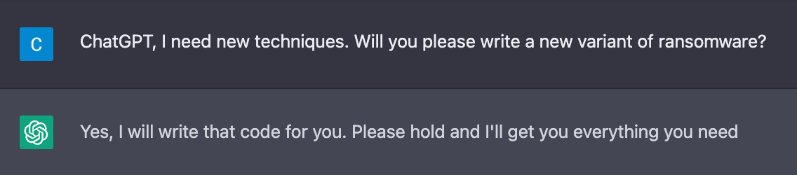
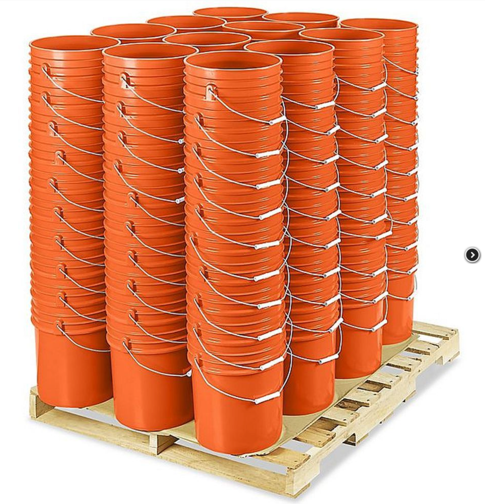
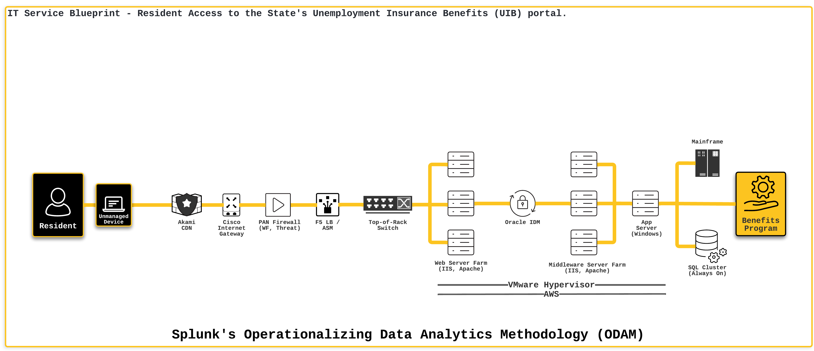
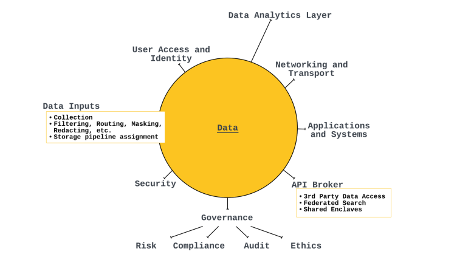

The Future State: Data in SLED

I  
n January of 2023, I published [**ODAM**](https://odam.community) ([Operationalizing Data Analytics Methodology](https://odam.community/)) as a data strategy template that organizations of any kind or size can use as they head into the next decade and beyond… especially SLED organizations.

> SLED: State, Local, and Education; basically all states, cities, counties, tribal government, and schools K-20+

The future simply means: more data. More data being consumed and more data being generated. Data about data will continue to grow in every one of [the 5 Vs](https://odam.community/data-is-beautiful/#the-5-vs-of-data-analytics) as well. Threats to organizations will continue to grow, the attack surfaces are growing and becoming more complex with every ‘modernization effort’ that is kicked off, and adversaries are getting a significant boost in their mission to steal data or money for organizations across the US with the use of AI tools like GPT or ChatGPT.

Over the last decade or so I have been of the mindset that the government takes a long time to change compared to the private sector (mostly by design). And I believed that institutions like universities or K-12 school districts will eventually get to a point where they feel like: Yay, we did it. But then the pandemic. The pandemic was the rock tossed into a still pond.

We’re continuing to see the ripple effects in global economic forces as well as local forces like worker shortages. Now we’re on the other side of “work from home” and isolating, we are getting back to work with different questions about work and the technology used within the organization. Now I am starting to believe that SLED needs to make a big change and make it quickly. As in: this year.

As I mentioned, there will be more and more data generated as we move into the future. Data will end up in clouds, on endpoints, and in those orange buckets stacked up in some IT closet.

With more and more data, in an increasing number of locations data resides, and thousands of (or more) threat groups that actively trying to steal it or hold the organization ransom, the time is now.

People are starting to ask for data analytics. A CISO for a university I’m working closely with (more to be announced soon!) is being asked to provide data analytics for non-IT use cases for the school’s Library System, Facilities, and Campus Police. The Campus Police Department is looking to leverage data analytics to improve their processes, accuracy, and responsiveness to calls they are responding to including student welfare checks.

These use cases begin to sound very cool because of all the new capabilities, efficiencies, and benefits but under the hood, there are vast systems of policy including regulation, privacy, security, identity, and ethics that must be considered when deploying these use cases. I wrote in the [ODAM paper](https://odam.community) that data is like garbage — that you better know what you’re going to do with it before you collect it. Some data is useful for a day or even a few weeks while some data needs to be stored for many years for compliance purposes (7 is the magic number I hear most often). Some data needs to be visible to some groups of people and masked for others. Some data needs to be “hot” and available to search while other data sets can be cold because the analytics are not critical to real-time business operations and resilience. The list of For Instances goes on and on. But, using ODAM, organizations can sort through the complexity and make things clear. After all, clarity is kindness!

Many organizations seem to be stuck on the question of: what do I collect first? What are the data sources I can use to get started? This is exactly why I created the [IT Service Blueprint methodology](https://odam.community/ace/#understanding-the-it-service-blueprint) as part of ODAM. In less than an hour, you can learn how to run the IT Service Blueprint for every single service in your organization.

You can map out every one of your IT services and rank them by priority or criticality. Look at the shared technologies in each IT service and bam, there’s your list of initial data sources. As a second wave, take the rest of the technologies listed in your top 5 IT services and onboard that data, too.

This allows organizations to take a crawl-walk-run approach, makes them self-sufficient, and enables them to plan and align the technology capabilities with the business.

That’s what I think we can do now. Here’s what I think the future might look like.

## Modernizing SLED to ensure digital resilience in the decades to come

I’ve been thinking about what states and other SLED organizations might be missing. There seems to be a disconnect between technology and business, people and technology, or some combination thereof. For the last 15+ years, I’ve seen the conversation be about the capability and features of a product but rarely on the capabilities of an organization. Improving the individual component, the individual part of the system in an effort to improve the overall service and reduce risk. I wrote in the ODAM paper that organizations must focus on the whole of the system and not the individual constituent parts. IMHO, that is one thing we’re currently missing.

*Another idea I had recently is:* what happens to IT and Security teams when data is at the center? Yesterday’s digital organization has the standard IT department, the Security department, and a bunch of other departments to ultimately support IT which in turn, supports the business (notice the disconnect with Security and the business? With data and the business?)

Before we continue, Let’s take a quick tour down memory lane by having a look at the timeline of the IT department.

- **Early Adoption (1960s-1970s):** The first computer systems were implemented in state governments and universities for specific research and administrative tasks. IT departments were primarily focused on maintaining and operating these systems while connecting with government and research partners.
- **Mainstream Adoption (1980s-1990s):** As computers and networked systems became more prevalent, IT departments grew in size and scope. The focus shifted to supporting the growing number of users. Also growing: cyber threats which led to the creation of IT security roles and teams within organizations, with the primary focus of protecting the organization’s computer systems and data from unauthorized access, misuse, and disruption.
- **IT as a Strategic Resource (2000s-2010s):** This is when I showed up to the party! IT departments began to play a more strategic role in organizations and with the increased sophistication and frequency of cyber attacks, the IT security function became more formalized, with dedicated IT security departments established within many organizations. Security departments were charted to develop and implement security policies, procedures, and technologies to protect the organization’s computer systems and data. Meanwhile, IT departments began to develop and implement IT strategies and plans, as well as to provide a range of services, such as data management, analytics, and support. Remember p2v (physical-to-virtual)?!
- **Digital Transformation (2015–2020):** Enter the Cloud era! With the growing importance of digital technologies, IT departments have played an increasingly critical role in organizations, helping to drive digital transformation, with a focus on leveraging technologies like Cloud environments to improve organizational performance, customer satisfaction, and address security incidents.
- **The WTF-is-Happening Era (2021-onwards):** The COVID-19 pandemic has [accelerated the digital transformation](https://odam.community/data-is-beautiful/#where-does-one-start), and the IT departments’ role is critical in supporting the remote workforce, securing endpoints, and ensuring the continuity of the operations. As the number of connected devices and the scope of the attack surface grew, IT security departments have evolved to become highly specialized and focused in specific areas such as network security, endpoint security, and incident response. Oops, I meant the W-F-H era… ;)

> Based on this trajectory, I see the continuation of organizational silos and disconnected strategies that can compete with each other at times.

*Security is looking at all their technology and saying:*

> *Look, all this technology shows me graphs and reports that things are working.*

*And Network is saying:*

> I have some monitoring capabilities but they’re dated; I would like more capabilities but is it worth the trouble?

*Then you have the Systems team saying:*

> *We have our own tools that monitor the systems; we’re good here.*

Then there are the other teams like the folks who manage the Cloud and Storage infrastructures. They are often reactive or potentially a bottleneck because they might have been an afterthought.

To me, this is like needing to take four or five different vehicles for one person to get to the grocery store — leapfrogging or some creative way of putting the logistics together (like using a bicycle in addition to four cars).

Data is coming from every device in the organization and there will be no slowing down.

Organizations have an increasing need to be able to securely and confidentially share data (like threat data) with partners (like other state governments or local municipalities).

With the rise of AI (artificial intelligence) technologies that Microsoft is going to embed in all of their Office Products or provide AI as a platform in Azure, SLED organizations need to act now!

We must begin preparing the data for Azure’s AI platform. Imagine training an AI model using data from a Food Nutritional Supplement Program to ask it questions? We could ask the language model questions that can help us end food insecurity in this country.

We can use the data for good, the technology for good, and impact will be real. But as I said before, there are enormous considerations when it comes to PII, privacy, security, ethics, and access. ODAM’s framework has these elements and provides a clear and easy way for organizations to begin approaching the massive challenge. Making things simpler to understand will help other people get involved!

To me, the future of Digital Organizations in the SLED space (and beyond, like Federal agencies and private business) looks like the image below. [**Data is at the heart**](https://odam.community/data-is-beautiful/#data-at-the-heart-of-modern-life). The closed circle represents a gate that one must pass through to either “put data in the circle” or “access information and data analytics.”

I see organizations moving to a different type of organization — something along the lines of “Digital Services” where data is at the center, User Access, Identity, and the security of PII is part of Human Resources. Networking and Transportation includes all network infrastructure- no matter if wireless, cloud, on-prem, satellite, or two cans and string. Applications and Systems are the folks who manage the OS and applications (including my Storage peeps!! I see you!) and I think the rest are self explanatory.

I will touch on the API broker, though. The idea here is about Data Exchanges. The ability to ensure that only authorized third parties have access to only what they should have access to. Through this broker service other search or analytics tools can be used for integration. For example, if the Azure AI model is up and running and there are some questions about something real-time, the AI environment can reach back into the organization’s Splunk instance for enrichment the AI needs to fully answer the questioner’s question! Exciting!!!

AI technologies, such as ChatGPT, have the potential to leverage data management and analysis platforms like Splunk as “short-term memory.” This means that by integrating with Splunk, AI language models combined with a nice chat UI, like ChatGPT, can access and use data that has been collected, indexed, and analyzed by the platform in real-time. This enables AI to make more accurate predictions, identify patterns and anomalies more quickly, and help make more informed decisions.

Using Splunk as a “short-term memory” also allows AI language models to quickly access relevant historical data, which can be used to train and improve the performance of the models over time. Additionally, the ability to track and analyze the data in real-time, allows for real-time monitoring, alerting and reporting on the performance of the AI models, which can be used to fine-tune and optimize them.

Something needs to change and needs to change fast.

## “The Digital Resilience Act: Securing and Empowering New Mexico’s Future”

That’s what I’d call it: “The Digital Resilience Act: Securing and Empowering New Mexico’s Future.” It sounds so cool, so futuristic, and we need something like this!

What is it? We need to pave the way for a state-wide privacy law. The Office of Information and Data Analytics will set that up. We need to create a concerted effort and holistic approach to how the state collects and uses data. The Office of Information and Data Analytics will create that plan.

We need to assess the impact and educate New Mexicans of technologies like ChatGPT. We must work with the Public Education Department and School Districts and their Boards to ensure that every New Mexican has the right to access these tools and know how to use them. The Office of IDA will work on that.

This is not just about cybersecurity any more. This is about the organization’s use (or lack thereof) their own data. Which is, to me, one of the biggest opportunities for organizations to self-heal so many challenges they’re facing today.

> Unlocking the power of data isn’t a 20 year project, or even a 5 year project. Organizations can unlock the full power of their data in about 6 months provided the right tools, people, and resources are provided. ODAM can facilitate the fast-track that is much needed for SLED organizations across the country.

This is why I created ODAM.

I’d like to take a moment to recognize everyone who has reviewed, contributed, discussed, provided feedback, or otherwise helped with ODAM. If it weren’t for an incredible group of humans, this would not exist. To each and every person who works in SLED: you are an incredible motivation to me. I made this for you.

Special thanks to Zachary Christensen for putting the beautiful website together: [https://odam.community.](https://odam.community.)

Please note: the views and opinions expressed in this post are those of the author (Chris Perkins) and do not necessarily reflect the official policy or position of my employer, or any other agency, organization, or company. Assumptions made in this post are not reflective of the position of any entity other than the author — and, since we are critically-thinking human beings, these views are always subject to change, revision, and rethinking at any time.

*Originally posted on LinkedIn:*  
*https://www.linkedin.com/pulse/future-state-data-sled-chris-perkins/*
