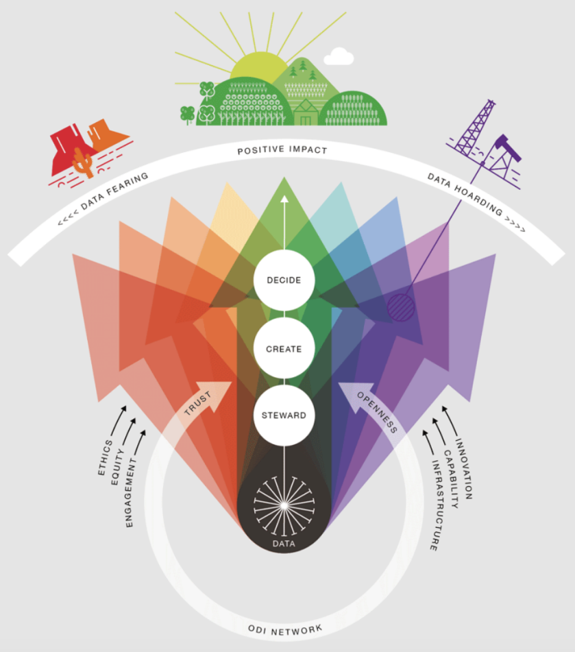
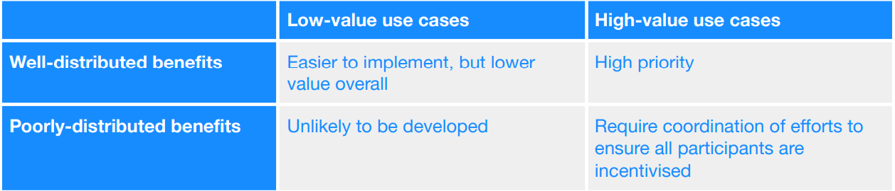
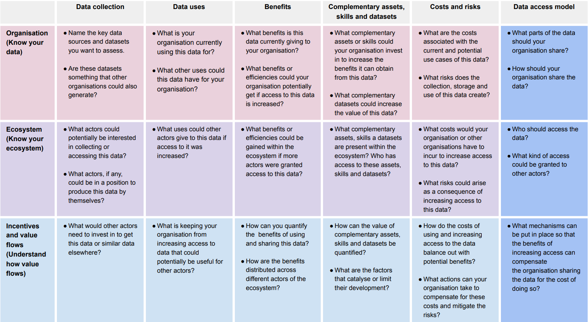

Discovering the True Worth of Data: Unlocking Value with ODAM

In today’s data-driven world, discerning the true value of data can be a challenging pursuit. As previously explored in “Data is Beautiful,” a multitude of factors — such as access, timing, quality, and granularity — play a crucial role in determining the significance of data. This article will delve into several key areas of interest.

Firstly, we would like to showcase an exemplary organization that consistently delivers exceptional, insightful, and valuable contributions: The Open Data Institute (ODI).

Founded in 2012 by luminaries Sir Tim Berners-Lee and Sir Nigel Shadbolt, the ODI is a non-profit organization sustained by a combination of grants and commercial revenue, with annual operating costs amounting to approximately £6m ($7.4M) since 2017. Committed to partnering with companies and governments to establish an open and trustworthy data ecosystem, the ODI operates as an institute that undertakes commercial projects in alignment with their central mission.

Engaging with policy, business, NGOs, nonprofits, and government sectors, the ODI is devoted to cultivating data infrastructure that benefits individuals, organizations, governments, and civil society collectively. Their primary emphasis is on expanding data flows within the ecosystem, bolstering skills and capabilities, and fostering innovation throughout.

The second focus of this article is on how the Operationalizing Data Analytics Methodology ([ODAM](https://odam.community)) empowers organizations to construct a more secure and resilient digital landscape.

Lastly, we will highlight some of our favorite insights from the Open Data Institute’s (ODI) recent report, “[Understanding the Social and Economic Value of Sharing Data](https://www.theodi.org/wp-content/uploads/2023/04/Understanding-the-Value-of-Data-.pdf).”

## What is the value of data?

The ODI report says it perfectly:

> Many of the issues associated with valuing and unlocking value from data arise from its economic characteristics. As laid out in the Value of Data report published by the Bennett Institute for Public Policy and the ODI, data has particular characteristics that differentiate it from other goods or assets that organisations normally hold or have access to:

Data can be used multiple times without being depleted, which makes it hard to know how it might be used in the future and thus to quantify its potential value over time.

Data is ‘non-rival’, meaning that the same data can potentially be used by multiple actors at the same time without them needing to compete for access to it.

Data may have different levels of excludability. Although it is non-rival in nature, in some cases some actors may have the capacity to restrict others from accessing or using certain data.

Data often involves externalities. The use of data can produce positive or negative effects for actors beyond those who collect, process or use it.

Data may have option value: its value may increase in the future if it can be put to productive uses that have not yet been thought of, or anticipated by, its current holders.

Its value is strongly linked to access: all other things being equal, the more accessible data is, the greater the value that can be created from it.

It’s extremely difficult to estimate or predict the uses to which data might be put and as a consequence, the total value or benefit that any individual actor or society as a whole could theoretically get from a specific dataset. Value can be created from data multiple times, for multiple stakeholders every time it gets used and reused, and its dimensions are highly dependent on the context in which the data is used and the infrastructure, assets (including, but not limited to, other data assets) and skills with which it can be combined. Clinical data that was originally collected to track a patient’s progress, for example, can potentially become useful in the development of new health services or for health policy decisions once individual records are depersonalised, aggregated and combined with other sources of data.

## ODI’s Theory of Change

### Building a Safer and Resilient Digital World

The ODI is a trailblazer in the realm of open data culture, striving to create a sustainable data infrastructure that contributes to the public good. Their Theory of Change outlines a comprehensive vision for a data-driven world, encompassing key components such as:

1. Vision: A world w[here](https://odam.community/data-is-beautiful/#introducing-splunks-operationalizing-data-analytics-methodology) data is openly available, accessible, and used ethically to create a positive impact.
2. Mission: Collaborating with companies, governments, and civil society to promote open data use, devise innovative solutions, and nurture the next generation of data leaders.
3. Inputs: Providing expertise, funding, and resources to develop and implement open data initiatives.
4. Activities: Conducting research, policy development, advocacy, training, and community engagement to foster open data adoption.
5. Outputs: Producing open data standards, tools, resources, and best practices, while cultivating skilled individuals and organizations.
6. Outcomes: Boosting data literacy, accessibility, transparency, and driving innovation and economic growth.
7. Impacts: Enabling better decision-making, improved public services, increased citizen participation, and sustainable development.

Theory of Change

ODI identifies three core activities that generate impact from data:

- Data stewardship: Collecting, maintaining, and sharing data.
- Insight creation: Generating valuable information from data through products, services, analyses, stories, and visualizations.
- Decision-making: Basing decisions on insights, experience, and understanding.

One major theme in The Open Data Institute’s (ODI) recent report, they emphasize the need for…

> “increased access to data to drive value creation and recommend implementing suitable models for safely granting access.”

Enter ODAM (Operationalizing Data Analytics Methodology), a game-changing methodology that I developed over the last 6 years. When paired with the Splunk unified data analytics platform, ODAM helps organizations unlock the true potential of their data, bridging the gap between raw information and actionable insights.

I wrote in the ODAM paper (Exploring the Value of Data: A Journey Through the Wilderness) about value as one of the [5 Vs of Data Analytics](https://odam.community/data-is-beautiful/#the-5-vs-of-data-analytics). The value of data is contingent upon context, need, time, relevance, and access. By adopting a hierarchical approach to data management, organizations can [optimize](https://odam.community/ace/#assessing-your-current-data-analytics-maturity-level) policy, analytics, archiving strategies, and much more.

ODAM offers a solid framework for organizations to fully leverage their tools, teams, and data to achieve measurable business outcomes. By adopting a data analytics platform, such as Splunk, and following ODI’s recommendations, [ODAM can help organizations build a data-driven culture](https://odam.community/ace/#building-a-data-driven-culture-the-role-of-communication-engagement-and-collaboration), enhance their data stewardship, create actionable insights, and make informed decisions.

> The end result? A world where data not only holds the power to transform lives and foster a brighter future but also emphasizes equitable access and prioritizes accessibility, enabling everyone to benefit from the wealth of information available.

## Understanding the Social and Economic Value of Sharing Data

### Using ODAM to Enable Sharing and Value Creation

After reading ODI’s report “Understanding the Social and Economic Value of Sharing Data,” I was compelled to share my favorite insights from the report and explore how ODAM can be applied by organizations seeking to harness their data’s full potential.

Here are some key highlights from the report and how ODAM comes into play:

Assessing the Potential Value of Datasets for an Ecosystem

Taking an ecosystem perspective allows for a better understanding of how data creates value, enables dataflows, and facilitates value distribution. ODAM provides a comprehensive framework for organizations to analyze their data ecosystem, helping them to identify opportunities for value creation. Specifically, the [IT Service Blueprint](https://odam.community/ace/#understanding-the-it-service-blueprint) component of ODAM is how organizations can identify their data ecosystem; including users, systems, networks, insights, and action.

Value Distribution

ODI introduces a simple two-by-two matrix for prioritizing use cases at an ecosystem level, dividing them into high-value and low-value cases with well-distributed or poorly-distributed benefits.

At its core, ODAM provides guidance to organizations looking to prioritize which data to collect, which systems to monitor, and which applications to instrument. Using ODAM and the IT Service Blueprint, organizations can list out their critical services and begin to map them to the two-by-two matrix below and develop strategies to maximize their benefits.

Improve Access to Data

> “increased access to data to drive value creation and recommend implementing suitable models for safely granting access.”

To drive value creation, increasing data access remains a challenge that demands innovation and active participation from both public and private partners.

Using ODAM, organizations can approach this with the end user in mind. What is the end user of data analytics interested in? What will help them make a well informed decision? ODAM helps suss out the nuances that individuals or teams prefer. Different teams will look at the same data set and see insights.

Simply put, ODAM can provide organizations with a pathway to insights for anyone in the organization (at scale). Read more about ODAM here.

Value of Data Canvas

ODI has developed the Value of Data Canvas to help organizations understand the potential value of their datasets and guide decision-making. I will be using this canvas in the future as I see many benefits to it. It’s easy to read and consume, it’s well organized, and it can be used by people with different skill sets.

ODAM can be utilized alongside the canvas to assess the value generated from datasets and identify ways to enable and incentivize value creation across the data ecosystem.

The Data Spectrum

The final favorite from the report is the Data Spectrum chart. Just look at this beautiful graphic!!

The ODI Data Spectrum, Page 19

The Data Spectrum helps organizations determine the extent to which data should be shared with partners, stakeholders, and the ecosystem. As data moves from closed to shared to open, the potential for creating value and impact rises, but so do the risks. ODAM offers a method for balancing these factors, ensuring that data sharing is optimized for maximum value and minimal risk.

I can see how this can be applied to zero trust architecture discussions and planning efforts. I’d like to know your thoughts on that!

In Conclusion

Check out the full report and let me know what you think about it! If you have a chance, please check out the ODAM paper (roughly 100 pages long!) and let me know if you think there are any parts of ODAM that were helpful to you.

You can follow ODI on LinkedIn and please do check out their website here.

Farmland (ODI)
