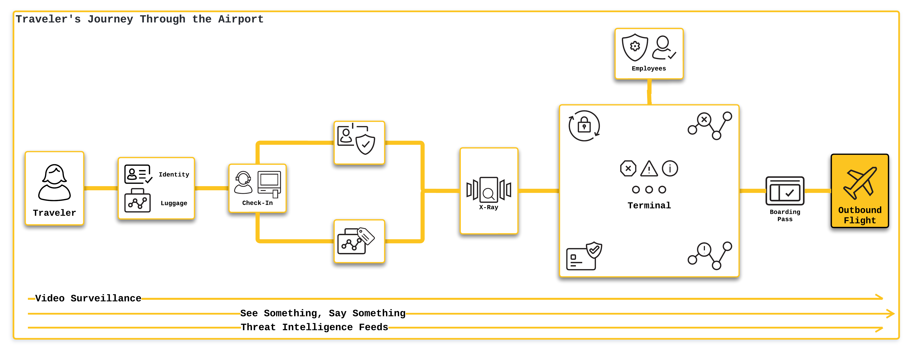
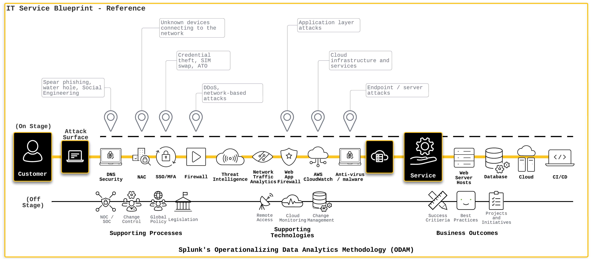

Unraveling Zero Trust: An Airport Security Analogy + ODAM

I created this with Midjourney and Adobe Photoshop AI. The image represents identities, public vs. zero trust, and a user-centric view into addressing cybersecurity across public sector.

This blog post aims to present a comprehensive examination of the intricate relationship between [ODAM](https://odam.community) (Operationalizing Data Analytics Methodology) and [Zero Trust Architecture](https://csrc.nist.gov/glossary/term/zero_trust_architecture) (ZTA), with a focus on clarifying the prevailing industry discourse. While marketing teams excel in guiding customers towards informed purchasing decisions and articulating the advantages of specific products for organizations, this analysis will delve into the convergence of zero trust and ODAM, illuminating the profound synergies and strategic advantages that arise from their seamless integration.

However, a critical aspect I often find overlooked by marketers is the ‘How.’ Once an organization has acquired the product, they’re faced with a pivotal question: “How do we integrate this particular product seamlessly with our existing infrastructure?” The complexity of this situation is evident.

The movement towards “implementing zero trust” is gaining momentum across industries like healthcare, finance, and more, but there is a prevailing lack of consensus on what zero trust truly encompasses. From my perspective, zero trust can be depicted in a multitude of ways, such as a product feature, a standalone product, an ensemble of products, an organizational process or intention, a responsibility solely shouldered by the cybersecurity team, or a blend of all these elements.

Through this blog, my goal is to offer you a distilled perspective of what zero trust really is and how to embark on a successful implementation journey. This approach should encapsulate principles, tasks, and concepts from three core categories: People, Process, and Technology (note the sequence?).

So, how can organizations not only implement a people-centric approach to zero trust but also operationalize their IT and cybersecurity data to decrease risk, mitigate the frequency of incidents, reduce the attack surface, and minimize business impact when an incident does occur? I’d like to suggest a **start**ing point or, at the very least, a preliminary solution.

The challenge in offering such a solution stems from the reality that every organization is unique. Despite this, organizations across the US, particularly those in the public sector, grapple with a similar set of challenges. Given the variations in customer maturity, budget constraints, team skill sets, executive-level understanding and buy-in, and organizational size, a ‘one-size-fits-all’ approach simply won’t suffice. Instead, solutions must be flexible, modular, and extendable, built from the ground up with these principles at the core.

**Before we dive into the analogy, let’s briefly level-set on zero trust.**

Zero Trust Architecture is a cybersecurity strategy grounded in a clear, straightforward principle: Trust none, verify all. Instead of assuming safety within the confines of network perimeters, zero trust requires ceaseless validation of security, no matter where a request originates from or what resources it accesses. This methodology guarantees that every user, device, application, and data packet is authenticated and authorized, thereby reducing the risk of security breaches.

At its core, ZTA is essentially the embodiment of the ‘least privilege’ concept. No individual (or endpoint) should aimlessly wander within the digital enterprise, much like how passengers are barred from freely roaming on the airport tarmac.

To draw a parallel, consider ZTA as akin to airport security. Like digital enterprises, airports also engage with a diverse and transient set of users, each possessing varying levels of access and intent. The airport, in essence, is a heavily secured environment where numerous actions, both harmless and potentially threatening, transpire.

> “Both the airport and movie theater analogies in cybersecurity highlight the need for a nuanced handling of trust and risk.” **— Zachary Christensen, Security Solutions Architect, Splunk, Inc.**

Consider these two pathways. One depicts an end user accessing an application within your environment, and the other illustrates a passenger being dropped off at the airport to catch a flight.

Embedded within each pathway are mechanisms to gather telemetry data, perform risk assessments, comprehend issues, and implement enforcement actions.

Here are some ZTA components that align with the intricate systems at an airport:

- **See Something, Say Something = Continuous Risk Evaluation:** In an airport, passengers are encouraged to report suspicious activities. Similarly, in a ZTA environment, continuous monitoring and reporting of network activities help identify potential risks and threats in real-time.
- **Gate Area Access for Ticketed Passengers = Identity Establishment:** Only passengers with valid tickets can enter the gate area in an airport, ensuring secure and restricted access. ZTA operates similarly by permitting access only to users whose identities are verified and stored in the organization’s identity system.
- **Boarding the Plane = Restricted Access to Sensitive Applications:** Passengers are only allowed to board their designated flights, sometimes with assigned seating. In the same way, ZTA ensures that users can access only those applications for which they have clearance.
- **Regular Monitoring of Airport Personnel = Continuous Identity Verification:** Just like airports continually verify the identities of their personnel, who move through various pathways, ZTA continuously authenticates users within the network to prevent identity theft and unauthorized access.
- **Baggage Inspection = Payload Inspection:** Just as every luggage item in an airport is thoroughly screened to prevent hazardous items from entering the flight, organizations regularly scrutinize every data packet traversing the network. If something hazardous is found, there is a follow-up process that could include denying access to any harmful data… or perhaps your flight.

Midjourney

**How the Operationalizing Data Analytics Methodology Can Help**

Integrating the ‘zero trust’ principle into an organization’s cybersecurity strategy can significantly augment its security stance. Successful implementation, however, necessitates a thorough comprehension of the organization’s business flows, analogous to how an airport charts out every passenger’s journey. Here, the Operationalizing Data Analytics Methodology (ODAM), along with its [IT Service Blueprint](https://odam.community/ace/#understanding-the-it-service-blueprint), plays an instrumental role.

ODAM is a structured methodology to mature and operationalize data analytics capabilities across organizations of any size or type. By enhancing threat detection capabilities, streamlining incident investigation, and accelerating decision-making processes, ODAM bolsters cybersecurity operations. It brings consistency, efficiency, and continuity, enabling organizations to reduce their attack surface, mitigate the impact of security events, and curtail the frequency of such events, thereby reducing the overall risk.

A crucial element of ODAM is the IT Service Blueprint, a visual depiction of the various components and processes that constitute an IT service. This blueprint acts as a strategic guide, steering organizations through the complex terrain of IT services and data flows, much like how an airport maps out each step a passenger takes from drop-off to departure.

In the realm of cybersecurity, ODAM assists in hastening incident response efforts. Just as airport staff can swiftly detect any disruptions in passenger flow and rectify the situation, organizations utilizing ODAM can proactively identify and resolve issues. This decreases the ‘mean time to innocence’ by quickly pinpointing where and what the problem is, enabling organizations to be proactive rather than reactive.

In essence, the strategic combination of a zero trust approach, bolstered by the integration of ODAM and the IT Service Blueprint, holds immense potential in reinforcing an organization’s cybersecurity operations. This comprehensive framework equips businesses to navigate the ever-evolving and intricate threat landscape, akin to the intricate and regulated environment of an airport.

For further insights on how to start ODAM and the IT Service Blueprint to navigate the challenging terrain of enterprise cybersecurity, visit the ODAM Community website or send me a message!

Please note: the views and opinions expressed in this post are those of the author (Chris Perkins) and do not necessarily reflect the official policy or position of my employer, or any other agency, organization, or company. Assumptions made in this post are not reflective of the position of any entity other than the author — and, since we are critically-thinking human beings, these views are always subject to change, revision, and rethinking at any time.

