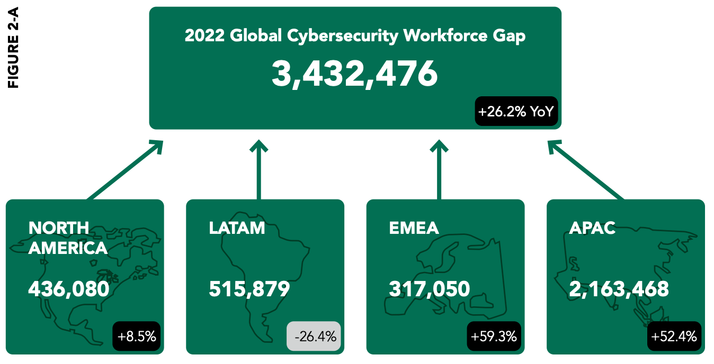

ODAM, a Revolution! Reinventing the Cybersecurity Workforce in New Mexico
In this article, we’re going to take a deep dive into two intertwined challenges that public sector organizations often grapple with — the need for standardization in cybersecurity and data strategy, and the lack of practical data strategy curriculum in the classroom. We’ll also discuss how to use Operationalizing Data Analytics Methodology (ODAM) as a framework to link up educational practices and organizational requirements across the State of New Mexico and beyond.

## In**t**roduction

As a security solutions architect who loves data analytics, I have witnessed first-hand the evolving landscape of cybersecurity and its many challenges. The digital world is a dynamic realm, continually shifting under the weight of new technologies, applications, and an ever-growing legion of threat actors. Through it all, I have seen the need for a skilled and adaptable cybersecurity workforce become not just a desire but an absolute necessity.

My personal journey with cybersecurity began here at home, in New Mexico. Born and raised in Albuquerque, I have a deep appreciation for the history, culture, and the resilient spirit of our communities. The importance of community and uplifting one another was instilled in me from a young age just like the people before me. The teams of people who brought the Cisco Networking Academy to Central New Mexico Community College ([CNM](https://www.cnm.edu/)) — then [TVI](https://www.cnm.edu/) — helped me discover my passion for cybersecurity as I began to understand the endless potential and immense responsibility that comes with this field.

I remember my first Cisco Networking Academy classes with both nostalgia and gratitude. The experiences I had while studying for my Associates degree in Networking Technology created opportunities that I was able to leverage while I launched my career. CNM is where I set the foundation and the internship I had immediately following was the initial framing that I’ve been building on ever since. I am profoundly grateful for the opportunity to take the knowledge and skills I’ve gained over these years, and apply them to help secure our communities’ digital landscapes.

As I survey the current state of cybersecurity education and workforce development in New Mexico, I feel a growing sense of energy, especially in the last few years. I see talented students and aspiring professionals hungry for guidance and opportunity. Noticing an opportunity to connect people, I co-founded **ChileSec** with five New Mexico-based cybersecurity professionals. ChileSec is a one-stop-shop for all things cybersecurity in New Mexico; it’s a community of communities. ChileSec’s goal is to help people find resources to find career pathways and the skills they need to thrive.

When I think about the gap that exists between education and what is needed in the public sector, It appears to me that our current trajectory is unsustainable. If we are to secure our digital futures, we need to take drastic measures. We need a change.

This is where the [Operationalizing Data Analytics Methodology](https://odam.community/) ([**ODAM**](https://odam.community)) comes into play. I believe that this framework, born from years of experience in data analytics and cybersecurity, has the potential to revolutionize how we approach cybersecurity education and workforce development in New Mexico. The time for change is now. Together, we can redefine the future of cybersecurity here at home.

“Government” is the name we give to the things we choose to do together. — **Deval Patrick**

Join me on this journey to transform our cybersecurity landscape, through the lens of ODAM. With the help of this methodology, I hope to contribute ideas and processes that can be leveraged to create a bigger pipeline of students as they enter the workforce.

Before we move on to the second chapter, let’s briefly define ODAM and one of its major components, the [**IT Service Blueprin**](https://odam.community/ace/#understanding-the-it-service-blueprint)t.

> ODAM (Operationalizing Data Analytics Methodology) is a methodology that helps organizations bring data analytics to the next level. Not only can it provide an efficient way to define, plan, execute, and measure data analytics initiatives, but it also can play a critical role in an organization’s cybersecurity. By following this methodology, organizations can use data analytics to improve their threat detection capabilities, streamline incident investigation and make faster and more informed decisions in their incident response efforts. This can lead to more efficient and effective cybersecurity operations, help organizations stay ahead of emerging threats, and ultimately minimize the impact of security incidents on the organization and its stakeholders.

An IT Service Blueprint is a visual representation of the various components and processes that make up an IT service. It typically includes information about the service’s stakeholders, customer needs, the service’s value proposition, and the various components (such as processes, technology, and people) that are required to deliver the service. The purpose of an IT Service Blueprint is to provide a clear and comprehensive overview of an IT service, which can help organizations understand how the service is delivered and identify areas for improvement. ODAM provides a framework for defining, planning, executing, and measuring data analytics initiatives, which can be used to create an IT Service Blueprint for an IT service that leverages data analytics to deliver value to stakeholders, end users, and customers.

## Setting the Stage: The Current Cybersecurity Landscape in New Mexico

As we examine the existing landscape of cybersecurity education and workforce development, not only in New Mexico but throughout the United States, the stakes become clear. Our everyday lives, personal information, and vital public services all face an escalating threat.

On the educational front, our universities and community colleges offer a variety of classes and programs aimed at equipping students with the skills they need to navigate the cybersecurity landscape. Ranging from information systems security to network defense, these programs cover a broad spectrum of cybersecurity domains. ChileSec is currently working on putting a full list together including offerings from:

- New Mexico State University
- University of New Mexico
- CNM
- Eastern New Mexico University
- New Mexico Tech
- Community colleges and universities across the state
- Other organizations based here in New Mexico (EC-Council, White Sands Missile Range, Sandia and Los Alamos National Labs, etc.)

But another problem in higher education looms: There is a shortage of university professors willing and able to teach cybersecurity to students. **— Cybersecurity Dive**

There’s a critical gap in the current path from education to employment — a consistent cybersecurity curriculum that mirrors the way organizations actively protect their operations and minimize risk is exactly what ODAM can enable.

Going even further, my hope is to use the ODAM framework to help create a better connection between these higher educational offerings and our K-12 school districts. The importance of introducing cybersecurity concepts at a younger age, particularly in high school, cannot be overstated.

As we pivot our attention toward the current cybersecurity workforce in New Mexico, the challenges become even more apparent. We have dedicated, passionate individuals working tirelessly to secure our public sector institutions. However, their efforts are often overshadowed by the sheer magnitude of challenges they face.

The public sector plays an integral role in cybersecurity. As guardians of sensitive public data and critical infrastructure, public sector organizations are an enticing target for threat actors. Yet, the struggle to attract and retain talent in this sector is very real. The reasons should not surprise you: bureaucratic red tape that slows innovation and response times, outdated technologies that increase vulnerability, and a constant understaffing issue that leaves existing employees overwhelmed and burned out.

As a result, the public sector often faces a talent shortage, which in turn exacerbates the vulnerability of their systems. When cybersecurity professionals are constantly firefighting and navigating bureaucratic obstacles, or fighting for more budget, there’s little time left to develop and implement proactive, strategic digital resilience measures. This results in a depleting cycle.

These challenges, though significant, present us with an opportunity — an opportunity to recalibrate our approach to cybersecurity education and workforce development. The path forward requires us to think differently, to be innovative, and to be willing to embrace sustainable change.

## An Unappealing Public Sector: The Challenges

Public Sector infrastructure is critical infrastructure. The data within these systems range from tax returns, public benefits, permitting and licensure, and other services. In theory, everything a state knows about a resident sits there in the state’s custody spanning hundreds or potentially thousands of systems. These custodians of public data and critical infrastructure form the backbone of a secure digital environment. We certainly owe our gratitude to those of you who have worked or are currently working in the public sector on the front lines!

First and foremost, the pervading bureaucratic procedures pose a significant challenge to the people actually doing the work. The people in the public sector working on the deployment and operations of cybersecurity are often not empowered to make local-level decisions and have their own autonomy leading to the lack of time needed for improvements and visionary thinking. From acquiring indispensable tools to instituting required security safeguards, all actions are encumbered by a sluggish bureaucratic process. And as we know, threat actors are not known for their sluggish processes and under-resourcing.

Understaffing also presents a major hurdle, as uneven workload distribution often results in burnout. There’s also the issue of wide-spread use of outdated technology. The use of such legacy technology not only heightens the vulnerability of public entities to cyber threats but can create bottlenecks resulting in substandard user experience.

These challenges are not merely inconveniences; they have far-reaching consequences. They impact the quality of life of those cybersecurity professionals who wish to work in the public sector. Talented individuals can be discouraged by these roadblocks and often choose private sector opportunities, leading to a talent drain. The cycle continues.

I have the privilege of working with people in the public sector across the US and have observed two things. One, the people doing the work are among the most dedicated professionals in our field and two, there are a variety of opinions on why their team is perpetually under-resourced.

Ultimately, the lack of cybersecurity professionals in the public sector hinders the development of effective, forward-thinking cybersecurity strategies. Cybersecurity professionals are spending their time continually putting out fires and are left with little or no time to design and implement long-term, strategic initiatives that would make our public systems more resilient.

Addressing these challenges is not a mere suggestion; it’s an imperative. In the next chapter, we will explore how we can use ODAM to not only address these issues but also to revolutionize the public sector’s approach to cybersecurity.

## Bridging the Gap: The Role of ODAM

I believe that when we use creative thinking and practical methods together, we can find solutions to even the toughest problems. ODAM is a great example of this. It has the potential to really shake things up and improve cybersecurity across New Mexico’s public sector.

ODAM is a framework that I developed over years of working with public sector organizations across the country. ODAM aims to normalize and streamline the approach to applied data analytics for cybersecurity and other use cases, creating an environment where predictability and structure are at the forefront. By breaking down siloed operations and enhancing data accessibility, ODAM offers a comprehensive solution to many of the challenges currently plaguing the cybersecurity landscape.

A core tenet of ODAM is the standardization of cybersecurity and IT processes inter- and intra-organizationally.

> **Here’s an analogy:** Consider the truck driving industry. Student drivers are educated about road regulations, maintenance routines, and truck manufacturers often adhere to comparable design norms.

Yet in our public sector, leaders often adopt a slightly different approach due to personal/professional objectives, institutional norms, budget constraints, and a range of other factors typical of public entities. This results in each organization carving out a novel method. ODAM offers a common set of guidelines for harmonization across the technology fleet (i.e., the tech stack) and aligns expectations as entities deliver their insights.

ODAM can serve as a directional map for guidance in this regard, helping to create a common language and set of practices for public sector organizations. Through its implementation, each organization, whether it is a city, state agency, county, tribal governmental department, or school, including academic medical centers, can align their cybersecurity efforts. This standardization eliminates the complexity and ambiguity often associated with varying practices, making it easier for technology (i.e., those who are and who are not technical experts) professionals to navigate and work within the system.

This standardization will not only help organizations optimize but also play a crucial role in alleviating the challenges that make the public sector unattractive and unsustainable to many cybersecurity professionals. By eliminating the variances in practices, we reduce the unnecessary bureaucracy that slows down decision-making processes. Simultaneously, by implementing a structured approach, we can ensure that we are staying current with the latest technological advances in cybersecurity.

By creating a unified approach right here in New Mexico, we can tackle the issue of understaffing. A standardized process means everyone is on the same page, reducing the burden on individual employees and ensuring a more equitable distribution of workload.

A shared understanding results in shared responsibility.

As we head into the next chapter, we will explore the practical steps we can take to implement ODAM within our public sector and start the journey towards a more robust, resilient, and attractive cybersecurity landscape in New Mexico.

Operationalizing the Change: Proposals and Partnerships

As we have been discussing, adopting ODAM can help address some of the most pressing issues across the public sector’s cybersecurity and IT environments. But how do we go about implementing this methodology across different education levels and forming effective public-private partnerships to bridge the gap between education and workforce?

At the community college and university levels, the adoption of ODAM could start with an integration into the curriculum. Classes and programs could include modules that teach students the principles and practices of this methodology. This learning will equip them with the knowledge they need to implement ODAM in the real world. At the same time, these institutions could actively engage with public sector organizations, providing students with opportunities to apply their learned skills in real-life scenarios, akin to my early experiences as an intern at a local consulting firm.

K-12 education provides a different challenge and opportunity. Integrating ODAM into these earlier stages of education could involve introducing students to the fundamentals of data analytics and cybersecurity. Simple lessons in digital safety, ethical computing, and basic data analysis can serve as stepping stones. By doing so, we will not only be creating an awareness of cybersecurity but also laying the groundwork for the adoption of ODAM in their higher education.

But education is only half the equation. To bridge the gap between education and workforce, we must foster public-private partnerships that provide students with real-world experiences and pave the way for future employment. Partnerships between educational institutions, the public sector, and the private sector can create a robust network that supports internships and job placements.

The work is hard not because the tech is complicated but because the environment is. — Jennifer Pahlka, [Recoding America](https://us.macmillan.com/books/9781250266774/recodingamerica)

From my personal journey, I can vouch for the immense value of such partnerships. My training at CNM through the Cisco Networking Academy and my internship at a private consulting firm were instrumental in shaping my career in cybersecurity.

As we continue to replicate similar experiences for students today we are creating a robust pipeline of talented, skilled cybersecurity professionals ready to join the public sector and contribute to securing our state’s digital enterprise.

Bridging the Gap: Shaping the Future of Cyber Defense

What comes next is up to us.

As I have worked with states, tribal governments, academic medical centers, and schools (K-20) over the past two decades I’ve observed very similar challenges across each of these organizations — big or small.

I think back twenty years ago about my days at TVI where I first began to think about systems. It was in one of my first community college classes that I learned how to troubleshoot packets traversing the network. These experiences have shaped and influenced the way I approach consulting across the US, then in turn, bringing that experience back home to make this proposal.

I propose we align the output of New Mexico’s education system with the input of local government. I propose we begin building the bridge from both sides, connecting students ready for the workforce and our local government’s need for staff.

That is why what we think matters. So much of what drives how tech delivery works in government is not law, policy, or regulation but our expectations. — Jennifer Pahlka, Recoding America

Please note: the views and opinions expressed in this post are those of the author ([*Chris Perkins*](https://www.linkedin.com/in/cperkins2/)) and do not necessarily reflect the official policy or position of my employer, or any other agency, organization, or company. Assumptions made in this post are not reflective of the position of any entity other than the author — and, since we are critically-thinking human beings, these views are always subject to change, revision, and rethinking at any time.
