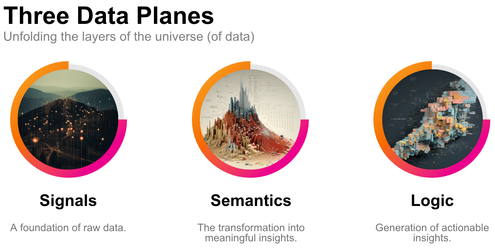
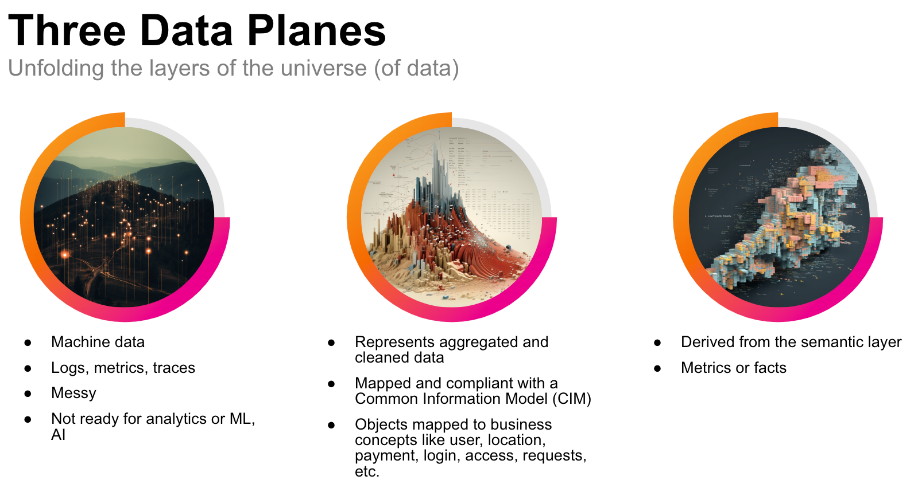
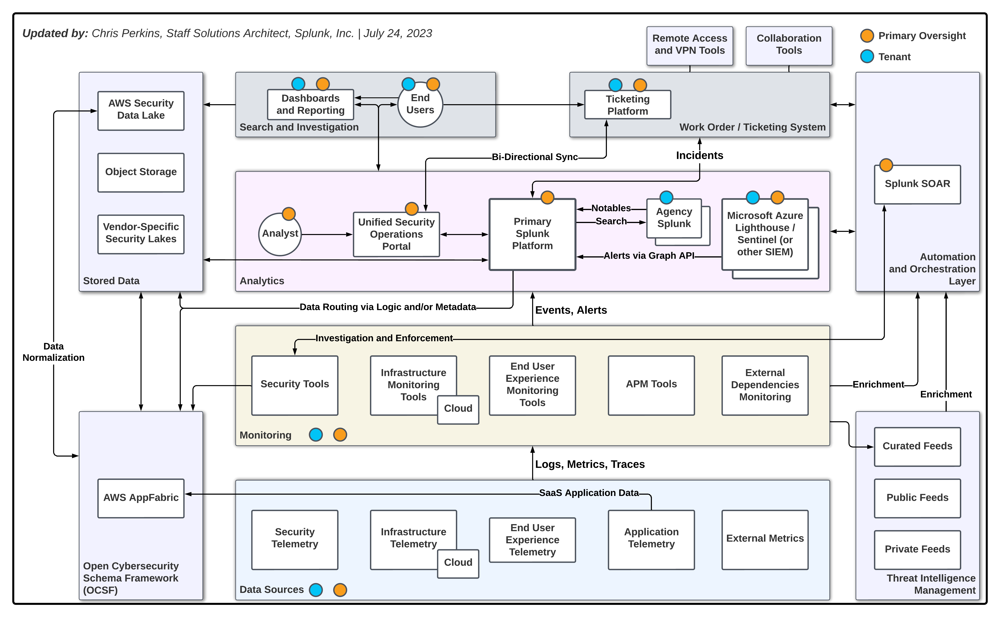

Mapping the Cyber Terrain: The Intersection of Cartography and Cybersecurity
In this article, we venture into the intersections of cartography and cybersecurity, discussing how map-making principles can enhance our ability to tackle cyber threats and increase organizational resilience. We also discuss how the strategic integration of Microsoft Sentinel and Splunk serves as a key conversation in the public sector, in an effort in strengthening our digital defenses.

In my role **a**t Splunk, I have the unique privilege of interacting with a diverse array of public sector organizations nationwide. My engagements span state **and** city departments, educational institutions from elementary to tertiary levels, tribal governments, counties, academic medical centers, and public utilities. A recurring theme echoing throughout these interactions is the quest to effectively harness the combined capabilities of Microsoft Sentinel and Splunk’s data analytics platform.

Central to our discussion is the Operationalizing Data **Analytics** Methodology ([**ODAM**](https://odam.community/)) framework, a common language that bridges the gap between disparate organizations, tools, and processes. To illustrate this, we’ll draw from the fascinating parallels between the fields of cartography and cybersecurity.

Before we get dive in, here’s the **TL;DR.**

1. **Discuss commonalities between cartography and cybersecurity:** We will discuss parallels between cartography and cybersecurity, and understand how techniques from physical mapping can be applied to cybersecurity thinking (e.g., increased security / reduced risk).
2. **Introduce the Operationalizing Data Analytics Methodology (**ODAM**) **framework:**** Meet the ODAM framework! ODAM is a fast-track to data analytics maturity. Using ODAM, organizations can identify sustainable ways to use data analytics in all departments, not just cybersecurity.
3. **How to harness the synergy of Microsoft Sentinel** and **Splunk’s platform:** We will discuss a solution that leverages Microsoft Sentinel and Splunk to fortify your defenses. We will explore how these robust tools can enhance your organization’s security operations while complimenting each other’s capabilities.
4. **How to operationalize Sentinel and Splunk‘s data analytics with the** ODAM framework: Let’s talk about practical steps to integrate Microsoft Sentinel and Splunk using the ODAM framework.

> “No individual stakeholder can address the growing cyber workforce demands at scale. Vigorous collaboration among education, labor, and commercial stakeholders is essential to success. Further development of robust cyber education and workforce development ecosystems must prepare workers to thrive in the digital environment.”

— Biden Administration plan for National Cyber Workforce and Education Strategy

## Introduction: The Terrain of the Digital World

In our increasingly digital world, cybersecurity has become crucial. Just as cartographers map out physical landscapes, cybersecurity experts map out digital ones, identifying potential threats and safe pathways. Although cartography and cybersecurity seem different, they share the goal of making complex topics easier to understand.

In this article, we’ll explore how cartographic methods can accelerate cybersecurity efforts. We call this approach ‘Cyber **Cartography**,’ a simple yet powerful way to navigate the digital world.

> Cartography is the study and practice of making and using [maps](https://en.wikipedia.org/wiki/Map). Combining [science](https://en.wikipedia.org/wiki/Science), [aesthetics](https://en.wikipedia.org/wiki/Aesthetics) and technique, cartography builds on the premise that reality (or an imagined reality) can be modeled in ways that communicate spatial information effectively.

Understanding the convergence of cybersecurity and cartography is essential. This understanding becomes clearer when we think about data in three distinct levels, similar to the various terrains a cartographer might map.

In comprehending the intersection of cybersecurity and cartography, let’s draw parallels between the layers of data and geographical terrains.

- The **Signals** layer is analogous to a topographic map, representing raw data about elevation and longitude/latitude, similar to machine data and system logs.
- The **Semantics** layer is like the details on a city’s blueprint that show the city’s layout, including its heights, depths, land features, and key structures. This layer changes raw, complex data into understandable business terms and concepts, providing a clear and meaningful context.
- The **Logic** layer is where we encounter insights abstracted from the Semantic layer. Further, we can add value to the Logic layer with one-way sharing as described later in this article.

Three Data Planes with Details

I will provide more details on these layers later in this article.

### From Data Chaos to Cybersecurity Coherence

As we dive into a seemingly infinite number of flows, signals, data feeds, and streams, it’s difficult to know where to focus your attention and how to make the most of your time.

This article aims to help guide you on how to identify critical signals amidst the noise, how to interpret the various types of data, and how to securely manage continuous streams of information.

The goal is not just to help you navigate this digital complexity but to turn it into a resource that yields valuable, coherent insights over time.

Ultimately, I’m keeping the goals of the public sector in mind — which are:

- Employ techniques that enable you to delve into the historical logs and data for valuable hindsight, giving you a detailed picture of past events.
- Adopt methodologies that facilitate trend reporting, allowing you to track patterns over time, thereby offering crucial insights for forecasting and strategic planning.
- Enable the organization to ‘see’ across various technology domains, business units, types of technology, and policy boundaries. We want to help you transition from a narrow, siloed view to a comprehensive, holistic perspective.

Cybersecurity can feel like trying to find your way in a new city without a map. In this article, we’ll show you how ODAM works like a map for understanding your data, its history, and your technology landscape. It’s a way of making your cybersecurity journey easier and more predictable.

ODAM works like a map for understanding your data, its history, and your technology landscape.

The world of cyber threats is always changing, growing more complex each day. It’s essential we respond with dynamic strategies that keep us one step ahead, and through the lens of ODAM, we’ll explore how to do just that.

## Tools of the Trade: Microsoft Sentinel and Splunk

Public sector organizations require robust cybersecurity operations that rely on a combination of powerful tools and strategic partnerships. This chapter is about the capabilities organizations can unlock when they integrate Microsoft Sentinel and the Splunk platform.

As we all know, Microsoft Sentinel is an integral part of the Azure ecosystem that excels in identity management, securing endpoints, and has many other capabilities within the Azure universe. Sentinel oversees Microsoft-specific infrastructure, spotting potential security events and threats and upon detecting such events or threats, Sentinel triggers alerts, initiating prompt response protocols executed within the Azure cloud.

Splunk steps in at this stage. A unifying data analytics platform, Splunk collects, processes, and analyzes massive amounts of data from a wide array of sources. In this cooperative model, the alerts from Sentinel become crucial data inputs for Splunk, offering real-time insights into the security status of the Microsoft environment.

Splunk’s advanced analytics engine then amalgamates this alert data with other data streams (or, signals, which I will discuss later in this article), presenting a comprehensive view of the overall digital landscape. This wider perspective allows for the identification of subtle patterns within alerts, which may not be as noticeable when these alerts are analyzed independently.

Beyond analytics, Splunk can automate routine tasks using Splunk SOAR (Security Orchestration, Automation, and Response) to improve incident response processes. This automation allows security teams to concentrate on strategic and complex issues as opposed to handling the monotonous tasks associated with Sentinel alerts.

The [integration](https://splunkbase.splunk.com/app/5312) of Sentinel’s specialized alert system with Splunk’s extensive data analytics and automation capabilities results in a powerful symbiotic relationship. Each platform’s strengths complement the other, boosting the effectiveness of security operations.

The recent [announcement](https://www.splunk.com/en_us/newsroom/press-releases/2023/splunk-and-microsoft-collaborate-through-strategic-partnership-to-advance-digital-resilience.html) of the Microsoft and Splunk alliance underscores the advantages of a holistic, efficient, and agile cybersecurity strategy.

The unity of these platforms reinforces the critical importance of collaboration in tackling complex cybersecurity challenges.

There’s a lot to unpack in the diagram above. Let’s start at the bottom and work our way up.

- The **Data Sources** layer contains the pieces of infrastructure that performs certain tasks or function with an IT department. There are external sources of information as well. If the data is not generated within the organization, the data source is considered external. Data sources generate logs, metrics, or traces.
- The **Monitoring** layer is where the management functions for the data sources takes place. This could be Microsoft Sentinel, a Panorama server, the EDR console, or perhaps the management portal for the wireless environment. The monitoring layer can perform some aggregation and analytics on the information it has available to it. Here again is a reference to External Dependancies — this could be an API (application programming interface), or the DNS protocol — as examples.
- Events and/or alerts are sent into the Analytics layer. This layer is where the semantics of data start to make sense. The signals are coming in from various systems and technologies in many different formats. The analytics layer is where a Common Information Model (CIM) is applied. For example, a CIM can harmonize identities across hundreds of systems. Deduplicating them along the way.

There are many other elements to this diagram that might be out of the scope of this article but I will certainly come back to these topics in later articles. Please DM me or otherwise let me know if there’s a particular direction you are interested in.

The last thing I’ll mention here is about the colored dots. Here they represent “Primary Oversight” and a “Tenant.” This is to show that there are multiple points of management/admin and there are shared points. There is a world where a state agency has autonomy while providing an OIT (Office of Information Technology) with “least privilege” access to the Agency’s SOC data.

Let’s take this discussion further and talk about sharing in the next chapter. In my research and discussions with peers, I’ve listed out eighteen (18) things that two departments might want to share. These can be two departments within one organization or they can be completely separated by technical and policy boundaries.

Let’s use the example of a State SOC and an Agency SOC. These two SecOps teams want to combine efforts to increase visibility, reduce risk, and work towards the greater good.

## The Power of Collaboration: Sharing

Collaboration and information sharing are at the heart of successful cybersecurity strategies. When we share, we multiply the power of our tools and strategies. When we build a network of defenses that are interconnected and dynamic, capable of adjusting and responding to threats in real-time, everyone benefits.

It is in this rhythm that we find our best defense against evolving threats. In the end, collaboration and information sharing are not just strategies; they are essential ingredients for resilient and robust cybersecurity programs.

As cyber threats evolve in sophistication and scale, so too must our strategies to counter them. In isolation, a singular system or tool might be capable, but it would lack the comprehensive visibility and contextual understanding that collaboration provides.

When organizations share information with each other, it is likely that they are sharing all or some of these eighteen (18) items. Before we get into the list of eighteen, let’s talk about the three data planes (or layers as I sometimes refer to them as).

## Three Data Planes

There are three distinct but interconnected layers of data… each serve a unique function.

1. Signals, the first level, encompass the raw, machine-generated data and logs, acting as the foundation of our cyber terrain.
2. Semantics is where raw data is transformed into meaningful business terms and concepts, providing valuable context (assets, identities, risk factors).
3. At the highest level, Logic; where abstract extrapolations from the semantic layer occur, revealing valuable insights hidden beneath the surface.

Sharing Across and Within Data Planes

Machine data, by nature, is raw.

Machine data is not ready for analytics, sorting, filtering, or anything really.

Raw data is the first layer, Signals.

Raw data is not not ideal to share as-is. Basic cleaning, sorting, deduplicating, and scoping measures should be taken before sharing raw data.

Normalized information is how we get to the second layer, Semantics.

Let’s briefly discuss these layers and discuss how we can leverage partnerships to provide enrichment to our security programs.

### **The first layer: Signals.**

The Signals layer is similar to the raw geographical features and terrain data that serve as the foundation of a map.

This data, like the latitude and longitude coordinates, elevations, or water bodies, is the raw, unprocessed information that, on its own, may not convey much meaningful information to a map reader.

**Examples of raw signals:**

- Latitude and longitude coordinates
- Raw terrain elevation data
- Bodies of water positions
- Natural geographical features (e.g., mountains, forests, deserts)
- Positions of man-made structures (e.g., buildings, bridges)
- Roads and pathways raw data
- Climate data at different locations
- Soil composition data
- Data of natural resources available
- Astronomical data (for celestial maps)

> In the Signals layer, raw machine (structured and unstructured) data is collected.

### **The second layer: Semantics**

The Semantics layer is akin to a basic roadmap that has been generated using raw geographical data.

This layer involves the cleaning, aggregating, and validating of raw data to create understandable information.

**Examples of the Semantics layer:**

- Aggregating and cleaning raw data
- Validating data accuracy
- Mapping roads, bridges, and buildings onto the map
- Labeling of geographical features
- Demarcation of political boundaries
- Indicating and labeling different types of terrain
- Noting down important natural features
- Display of climate zones based on climate data
- Visualization of resource distribution based on available data

The roads, bridges, cities, and other features are drawn onto the map, making the raw geographical data more usable and comprehensible. It’s the layer that starts to put the data into context and adds meaning — just as labeling a line as a highway or a dot as a city helps a map reader understand the geographical features they’re looking at.

From a cybersecurity perspective, this process can be facilitated by the bi-directional sharing of:

1. **Notables and Alerts:** Both parties exchange alerts about emerging threats or issues.
2. **IOCs and Threat Intel:** Each party shares indicators of compromise and threat intelligence.
3. **Detections and TTPs and Conte**nt: Detected threats and their associated tactics, techniques, and procedures are shared between parties.
4. Third-Party Vendor Security: Both parties share and learn from each other’s experiences and assessments of third-party vendors.

The third layer: Logic

The Logic layer is like the services provided on top of a basic map.

These might include traffic flow predictions, points of interest, route optimization and other features that help users to not just understand the map, but derive additional value from it.

Examples of the Logic layer sharing:

- Traffic flow prediction services
- Route optimization services
- Points of interest annotation
- Detailed city maps with public facilities labeled
- Providing different routes based on user preference (fastest, scenic, least traffic)
- Planning future infrastructure development based on patterns and trends
- Predictive services for weather and natural disasters
- Mapping population density and demographics
- Adding historical or cultural context to specific locations
- Incorporation of real-time data updates to keep the map current and accurate

This is the layer that extracts insights and creates valuable outcomes from the map. For instance, a GPS system that helps drivers navigate through traffic and reach their destination uses logic to interpret the map and provide actionable recommendations. Similarly, the logic layer uses cleaned, aggregated data to derive insights that help users to understand trends, make predictions, and make informed decisions.

> The logical layer is all the derivations of the semantic layer into corporeal entities that only exist in the data plane. This is what typically makes up metrics/facts. — [Chad Sanderson](https://medium.com/u/552b7bc2d1de)

From a cybersecurity perspective a two-way exchange of the following elements would prove beneficial:

1. Best Practices: Both parties can contribute and learn from each other’s shared best practices.
2. Incident Response: Each party can learn from the other’s incident response strategies and outcomes.
3. Risk Management and Assessment: Shared understanding of risks and mitigation strategies benefits both organizations.
4. Training and Awareness Programs: Shared training materials and awareness programs contribute to mutual learning.
5. Secure Configuration and Patch Management: Sharing strategies for secure configurations and patch management benefit both parties.
6. Red/Blue/Purple Team Exercises: Both parties learn reciprocally from the outcomes and learnings of these exercises.
7. Physical Security: Shared physical security strategies benefit both parties.

Adding Value to the Logic Layer

Alongside the bi-directional sharing, a one-way share of certain strategic items adds value at the logic layer:

1. Reports and Dashboards: One party generates and shares reports or dashboards.
2. Metrics and KPIs: One party generates and shares metrics and KPIs.
3. Policies and Procedures: Policies and procedures developed by one party are shared for implementation by the other.
4. User Identity and Unified Access Policy: One party sets these policies and shares them for the other to follow.
5. Compliance and Audit: One party conducts compliance checks or audits and shares the results.
6. Asset and Identity Management: One party shares its asset management strategies or lists.

Empowering Cyber Navigators: The Role of Cyber Cartography Education

As we discussed in ODAM, a Revolution! Reinventing the Cybersecurity Workforce in New Mexico, educating young people is key to our long-term strategy. Teaching a gamified version of ODAM that encourages the collection and public display of micro-credentials can start as early as middle school. I remember taking typing classes in middle school and playing practice games that you could earn points if you typed well. I still love games like this — like [TypeRacer](https://play.typeracer.com/)! I digress.

Teaching the basic concepts of ODAM (or cybersecurity cartography, or whatever YOU want to call it) can be done in a couple of weeks. Because the framework was designed with modularity in mind, we can update the curriculum every year or two.

As the public sector adopts a consistent approach (hopefully ODAM!), we can begin to map the curriculum to jobs.

## Charting your Course: Implementing ODAM

Closing thoughts and parting shots…

- Collaboration is key — adopting consistency, common language, and processes can enable more and strong partnerships.
- ODAM is a framework the public sector can use today — getting started is straightforward… start small and iterate!
- [Microsoft Sentinel’s alerts can be fed directly into Splunk](https://techcommunity.microsoft.com/t5/microsoft-sentinel-blog/azure-sentinel-side-by-side-with-splunk/ba-p/1211266) enabling more visibility across the digital organization.
- It’s not just about hooking to pieces of technology up (Sentinel and Splunk)… it’s about defining what the two departments (or organizations) are looking to share and receive. The hardest and potentially the most unhelpful thing to share with another org/department is raw data.
- We have yet to discuss the value of data when viewed through the lens of compliance, fraud, IT operations, and observability.

I plan to dive into other topics in the future, but I wanted to scratch the surface and ask for collaborators! If there’s anyone out there who would like to talk more about this — please hit me up!

Thank you Chad Sanderson for your input, collaboration, and all you do for the community!

Please note: the views and opinions expressed in this post are those of the author ([Chris Perkins](https://www.linkedin.com/in/cperkins2/)) and do not necessarily reflect the official policy or position of my employer, or any other agency, organization, or company. Assumptions made in this post are not reflective of the position of any entity other than the author — and, since we are critically-thinking human beings, these views are always subject to change, revision, and rethinking at any time.

If you see any typos or omissions, please ping me. I’ll buy you coffee!
