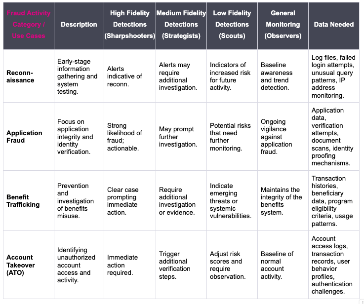
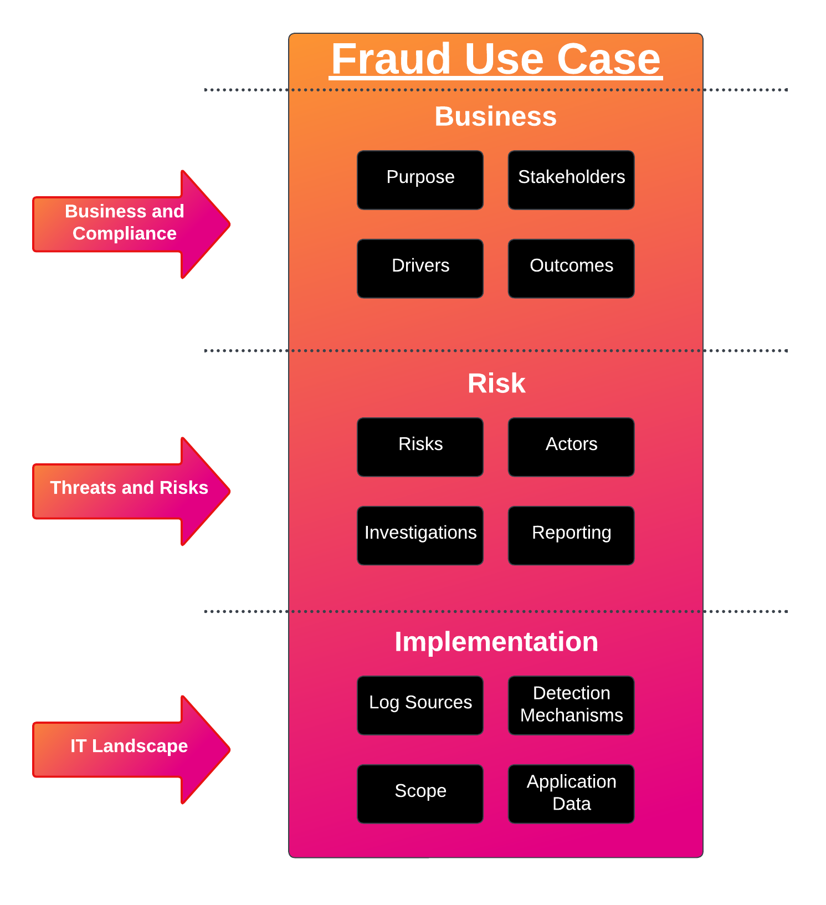
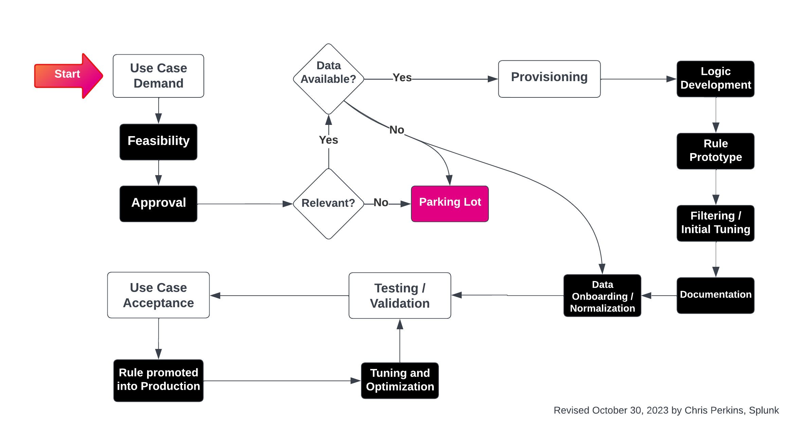
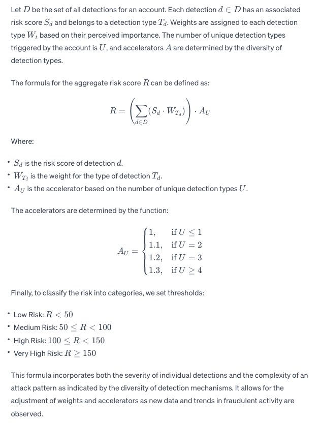

Fighting Fraud in the Public Sector with Splunk Data Analytics Platform


It’s been a while since I’ve posted about #fraud. If you’ve seen the news recently, you’ll notice that fraud is being talked about this year more than previous years. Financial fraud, election fraud, and state-sponsored fraud against US state government programs like PUA (pandemic unemployment assistance) are in the headlines.

I remember in the early days of the pandemic we were home under “shelter in place” orders as I watched the news and the dark web for any mention of Unemployment Insurance Benefits (UIB) fraud. Since then, much of my work has been about helping state government agencies stop fraud.

This article is about sharing what I’ve learned over the last 3 years since joining the good fight… and how I was able to quickly learn given my background in cybersecurity. This article is motivated by some common questions I’ve been getting when speaking with customers, prospects, and partners. Questions like: What data do I need and what detections are available out-of-the-box?

We will get to the answers to those questions later in the article but for now, let’s get into a brief introduction that provides some up-to-date information on the fraud problem we’re currently facing and the importance of data analytics in detecting and preventing fraud. We’ll also touch on why Splunk and how your data can be analyzed to fight fraud.

## Introduction

The landscape of fraud has shifted in the wake of global disruptions such as the pandemic. The application of data analytics has become critical, serving as a tool in examining the nuances of fraudulent operations. The deployment of analytics yields significant benefits, extending beyond the halting of fraudulent activity. Splunk enhances the efficiency of investigative and adjudicative operations, cutting down on the hours previously consumed by manual analysis and accelerating the processes of adjudication or appeals (for example).

Splunk is a powerful data analytics platform that specializes in parsing through, indexing, and making sense of large volumes of real-time and historical data; both structured and unstructured streams. Splunk offers the ability to aggregate and analyze disparate data streams to uncover hidden patterns, anomalies, and trends that could indicate fraudulent activity, t[here](https://www.brighttalk.com/webcast/15429/509123)by enabling organizations to prioritize and effectively respond to suspected fraud.

This article builds on previous work I published early in the pandemic. Please check out these articles specific to UIB fraud.

- Aug 18, 2020 https://www.linkedin.com/pulse/pandemic-unemployment-assistance-fraud-chris-perkins/
- Jan 4, 2021 Part 1 https://www.linkedin.com/pulse/pandemic-unemployment-assistance-fraud-zero-trust-part-chris-perkins/
- Jan 4, 2021 Part 2 https://www.linkedin.com/pulse/pandemic-unemployment-assistance-fraud-zero-trust-part-chris-perkins-1c/

The journey has been marked by significant advancements and insights lead by New Jersey as they stand at the forefront of emerging trends. A fact often echoed by the Chief Information Security Officer of New Jersey’s Department of Labor during various panel discussions and webinars (here and here). The department’s strategic [deployment of Splunk’s data analytics](https://diginomica.com/how-new-jersey-uses-splunk-detect-unemployment-benefit-fraud-saving-billions-dollars) has been pivotal in detecting and preventing fraud, a point underscored by the testimony of the NJ DOL Commissioner to the House Ways and Means Congressional Committee in October. Their experience illuminates the powerful impact of Splunk in enhancing fraud prevention measures.

I won’t get into the numbers here as there are many think tanks, journalists, Office of Inspector Generals (OIGs) looking into the matter, but the problem is significant. Your data will tell you if there is anything suspicious in your environment and Splunk helps paint the picture of where mitigating measures can be implemented. That said, the goal of this article is to put emphasis on the mechanics of fraud analytics using Splunk.

Splunk uses a risk-based model to detect fraud. The systematic and scalable approach is anchored in the application of risk scores across various detection methods. These scores are dynamically weighted to reflect the gravity of each detection signal and are enhanced by an accelerator that enriches the model with the diversity of fraud signals. We will get into the weeds of this later in the article.

This model stands out for its:

- Standardized Scoring: A uniform scoring system that evolves with the influx of new data, ensuring that risk assessments remain current and accurate.
- Flexible Weights and Accelerators: Tailored adjustments within the framework accommodate new insights into fraud patterns and emerging detection technologies.
- Data-Driven Adaptation: As a living system, the model matures with additional data, leveraging machine learning to sharpen its predictive accuracy.
- Defined Actionable Thresholds: Preset risk levels trigger corresponding actions, from heightened surveillance to in-depth investigations.
- Holistic Detection Coverage: It offers a broad lens on fraudulent behavior, integrating diverse detection types for a more complete risk assessment.
- Proactive Dynamics: The model’s design anticipates and adjusts to novel threats, ensuring its longevity without the need for wholesale changes.
- Clarity and Accountability: It operates with transparency, providing clear rationale for risk scores, which is essential for those who oversee and rely on its conclusions.

Splunk recommends weaving this risk-based model to real-time data streams, transaction monitoring systems, a feedback loop, and case management. We will discuss data sources later in this article, but for now, let’s keep in mind that Splunk is unique in this way: it can collect and analyze data streams, databases, and flat files putting together a risk profile for each transaction/claim/application.

Now that the stage has been set, let’s get into how I think about detections, scoring, and what data is needed to run these analytics.

I’ll wrap up this article with two real-world scenarios using this model.

## Detections — Setting the Traps for Fraudsters

We call them “detections” here at Splunk but we might want to refer to them as Detectors or Detectives! Let’s imagine we have a team of Digital Detectives on our team that are purely digital. They exist only in your organization’s IT environment. Let’s break down each team member’s speciality and outline which detections they assist with.

General Monitoring is overseen by The Observers, a vigilant group:

- Tasked with the continuous surveillance of authentication processes and user behavior during active sessions, The Observers are crucial for spotting deviations from established norms.
- They also analyze transaction records, uncovering intricate patterns that often signal Benefits Trafficking activities.

For the low-fidelity signals, we rely on The Scouts:

- The Scouts diligently track transaction histories and usage patterns, essential for establishing baseline activity and identifying anomalies.
- They also provide a comprehensive overview of account access trends, essential for early detection of irregularities.

The Strategists are our medium-fidelity detection experts:

- They are the tactical force, adept at identifying signals of reconnaissance as intruders probe for vulnerabilities and blind spots.
- Beyond initial flags, The Strategists delve into deeper analysis, correlating eligibility criteria with identity and environmental data to pinpoint fraudulent schemes.

Our high-fidelity detections are provided by The Sharpshooters:

- With precision focus, The Sharpshooters engage in the close examination of login attempts and validation, swiftly identifying signs of Account Takeover and Application Fraud.
- Their expertise in discerning the legitimacy of credentials and user identities forms a layered defense against sophisticated fraud attempts.

Now that we’re familiar with the different detection capabilities, let’s discuss how they map to fraudster activities. The table below summarizes how the detections are used to identify reconnaissance, application fraud, benefit trafficking, and account takeover attacks.



Let’s have a look at what this can look like for your organization.


Starting at the bottom left, there is a transaction, application, or claim… the state resident (end user) interacts with the state’s webportal. In doing so, the end user is transmitting an incredible amount of data and telemetry that the agency can collect and analyze.

The end user is not only providing their personal information (structured data) but they’re also sending streams of metadata to the state’s system as they interact with the portal/webapp. This interaction happens at machine speed and in real-time. Splunk provides the ability to collect this real-time information and quickly analyze it with other real-time or historical data.

As detections are run on the never-ending streams of data, risk accumulates per unique ID (Social Security Number, client_id, etc.) and eventually crosses a threshold for some prioritized action. Easier said than done, for sure!

## Use Case Lifecycle Management

The four use cases listed above are high-level and may require customization and tailoring. Should the need arise, I recommend approaching use case development and the use case lifecycle as described in the images below.

Generally speaking, the first step is to look for ways to speed up existing processes then focus on building out new use cases. Once you begin building out new use cases, thinking about the components below could help finalize each use case.



A more detailed view into use case lifecycle management is shown below.



Next let’s talk about the most important part of fraud analytics in Splunk… the risk score!

## Risk Scoring — A Deep Dive

Risk scoring is the foundation of fraud detection analytics. Organizations need a modernized, scalable, and systematic approach to assigning numerical values to the probability of fraudulent activity. The score is derived from a range of data inputs and behavioral indicators that paint a picture of the risk level associated with a particular action, claim, application, or entity.

The assignment of risk scores begins with the identification of risk indicators — patterns, anomalies, or behaviors that deviate from the norm. Each indicator is assigned a weight based on its significance and rate of false positives. The calibration of these scores is a delitate process that involves historical data analysis and ongoing testing to ensure accuracy. As new threats emerge and data evolves, the calibration process should be revisited to maintain the integrity and relevance of the scoring system.

Splunk shines as a valuable tool for organizations fighting fraud. Splunk automates the aggregation and analysis of vast datasets enabling real-time risk assessments and correlation of events across different data sources. Splunk has sped up investigative teams across the US and is proving to be the foundation to keep building their anti-fraud practices on.

Let’s get into the mechanics of risk scoring starting with some basic information and key points.

Note: the detections discussed and provided in this article are only a few of the hundreds (or more) that could be helpful.

### There are four categories of detections

1. Device Fingerprinting
2. Network
3. User Profile
4. Complex Behavior Patterns

### I’ve added weighting to these categories

1. User Profile: 1.0 (base weight)
2. Device Fingerprinting: 1.2
3. Complex Behavior Patterns: 1.3
4. Network: 1.5

### I’m considering a variety of detections triggered should render an accelerator or multiplier. Let’s use the following scheme

1. If 2 different detection techniques are present, apply a multiplier of 1.1
2. If 3 different detection techniques are present, apply a multiplier of 1.2
3. If all 4 detection techniques are present, apply a multiplier of 1.3

### Each detection is given a severity label

1. High (25)
2. Medium-High (20)
3. Medium (15)
4. Low (5)

Finally, we’re going to assign some labels to the various aggregate risk levels. For the purposes of this article, let’s use the following thresholds.

- Low Risk: Aggregate score less than 50
- Medium Risk: Aggregate score between 50 and 100
- High Risk: Aggregate score between 100 and 150
- Very High Risk: Aggregate score greater than 150

There’s a lot to consider here that I’m not including on this first pass (mostly because I don’t have a concise answer that will generally fit) but there needs to be consideration about time. Here are a few examples of how time comes into play.

- If I’m looking for low and slow attacks that happen over long periods of time.
- If I’m looking for high risk things in a 24 hour period versus some other period of time (72 hours, 1 week, etc.)
- If I’m looking for the number of different detection categories over periods of months.

I think what it comes down to is the calibration and properly outlining the use case using the Lifecycle Management recommendations provided above.

Putting it all together. I asked our old friend (1 year old this month!) ChatGPT to take this information and write the formula for it. Here’s what that looks like.



I ended up expanding on this one to include a feedback loop. Please hit me up if that’s something of interest to you. I’d like to discuss further.

Next, let’s move on to talking about data sources.

## Required Data Sources — The Fuel for Your Analysis Engine

Every benefits program / anti-fraud team will have nuances to their operation. Considering there will need to be some tailoring and customization, the list below shows some of the main data sources and types that are required for detecting fraud with metadata + data analytics.

### Network

User Authentication Data:

- Username and password logs
- Timestamps of login/logout activities

Geolocation Data:

- IP addresses and associated geolocation data
- Records of access from different locations

Network and Connection Data:

- VPN and Tor usage data
- Records of interactions with known fraudulent entities

External Data Sources:

- Lists of known fraudulent IP addresses, phone numbers, or email domains
- Other lists

### Device Fingerprinting

Device and Access Data:

- Device identifiers and hardware fingerprints
- Browser and device metadata

Security Settings and Changes:

- Logs of changes to account settings
- Security questions and answers

### Complex Behavior Patterns

Transaction Data:

- Transaction amounts and timestamps
- Transaction histories to determine normal behavior patterns

Download and Usage Patterns:

- Data download volumes and frequencies
- Access logs to sensitive account features

Payment Methods:

- Patterns of refunds, returns, or declined transactions

Analytical and Monitoring Tools Data:

- Fraud detection and analysis system logs
- Anomaly detection outputs

### User Profile

Multi-factor Authentication Records:

- Records of password resets and recovery attempts
- Multi-factor authentication settings and changes

Communication Records:

- Customer service interaction logs
- Email headers and metadata

Behavioral Biometrics:

- Keystroke dynamics
- Mouse movement patterns

Profile and Background Information:

- Detailed customer profiles
- Historical customer behavior data

## Getting Data In

Getting to the data / getting data into Splunk breaks down into three parts.

1) Sending the data

- The sending system needs to be configured to send or allow access via login or API.

2) Receiving the data

- Splunk needs to be able to successfully receive the data from the system via listening port, API, or reading files (as an example).

3) Transmitting the data

- Consideration for network routing, firewall rules, ground-to-cloud communication, and other communication parameters need to be configured for data to be transmitted and received by Splunk.

In the last section of this article we will review two real-world examples of how this framework can be leveraged.

## Real-world Applications — Splunk in Action

As we wrap up the article, let’s pivot to the practical applications of our discussion. Let’s review two scenarios that exemplify the power and efficacy of the fraud detection framework in a tangible setting.

Let’s apply our risk calculations to these two scenarios:

1. Detecting fraudulent claims in Unemployment Insurance Benefits.
2. Detecting an account takeover (ATO) attack to steal someone’s tax return.

### Unemployment Fraud

During the claims process, the following detections fired:

- Two “Network” detections, both with high risk scores (25).
- One “Device Fingerprinting” detection with a medium risk score (15).
- Three “User Profile” detections, one with a medium risk score (15) and two with low risk scores (5).
- One “Complex Behavior Patterns” detection with a high risk score (25).

Calculate the score for each detection category: For each detection, multiply the severity score by the weight of the category.

- Network: 2×25×1.5 because there are two high-severity detections.
- Device Fingerprinting: 1×15×1.2 for one medium-severity detection.
- User Profile: 1×15×1.0 for one medium-severity detection, and 2×5×1.0 for two low-severity detections.
- Complex Behavior Patterns: 1×25×1.3 for one high-severity detection.

Sum up all the individual scores to get a total before applying the multiplier.

Determine the accelerator (multiplier): Since all four detection techniques are present, we would apply a multiplier of 1.3 to the total score.

Calculate the final risk score by multiplying the total score by the accelerator.

Determine the risk level based on the final risk score using the thresholds.

Let’s do the math…

```
For the Network category:
```

Based on the information provided, a total risk score of 195 would be considered Very High Risk.

## Account Takeover Attack to Steal State Tax Returns

Over some length of time, the following detections are triggered.

- One “Network” detection with a high risk score (25).
- Two “Device Fingerprinting” detections with medium risk scores (15).
- Two “User Profile” detections, one with a medium risk score (15) and one with a high risk score (25).
- One “Complex Behavior Patterns” detection with a high risk score (25).

Calculate the score for each detection category: For each detection, multiply the severity score by the weight of the category.

- Network: 1×25×1.5 because there is one high-severity detection.
- Device Fingerprinting: 2×15×1.2 for two medium-severity detections.
- User Profile: 1×15×1.0 for one medium-severity detection, and 1×25×1.0 for one high-severity detection.
- Complex Behavior Patterns: 1×25×1.3 for one high-severity detection.

Sum up all the individual scores to get a total before applying the multiplier.

Determine the accelerator (multiplier): Since all four detection techniques are present, we would apply a multiplier of 1.3 to the total score.

Calculate the final risk score by multiplying the total score by the accelerator.

Determine the risk level based on the final risk score using the thresholds.

Now let’s do the calculations…

```
For the Network category:
```

Based on the information provided, a total risk score of 189 would be considered Very High Risk.

## Conclusion

Thanks for reading about the latest and greatest on fraud detection with Splunk.

This model / framework is repeatable and scalable. It’s based on the application of risk scores derived from different detection mechanisms. The more serious things will bubble up to the top while “clean and green” will settle towards the bottom (of the risk spectrum).

Organizations across the country are currently benefiting from this solution in a tangible way… in the order of potentially BILLIONS of dollars saved from theft.

Once more, here is what makes this a robust solution:

- Standardized Scoring: It uses a standardized scoring system for different risk levels, which can be easily updated or recalibrated as new data becomes available.
- Weights and Accelerators: The framework incorporates flexibility through the use of weights and accelerators. These can be adjusted based on evolving understandings of fraud patterns or the introduction of new detection technologies.
- Adaptable to New Data: As more data is collected, the model can be further refined and trained to better predict fraud.
- Thresholds for Action: It sets clear thresholds for different risk levels, guiding the response to potential fraud. These responses can range from additional monitoring to active investigation.
- Comprehensive Detection Types: By covering various detection types, the model creates a comprehensive view of potential fraud that accounts for a wide range of fraudulent behaviors.
- Dynamic and Proactive: The framework supports dynamic risk scoring, which can proactively adapt to new threats and changes in the fraud landscape without needing a complete redesign.
- Transparent and Explainable: The model uses clear and explainable factors, making it transparent for analysts, investigators, and auditors to understand why a particular score was given.

Stay tuned for more blog posts on this topic. As you know, this is a living and breathing practice that will always keep us on our toes. If you have anything to add or argue, please reach out! I’d love to hear from you.

## Additional Resources

Links to further reading on Splunk and fraud detection.

1. https://lantern.splunk.com/Splunk_Platform/UCE/Financial_Services_and_Insurance/Detecting_wire_transfer_fraud
2. https://www.splunk.com/en_us/blog/industries/detecting-financial-crime-conf-session.html
3. https://www.splunk.com/en_us/resources/splunk-fraud-analytics-success.html
4. https://www.splunk.com/en_us/blog/security/detect-fraud-sooner-with-the-splunk-app-for-fraud-analytics.html
5. https://www.splunk.com/en_us/blog/industries/fraud-is-in-your-backyard.html
6. [https://www.splunk.com/en_us/solutions/fraud-detection.html](https://www.splunk.com/en_us/solutions/fraud-detection.html)
7. [https://conf.splunk.com/watch/conf-online.html?search=1397A](https://conf.splunk.)
8. https://www.splunk.com/pdfs/ebooks/using-data-to-cure-unemployment-fraud.pdf
9. https://www.splunk.com/en_us/pdfs/resources/e-book/fraud-detective-and-the-case-of-the-pandemic-unemployment-insurance-con.pdf

Please note: the views and opinions expressed in this post are those of the author (Chris Perkins) and do not necessarily reflect the official policy or position of my employer, or any other agency, organization, or company. Assumptions made in this post are not reflective of the position of any entity other than the author — and, since we are critically-thinking human beings, these views are always subject to change, revision, and rethinking at any time.
