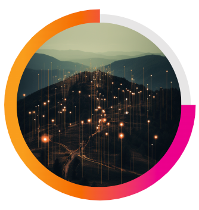
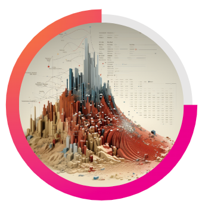
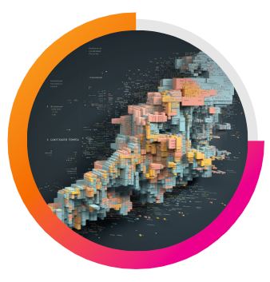
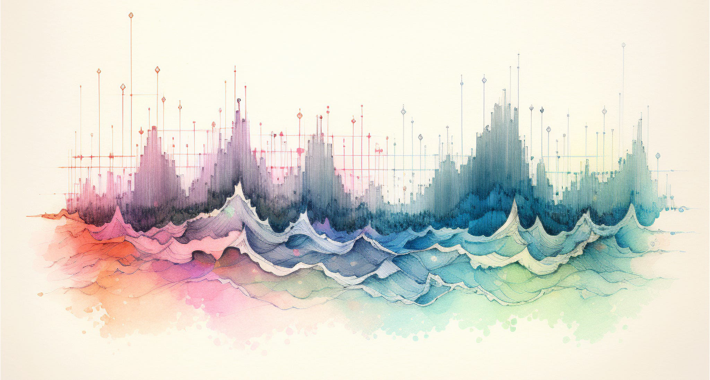

The Invisible Cartographer
Foreword for: Clarity in the Chaos

In a recent article titled, “Mapping the Cyber Terrain: The Intersection of Cartography and Cybersecurity,” we discussed the intersection of map-making, data analytics, and cybersecurity. This article introduces you to The Invisible Cartographer!

Imagine this character as your personal guide in the digital [wilderness](https://odam.community/part-1/1-value-of-data/#exploring-the-value-of-data), with [Operationalizing Data Analytics Methodology ([ODAM](https://odam.community))](https://odam.community) as her compass to navigate through the complexities. In the movies, the hero always finds a map and some help along the way. As the story unfolds, we’ll meet her squad and hear about “that one time” they saved the day.

The Invisible Cartographer has a unique blend of skills and experience in cybersecurity, data science, and cartography that come together to help you and your organization succeed in now and in the future.

In the Mapping the Cyber Terrain article, we discussed the three levels of data… or “the terrain” as the Invisible Cartographer refers to it. The digital wilderness is vast, largely unknown, and always changing. To help organize information, tactics, and [strategy](https://odam.community/part-2/#data-strategy-template), the Invisible Cartographer uses these concepts when communicating to her squad. These layers — Signals, Semantics, and Logic — serve as the foundation for understanding and interacting with vast amounts of data. Let’s review:

### Signals: The Foundation of the Data Landscape

> Raw Data Streams: Signals represent the raw, unprocessed data. This is the initial layer, akin to the basic contours of a terrain. Just as contours depict the altitudes and depressions on a physical map, signals provide the fundamental structure of the information landscape.

### Semantics: Contextualizing Data

> Meaning and Interpretation: The semantics layer adds context and meaning to the raw signals. It’s similar to how a cartographer adds annotations to a map, turning simple lines and shapes into meaningful representations of roads, rivers, and cities.

### Logic: The Layer of Decision and Action

> Strategic Analysis: Logic operates as the decision-making layer. Here, the interpretations and context provided by the Semantics layer are used to make strategic decisions.

The Invisible Cartographer and the squad have saved the day many times over the years. Future articles will tell the tales of these heroes and how they saved organizations from being attacked by APTs (advanced persistent threats). We’ll get to know these specialized teams later in this article and in future articles but here is a brief overview.

## Meet the Squad

### Observers — The Watchers:

> Surveillance Specialists: Armed with advanced monitoring tools, these experts meticulously scan the network’s data traffic. They analyze patterns in real-time, seeking out anomalies in data flow or unexpected encryption activity — essential for early detection.

### Scouts — The Reconnaissance Patrol:

> Vulnerability Assessment Experts: Agile and thorough, these Scouts skillfully navigate through the network’s complex structure. Using sophisticated scanning tools, they systematically uncover and assess vulnerabilities — the hidden cracks and crevices in the network’s architecture that could be exploited by cyber threats.

### Strategists — The War Room Planners:

> Advanced Contingency Planning: With a focus on preemptive measures, the Strategists craft detailed incident response plans specifically tailored for scenarios like ransomware attacks. They leverage the Cartographer’s insights on risk and predictive analytics to outline key action steps and allocate resources effectively.

### Sharpshooters — The Precisionists:

> Targeted Defense and Forensic Analysis: The Sharpshooters are adept at deploying precise detections as they seek out specific threats. Post-attack, they shift into forensic experts, meticulously analyzing the breach to trace its source, understand the attack patterns, and guide the recovery process.

### Engineers — The Builders:

> Infrastructure Fortification and Backup Systems: These Engineers expertly reinforce the digital infrastructure, utilizing data analytics to inform their decisions on where fortifications are most needed. In parallel, they design and implement robust backup systems, ensuring these safeguards are strategically aligned with the most critical data and system vulnerabilities for optimal protection and continuity.

### Communicators — The Storytellers:

> Digital Narrators: These masterful Communicators bridge diverse worlds, transforming the complexities of the digital wilderness into captivating, accessible stories. They make the technical terrain understandable for all but also disseminate both timeless and contemporary knowledge. As guardians of cyber wisdom, they ensure that the entire team is equipped with the context they need.

Now that we’ve acquainted ourselves with the Invisible Cartographer and her squad, let’s hear how they saved the day by averting crises. In the articles ahead, we’ll hear their stories, highlighting how their strategic blend of data analytics, cybersecurity expertise, and collaborative tactics have been instrumental in safeguarding organizations against a persistent barrage of attacks.

### How the The Invisible Cartographer and Her Squad Saved the Day.

These are future articles to tell the tales of how they brought clarity to chaos:

- Stopping Fraud: Applied Data Analytics to Fight Fraud, Waste, and Abuse
- Achieving Zero Trust: Building the Digital Fortress
- Illuminating the Shadows: Gaining Unprecedented Visibility
- Guarding the Gateways: Enhancing Organizational Resilience
- Navigating Compliance Requirements: Meeting and Exceeding Standards
- Streamlining Systems: Driving Efficiency with ODAM
- Mitigating Risk: Proactive Risk Reduction (Insider Risk as well as External Risk)
- Mapping the Future: The Invisible Cartographer’s Vision for an Evolving Digital Landscape

Before we move on, let’s briefly review ODAM and one of its core components, the IT Service Blueprint Workshop.

## Operationalizing Data Analytics Methodology (ODAM) is Your Compass

ODAM is how we know which direction is which.

> “ODAM, in its essence, seeks to bridge the gap between policy and practice”

The framework/methodology (I use those terms interchangeably) is thoroughly documented on the [ODAM Community website](https://odam.community). There, you will find details and actionable information that you can use as part of your organization’s data strategy.

If you’re just now learning what ODAM is, I recommend you check out the website and these articles before continuing on with this article.

- ODAM 2-pager [https://odam.community/static/splunk_odam_overview.pdf](https://odam.community/static/splunk_odam_overview.pdf)
- ODAM: a Digital Resilience Strategy https://medium.com/@chrisperkins505/odam-a-digital-resilience-strategy-fc34f2fbc286
- Discovering the True Worth of Data: Unlocking Value with ODAM https://medium.com/@chrisperkins505/discovering-the-true-worth-of-data-unlocking-value-with-odam-fbb007b7b8d8

In a nutshell, the ODAM approach enhances:

1. Data-Driven Decision Making: ODAM’s structured methodology leverages data analytics to make informed decisions.
2. Achieving Maturity Milestones: ODAM’s systematic approach, structured as Define, Plan, Execute, and Measure, enables agencies to progress through stages of “Initial”, “Advanced,” and “Optimal,” within their cybersecurity journeys.
3. Unified Compliance Framework: ODAM integrates guidelines, requirements, and frameworks, ensuring that agencies not only meet specific policy/compliance benchmarks but also have an ability to cross-walk multiple frameworks at once.
4. Scalability and Uniformity: Thanks to its modular nature, ODAM offers consistent implementation across various agencies, regardless of their existing cybersecurity maturity or size.
5. Enhanced Reporting and Monitoring: The data-driven methodology helps organizations establish real-time monitoring and comprehensive reporting.

I’d like to discuss the ‘Why’ with you all. Why I created ODAM and why organizations need ODAM are two sides of the same coin.

- For nearly two decades I’ve had the privilege of working with organizations across the US. Private enterprise as well as the public sector (specifically, state/local/tribal government, K-20 education, and public utilities) face similar challenges in the modern digital landscape. I also receive similar questions from different organizations weekly. I wanted to write down some recommendations and also provide a method for even the most under-resourced organizations to leverage.
- Organizations (especially those in the public sector) have evolved throughout the years, maturing processes, maturing their skill sets, reducing tech debt, and acquiring tools. Organizations have mostly landed on the tools, processes, and team structures that suit their needs and are now looking for a way to integrate these assets to better protect the organization, become more efficient, measure progress, and reduce organizational risk. The two things that tie the organization together are…. Data and People. We will dive more into People, Process, Data, and Technology later in this article.

It is through these articles that I hope to shine a light on how the ODAM framework can help organizations find better alignment of their IT department to the org’s mission. One way I hope to contribute is by taking some time to think and write about these characters in an effort to make it fun and more accessible. I’ve been working in the field for nearly two decades now and have yet to see progress towards translating cybersecurity speak… or risk lingo… for non-security people. This will be a work in progress and will likely change a bunch before I get to the end of the planned articles. I hope to hear from you if you have any feedback for me. I appreciate any feedback you can offer!

The first article in the series is titled, Clarity in the Chaos. In the following sections, we’ll discuss what it means to have clarity and why the environment is so chaotic in the first place. We’ll discuss how change can lead us to challenges and opportunities and how the Invisible Cartographer and her squad can help your organization gain a clearer understanding of the digital landscape.

## Clarity in the Chaos

When we think of explorers, we tend to imagine images of cartographers charting unknown lands, drawing borders, and penning the pages with pathways for others to follow. Yet, in today’s digital world, the uncharted territories are not of this planet or even this solar system, but of zeros and ones. In the digital domain, the topography is a tapestry of processes, algorithms, networks, and data.

The chaos of the digital domain comes from a systematic disconnection consisting of siloed information, processes, tools, and teams. This disconnection comes at a price.

> “The cost of this disconnection is measured in inefficiencies and the slow erosion of strategic advantage.”

So, what is the cost of this systematic disconnection?

> This fragmentation typically manifests as widespread inefficiencies across various organizational facets. It hinders the smooth flow of information and collaboration, leading to delays, redundant efforts, and missed opportunities. Over time, these inefficiencies accumulate, gradually eroding the organization’s strategic advantage.

What are the implications of not having a unified data strategy?

> The absence of a unified data strategy can lead to significant consequences, primarily in the form of fragmented and inconsistent intelligence. Without a cohesive approach to data management and analysis, organizations risk creating substantial blind spots in their decision-making processes. This fragmentation can result in missed opportunities, overlooked risks, and inefficient resource allocation, ultimately hindering the organization’s ability to respond effectively to economic crises, customer needs, and cyber threats. In today’s data-driven landscape, lacking a unified data strategy is not just a minor setback; it’s a critical vulnerability that can compromise the overall organization.

In what ways could a centralized data analytics platform enhance collaboration and communication across departments?

> Centralizing data analytics can significantly enhance collaboration and communication across different departments by breaking down the barriers created by data silos. When data is consolidated into a unified platform, it enables a more holistic approach to problem-solving. Departments can access and leverage a wide range of insights, which would otherwise be confined within isolated segments of the organization. This shared access not only streamlines communication but also encourages a cross-functional perspective, leading to more comprehensive and effective solutions.

In what ways might a lack of centralized data analytics affect an organization’s customer service or user experience?

> A lack of centralized data analytics can detrimentally affect an organization’s customer/resident service and user experience, two critical components that form the public face of an organization. When data is scattered across different systems, it creates challenges in obtaining a unified view of the end user. This fragmentation can lead to inconsistencies in user interactions, misinformed service decisions, and a failure to recognize and respond to user needs effectively. As a result, users may experience frustration due to disjointed communication, delays, and a perceived lack of understanding of their requirements. Over time, this can erode user satisfaction and lower trust and confidence in the system.

Clarity requires change. Change requires buy-in and incremental adjustments. In the next section, let’s discuss how the only constant is change and how we can find our organizational groove.

## Change is Constant

> “It is not the strongest of the species that survive, nor the most intelligent, but the one most responsive to change.” — Charles Darwin

We see through the lens of history that change has been an ever-present force, pushing us from the wheel to the web, from the printing press to pixels. We are witnessing rapid-change first hand. ChatGPT (and Large Language Models; LLMs) were far from being mainstream just a year ago. Tools like Midjourney and DALL-E were just becoming available in the latter part of 2022.

The question that comes up for me is: how do we harness the power of change? I believe that to embrace and lean into change, we need a strategy.

At the heart of change is the feedback loop. I’m referring to an iterative process that feeds the organization’s growth or maturity. [Centralized](https://odam.community/part-3/#using-odam-to-set-up-your-ace) data analytics, therefore, must become part of this loop, guiding decisions, informing strategy, and helping us navigate the path ahead.

In a world where the only constant is change, organizations must adapt.

This is nothing new… from the dawn of civilization to the cutting edge of digital transformation, we have always pondered the nature of change — its challenges and its opportunities. One thing we’re missing right now is a guide.

> “The world as we have created it is a process of our thinking. It cannot be changed without changing our thinking.” — Albert Einstein

## Navigating Cyberspace

> “In the era of explorers, the vastness of the unknown world was limited by the edge of a map.”

At first glance, map-making and defending the digital enterprise might seem worlds apart. However, both disciplines involve navigating vast, often unknown territories, identifying potential threats or landmarks, sifting through mountains of data, and guiding explorers through myriad challenges. Just as cartographers first charted out territories for explorers, today’s cyber defenders map out the digital wilderness and pinpoint vulnerabilities while identifying strategies for safe passage.

Some similarities I’ve noticed between map-makers and cyber defenders:

> Terrain Understanding: Cartographers study the physical layout of lands, noting mountains, rivers, and other geographic markers. Similarly, cyber defenders analyze digital landscapes, identifying network topologies, data flow paths, and system interconnections.

In the digital expanse of cybersecurity, the parallels with cartography are evident. When organizations use ODAM, we can efficiently chart the vast cybersecurity landscape to ensure a safer path for the organization.

And don’t forget! Documentation, documentation, documentation!

> “The difference between science and screwing around is writing it down.” — Adam Savage

## People, Process, Data, and Technology

Without the challenges we face today, I wouldn’t be writing this article and we’d all be on the beach somewhere. Or, perhaps camping in the Pecos.

These cannot exist without one another and they are interrelated. Given this, how do we improve all areas in a concerted manner? How can we measure them independently and how they’re working together? And how can we address our organizational challenges holistically?

> People: The success of cybersecurity strategies hinges on the people involved, encompassing their diverse skills and knowledge, and the organizational challenges in acquiring and retaining such talent.

As we begin wrapping up the first article in the series and our exploration of the critical pillars of cybersecurity — People, Process, Data, and Technology — it becomes evident how each of these elements plays a vital role in enhancing organizational resilience. The effectiveness of an organization’s cyber defense is not just dependent on one aspect but on the harmonious integration of all these components. The right blend of skilled personnel, agile processes, quality data, and advanced technology forms the backbone of your organization’s overall defense strategy.

This brings us to the rise of The Invisible Cartographer!

## The Rise of the Invisible Cartographer

The Invisible Cartographer brings a unique perspective to organizations.

The Invisible Cartographer represents not just a role, but a paradigm shift in how we perceive and tackle the threats and complexities of the digital wilderness. As we delve deeper into her story, we uncover how her innovative approach and unparalleled expertise enables organizations to chart a course through a hostile digital landscape, turning chaotic data streams into structured maps.

In closing, the journey through the digital wilderness is fraught with challenges and opportunities, demanding not only tactical precision but also strategic foresight and adaptability. The Invisible Cartographer will guide us through uncharted territories with a blend of expertise and vision.

As we continue to navigate this complex landscape, her insights and methodologies offer ensure that we not only respond to the present challenges but also proactively prepare for the future.

The rise of the Invisible Cartographer marks a new era in digital strategy and manifests as an experimental blend of art and engineering.

Thank you for reading!

Special thanks to Audra Streetman and Nate for their reviews, edits, and feedback!

Please note: the views and opinions expressed in this post are those of the author (Chris Perkins) and do not necessarily reflect the official policy or position of my employer, or any other agency, organization, or company. Assumptions made in this post are not reflective of the position of any entity other than the author — and, since we are critically-thinking human beings, these views are always subject to change, revision, and rethinking at any time.
