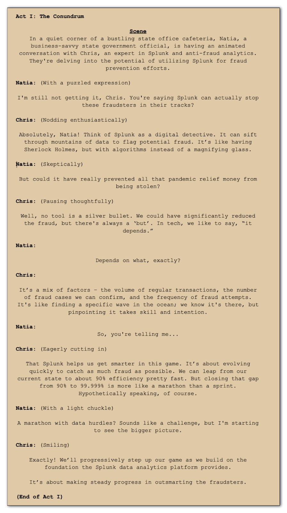
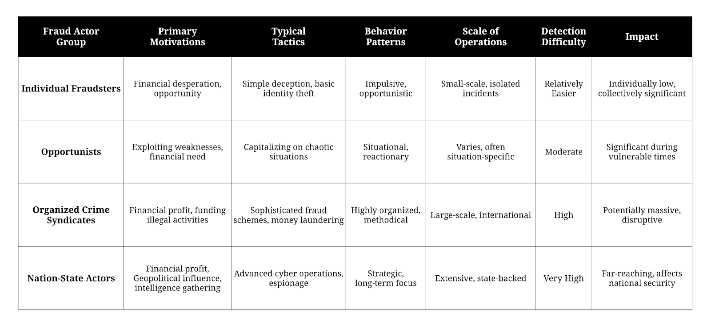
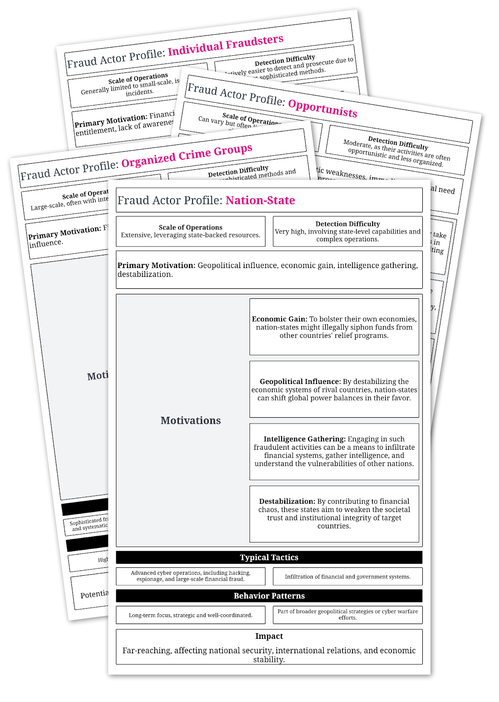
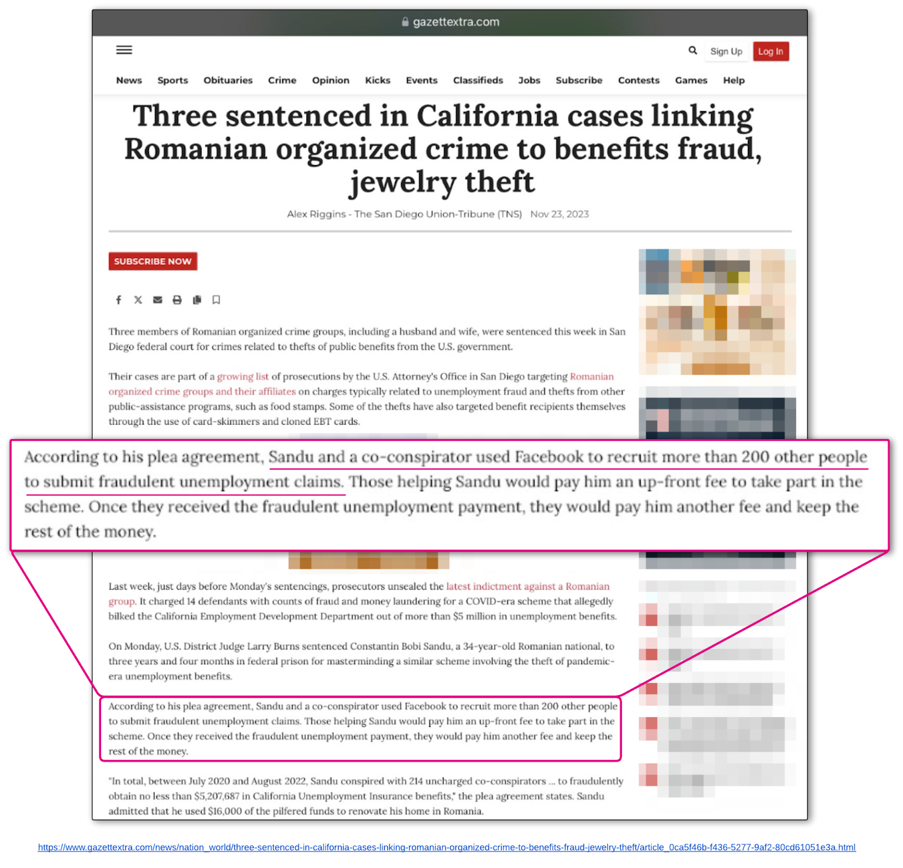
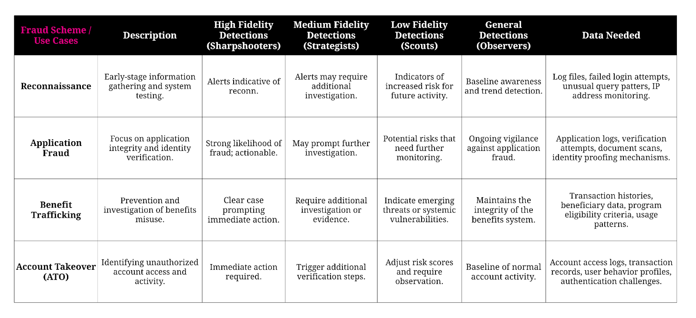
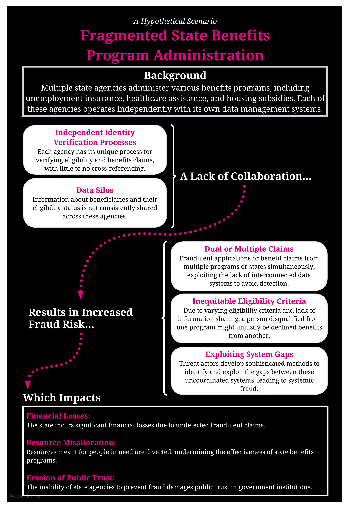

The Digital Battleground: Uniting Cybersecurity and Fraud Prevention in State Agencies
Navigating the Cyber Terrain

**TL;DR:** As fraud threats continue to increase in scale and sophistication, state governments face the urgent challenge of safeguarding resources and public trust. From opportunistic individuals to organized crime rings, fraud actors are besieging state-level systems from all fronts. The nature of these threats demands an equally dynamic and multi-layered approach to fraud prevention.

As fraud tactics and digital capabilities evolve rapidly, anti-fraud systems must embrace innovation and adaptability as core principles.

This series of articles delves into these three main areas of the conversation:

1. Who are the threat actors and what are their schemes?

2. Why the identity layer is the critical battleground for anti-fraud.

3. The Future State: Fortifying Security Through Cyber-Fraud Convergence.

## Introduction

In a recent Government Accountability Office (GAO) report, the estimated total amount of fraud across all Unemployment Insurance (UI) programs during the COVID-19 pandemic was likely between $100 billion and $135 billion — or 11% to 15% of the total UI benefits paid out during the pandemic. **[1]**

In 2022, the US median household income was $74,580 (pre-tax)**[2][3]**. If you take the estimated amount lost to fraud across UI programs, we are talking about 1.4 billion households. That’s the size of San Antonio, Texas and nearly the size of Phoenix, Arizona. If we were talking about a city, it’d be the 6th or 7th largest city in the US.

Fraud: the deliberate misrepresentation of information and identity for an unfair or unlawful gain. Fraud activities may involve manipulation, falsification, or alteration of records, intentional omission, or the misapplication of organizational policies (i.e., insider risk).

So, how much was paid out across these programs that went to eligible recipients? According to the GAO, 85% or approximately $630 of the $765 billion. According to the report, nearly $7 billion has been recovered, although data is still being analyzed and investigations are underway.

The question of how much could have been prevented always comes up. Hindsight is always 20/20, right? That said, I wanted to share this conversation that I recently had with Natia.

Imagine the two of us sitting in an office cafe and the following conversation ensues:

Following the profound revelations about the extent of fraud, a detailed exploration of these schemes is crucial — focusing on the perpetrators as well as the systemic weaknesses that facilitated these breaches.

Effective anti-fraud measures transcend one-size-fits-all solutions, necessitating a holistic integration of diverse strategies and methodologies across technology, process management, teamwork, and partnerships. The key to success is in harmoniously blending these elements to construct a solid defensive framework.

By exploring critical dimensions like identity assurance, security integration, analytics capabilities, and collaborative networks, we’re moving toward more vigilant and resilient posture.

Driving this journey is the commitment to safeguarding state-level resources, systems integrity and public trust through unified efforts. Together, leveraging leading practices and technologies, we can forge effective partnerships between teams, agencies, and fraud experts in the public and private sector. With open collaboration, continuous learning, and steadfast determination, state governments can navigate the ever-changing terrain of fraud threats impacting vital government programs and services.

The discussion will include an examination of threat actor profiles, an analysis of their methodologies, and an assessment of their impact on state systems. Concluding with a presentation of key preventive strategies, the aim is to shield assistance programs from similar vulnerabilities in the future.

## Part 1: Who Are The Threat Actors And What Are Their Schemes?

T[here](https://www.linkedin.com/smart-links/AQG6Gmm_PmmNaw) are four key groups of fraud actors pillaging the system: Nation-States, Organized Crime Syndicates, Opportunists, and Individuals. (For more, see my [blog](https://www.linkedin.com/pulse/pandemic-unemployment-assistance-fraud-chris-perkins/) from late 2020.)

> “Nearly every federal program was either legally or illegally looted during the pandemic, according to Andrezejewski. 140 contractors that were based in the U.S. were owned by the CCP [Chinese Communist Party] where they took up to $400 million worth of round one paycheck protection programs funds which were earmarked for mom and pop shops on Main Street.” — [**ABC St. Louis**](https://abcstlouis.com/news/nation-world/expert-its-the-largest-public-fraud-in-the-history-of-our-country-as-covid-concerns-rise-pandemic-us-economy)

The table below outlines these groups, their primary motivations, tactics, behavior patterns, and potential impact.

I put these profiles together that outline the details of these fraud actors. You can download the profile document here.

Fraudsters from all walks of life seek to exploit organizational structures and processes, leveraging any and all weaknesses to achieve their objectives. In the public sector, these fraud actors capitalize on gaps in inter-agency communication, rigidity in systems, bureaucratic inefficiencies, not enough staff, and technical vulnerabilities.

In a recent article, Fighting Fraud in the Public Sector with the Splunk Data Analytics Platform, I outlined different fraud activities that we observe across all threat actors.

> One thing in common among all is that they rely on stolen or synthetic identities for their success.

The dramatic rise in data breaches in recent years has led to numerous facets of identity theft. Check out the Information is Beautiful site for some great visualizations on the world’s largest data breaches.

When a threat actor steals identities from CompanyXYZ, they list these identities on dark web marketplaces where criminals can buy this data. Further, fraud actors blend this real data with fake information to make it more challenging to detect identity fraud.

> “A synthetic identity is a combination of fabricated credentials where the implied identity is not associated with a real person.” — LexisNexis Risk Solutions

In order for fraud actors to be successful in stealing money, there are a lot of tools, systems, and other infrastructure required to pull off fraud at a global scale. For example, fraud actors typically use money laundering (aka money mule) accounts opened with fake or stolen identities. Add to this, criminals are also using identity information on children or people who are now deceased.

Taking a closer look at the current landscape reveals the methods and tactics that make fraud actors successful.

Given the size, complexity, number of fraud actors, and tools they have available to them, we can summarize how fraud actors have successfully evaded defensive efforts.

1. **Technical system vulnerabilities:** They exploit weaknesses in IT infrastructure, such as outdated software or inadequate cybersecurity measures, creating loopholes ripe for technical exploitation.
2. **Challenges in data consolidation:** States encounter significant difficulties in effectively merging and analyzing varied data streams, such as machine-generated data, unstructured content, and the nuanced differences between metadata and claims data. The substantial volume and intricate complexity of these data sets frequently impede the streamlined detection and analysis of fraudulent patterns, posing a barrier to efficient fraud identification and mitigation.
3. **Exploiting of organizational silos:** By capitalizing on the insufficient communication and coordination among agencies, states, and departments, fraud actors find fertile ground for their schemes. Contributing to this issue are outdated statutory or policy requirements and technological infrastructures, like legacy mainframe systems, which significantly hinder effective information sharing.
4. **Rigidity in government systems:** The inherent inflexibility of certain government systems makes them prime targets for fraud, as their slow adaptation processes offer fraudsters opportunities to exploit.
5. **Bureaucratic inefficiencies:** Cumbersome and slow bureaucratic processes within change management can delay the detection and response to fraudulent activities.

When it comes to offense — or committing fraud, fraudsters have successfully leveraged these tactics (but not limited to):

1. **Leveraging automation and bots:** The escalating deployment of automated tools and bots not only boosts the capacity for large-scale fraudulent activities but also accelerates the pace of attacks. This automation enables fraud actors to execute more operations in less time, significantly enhancing their ability to quickly scale up their efforts and swiftly evade detection.
2. **Utilizing advanced technologies:** The quick adoption of new tools, including artificial intelligence (AI) and constantly evolving techniques, exemplifies the sophistication and agility of modern threat actors.
3. **Exploiting network effects and collaborative tactics:** Fraud actors are significantly bolstered by the power of network effects and collaborative strategies.
4. **Amplified impact through collaboration:** Fraud actors gain a significant advantage by pooling resources, tools, and expertise within a network, enabling them to enhance the scale and complexity of their operations.
5. **Exponential growth with network expansion:** The network effect creates a multiplier effect, where each new participant in the fraud network exponentially increases its reach and effectiveness.
6. **Rapid dissemination of methods:** The interconnected network enables quick sharing of successful fraud strategies, ensuring that effective tactics are adopted and replicated rapidly across the network.
7. **Pooling** of diverse expertise: Collaboration in these networks brings together varied skills and insights, leading to more innovative and resilient fraudulent methods.
8. Challenges in detection and prevention: The adaptability and resilience of these fraud networks, bolstered by collaborative efforts, make detecting and preventing fraud activities more complex and challenging.

Concluding the list of tactics, it’s evident that the absence of collaborative networks significantly diminishes the capacity of individual fraudsters. When isolated, these actors face limitations in their operational scope and sophistication, lacking the pooled resources and collective knowledge that are crucial for executing complex fraud schemes. This limitation highlights the critical role that networks play in elevating the scale and intricacy of fraudulent activities.

As we transition from understanding these tactics, let’s consider a hypothetical scenario that further illustrates the impact and challenges of dealing with such sophisticated fraud networks in a real-world context.

Part II: Why The Identity Layer Is a Critical Battleground For Anti-Fraud

Part III: The Future State: Fortifying Security Through Cyber-Fraud Convergence

Thank you to my editors and reviewers!! Audra Streetman, Brett Feldmann, Tina Carkuff, Paul Eckloff, Chris Selvig, and Amy Simon.

[1]https://www.gao.gov/products/gao-23-106696

[2]https://www.census.gov/library/publications/2023/demo/p60-279.html

[3]https://www.census.gov/content/dam/Census/library/publications/2023/demo/p60-279.pdf

Please note: the views and opinions expressed in this post are those of the author (Chris Perkins) and do not necessarily reflect the official policy or position of my employer, or any other agency, organization, or company. Assumptions made in this post are not reflective of the position of any entity other than the author — and, since we are critically-thinking human beings, these views are always subject to change, revision, and rethinking at any time.
