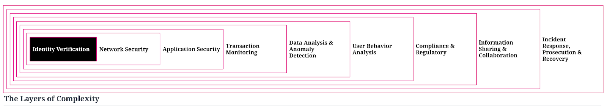
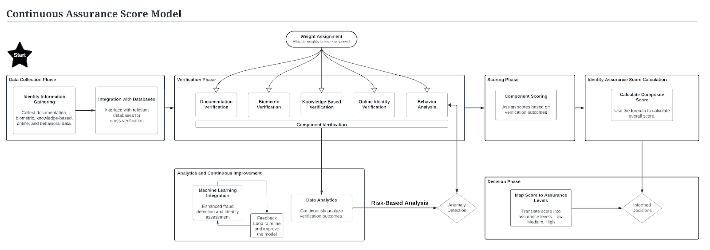

Why The Identity Layer Is a Critical Battleground For Anti-Fraud
Part II of The Digital Battleground: Uniting Cybersecurity and Fraud Prevention in State Agencies

In order to get ahead of the problems, and in an effort to help us all communicate more effectively, I created this list of layers where we can describe threats, vulnerabilities, actors, risks, mitigations, and areas with low visibility.

Within each level of our anti-fraud defenses, critical conversations unfold concerning the extent of vulnerabilities, the sufficiency of resources, and the interplay between layers. It’s essential to consider how each layer not only stands on its own but also contributes to the strength of the overall structure.

Each layer represents a different aspect or level of security infrastructure that collectively forms a comprehensive defense against fraudulent activities.

- **Identity Verification:** This is the foundational layer where individuals’ identities are confirmed. It is crucial for preventing unauthorized access and ensuring that services are provided to legitimate users. Techniques might include document verification, biometric checks, and multifactor authentication.
- **Network Security:** This layer involves protecting the infrastructure that supports data transmission. This could involve firewalls, intrusion detection systems, and network segmentation to prevent unauthorized access and data breaches.
- **Application Security:** Focused on protecting software and applications from threats, this layer may employ code reviews, security testing, and the implementation of secure coding practices to mitigate the risk of exploitation through applications.
- **Transaction Monitoring:** This involves the surveillance of transactions to identify suspicious behavior that could indicate fraud, such as unusual patterns, high volumes of transactions in short periods, or transactions from anomalous locations.
- **Data Analysis & Anomaly Detection:** At this level, data analytics tools are used to scrutinize vast datasets for anomalies or patterns indicative of fraudulent activity, which may not be visible through transaction monitoring alone.
- **User Behavior Analysis:** By understanding how legitimate users typically interact with systems, deviations from these patterns can be detected, often indicating potential fraud or security breaches.
- **Compliance & Regulatory:** This layer ensures that all systems and practices are in line with legal and regulatory requirements, which can include data protection laws, industry standards, and government regulations.
- **Information Sharing & Collaboration:** This emphasizes the importance of sharing information about threats and vulnerabilities between different entities, such as between states, agencies, or with federal organizations, to improve collective security posture.
- **Incident Response, Prosecution & Recovery:** The final layer covers the actions taken after a breach or fraud is detected, including efforts to mitigate damage, prosecute offenders, and recover lost funds or data.

The **Identity Verification Layer (IVL)** serves as a fundamental battleground in the fight against fraud. It’s where individual identification intersects with systemic defense, and its robustness runs through all other layers. By employing a continuous, risk-based approach, state authorities can leverage ongoing analytics to dynamically update an individual’s *Identity Assurance Score*. This score then could become a living metric, informing and involved with every interaction across state government regardless if in person, via snail mail, over the phone, or digitally.

## Identity Verification Layer

The Identity Verification Layer has led to the largest fraud risk exposure across government. This layer is exactly where we, the humans, intersect and interact with the technology that supports these benefits.

The IVL (Identity Verification Layer) consists of multiple phases. Let’s quickly review each phase and what happens within that phase. This will help us understand how data analytics can be applied and how states can bridge the gaps between phases and between layers.

**Data Collection Phase**

- **Description:** Collection of identity information from individuals and devices, establishing a verification baseline.
- **Data analytics benefit:** Centralizes and indexes various data types, offering a consolidated dataset for deeper analysis.
- **Interlayer impact:** Feeds validated identity profiles into subsequent phases; receives input from behavior analysis and device fingerprinting.

**Verification Phase**

- Description: Utilizes multiple methods or services to verify the accuracy and authenticity of collected data.
- Data analytics benefit: Employs correlation engines and pattern recognition to authenticate data across timeframes.
- Interlayer impact: Relies on comprehensive data from the collection phase; outputs verified data to scoring systems and risk analysis.

**Scoring Phase**

- Description: Assigns scores to each verification component to determine identity assurance levels.
- Data analytics benefit: Automates scoring and provides visualizations of confidence levels.
- Interlayer impact: Synthesizes verification results into quantifiable scores; informs composite score calculations and risk assessments.

**Identity Assurance Score Calculation**

- Description: Combines scores from various components into a composite score representing overall identity assurance.
- Data analytics benefit: Quickly aggregates individual scores for rapid risk assessment.
- Interlayer impact: Integrates component scores into a comprehensive metric; serves as a basis for decision-making.

**Decision Phase**

- Description: Uses the composite score to make informed decisions about claimant eligibility.
- Data analytics benefit: Maps scores to predefined assurance levels, aiding data-informed human decision-making.
- Interlayer impact: Translates analytical insights into actionable outcomes; shapes the approach of continuous improvement efforts.

**Analytics and Continuous Improvement**

- Description: Applies insights from current and past verifications to enhance future process accuracy and efficiency.
- Data analytics benefit: Incorporates machine learning to refine fraud detection models and implements feedback loops for process enhancement.
- Interlayer impact: Improves the efficacy of verification and scoring phases; adjusts risk-based analysis with refined models.

**Risk-Based Analysis**

- Description: Analyzes risk across all layers, focusing on detecting fraud indicators.
- Data analytics benefit: Offers real-time anomaly detection and risk-based analysis across all data sources and types.
- Interlayer impact: Informs and adjusts verification and scoring methods; feeds into continuous improvement and decision-making processes.

The interwoven structure of the phases, underpinned by data analytics tools, stands as a testament to the sophistication required in modernized anti-fraud strategies. Each phase not only builds upon the last but also informs the next, creating a dynamic, continuous loop of improvement and enforcement. As the landscape of fraud continually evolves, so too must our approaches, utilizing the full spectrum of available data and analytics to maintain the integrity of our systems.

> As the landscape of fraud continually evolves, so too must our approaches, utilizing the full spectrum of available data and analytics to maintain the integrity of our systems.

> The integration of cybersecurity and anti-fraud teams is akin to merging distinct maps, revealing a fuller picture of the terrain we must navigate to safeguard our digital domains.

**Next**

- Part III: The Future State: Fortifying Security Through Cyber-Fraud Convergence

**Previous**

- Part I: Who Are The Threat Actors And What Are Their Schemes?

Please note: the views and opinions expressed in this post are those of the author (Chris Perkins) and do not necessarily reflect the official policy or position of my employer, or any other agency, organization, or company. Assumptions made in this post are not reflective of the position of any entity other than the author — and, since we are critically-thinking human beings, these views are always subject to change, revision, and rethinking at any time.
