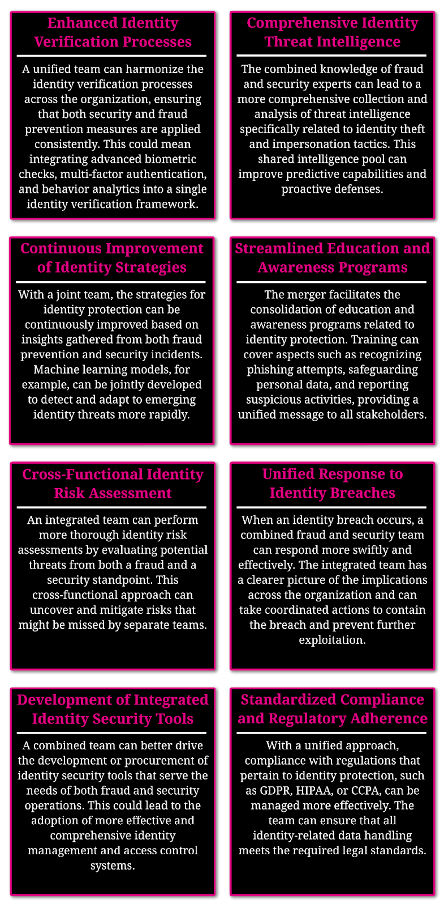

The Future State: Fortifying Security Through Cyber-Fraud Convergence
Part III of The Digital Battleground: Uniting Cybersecurity and Fraud Prevention in State Agencies

As the cyber terrain broadens and deepens with increasing technological sophistication, the urgency for proactive fraud prevention strategies becomes clear. In this environment, the deployment of AI, machine learning, and blockchain technologies transitions from nice-to-haves to necessity within state infrastructures, enabling a more preemptive stance against the agility of cyber threats through predictive analytics and real-time monitoring.

The move toward integration is evident as organizations blend their cybersecurity and fraud prevention units, yielding a comprehensive view on potential threats. This unified field of view allows for a more nuanced analysis of data, insight sharing, and strategic response, thereby enhancing the capabilities to detect, analyze, and neutralize fraudulent activities.

Integrated teams, equipped with a diverse arsenal of advanced technological tools, respond with unprecedented speed and efficacy to security incidents. This agility ensures that immediate actions can be taken to assess risks and implement countermeasures against associated fraud, maturing defenses, and streamlining recovery efforts.

## Rethinking Defense and Uniting Fronts: The Convergence of Security and Anti-Fraud Efforts

In an era where digital threats are constantly evolving, the intersection of cybersecurity and fraud prevention has become a critical frontline in safeguarding our government.

The integration of cybersecurity and fraud prevention strategies will become standard in the future. States are also beginning to address the policies and MOUs (memorandum of understanding) that enable inter-agency collaboration in fortifying defenses against increasingly sophisticated fraud schemes.

By blurring the line between these once separate domains, we uncover the shared goals that are essential in the collective fight against fraud and cyber threats.

### The Overlap of Security and Fraud Prevention

Traditionally, cybersecurity focused on protecting data and systems from external threats, while fraud prevention deals with a slightly different set of challenges. Fraud prevention, external monitoring (dark net, etc.), and adversarial intelligence requires specialized skill sets. They also originate from different areas of the government which vary state to state.

However, the rise of cyber-enabled fraud has highlighted the interconnectedness of these domains. Techniques like phishing, identity theft, and account takeover illustrate how cyber threats directly enable fraudulent activities.

### The Trend Towards Integration

Recognizing this overlap, organizations are increasingly merging their cybersecurity and fraud prevention units. This integration allows for a more comprehensive view of threats, as teams can collaboratively analyze data, share insights, and deploy cohesive strategies that address both security breaches and fraudulent activities.

### Enhanced Fraud Detection and Prevention Through Integration

1. By pooling resources and expertise, integrated teams can leverage advanced technologies like AI and machine learning more effectively. For instance, a combined unit can use these technologies to identify patterns indicative of both cybersecurity threats and fraudulent behavior.
2. Integrated teams can respond more rapidly and effectively to incidents. For instance, if a security breach occurs, the combined unit can immediately assess the risk of associated fraud and take steps to mitigate it.
3. Collaboration between these teams also leads to the development of more robust policies and procedures that address both security and fraud, ensuring a more fortified defense mechanism.
4. Looking ahead, the anticipation is a pivot towards the establishment of Centralized Identity Centers — repositories where identities and corresponding assurance levels are maintained, enhancing the integrity of state programs.

As cybersecurity and fraud teams combine, we can expect a fuller, more robust capability to detect and prevent fraud. Each of the following capabilities are enhanced with data analytics.

## Advanced Technological Integration: Blueprint for a Future-Proofed State

In the quest to fortify states against fraud, integrating advanced technologies is not merely enhancing existing systems; it represents a fundamental transformation towards a more secure and efficient future. Central to this evolution is the strategic incorporation of technologies like AI, machine learning, and blockchain into state infrastructures, fundamentally altering the approach to fraud prevention. However, it’s crucial to emphasize that these technological advancements are tools to aid human decision-making. They empower professionals to make quicker, more informed decisions, ensuring that eligible claimants receive accurate and expedient services.

> The goal is to use tools and data for predictive analytics — to anticipate and prevent fraud rather than just react.

### **Advanced Technological Integration: Empowering Human-Centric Fraud Prevention**

- **Predictive analytics for proactive fraud prevention:** Utilizing data and tools like AI for predictive analytics shifts the focus from reactive to proactive fraud prevention.
- **Machine learning and adaptive AI algorithms:** Leveraging machine learning models enables the detailed analysis of transaction data to detect emerging fraud patterns, constantly refining these models with extensive datasets for heightened accuracy. Concurrently, AI algorithms play a pivotal role in rapidly identifying and adapting to evolving fraudulent tactics. This integration facilitates real-time, automated monitoring and responses, creating a dynamic system that continuously evolves in step with the changing nature of fraud.
- **Blockchain for immutable record keeping:** Blockchain technology ensures the integrity of transaction records, significantly obstructing data tampering and fraud.
- **Efficient data processing:** The deployment of these technologies facilitates rapid processing of large data volumes, expediting the detection of anomalies and issuance of fraud alerts.
- **Automated, improved fraud detection with human oversight:** The integration of advanced technological tools significantly bolsters the capability of state governments to automate fraud detection processes. This advancement leads to more efficient and prompt responses, substantially reducing the dependence on time-consuming manual reviews. However, it’s crucial to recognize that these automated systems serve to inform and assist human decision-makers. The final judgment and actions remain in the hands of trained professionals, who now make data-informed decisions backed by comprehensive analytics and automated insights.

This technological integration not only elevates the efficiency and effectiveness of fraud detection but also underscores the critical role of human oversight in interpreting and acting upon the insights provided by these systems. By combining technological innovation with human expertise, states can ensure a more robust, resilient, and trustworthy system for managing and distributing public resources.

## Building a Tech-Enabled Infrastructure

The goal is to tightly integrate advanced tools like AI and blockchain into state systems and processes. Rather than isolated applications, these technologies should mesh seamlessly with existing frameworks.

While promising major benefits like better analytics and data security, these technologies have notable implementation challenges:

- Substantial upfront costs.
- Requiring specialized skills and expertise.
- Ongoing upkeep and upgrades amid rapid innovation.

By acknowledging these hurdles, states can strategize solutions, such as:

- Phased rollout plans balancing priorities and budgets.
- Training and partnerships to build necessary technical competencies.
- Modular architectures for easier system modifications.

With deliberate planning, states will overcome adoption barriers. A cohesive incorporation of emerging tools transforms passive fraud reaction into proactive future-proofing of state infrastructures against evolving digital threat landscapes.

## Enabling Seamless Collaboration

Combating fraud requires breaking down silos and barriers that prevent information sharing. A unified framework can connect agencies at the state, federal and international levels alongside public and private sector partners.

The goal is seamless collaboration — leveraging complementary skills and data resources between cybersecurity and fraud teams for a coordinated fraud prevention strategy. Key elements include:

**Communication Channels**

- Real-time alerts on emerging fraud threats.
- Best practice playbooks and training programs.
- Joint investigation task forces, composed of experts with a diverse set of backgrounds, are formed to conduct comprehensive, multi-jurisdictional fraud investigations across various departments and states.

**Data Sharing Platforms**

- Centralized hubs for pooling fraud data intelligence.
- Common data standards and models.
- Automated analytics and visualizations.

**Technical Infrastructure**

- Integrated APIs allowing systems interoperability.
- Configurable access controls balancing security and availability.
- Cloud-based delivery model enabling scalability.

With robust networks facilitating open collaboration, fraud patterns can be detected faster from collective intelligence. Responses also become more rapid by closing information gaps.

Tight collaboration cycles will accelerate learning and innovation. By connecting systems, skill sets and people, anti-fraud efforts can become truly unified — turning isolated actions into coordinated advancement.

Beyond this, an [Analytics Center of Excellence (ACE)](https://odam.community/part-3/#using-odam-to-set-up-your-ace) will be born!

## Conclusion

As we draw the curtain on this exploration of state-level fraud prevention, it’s crucial to emphasize the ongoing need for dynamic strategies and the convergence of diverse skill sets to effectively combat fraud. The battle against fraud actors, ranging from opportunistic individuals to sophisticated nation-state entities, requires our persistent vigilance and a multifaceted defense strategy.

> **The future of fraud prevention lies in our ability to adapt and evolve.**

This calls for a commitment to continuously update our fraud prevention mechanisms and invest in the ongoing education of our teams.

By staying abreast of the latest fraud tactics and technological advancements in AI, machine learning, and blockchain, we can ensure that our strategies remain relevant and effective in this fast-paced digital era.

The merging of fraud and cybersecurity teams symbolizes a strategic response to the increasingly digital nature of fraud. This convergence brings together a wealth of knowledge and skills, fostering a unified approach to identifying and mitigating a broad spectrum of threats. By breaking down silos and encouraging collaborative problem-solving, we create a more cohesive and robust defense mechanism. This unified front not only enhances our current fraud prevention capabilities but also builds resilience against the threats of tomorrow.

As we move forward, it’s clear that the fusion of technology, process, data, and people will be instrumental in protecting our systems and the trust of our communities.

We stand united in our efforts to safeguard state-level resources, letting innovation guide us through the ever-changing cyber terrain.

> In the fight against fraud, our greatest weapon is the unity of purpose and action across cybersecurity and anti-fraud teams.

Part I: Who Are The Threat Actors And What Are Their Schemes?

Part II: Why The Identity Layer Is a Critical Battleground For Anti-Fraud

Thank you to my editors and reviewers!! [Audra Streetman](https://medium.com/u/fa0e5738f06a), Brett Feldmann, Tina Carkuff, Paul Eckloff, Chris Selvig, and Amy Simon.

Please note: the views and opinions expressed in this post are those of the author (Chris Perkins) and do not necessarily reflect the official policy or position of my employer, or any other agency, organization, or company. Assumptions made in this post are not reflective of the position of any entity other than the author — and, since we are critically-thinking human beings, these views are always subject to change, revision, and rethinking at any time.

![This series of articles, spanning approximately 4400 words, weaves a tapestry of interconnected ideas, each word lending significance to the next. Like a unique fingerprint, the word map depicted in the images above reveals the intricate web of thoughts, concepts, and ideas that interlace throughout this narrative. My aspiration is that these articles, coupled with the art and insights presented, serve as a source of inspiration, encouraging you to create, collaborate, and connect in your endeavors.](images/figure-02.png)
