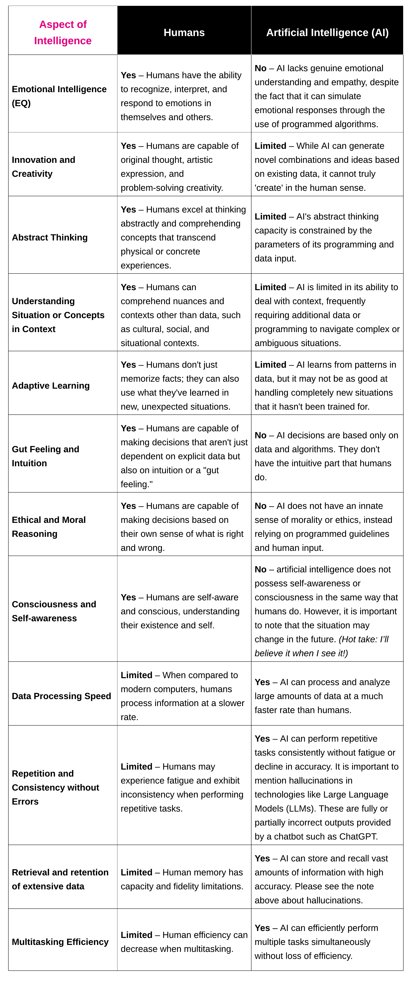
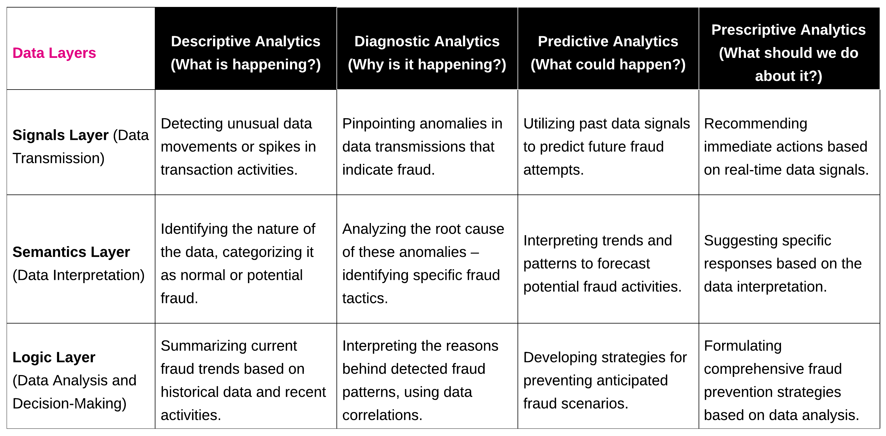

SHIFT: The Future of Fraud Resilience
A New Era in Fraud Management for Government Agencies

The Strategic Hub for Intelligence and Fraud Tracking, or SHIFT, as I’ll refer to it, is a framework or process rather than a product for detecting and managing fraud. This framework offers a thorough method for detecting, analyzing, and reacting to fraud by combining advanced data analysis, real-time monitoring, and intelligence processing.

We can also refer to this as a hub or main dashboard for fraud. Whatever we call it, these terms (SHIFT, Hub, Dashboard) are meant to convey the idea of the work surface for a given persona within state government. Fraud Investigations Director, Fraud Analyst, Fraud Investigator, or any other role can leverage data analytics in their day-to-day.

SHIFT’s focus on resolution, escalation, and adaptive control tactics, or **REACT** if you love acronyms as much as I do, enables it to quickly resolve fraud situations. This important part of the system sets up clear rules for quick action, allowing quick escalation and measures that are specifically tailored to each fraud case, ensuring that the problem is solved effectively and on time.

> REACT — **Think:** quick reactions, rapid response.

Tactical response and continuous enhancement, or **TRACE**, is a critical component of the SHIFT framework, stressing long-term improvements in fraud control. It regularly refines and improves the system by making use of data-driven insights, allowing for more proactive actions. This component is critical to the progressive development of fraud detection and prevention methods, maintaining their effectiveness and relevance in an ever-changing fraud scenario.

> TRACE — Think: Tracing fraud all the way through the system.

Resolution and optimization (**ROO**) activities are critical components of the SHIFT framework, including factors such as escalation, legal coordination, remediation, and prevention. This framework component aims to reduce risk over an extended period of time and enhance detection capabilities. It methodically incorporates strategies for elevating key concerns, giving legal advice, conducting effective remedial actions, and improving processes to maximize efficiency and impact.

> ROO — Think: Kanga-roo…. just kidding.
> Think: Long-term, always improving the system.

A comprehensive workflow designed especially for state agency fraud prevention and detection is at the heart of SHIFT. This process includes both the initial handling of incidents and continuous strategy improvement for any fraud prevention program within the state. This framework has several key components (or modules) that help state agencies align processes, with data, with tools. Key components covered in this article are:

- Rapid reaction to fraud incidents,
- Continual system enhancements to stay up with fraud trends, and
- Comprehensive post-detection case management that includes resolution, legal coordination, and optimization.

SHIFT strengthens the public’s trust by uniting different state departments in a joint effort to combat financial fraud.

## Rapid Reaction: Resolution, Escalation, and Adaptive Control Tactics

The SHIFT framework’s immediate response component focuses on responding quickly and effectively to fraud incidents as they occur. This aspect ensures that state agencies are prepared to respond decisively in order to mitigate potential damage and adapt quickly to changing fraud scenarios.

- Rapid and decisive response to fraud incidents, reducing potential harm.
- Managed fraud incidents more efficiently.
- Enhanced adaptability in response to evolving fraud tactics.

**Key features enabling rapid response:**

- **Quick Assessment and Action:** Streamlines the response to fraud incidents, allowing for rapid assessment and implementation of response protocols.
- **Escalation Guidelines:** Provides structured procedures for escalating serious fraud cases, facilitating critical decision-making.
- **Flexible Strategies:** Uses adaptable tactics based on the nature and severity of each incident to ensure efficient and effective responses.
- **Continuous Monitoring and Alerting:** Improves situational awareness by real-time monitoring of potential fraud activities and immediate alerting for timely intervention.
- **Collaboration with Law Enforcement:** Enables collaboration with legal and enforcement bodies in cases that require judicial intervention, providing comprehensive assistance in complex fraud resolutions.

> Example: providing prosecutors with “packets” or complete sets of information in an organized format.

Along with immediate response, the SHIFT framework factors in long-term strategic improvement. This focuses on continuous improvement and applies insights from each incident to improve total fraud detection and prevention skills. Approaching it from this perspective helps ensure that state agencies are not only ready to deal with threats but also prepared for possible problems before they happen.

## Continual Tactical Response and Continuous Enhancement

The SHIFT framework’s long-term improvement component is all about how fraud detection and prevention strategies change and improve over time. This aspect is very important for the state to learn from past mistakes and improve its ability to find and stop fraud threats in the future.

- It helps the SHIFT system grow and change to keep up with the ever-changing world of fraud.
- It improves state agencies’ predictive abilities for identifying and addressing fraud risks.
- It improves the long-term approach to managing fraud by moving the focus from quick fixes to long-term strength and readiness.

**Key features enabling long-term strategy:**

- **Systematic Post-Incident Analysis:** This involves performing thorough examinations of completed fraud cases to gain insights and inform future fraud detection and prevention strategies.
- **Data-Driven Improvement Strategies:** Uses analytics to identify patterns in previous fraud incidents, then applies these insights to anticipate potential vulnerabilities and prevent future fraud attempts.
- **Continuous System Enhancements:** Regularly updates and optimizes detection algorithms and operational protocols while allowing for the integration of new technologies to stay ahead of sophisticated fraud tactics.
- **Long-Term Strategic Planning:** Focused on the strategic vision of fraud management within state agencies, ensuring that measures are proactive and forward-looking.
- **Collaboration and Knowledge Sharing:** Encourages the sharing of insights and strategies with other departments and agencies, fostering a collaborative approach to continuously improve fraud detection and prevention.

## Post-Detection Resolution Operations and Optimization

The SHIFT framework’s post-detection fraud case management component focuses on holistic case resolution while also optimizing overall fraud management processes. This aspect of the framework ensures that each resolved case provides valuable insights for improving the system’s future resilience and efficiency.

- Ensures an all-encompassing approach to each fraud case, focusing on effective resolution, incorporating lessons learned, and striving for ongoing process enhancements.
- Boosts the efficacy of fraud management operations within state agencies by streamlining processes and optimizing resource allocation.
- Utilizes insights gained from past fraud incidents to strengthen defenses, creating a more secure and adaptive environment against future fraud threats.

**Key features for enabling resolution and remediation:**

- **Escalation Procedures:** Describe clear protocols for escalating significant fraud cases so that they receive adequate attention and resources, allowing for quick and effective decision-making in complex scenarios.
- **Legal Coordination:** Enables the seamless transfer of cases to legal authorities, including all necessary documentation and evidence, ensuring effective collaboration between investigative and legal teams.
- **Remediation Strategies:** Creates measures to mitigate the impact of fraud on victims, such as account restoration and security advisories, with the goal of reducing the occurrence of similar incidents.
- **System Optimization:** Uses insights from resolved cases to refine fraud detection methods and update operational protocols, with a focus on continuous improvement in fraud detection and prevention.
- **​​Proactive Risk Reduction:** Implements strategies to reduce the overall risk of fraud, such as system security enhancements and proactively addressing vulnerabilities to deter future fraud activities.

In essence, this SHIFT framework component is critical for not only resolving current fraud cases but also leveraging them to strengthen defenses against future fraud threats.

Now let’s shift (see what I did there?) our focus to the broader landscape of fraud detection across state government.

## From Detection to Prevention: Evolving Fraud Risk Management Strategies

Fraud risk in state government is changing quickly, which means that traditional reactive approaches need to be replaced with proactive, preventative ones. Let’s look at how state agencies are changing their methods to fight fraud better and how states can start to use risk-based analytics on a large scale. SHIFT allows not only the detection of possible fraud but also the ranking of these activities by risk severity, probability, and likelihood. Plus, it’s easier for all teams to work on things like cybersecurity, compliance, application visibility, and IT operations. Stay tuned for more on this in a future article.

More and more, state governments are using data-driven insights and predictive analytics to help them manage the risk of fraud, but they do so separately from each other. For strong safety measures that shield public funds and keep the state’s financial systems running smoothly, these tools and abilities are necessary.

By taking a more proactive approach, agencies are now trying to strengthen their defenses against complex fraud schemes and use risk-based analytics to set up stronger safeguards. These cutting-edge strategies are examined in great detail here to show how they are changing the fight against fraud in state government.

## The Evolution of Fraud Risk Management

After years of reactive methods, fraud risk management has changed a lot, moving toward proactive, technology-driven methods. In the beginning, fraud management primarily involved reacting to improper payments or suspected fraud incidents as they happened. Nevertheless, the growing intricacy and refinement of fraudulent schemes, coupled with the digitization of government, have revealed the shortcomings of these conventional methods for detection and prevention.

Sophisticated methods are now crucial to effectively combat contemporary fraud. The incorporation of technology like data analytics, artificial intelligence, and machine learning into fraud detection and prevention strategies marks this shift. These technologies have greatly improved the capacity of state agencies to detect possible fraudulent activities in advance, enabling them to take proactive measures.

During the “run” phase of crawl-walk-run, agencies rely on predictive analytics to forecast potential fraud scenarios using historical data and emerging trends. Continuous monitoring and modification of fraud prevention strategies strengthens this proactive approach by ensuring that defenses remain strong against constantly evolving fraud techniques.

The evolution of fraud risk management necessitates a shift in mindset, going beyond the mere adoption of new tools. State government agencies are becoming more aware of the importance of staying ahead of fraudsters. This has resulted in a more proactive and adaptable approach to safeguarding public funds and ensuring the integrity of the state’s financial systems through the use of data.

## Introduction to Risk-Based Analytics

Risk-based analytics has become an important part of modern fraud risk management. This is a big change from the old ways of finding fraud.

Using this method involves looking at different risk indicators to find and rank possible fraud activities, focusing on the most dangerous ones.

In the past, most methods for finding fraud were rule-based, using a set of predefined criteria to spot suspicious behavior. Some of these methods worked, but they often gave a lot of false positives and weren’t able to keep up with how fraudsters’ strategies, skills, and speed were changing.

Risk-based analytics, on the other hand, is more flexible and based on data. It uses past data, patterns of transactions, and behavioral analysis to figure out how likely fraud is and how bad it could be.

Risk-based evaluations have been around for a while, and a lot of tools and processes have helped states find fraud. But the problem is that these solutions don’t work well together, and they don’t scale. They also don’t give other teams (like business **user**s, cybersecurity, IT operations, compliance, and application observability) a single Operational User Interface (Op-Ui) where they can access all of their data. A data analytics platform that can do two very powerful things is used in the method I’m going to describe here.

1. **Collect data** in large volumes (think: garden hose vs. firehose vs. dam on a reservoir).
2. **Normalize data** into one Common Information Model (e.g., userid = user AND user_id = user. Both userid and user_id are mapped to a common field, user).

> This little example is incredibly powerful when you scale things out to terabytes or petabytes of data.

If we can do those two things well, the possibilities for the state agency open up. The data is telling the story, whether you’re collecting and analyzing it or not.

One of the best things about risk-based analytics is that it can sort risks by how bad they are, how likely they are to happen, or even how they might affect things. This sorting of tasks into priorities makes sure that resources are used more wisely, putting more investigation into high-risk areas and lessening the attention that is needed on low-risk activities. This method not only makes things run more smoothly, but it also makes fraud management programs more effective by letting people respond faster to the most dangerous fraud attempts.

Risk-based analytics is also very useful because it can be changed to fit different situations. Risk-based analytics can constantly learn from new data, so it can change its risk assessments to keep up with the latest fraud trends and methods. This ability to adapt is very important in a world where thieves are always coming up with new ways to get around security. Check out this earlier blog post for the complete breakdown of applied risk-based analytics for fraud prevention!

## Data-Driven Insights, Predictive Analytics, and Future-Proofing

The use of data and predictive analytics has transformed the way state agencies identify and avoid possible fraud in fraud risk management. Effective analysis of the massive amounts of data produced by public-to-government transactions can unearth trends, patterns, and anomalies that point to cybercrime or other forms of fraud.

## The Power of Applied Analytics in Fraud Detection

Applied data analytics enables agencies to sift through massive datasets, including transaction records, user behavior logs, and communication patterns, to identify irregularities that may signify fraud. This approach goes beyond surface-level analysis, delving into the depths of data to uncover subtle correlations and sequences that might escape traditional detection methods.

## Predictive Analytics for Foreseeing Fraud

This goes one step further with predictive analytics, which uses past data to guess what kinds of fraud might happen. By looking at past crimes and current data patterns, predictive models can figure out how likely it is that fraud will happen again, so agencies can take steps to stop it before it happens. This proactive approach is very important for lowering risks before they turn into fraud, which lowers the damage to the company’s finances and reputation.

## Using AI in Fraud Analytics

Before we get into how I think states will be using AI in the future, let’s discuss what AI is and what it is not.

Artificial intelligence (AI) is the field of technology that lets machines think and act like people. Even though they aren’t fully human-intelligent, they can do things that humans can’t. AI is the combination of art, science, and math that makes machines (mostly computers) able to do things that humans normally have to understand and decide how to do.

Another point that I’ll save for a future article, perhaps. Which is, **what about human willingness, availability, and ability?** Computers can scale up to the extent that they have compute, memory, power (energy), storage, and connectivity. The concepts of centralization and decentralization are important considerations that I’d like to weave into here. Please [ping me](https://www.linkedin.com/in/cperkins2/) or leave a comment if you have thoughts on this!

## Layered Insights: The Intersection of Data and Analytics in Fraud Detection

What is data? ([Such a beautiful question!](https://odam.community/part-1/#data-is-beautiful))

This is a question that I’ve been researching for years now. A topic I love to write about and talk about with anyone who will read and listen. Let me give you my take on what data is in a nonconventional way.

To me, data is:

- My geolocation, or place on this earth, at any given moment.
- The wind speed.
- The temperature.
- My heart rate.
- The log message generated when I “fat finger” my password when logging in.
- The decibel level my watch warns me about.
- The S&P 500.
- The miles per gallon I get in my 12-year-old Tacoma.
- The DNA I am ultimately made of.

I have yet to find a data source that does not map to these three layers. Signals, semantics, and logic map to any data source you can think of. Tell me a data source that does not map, and I will buy you dinner! Check out this article for all the details on these layers of data: Mapping the Cyber Terrain: The Intersection of Cybersecurity and Cartography.

These three layers are insightful when we look at their integration with the four essential levels of data analytics: **descriptive, diagnostic, predictive, and prescriptive.**

My hope is to clearly explain the role of each data layer and analytical level in building a powerful fraud detection strategy. This knowledge is vital for state agencies to effectively use data analytics. By understanding these layers and levels, agencies can improve their skills in identifying, understanding, and reacting to fraud more accurately and proactively.

The matrix below provides state agencies with critical answers to the following questions along each layer of data:

1. What is happening?
2. Why is it happening?
3. What could happen?
4. What should we do about it?

Looking at fraudulent attack scenarios in this context is the best way to highlight the importance of each intersection in the chart above.

## In Context of Account Takeover (ATO) Attacks

### The Signal Layer (data transmission).

1. **Descriptive:** Monitoring login attempts, access locations, and times.
2. **Diagnostic:** Identifying irregular login patterns and IP address inconsistencies.
3. **Predictive:** Forecasting potential ATO incidents based on unusual login activity trends.
4. **Prescriptive:** Implementing real-time alerts for suspicious login attempts.

### The Semantics Layer (data interpretation).

1. Descriptive: Categorizing types of user activities post-login.
2. Diagnostic: Analyzing deviations from normal user behavior, like unexpected money transfers.
3. Predictive: Projecting future ATO risks based on behavior pattern changes.
4. Prescriptive: Advising on proactive measures like user verification steps for high-risk actions.

### The Logic Layer (data analysis and decision-making).

1. Descriptive: Summarizing historical data on ATO incidents and understanding common characteristics.
2. Diagnostic: Interpreting the context of ATO events, and understanding how and why they occur.
3. Predictive: Developing models to predict ATO risks based on comprehensive data analysis.
4. Prescriptive: Formulating strategic plans and policies to enhance overall system security against ATO fraud.

Viewing the specific attack type, it is clear that each level of data is key. Meaning, the ability to collect, normalize, search, visualize, and report on data within the system is key to fighting fraud.

- The **Signals Level** focuses on the raw data transmission, capturing the initial signs of possible ATO fraud.
- The **Semantics Level** goes deeper into interpreting and understanding this data, adding context to differentiate normal user behavior from potential fraud.
- The **Logic Level** takes a holistic approach, analyzing and making informed decisions based on the insights gained from the data.

### Required Data:

- Login and access patterns (time, location, device used).
- Transaction patterns and histories.
- Analytics of user behavior (changes in account profile (e.g., banking information), frequent password resets, and so on).
- Responses to security challenges (failed attempts, unusual answers).
- Data on IP addresses and device fingerprinting.
- Claims or account information, particularly historical data and a list of known victims.

Check out this earlier article for more thoughts on [Discovering the True Worth of Data](https://medium.com/@chrisperkins505/discovering-the-true-worth-of-data-unlocking-value-with-odam-fbb007b7b8d8).

## Implementing SHIFT

> **Shift: “A movement to do something, a beginning.”**

Rediscovery will inevitably bring us to a baseline. From there, we can start working in any direction to achieve the state’s goals. The IT Service Blueprint is essentially point A.

Data search engines, such as [Splunk](https://splunkbase.splunk.com/app/6250), have been around for a long time. Other tools that have been around for a long time allow their customers to search data in a fragmented and disconnected way. The difference now is that there is an urgent need and desire for an extensible and agile solution that can scale to 10 or 100 times the normal volume.

In future articles, I will discuss use case discovery, creation, and operationalization. For the time being, I’ll leave the next page blank and report back in the near future.

Thank you for reading, and if you’re on the state side, a big heartfelt thank you. Keep up the good fight!

Thank you to my editors and reviewers!! Special thanks to [Audra Streetman](https://medium.com/u/fa0e5738f06a) and Tina C. for always providing excellent edit recommendations and feedback!

## Other articles I wrote on fraud prevention:

### **Aug 18, 2020**

> https://www.linkedin.com/pulse/pandemic-unemployment-assistance-fraud-chris-perkins/

### **Jan 4, 2021**

**Part I: Pandemic Unemployment Assistance Fraud: Zero Trust**

> https://www.linkedin.com/pulse/pandemic-unemployment-assistance-fraud-zero-trust-part-chris-perkins/

**Part 2: Pandemic Unemployment Assistance Fraud: Zero Trust**

> https://www.linkedin.com/pulse/pandemic-unemployment-assistance-fraud-zero-trust-part-chris-perkins-1c/

### **Nov 7, 2023**

> https://chrisperkins505.medium.com/fighting-fraud-in-the-public-sector-with-splunk-data-analytics-platform-03cab0fabb29

### **Dec 4, 2023**

Part I: The Digital Battleground: Uniting Cybersecurity and Fraud Prevention in State Agencies

> https://chrisperkins505.medium.com/the-digital-battleground-uniting-cybersecurity-and-fraud-prevention-in-state-agencies-8ea46ba8eb5f

Part II: Why The Identity Layer Is a Critical Battleground For Anti-Fraud

> https://chrisperkins505.medium.com/why-the-identity-layer-is-a-critical-battleground-for-anti-fraud-1818480644ac

Part III: The Future State: Fortifying Security Through Cyber-Fraud Convergence

> https://chrisperkins505.medium.com/the-future-state-fortifying-security-through-cyber-fraud-convergence-b241a6b304e8

Please note: the views and opinions expressed in this post are those of the author (Chris Perkins) and do not necessarily reflect the official policy or position of my employer, or any other agency, organization, or company. Assumptions made in this post are not reflective of the position of any entity other than the author — and, since we are critically-thinking human beings, these views are always subject to change, revision, and rethinking at any time.
