Strategy to Signal: Charting the Data Terrain for State Government Innovation
Exploring the journey from overarching strategies to actionable data insights.

As we explore the National Association of State CIOs (NASCIO**)** report on data literacy within state government (Data Literacy Within State Government: Building a Knowledgeable Workforce That Knows How to Use Data for Better Decisions), we find that it places a strong emphasis on the importance of mastering core data competencies and successfully navigating through the various levels for data analytics. NASCIO’s guide describes how data literacy can help state government come up with new ideas and make better decisions.

## Introduction and TL;DR

> “Essentially every state employee is a decision maker that touches state data and as data stewards they should consider data to be one of their most enabling assets. Every employee should have a very high regard for and dependency on this most valuable resource.” — NASCIO Report

NASCIO’s March 2024 report is a stark reminder of how important it is for state and local governments to embrace data literacy. Consider this report as your map to navigate through the complex world of technology enhanced by the fundamental concepts of data (signal, semantics, and logic) and storytelling techniques.

According to survey results of 49 state CIOs (chief information officers) from 2023, which are included in the report, only 16% of CIOs say their teams have a formal plan in place for learning how to use data. The demands for change made by NASCIO are not only justified, but also essential.

For those eager to dive deeper, I highly recommend “Be Data Literate: The Data Literacy Skills Everyone Needs To Succeed” by Jordan Morrow and “Effective Data Storytelling: How to Drive Change with Data, Narrative, and Visuals” by Brent Dykes. These reads are invaluable companions on your data literacy journey.

But first, let’s define “data literacy.” If you search for “the best definition of data literacy,” you will get a lot of results. Here’s the definition I put together with inspiration from others.

> To read, work with, analyze and communicate with data through storytelling, context and applicability.

The NASCIO report outlines the particular circumstances and motivating factors behind the push for improved data literacy while shining light on the critical role that data plays in state government operations. Here’s a summary of the key reasons to hone our own analytical skills.

Data proves essential in a variety of scenarios, including but not limited to the following:

- Routine day-to-day functions.
- Strategy development and execution.
- Defining project scope.
- Anticipating outcomes of a project, program or management initiative.
- Responding to a crisis.
- Planning for and ensuring resiliency.

The insights provided by NASCIO emphasize how important it is to embrace data literacy for things like:

- Fraud detection and prevention.
- Better application of limited resources.
- Saving money or better investment of funding.
- Delivering transparency of government.
- Avoiding errors in decisions based on incorrect information.
- Earning and sustaining citizen trust in their government.

> “With all this foundational discussion regarding how data and analytics must become inherent with every state employee there must be a commensurate open door to welcome the insights state employees bring to issues, decisions and citizen outcomes being sought. This must necessarily bring in more collaborative arrangements between management and staff. This will require trust, business relationship management and an open culture that is non-threatening to challenges to direction and decision making. The new culture of data literacy will encourage such behaviors and not be threatened by them. “ — NASCIO Report

## From theory to practice: applying [ODAM](https://odam.community/part-1/7-digital-org/) in state data strategies

In the NASCIO report, there is a plan for how state governments should change: they should become more data-literate. [Operating Data Analytics Methodology (ODAM)](https://odam.community/) provides a strategic template that matches this vision. The graphic below shows how the way people think about data has changed over time, from the early days of Web 2.0, when people worked together and shared data, to the days of cutting edge technologies like AI, blockchain, and Web3 that will change the way we live in the future.

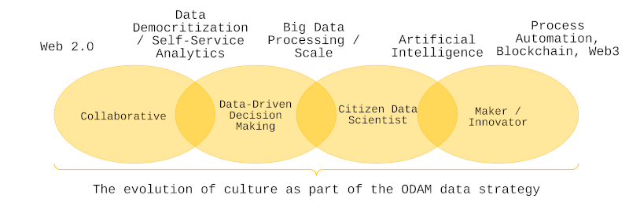

This visual representation reflects a path that state governments can walk along as they transform to meet the demands of the data age — a path highlighted by the NASCIO report as essential for the development of a knowledgeable workforce adept in data.

The ODAM approach is based on the idea that making decisions based on data is not a separate skill, but an important part of a data culture that is growing. The citizen data scientist and the maker/innovator are becoming more popular in this culture. These roles reflect the curiosity and creativity that states need to not only join the data revolution but also lead it.

[ODAM’s](https://odam.community/) roadmap dovetails with the NASCIO’s insights, suggesting that the future of state governance is one where every employee is empowered with the tools and understanding to wield data confidently. It’s a future where the silos between data producers and data consumers are dismantled, fostering an environment where data is a shared, dynamic asset fueling innovation and efficiency.

The ODAM framework can lead the way as we move forward, shining light on the route outlined in the NASCIO report. When used in tandem, these tools not only promise a new era of change, but also one in which the quantity of data available to us is only surpassed by our ability to use it wisely and intelligently.

> “Further, with the emerging use of generative artificial intelligence (GenAI), the criticality of data quality becomes more profound, and the potential risk related to feeding GenAI applications with poor quality data is equally alarming.” — NASCIO report

## Storytelling

Since the dawn of time, storytelling has woven the fabric of our existence.

> “Maybe stories are just data with a soul.” — Brene Brown, Research Professor and Author

Stories are an integral part of our existence. It’s an art form as ancient as humanity itself, dating back to the time when our ancestors used fire or hand signals to send messages, painted stories on cave walls, and employed other methods to communicate with one another.

Telling and receiving stories is a basic human behavior that has always captivated me. When I started working at Splunk, I found the world of data storytelling and dug in.

I have a deep personal connection to storytelling because it’s rooted in my home state of New Mexico. Here, stories are created with hands and hearts, not just told. I inherited this cultural legacy from my grandparents through treasured heirlooms: two storyteller pottery statues. According to [Wikipedia](https://en.wikipedia.org/wiki/Storyteller_(pottery)), Helen Cordero created the first of these modern figurines in 1964 by giving clay life and carrying on the family tradition that is passed down through the generations.

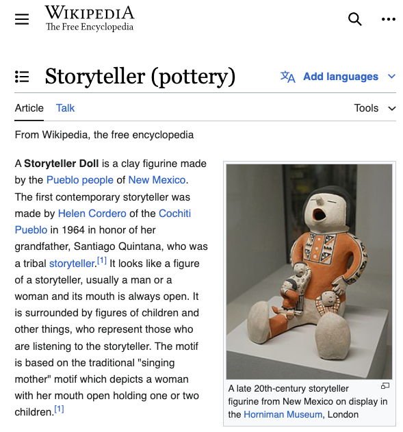

At its core, storytelling is about making connections: to our shared history, to one another, and to the opportunities that arise from each tale we tell. Storytelling assumes new forms in our data-driven world, converting dry statistics into gripping narratives that captivate, educate, and motivate action.

## Data storytelling

Data narratives are as complex and detailed as the most exquisite tapestries when we weave them through the loom of storytelling. Expert data storyteller Brent Dykes breaks it all down in his book “Effective Data Storytelling: How to Drive Change with Data, Narrative, and Visuals.” Dykes breaks down this art form into its fundamental components: an engaging story, striking images, and, of course, data, the unprocessed material from which we construct our stories.

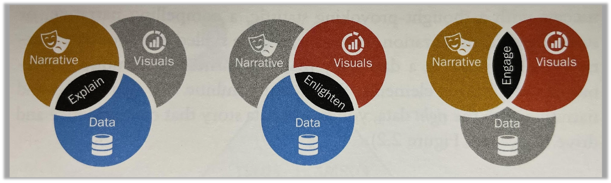

By going further, as Brent does in his book, we find the Aristotle Rhetorical Triangle. I’m paraphrasing Dykes when I say that your data story’s success will be influenced by both the reliability of your data and your own credibility (Ethos). Your data story will rely heavily on logic (Logos) appeal since it is supported by facts and figures. Your message becomes more captivating when you integrate the data into a compelling story that appeals to the emotions (Pathos). Putting a visualized insight at the center of your message sharpens its purpose and focus, adding appeal (Telos). Ultimately, your message has the potential to be a potent change agent when it is shared with the appropriate audience at the appropriate moment (Kairos) through a pertinent data story.

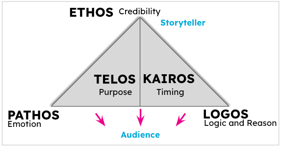

Storytelling: narratives in numbers and crafting stories from data

The need to distill massive amounts of data into useful insights has never been greater than in the modern day. Our goal is to make data more approachable and relevant to everyone by crafting narratives that shed light on its complexity. Starting with background information, we provide the groundwork for the significance of the facts we offer, turning raw statistics into compelling narratives that have an effect in the actual world.

**Context:** Setting the scene by providing background information that helps the audience understand why the data matters. Context turns data from mere numbers into a narrative with relevance to the audience’s experiences or challenges.

Subsequently, clarity emerges, reducing the complicated into insights that appeal to a wide range of people despite where they are on their journey of data literacy. However, having understanding without trusting the facts to be accurate and transparent is like being lost without a compass.

**Clarity:** Simplifying complex data into understandable insights. This involves using clear visuals, avoiding jargon, and breaking down complex concepts so that the story is accessible to all audience members, regardless of their data literacy levels.  
**Confidence:** Having confidence in the data and its accuracy, fidelity, and trustworthiness. Is the data transparent? Does it include stakeholders (i.e., who the data is being sourced from / collected on)?

At its core, our narrative is about building connections, where numbers come alive in people’s lives, transforming raw data and abstract signals into a powerful tool for understanding and empathy. By utilizing graphs, photos, and interactive components, we may create a captivating and engaging narrative through conveyance, which is a form of visual storytelling.

**Connection:** Humanizing the data by linking it to real-world implications, stories, and experiences. This element bridges the gap between abstract figures and the tangible impact on individuals and communities, making the data relatable and emotionally resonant.  
**Conveyance:** Employing effective visualization and narrative techniques to convey the message. Whether through graphs, charts, images, or interactive elements, conveyance is about choosing the right tools to communicate the story in a compelling and engaging manner.

Still, a Call to Action is an essential part of every tale. By encouraging readers to reevaluate their assumptions, expand their horizons, and actively participate in creating a better society, we hope that our stories will do more than merely educate.

**Call to Action:** Inspiring action or change by presenting data in a way that motivates the audience. This could involve highlighting opportunities for improvement, suggesting steps for action, or urging reconsideration of current practices based on the data’s insights.  
**Continuity**: Ensuring the data story is part of an ongoing conversation. This involves updating the narrative as new data becomes available, reflecting on past predictions or actions, and keeping the audience engaged over time. Continuity turns a single data story into a narrative thread that can guide decision-making and innovation continuously.

All of these things come together to make data storytelling our specialty, transporting the audience to a place where data is more than simply understood; it is lived, felt and used. Together, we will take this next step toward a society that is better educated, more actively involved in its governance, and more empowered by turning facts into stories, insights into actions, and data into decisions.

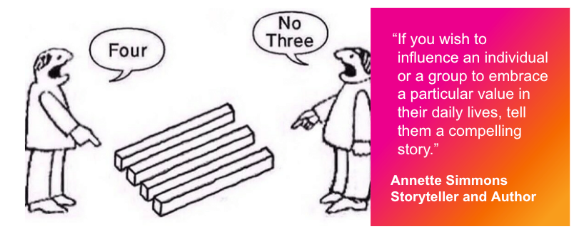

> “It is imperative that the state government workforce be data literate — that is to have a command of data management and an understanding that data is a critical state government asset.” — NASCIO Report

## Data literacy foundations: three data planes

Let’s first examine the three data planes: signal, semantics and logic, in order to gain a complete understanding of data. See the most recent article “Mapping the Cyber Terrain” for further information.

The first raw data form is called the signal layer. It is comparable to ore that is ready to be extracted for its precious metals.  
Semantics then enters the picture and gives this raw data context, converting numbers and observations into insightful and practical knowledge.  
The logic layer goes one step further, employing reasoning to identify trends, draw inferences, and make predictions about the future based on fresh data.  
Signals, Semantics, Logic.

NASCIO emphasizes the importance of state employees understanding the value of data, finding the right information, and correctly interpreting it, similar to the journey through these data planes. It is critical to be able to transition from signal to semantics and apply logic. Without these skills, data cannot be used to aid decision-making.

## Clarity in the chaos

The initial stage in mastering the intricate data world is to comprehend the basic levels of signal, semantics, and logic. The signals, which are the information nuggets in a data river and are unprocessed raw data points, can only be found by sorting through the noise. The story, though, is far from over. In order to provide these signals with context, a common language, and the ability to be transformed into useful information, we must engage in semantics. Through the application of logic, we are able to decipher patterns, identify outliers, and derive conclusions that direct our subsequent actions (i.e., AI).

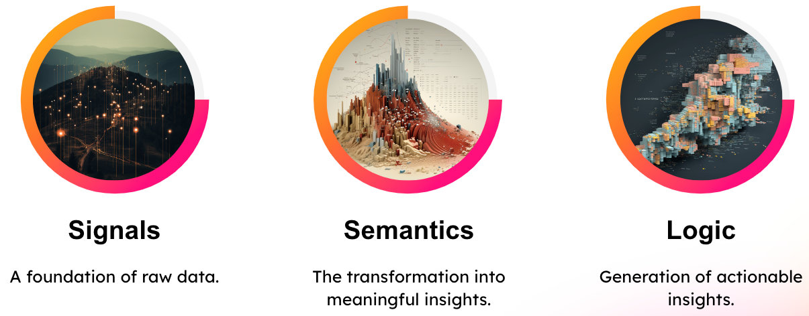

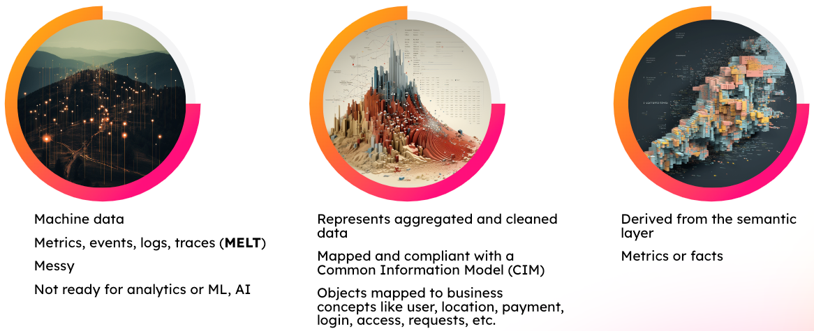

With the tools designed to glean insights from both the known and perceived data universe and the uncharted terrain of machine and unstructured data, we are delving further into the data analytics field. It is not enough to just have the right gear for this journey; you must also know how to use it properly.

Data literacy is a set of abilities that guides us and ensures that we apply analytics methods sensibly and effectively. If we comprehend and apply data analytics, we can face the future with confidence, find new opportunities and make decisions based on the best available information.

## The four levels of data analytics: the path to advanced data-informed decision making

Understanding the data planes is only one step in the process of becoming data literate. It also includes becoming proficient in the four levels of data analytics, which are essential for fostering innovation in state governments and enabling data-driven decision-making. Jordan Morrow’s book, “Be Data Literate,” provides a detailed description of each of the four levels.

Descriptive analytics offers a rearview mirror view of the data, revealing what has transpired. Diagnostic analytics provides insights into previous performances and outcomes, going one step further to explain why something happened.

As the name implies, predictive analytics forecasts future risk or outcomes using data, giving an idea of possible future events based on past data trends. The ultimate form of data analytics is called prescriptive analytics, which makes suggestions about how to proceed in order to minimize risks or attain desired results. Every stage builds on the one before it, forming an all-encompassing framework for fully comprehending and utilizing data.

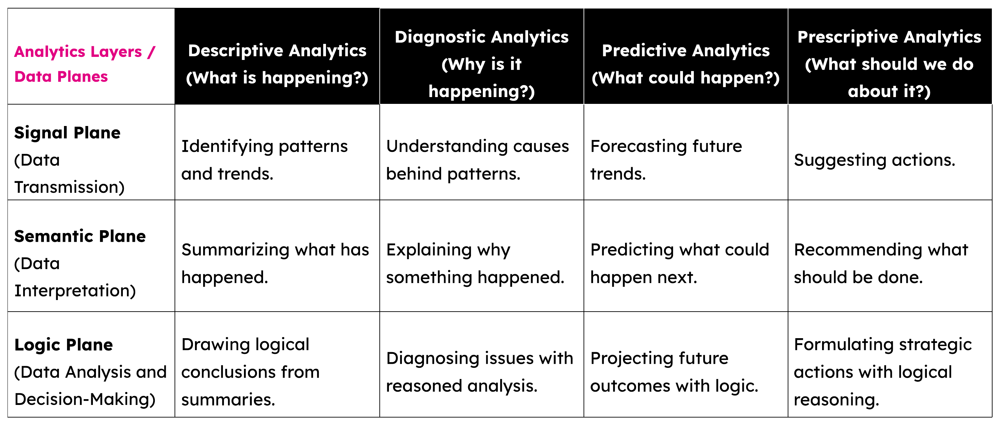

## Integrating NASCIO’s vision with the three layers of data and the four levels of data analytics

NASCIO’s recent work highlights the path toward a workforce that is fluent in the language of data, its context, and the analytics that give it life. It goes beyond just honing the craft of maintaining [beautiful data](https://odam.community/part-1/) and venturing into the unexplored realms of generative AI. These challenges are only a few of the many chapters in the larger story of data knowledge, which spans from the raw, signal origins of data to the strategic apex of prescriptive analytics.

The importance of having a workforce capable of handling the complexities of analytics, metadata, and data is emphasized in the NASCIO report.

Rather than focusing only on the surface value of data, we also need to understand its deeper implications across all layers and levels of analytics, which is reflected in the challenges associated with managing data quality and implementing generative AI.

In the future, every state employee will be deeply committed to maintaining the integrity of data quality and possess fluency in the language of data and analytics, according to NASCIO’s vision. This all-encompassing strategy guarantees that data that is both insightful and actionable, as well as accurate and dependable, informs decisions made throughout the public sector.

By advocating for state employees to acquire data management and analytics skills, NASCIO is essentially drawing attention to the necessity of transitioning from a basic comprehension of signal data to the application of prescriptive analytics. The objective of having a workforce in state government that is data literate, capable of fostering innovation in the public sector, and capable of making better decisions is contingent upon following this path.

## NASCIO competencies

Understanding the importance of data — Recognizing what data is and its significance.  
Knowing/learning where to find data needed for informing a particular decision.  
Knowing how to read and interpret data — Being able to understand and make sense of data.  
Understanding basic principles of data management — Grasping how data should be organized, stored, and maintained.  
Knowing how to prepare and analyze data — Being capable of manipulating data for analysis and drawing conclusions from it.  
How to communicate with others using data — Effectively sharing data insights and findings with others.

Let’s take a look at how NASCIO’s six competencies intersect with the three data planes and four levels of data analytics.

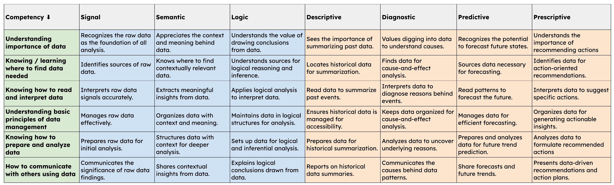

## Do you have any spare change?

“Our dilemma is that we hate change and love it at the same time; what we really want is for things to remain the same but get better.” — Sydney J. Harris, Journalist and Author

Effective data stories can drive change when you combine the right data, with the right narrative and visuals.

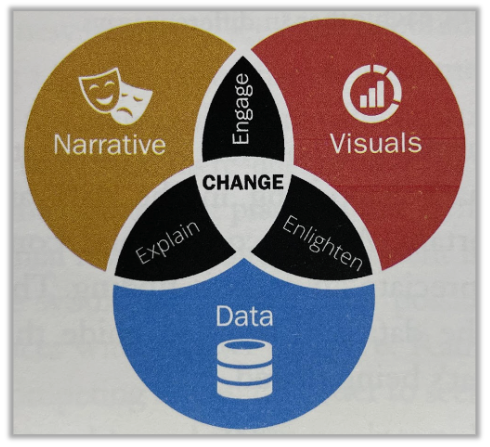

## Moving forward

> “The cost of this disconnection is measured in inefficiencies and the slow erosion of strategic advantage.”

Putting it all together means that we are creating change. When you present your insights as data stories, you’re more likely to influence decisions and drive actions that lead to value creation.

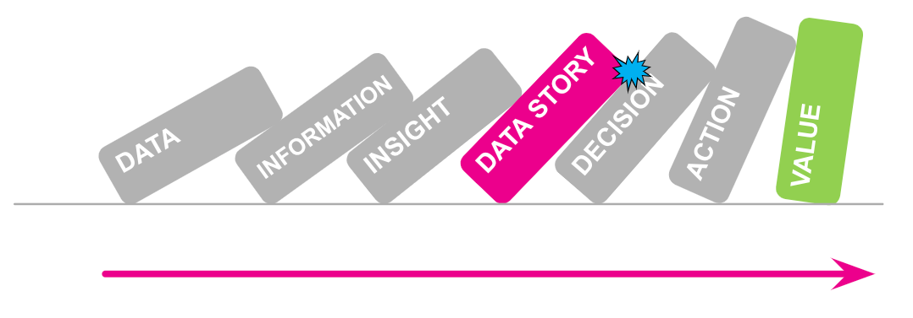

As states begin to follow NASCIO’s lead, it is essential that they see the link between the four analytics tiers and the three data planes. Attaining this level of skill does more than just raise data literacy rates; it also prepares state workers to face future problems and enjoy data age advantages.

A thorough comprehension of data literacy, including both foundational knowledge and analytical skills, is the foundation of NASCIO’s proposal, which also details measures to enhance state operations. Using data as a guide, it outlines a future where government services are more efficient and robust, and innovation drives decision-making.

Going beyond its framework, “Data Literacy Within State Government” becomes a manifesto for the present digital era by urging a paradigm shift in states’ data utilization. Joining a world where data literacy is key would help us better tackle future issues and seize future possibilities. This is a call from NASCIO.

### Building a Data-Driven Public Sector

Learning about data analytics and data literacy is much more than just peeling back the layers of information. The objective is to provide the groundwork for an efficient and innovative public sector that is led by data-driven choices. By committing to NASCIO’s mission, we are doing more than simply studying data; we are laying the groundwork to be leaders in a data-driven future.

> “Stories have been used to dispossess and malign, but stories can also be used to empower and to humanize. Stories can break the dignity of a people, but stories can also repair that broken dignity.” — Chimamanda Ngozi Adichie, The Danger of a Single Story, TED Talk

Special thanks to [Audra Streetman](https://medium.com/u/fa0e5738f06a) and Tina C. for their reviews, edits and feedback!

Please note: the views and opinions expressed in this post are those of the author (Chris Perkins) and do not necessarily reflect the official policy or position of my employer, or any other agency, organization, or company. Assumptions made in this post are not reflective of the position of any entity other than the author — and, since we are critically-thinking human beings, these views are always subject to change, revision, and rethinking at any time.

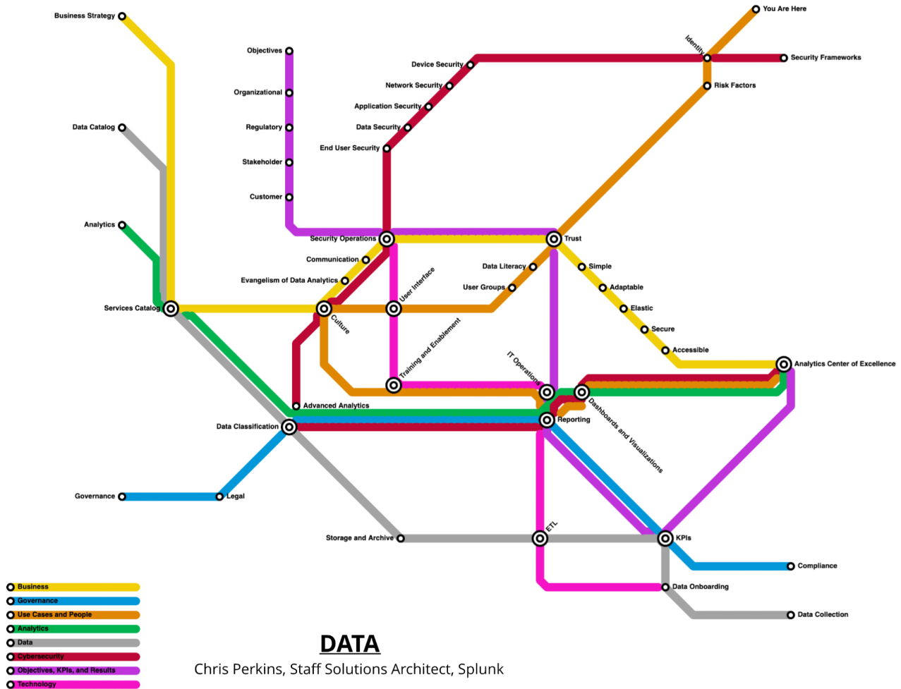
