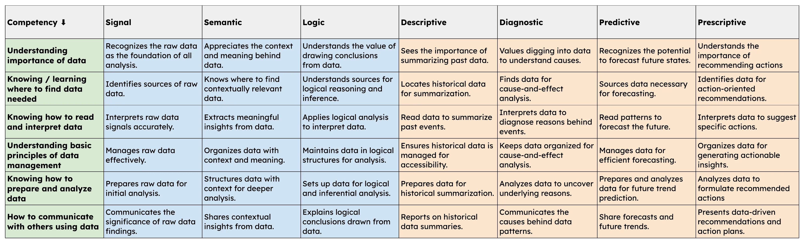
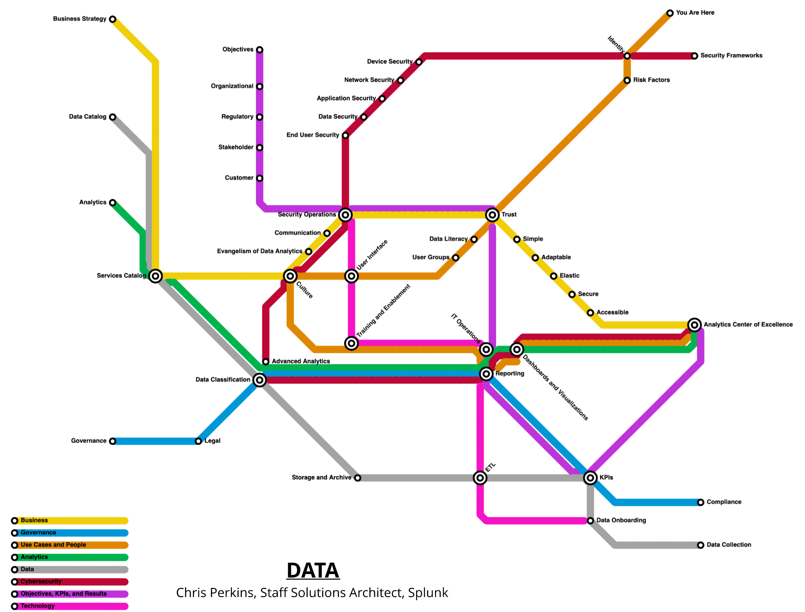

The Problem With… ChatGPT Performing Data Analysis
Have you tried using ChatGPT to do data analysis?

With the release of ChatGPT 4o last week, the impact is just beginning to be felt. I don’t think the news has fully sunk in yet, but it’s clear to me that Large Language Models (LLMs; a type of artificial intelligence) are giving us a glimpse around the corner.

ChatGPT 4o can now link directly to Google Drive or Box to pull in and analyze data within documents or spreadsheets. This is just the beginning. Soon, these language models will be able to access all sorts of data sets, both streaming and static, taking data-driven decision-making to the next level.

## Considerations for Both Efficiency and Security

Due to the growing demand for data analytics, workers are constantly looking for ways to streamline their workflow and processes. However, this convenience also comes with responsibilities, especially concerning data protection and comprehension.

### Awareness of Data Security

Ensuring data security is paramount. Users must be aware of the content they upload. While carefully selecting files to upload can mitigate risks, accidental uploads of sensitive documents can lead to data breaches or loss. It’s crucial to educate employees on acceptable data practices and proper usage of tools to safeguard organizational data.

Beyond the awareness, there needs to be enforcement of these policies. It may seem simple, but as these tools are used, the Copy and Paste feature within operating systems becomes a tool for data exfiltration or a mechanism for data loss.

Beyond enforcement, there needs to be data classification policies in place, documented data inventories and monitoring of the “crown jewel” data within the organization.

Without these parts and pieces in place, the organization will look risk directly in the eyes.

### Understanding and Interpreting Data

Equally important is understanding the significance of the data results generated by tools like ChatGPT or Splunk. Creating data visualizations sounds straightforward but users must grasp the context in addition to making it pretty. Users must be able to answer questions around the data like: what data was included or excluded, how does time factor in, or is the dataset is a sample or the entire set. There is a ton of context around data that needs to come through the visualization. As mentioned in the Signals to Strategy article, data storytelling is a critical component of data literacy.

> Accurate interpretation and decision-making depend on this critical contextual understanding. Additionally, users need to verify the accuracy of these results to ensure reliability, integrity and truth.

As our cultural approach to data evolves, becoming more data literate is inevitable. This progression is critical for effectively reading, working with, and communicating data insights.

[Analytics Center of Excellence (ACE)](https://odam.community/static/part-1/ace.webp)  
Strategic Plans for Analyzing Data

In my article, “Strategy to Signal: Mapping out the Data Landscape for State Government Innovation,” I explored the four levels of data analytics and the three data layers. These frameworks play a crucial role in communicating and managing the intricacies of data analytics while utilizing (meta)data for innovation.

[The intersection of…](https://miro.medium.com/v2/resize:fit:4800/format:webp/1*TNpqg2lfGdIq_LX1T5Ex9g.png)

Ultimately, I believe organizations need to form data literacy programs yesterday and move data security measures closer to the user (think: browser).

Please note: the views and opinions expressed in this post are those of the author (Chris Perkins) and do not necessarily reflect the official policy or position of my employer, or any other agency, organization, or company. Assumptions made in this post are not reflective of the position of any entity other than the author — and, since we are critically-thinking human beings, these views are always subject to change, revision, and rethinking at any time.
