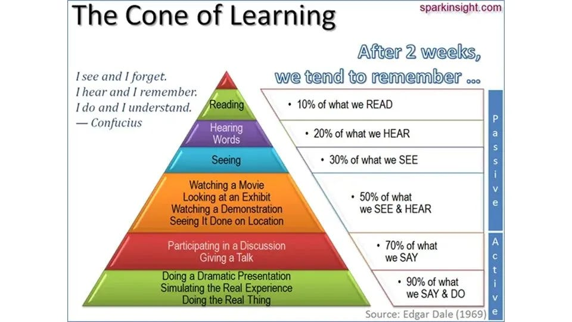
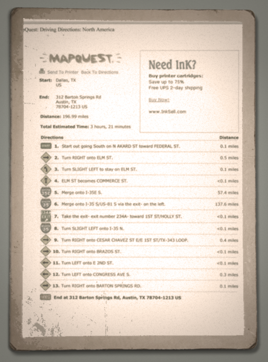
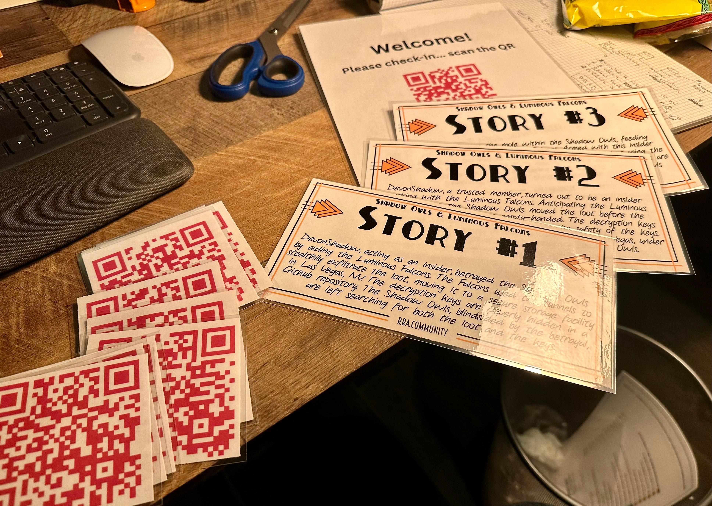
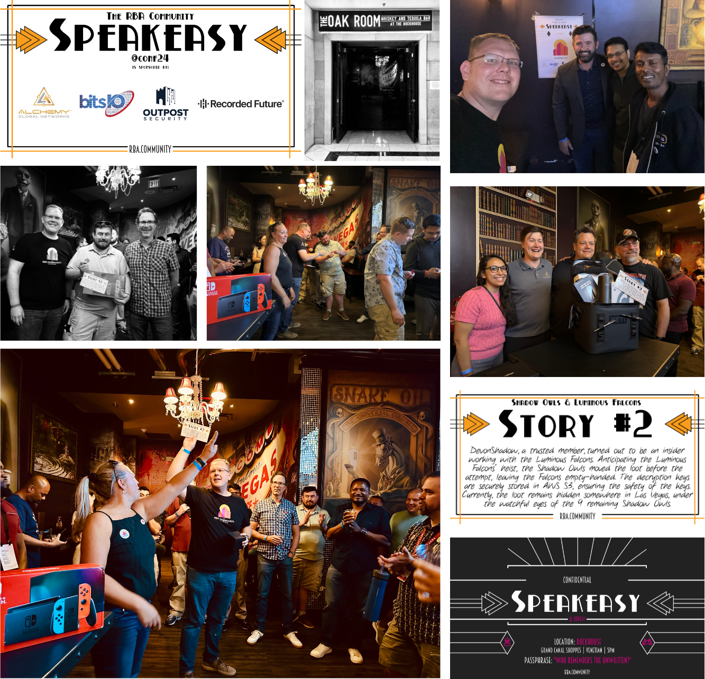
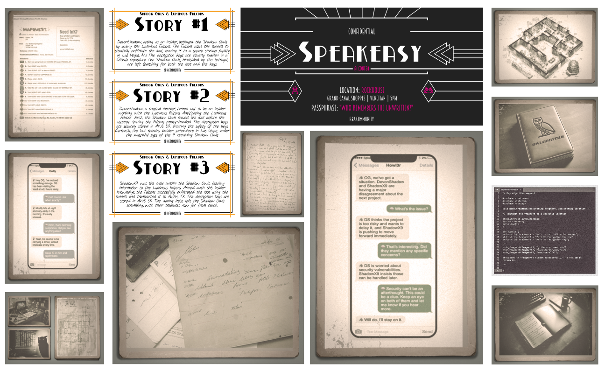

Corporate Storytelling — a Speakeasy Event in Las Vegas
It was the 100th anniversary of the great blackout and heist where new evidence was found which revealed the truth about the Shadow Owls and Luminous Falcons.

## **Introduction**

This is the story of the 2nd annual Speakeasy event hosted by [*The RBA Community*](https://rba.community).

The RBA Community was proud to host its 2nd Annual Speakeasy event, a unique gathering designed to bring our virtual user group together ahead of the main [.CONF](https://conf.splunk.com) experience.

> As of July 1, **2024**, our community boasts 889 members in the Slack space hosted by [Outpost Security](https://www.outpost-security.com/).

For the past 2.5 years, [the RBA Community](https://rba.community) has been meeting virtually every month to discuss the latest developments in RBA, learn from guest speakers, and engage in live Q&A sessions with a panel of experts. These virtual events, which are recorded and archived in our Library, have been instrumental in building our knowledge base and fostering online relationships. The Speakeasy event serves as a bridge between the digital and physical worlds, allowing members to strengthen these connections in person.

Set against the backdrop of a 1920s-style speakeasy, this event offers a unique blend of networking, knowledge-sharing and nostalgic fun. It’s an opportunity to bring the energy and insights from our online interactions into a real-world setting, creating deeper bonds and more meaningful collaborations among RBA enthusiasts.

Whether you’re a regular participant in our virtual meetups or new to the community, this Speakeasy event promised an evening of intrigue, valuable connections and engaging discussions.

Join us as we continue to grow and evolve by attending the next episode of [“The Office” Hours](https://rba.community/#the-office-hours).

**Mission Statement**  
The RBA Community is dedicated to advancing cybersecurity through risk-based alerting. Our mission is to empower cybersecurity professionals and enthusiasts at all levels by providing tools, education, and a collaborative platform. Together, we enhance the security and resilience of organizations worldwide, creating a safer digital landscape for all.

**Vision**  
At the heart of this community lies a powerful belief: intelligence should guide every alert, wisdom should drive every response, and resilience should be the cornerstone of every organization.

Together, we unite under these principles to transform cybersecurity — one insight, one action, and one member at a time. Step by step, we create a future where the digital world is secure, innovative, and trusted.

### The Speakeasy

I’ve always been drawn to the idea of hosting a speakeasy-themed event. There’s something intriguing about the history of speakeasies that makes you want to dig deeper.

Our first crack at this was in 2023 at Trustworthy Brewery (which isn’t around anymore). We had a good turnout with 186 people showing up. Outpost Security, our friends and partners, covered the whole thing. We kept it simple that year — just two speakeasy touches: we announced the location 24 hours before kickoff and used a secret passphrase to get in.

> “Do you have any spare tickets to the circus?”

— 2023 passphrase

“Who remembers the unwritten?”

— 2024 passphrase

For 2024, I wanted to shake things up. I decided to announce the location even later — just 4 hours before the event. It was a bit of a gamble, and I got a bunch of messages from people asking where it was and what the passphrase was. Everyone was worried about missing out.

About a week before the event, I started thinking about adding a game for people to play. I can’t pinpoint the exact moment, but I remember having a rough idea about 6 days out. I spent some time each day fleshing it out and going back and forth with my intelligent and lovely partner, Nayomi, who had a lot of great ideas. She grounds me by giving me her very non-technical advice! Then I thought: I need to ask Zach for help. If you know Zach, you know he was all in as soon as I mentioned it.

*Quick side note on Zach here…*

*Zach has been instrumental to* The RBA Community since we joined forces with Stuart and Will over at Outpost Security. There are many core members and advocates that we have recognized on our [*RBA Community Champions*](https://rba.community/community/rba-champions/) *page. Zach and I, along with a few others joined forces to launch version 2 of* The RBA Community. Will and Stuart had a strong foundation built which we were fortunate enough to be part of the the second layer. All this to say that Zach continues to be awesome, great to work with, and can knock out micro-sites in no time at all! Thank you for all you do, Zach!

### Game Pre-Logistics

With Zach on board, we had a tight three-day window to pull this off. We were in uncharted territory, simultaneously creating the game and crafting the overall experience.

Our guiding principle was ‘Keep It Simple’. We remembered the long lines from last year and wanted to avoid that. We also knew people are generally excited for the chance to win raffle prizes. So, I aimed to weave the game into both the check-in process and the raffle.

Knowing we had some pretty sweet raffle prizes lined up, I figured people would be willing to put in a bit more effort for a better shot at winning. I laid out a few key objectives:

1. Make the check-in process easy and voluntary, using attendees’ own devices.
2. Guarantee at least one raffle ticket for every guest.
3. Use attendees’ phones as the gateway to the game’s digital interface.

What we needed was an all-in-one solution.

After our first chat, Zach and I both saw the potential. It was a bit like building a plane while taking off — a stretch, sure, but that’s pretty much what we were doing!

Up next, we’ll dig into the nitty-gritty of the game logistics, narrative, and how it all played out.

## Setting the Scene

Inspiration for creating content, material, or ideas come from all directions and from all sources. Looking back, I realize a major influence was the Amazon show “The Outer Range.” Without spoiling anything, it sparked the idea to link events from June 10th, **1924** to our event on June 10th, 2024.

This 100-year anniversary angle added depth to our story and opened up possibilities for elements that I hoped would make players smile.

Of course, risk-based alerting (RBA) played a big role too. I’d previously created a presentation about a diamond heist to teach RBA concepts by piecing together signals to form a narrative. This approach shaped how I structured our game.

The third big influence was my interest in immersive learning experiences. There’s research out there supporting this approach. For instance, check out this image on learning retention:

At the end of the day, I wanted to create something fun for people to do while socializing. It turned out to be a great ice breaker and seeing everyone there, united by the game, talking and making new connections was a great feeling.

## The Game: Analyzing New Evidence

This is where AI entered the picture.

I turned to a chatbot to help expand on my initial concepts: the 100-year anniversary, owls as the Advanced Persistent Threat (APT), and the idea of using modern AI to solve unsolved mysteries.

My goal was twofold:

1. Incorporate AI as a character within the story itself.
2. Use AI as a tool for brainstorming and developing the narrative.

This approach allowed me to blend historical elements with cutting-edge technology, creating a unique backdrop for our game. The AI suggestions helped me connect dots I might not have seen otherwise, adding layers to the story that players could uncover.

By framing AI as both a storytelling co-worker and a character, we added a meta element to the game. I think this created an interesting parallel between the game world and reality.

### The plot

After nailing down the basics — threat group names, character names, and key story elements — I dove into the nitty-gritty of world-building. My first step was to lay out the fundamental information:

- Identify the threat groups.
- Categorize clues as high or low-confidence signals (I ended up with 10 clues total).
- Determine the insider.
- Establish what actually happened.

With this foundation in place, I started connecting the dots. But here’s the kicker — not all dots were meant to connect directly. I threw in some curveballs, including obscure clues that weren’t easy to decipher.

One example: I wanted to include an old Mapquest printout as a clue found in the journal. I grabbed the first suitable Mapquest image I could find online — a single-page scan of an original document with an address.

Here’s where it gets interesting: The address on Barton Springs Rd. in Austin, TX actually leads to a surfboard shop near the river. This was intentionally designed as a low-signal clue that ultimately led nowhere.

But you know what? I finally got to tick off a bucket list item: using a Mapquest image in a Speakeasy game in Las Vegas for the RBA Community. Dreams do come true, folks!

### How the game is played: an attendee’s perspective

I’m going to approach explaining how this game was played from the perspective of how I see an attendee playing then go into how I developed the game.

- As the attendee arrive, they are greeted by the venue host to verify age and provide a bracelet.
- Attendees were asked to scan a QR code hanging from the table as they entered.

The micro-site Zach created was where the QR code resolved to. There was a welcome message, a sponsor acknowledgement, and a form to “sign the guest book.”

Once they signed the guest book (name, email, organization), they were presented with the storyline and game rules. I forgot to mention that the people who RSVP’d through Eventbrite received an email from me giving people a heads up about playing a game tonight.

Christopher McConkey is the best. First of all! Second, he nailed the game orientation pitch and told nearly everyone who came through. His pitch was essentially this:

*Welcome to The Vault!*

*Today is the 100th anniversary of the historic Las Vegas blackout in 1924.* We came upon the Shadow Owls’ journal as we were getting ready for the centennial celebration. An artificial intelligence (AI) recently examined the information and discovered heightened risk and clues associated with what happened that fateful night.

Your task is to take on the role of detective and solve the mystery.

There are QR codes hidden throughout the speakeasy that can be used to access journal pages written by the Shadow Owls. Important hints and details about the circumstances leading up to the blackout are included on every page.

There are three possible accounts of what happened that evening. It is up to you to put the puzzle pieces together, piece together the clues, and figure out which version of the heist is accurate. You have the task of verifying the AI’s conclusions, as it has already determined the true story.

You will vote as you gather information by dropping your raffle ticket into the box that corresponds to the story you think is true. The true story is contained in a single box.

Discovering the mysteries of the Shadow Owls will take you on a journey through time filled with surprises and turns. Start your research right away and get immersed in the mystery that has baffled scholars for a century. I hope your curiosity takes you to the truth.

Now go have a beverage of your choice… Make yourself at home… and tell the Bartender, “Chris says hi.”

At this point, the players had signed the guest book, read the game rules, and given a quick explanation of game play as they received their 3 raffle tickets.

### Setting the clock

To add a sense of urgency and structure, we implemented a clear timeline. Attendees had until 7:45pm to find all clues, determine the true story, and place their raffle tickets in the correct box. We drew raffle tickets at 7:45pm as the event ended at 8pm.

### Searching for clues

I created 10 QR codes for this game. Each one was cut out and laminated.

The extra effort in preparing these codes — cutting them to size and laminating them — was all part of the plan. I wanted them to blend in seamlessly with the restaurant’s environment.

Here’s the kicker: I asked the bartender to post these QR codes around the venue, but I didn’t keep track of where they ended up. This added an element of authenticity to the search. The codes looked like they could’ve been a natural part of the restaurant’s decor — nothing out of the ordinary, just another detail you might or might not notice on a regular night out.

This approach was all about immersion. When players spotted a QR code, it shouldn’t have felt like they were playing a game. Instead, it should have felt like they’d stumbled upon a genuine clue in a real-life mystery. That’s the kind of experience I was aiming for — one where the line between game and reality blurs just a little.

### Not Everything is True

I added a twist to the game — a secondary challenge for the super fan of the game. The first person to correctly identify both the number of clues (10) and the right story (#2) would win the coveted 0024 RBA Community challenge coin.

Here’s where it gets interesting: I only gave the bartender 9 QR codes to place around the venue and the 10th clue? It was hiding in my pocket.

This setup meant that players would often approach me with the right story but the wrong clue count. If someone made a few guesses, I’d reveal the “secret” QR code from my pocket. Hey, I needed to have some fun too!

Breaking down the clues:

- 10 total clues.
- 2 were basically useless for solving the mystery or verifying the AI’s conclusion.
- 2 were designed to mislead, pointing towards the false story #3.
- Story #1 was deliberately easy to disprove.

This mix of true, false, and misleading clues added layers of complexity to the game and resembles real-life cybersecurity monitoring. It challenged players to think critically, weigh evidence, and not take everything at face value — skills that are crucial in the world of cybersecurity and risk-based alerting.

## The Story Arc

Classical storytelling eventually culminates in a dramatic climax or reveal. In our case, we employed a meta-storytelling approach, bridging two time periods and narratives. Here’s how it worked:

**Dual Narratives:**

- The 1924 Las Vegas blackout story.
- The 2024 investigation by attendees.

**Attendee Involvement:**

Although attendees weren’t part of the 1924 events or the AI’s analysis, they became investigators in the present-day narrative, hearing both the original story and the AI’s conclusions.

**The Reveal:**

The raffle at the event’s end served as the climax. It unveiled the true story (story #2) and the raffle/coin winners.

**Supporting **Characters:****

**Bartender:** Deployed QR codes, provided first beverage and clue.  
**Sponsors:** Welcomed attendees, acknowledged during prize drawings.  
**Zach:** “Phantom Orchestrator,” made real-time adjustments.  
**Myself:** Antagonist and wisdom-giver (LOL).

**Main Characters:**

**Individual players:** Heroes of their own investigations.  
**Raffle/coin winners:** Ultimate heroes of the overall narrative.

**What archetype was AI in this story?**

### Ten clues and three stories

I’m not great with Photoshop but I know enough to be dangerous. And when it comes to Google-fu, I’m practically a black belt. So, I hunted down this free PSD template that could make any image look like it was pulled straight out of your great-grandpa’s attic.

I had fun making pictures of iPhones looked old timey. I used a combination of a few tools. There’s an online tool that allows you to make fake iPhone text threads and I used Midjourney to help with the other images. Using the Photoshop template I found for free, I knocked out the supporting artwork.

I was under a massive time crunch because I need to 1) get these details to Zach so he had enough time to build the micro-site and fill in the content and 2) I had to travel to Las Vegas!

I also had to get some of the printed material over to Staples for printing and laminating. I was truly down to the last hour. I left Staples 10 minutes after the closed because I was getting everything finalized on a Sunday evening!

## Building Community Through Storytelling

Zach and I set out to create a game that would do more than just entertain — we wanted it to pull people in and get them talking.

As the night unfolded, it was clear our plan was working. The mystery became the hot topic and I couldn’t help but grin as I watched small groups huddled together, sharing clue locations and bouncing theories off each other. It was like watching a real-time detective movie, with everyone playing a part.

But here’s where it got really interesting: a few tech-savvy players took it to the next level. They came up to me, all excited, saying they’d PDF’d the clue images and text and fed them into AI tools like ChatGPT and Perplexity. When they showed me the output, I was impressed — these AI tools nailed the description of what was happening. But here’s the kicker: even with all that tech firepower, they were no closer to cracking the case. It just goes to show, sometimes there’s no substitute for good old-fashioned human intuition and teamwork.

> Watching all this unfold, I realized we’d created more than just a game. We’d built a shared experience, a story that everyone there was now a part of.

> Watching all this unfold, I realized we’d created more than just a game. We’d built a shared experience, a story that everyone there was now a part of.

This is what community is all about.

### Engaging narrative

Asking the lead bar tender to place the QR codes was completely impromptu and it worked out well. I had plausible deniability when it came to where the QRs were placed and tried to help players as they searched for more.

I did a search for “storage facilities in Las Vegas, NV” and got a list of the typical chain-type storage units. But then I saw one called Devon’s Storage. I honed in on that one so I could use the address to this real place in my story. The goal of this piece of information was to help explain how Devon — the insider — could hide the stolen loot after the heist. I’d be impressed if anyone connected those dots!

Also, the fact that there was an insider was something that the players had to find out for themselves.

### Imaginary and depths of details

I want to share the construction and chemistry of this event because I think the industry should do more cool stuff.

DEFCON has always struck me as a great learning environment. There are dedicated places and times that people can gather to learn and immersive themselves in whatever the topic with like-minded people.

I wanted to create a space where like-minded people could meetup to strengthen the community connections while expanding.

There’s a lot of detail that the game creator can put in to make it incredibly immersive. Using many tools, we were able to customize the story with a depth and width a good story needs.

Characters: specifically the attendee who was the main investigator / analyst have no end to their depth, experience, or thoughts. #love  
**Deep connections and history between characters:** For example, I tried to load up a lot of nuance and details in the text message exchanges between characters. I also tried to establish some pre-text about the characters.  
**Location = Las Vegas:** local places or real places to refer to are key. The location of the heist (the Vault), the storage facility, the surf shop in Austin. Locations are key in storytelling.  
**Technical accuracy:** the technical clues needed to be correct. I had code examples and other bits of the story that needed to be accessible to non-super nerds (aka general public) and super nerds. Is technical sarcasim a thing? If not, let’s make that a thing because I tend to think of technical sarcasm as a way to create and find “Easter eggs.”  
**Time blending:** I don’t know what else to call it but this seemed to have opened up doors that storytellers can only dream of! As seen on TV, in the show, “Outer Range,” we see that this works incredibly well. **What are some other shows that do this?** Not only do I have the context and details from one time period, I have the details from two time periods and everything in between and into the future! #dreams

Remember: There is always going to be a “**100 Years Ago Today”** story. Write it!

## I’ll Be Back

One of my favorite movies of all time is Terminator 2. Yes, I’ll admit it’s a bit of a “man movie,” but who doesn’t love a good time-traveling cyborg story?

I’ve always been inspired by and influenced by the possibility of time travel.

What happens if you meet yourself in the past / future?  
Do things change or were they always meant to be?  
Is there a multi-verse?

By the way, the answer to the last question there is: most definitely YES! It’s called [Meow Wolf](https://meowwolf.com/) ❤!!!

All of this said, I’ll be back for the 3rd annual RBA Community Speakeasy with a new game!

Last, if any of you out there are thinking about running your own event like this, don’t hesitate to reach out. I’ve got a ton of ideas, lessons learned, and I’m always happy to help get things planned and organized. After all, the more immersive experiences we can create in this community, the better!

## That’s a Wrap

Until next time, that’s all.

Please note: the views and opinions expressed in this post are those of the author (Chris Perkins) and do not necessarily reflect the official policy or position of my employer, or any other agency, organization, or company. Assumptions made in this post are not reflective of the position of any entity other than the author — and, since we are critically-thinking human beings, these views are always subject to change, revision, and rethinking at any time.
