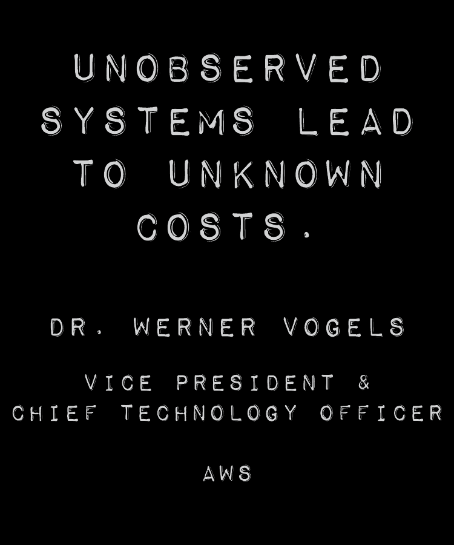
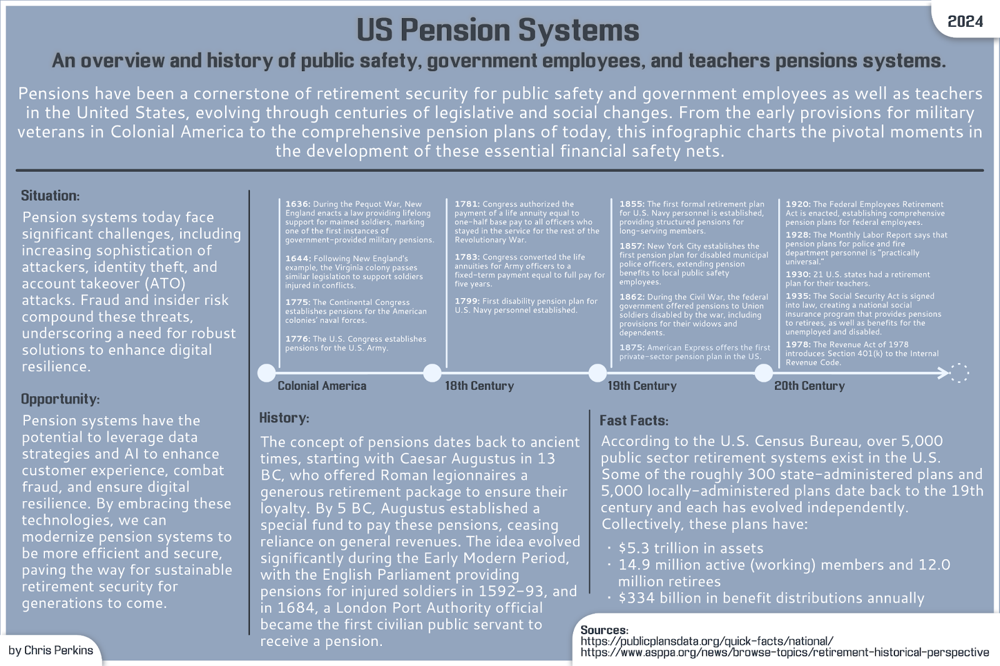
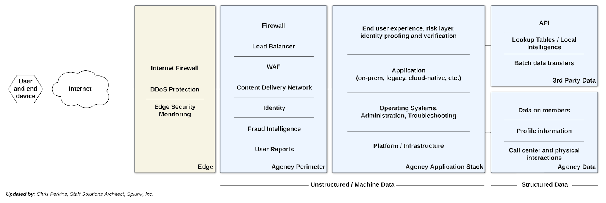
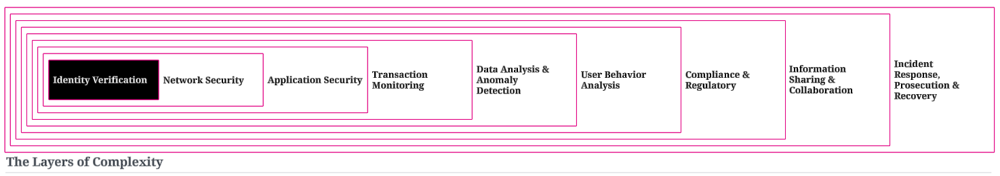
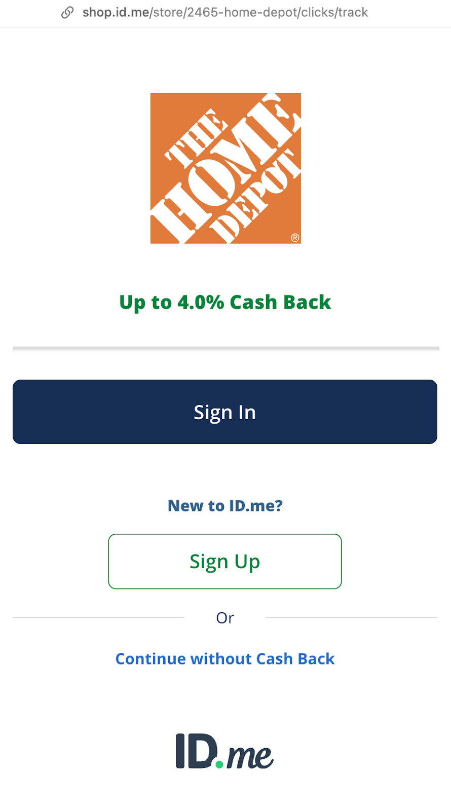
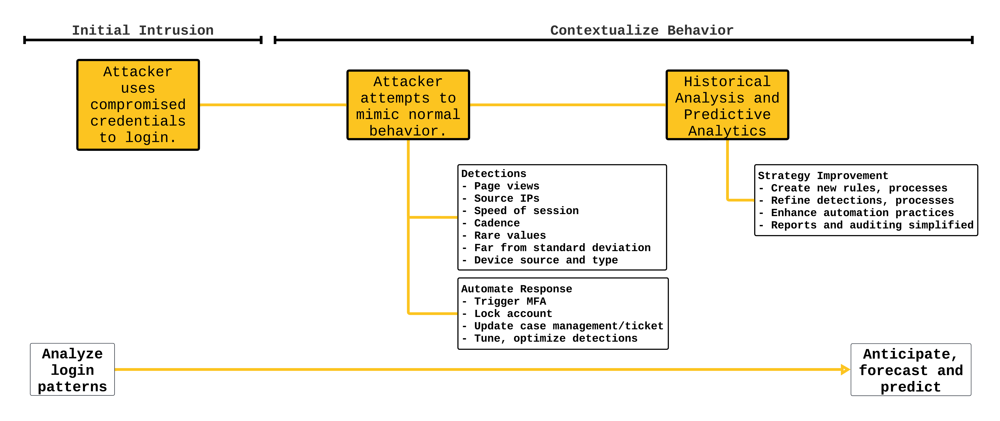
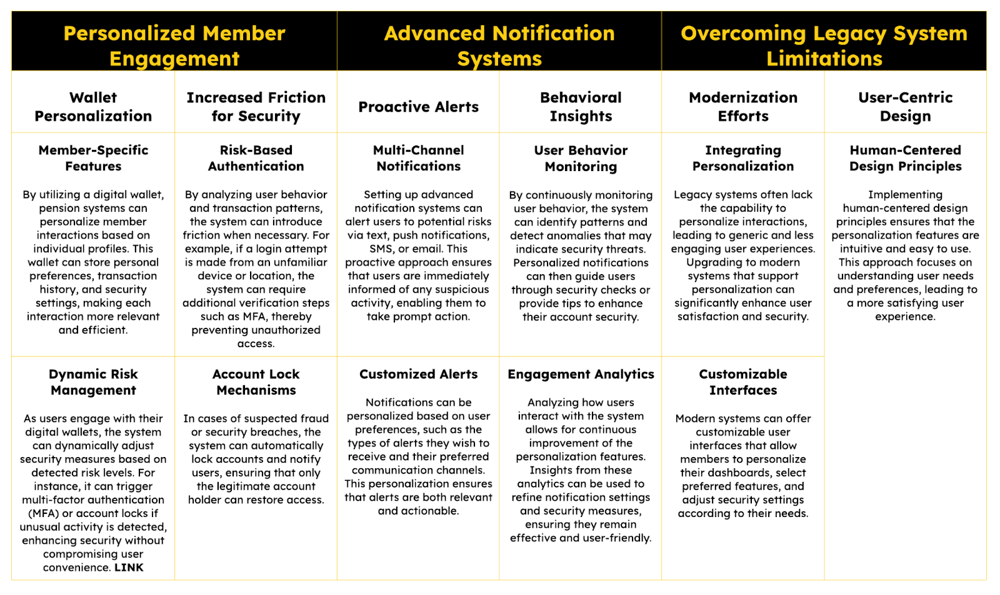

The Intersection of Security and Usability in Public Pensions
As public sector pensions navigate the modern threats of fraud and cyber attacks, we examine the intersection between technical innovation and security + how human-centered design can enhance anti-fraud efforts. This article discusses the transformation from traditional pension systems to advanced, resilient systems that safeguard the financial futures of millions of public servants while making them easier to use, manage and observe.

## Introduction

The concept of observability isn’t new, but the industry is talking about it a lot more these days. When we refer to “observability” today, we mean the ability to monitor and describe how systems are performing as they are being used.

We’ve always had an ability to monitor these systems both from an end user perspective and a machine perspective — it was just very manual. Today, we have tools that make observability — the practice — more accessible to organizations even as our digital systems have become more complex, distributed and intertwined.

I think of having visibility or an ability to observe as a spectrum. Imagine this spectrum as the difference between a grainy photo and a sharp, clear one. There could be various reasons why the image is grainy; but the goal is to make the image more clear with upgrades. Systems like pension systems are complex, long-running and have many components or modules that comprise the whole system. Some of these components are core and some are there to make operations and usability better for the admins and users. These modules are managed in-house, by a third party or through a hybrid management process. The ability to observe how users interact with this system is distributed across these modules I just mentioned: cloud, on-prem and third party.

Having the ability to see across the technology stack matches the organization’s ability to see across how people are performing or making an impact. You can measure staff numbers, hours worked, deliverables produced, or survey results. When organizations have equal capability in seeing what’s happening across the digital infrastructure as well as the team of humans managing + end users, you’ll have the best case scenario for anti-fraud, increased user satisfaction and accessibility, reliability (uptime) and security.

> In today’s digital age, the security and integrity of public sector pension systems are paramount. With the increasing sophistication of cyber attacks and fraud, it is crucial to implement robust security measures that protect sensitive financial data and ensure the integrity of pension systems.

However, this security must be balanced with the need for seamless user experiences, allowing retirees and employees to access their benefits without unnecessary hurdles.

Which brings us to [ID.me](http://id.me) and [Splunk](https://splunk.com). These technologies are essential to maintaining this balance of resilience and usability. Splunk offers data analytics for security and fraud prevention, enabling pension administrators to quickly identify and address threats. By improving identity proofing and verification, ID.me ensures that user authentication is done securely and is hyper-accessible on a large scale. When combined, these technologies strengthen the pension system and provide a seamless, user-friendly experience while also preventing fraud.

## The Evolving Terrain of Pension Security

### The history of public pension systems

Pension systems have a lengthy history. It was interesting to dive into the pension systems rabbit hole and create this infographic.To enhance my understanding, I needed an overview of where these programs originated, how quickly (or slowly) they evolved, and what trajectory they might be on.

### Similarities across public pension systems

For every pension system, there is a novel or distinct design. Similar to how elections are run county by county, pension systems are distributed and defined locally. As stated in the infographic, the US Census Bureau says there are over 5,000 public sector retirement systems across the United States.

Even with these differences, there are more commonalities than there are differences between these systems. They all have or have a need for:

- Identity proofing and verification.
- Technology and application stacks.
- Support, operations and maintenance processes.
- Data security and continuous monitoring capabilities.
- Compliance audits.
- Incident response processes.
- Fraud detection and prevention program.
- User training and awareness program.
- Disaster recovery and business continuity planning.
- An accessible user interface.
- For people who are blind, using low bandwidth connections on a mobile phone as well as other ways to ensure a wide level of access.

Increasing digital threats

As more funding is allocated to social safety programs or retirement funds like pensions, the complexity and attack surface continues to grow and expand.

There are pros and cons to having a highly distributed system of pension management. On one hand, it is more difficult to attack the whole system. On the other hand, it is difficult to establish procedural and technological consistency.

It’s about time we introduce a metaphorical example. Before the world had time synchronization, time zones were an agreement between regions but not precisely synchronized through any mechanical or digital means. The need for time zone synchronization was mainly driven by the railroad system in the US. While I don’t have time to delve into the story of how synchronization was established, I can tell you it has an interesting history.

All of this to say that the challenge of having 5,000+ systems is an opportunity to apply a standard. [Operationalizing Data Analytics Methodology ([ODAM](https://odam.community))](https://odam.community) is a data strategy template that can be the equivalent of the International Meridian Conference held in Washington, D.C., in 1884 where it was proposed to use the Greenwich Meridian as the “Prime” meridian and Greenwich Mean Time (GMT) as the world’s time standard.

The threats to pension systems range from friendly fraud (where a close relative with access commits fraud) to nation state threat actors who operate with precision and consistency.

In addition to these external threats, the ongoing issue of system abuse remains. As investigators look into cases, a pensioners’ 360-degree profile can reduce the time to investigate and can provide for a more nuanced and detailed investigation. Having full visibility of the digital infrastructure, system administrators can sleep well knowing that risk engines are constantly running — evaluating each connection, transaction or transfer.

> Artificial intelligence will certainly be a tool attackers and fraud actors use to steal or extort the pension system. It is incredibly important for us as defenders to start thinking seriously about how we label data at scale, how we access the right data at the right time and how we go about sharing information.

As threats continue to escalate and pose greater risk than ever before, my goal is to equip pension providers with robust security and anti-fraud capabilities, making it very difficult and unappealing to commit fraud or embezzlement. We are closer to achieving this than one might think. While onboarding data takes only a couple of weeks, leveraging it effectively is the greater challenge. However, with the right approach — like ODAM — organizations can thrive for years to come.

### The importance of data analytics and identity verification

As we look in our rear-view mirror, we continue down the road to resilience. I thought a lot about the typical system and then thought about how a pension application as an overlay looks as a diagram. The diagram shows major elements of the pension system and where data lives.

I usually describe the image above as the “potential universe of data.” An organization can have full visibility or observability on this universe and integrate this with insights on processes and personnel to ensure that fraud becomes a thing of the past. I believe… no, I know… there can be a system with 100% integrity. We just need to build it.

The challenge in building a system with 100% integrity goes back to the distributed nature of pension systems. Using ODAM, Splunk and ID.me, pension administrators can begin synchronizing or aligning while maintaining your organization’s uniqueness and sovereignty.

The importance of data analytics in pension systems spans many initiatives and layers of complexity:

- Fraud detection and prevention
- Predictive analytics
- Operational efficiency
- Personalized services

The Layers of Complexity.  
Leveraging Splunk for Enhanced Data Analytics  
Overview of Splunk’s platform

In my experience, when people say “data,” they mean the data sitting in a database that includes details about that person’s identity or their transactions. An assumption is that this data is structured or organized in columns and rows.

Splunk’s data analytics platform excels at handling not just protected data within your database, but also the metadata surrounding it. While protected data is stored in your database, machine data generated from IT systems facilitates connectivity and security during data access. Also, money is data and data is money.

I think of this data coming out of the IT systems as signals. These signals come from the IT equipment that provide connectivity and security.

Signals come from the equipment on-prem, in the cloud and from software provided by third parties. Splunk bridges the gap between isolated systems while providing us — the administrators — with all we need to understand the terrain we are trying to navigate.

This is where the [IT Service Blueprint](https://odam.community/part-3/3-ace/#understanding-the-it-service-blueprint) comes into play. When we did this with Georgia Tech ([Foreword on ODAM](https://odam.community/foreword/)), we mapped out the critical IT services and respective infrastructure. As a team of subject matter experts, we explored various aspects, such as the blueprint for student registration and the process through which students access the registration portal.

> The IT Service Blueprint is where the rubber meets the road with data analytics.

This whiteboard exercise brings many subject matter experts together with a facilitator who maps out the technology (hardware and software components) that ensure confidentiality, integrity and availability. The goal is to teach the organization how to do these whiteboard workshops so they can keep their IT Service Blueprint dashboards up to date.

As we enable pension administrators, troubleshooters and stakeholders to use the IT Service Blueprint and ODAM, we’ll synchronize our clocks.

### Detecting patterns and anomalies

Detecting patterns and anomalies within pension systems is critical for maintaining security, efficiency, and resilience. I have written extensively about Splunk’s risk-based approach to fighting fraud with data analytics. Check out this article for a detailed explanation of how risk scoring, weighting and multipliers can be implemented to fight fraud.

### Mapping out an account takeover attack using a stolen identity

This scenario describes an Account Takeover (ATO) attack perpetrated by an organized crime syndicate using a stolen identity to infiltrate a public pension system. The attack leverages multiple layers of data and analytics to detect and respond to the intrusion.

### Lifespan / life cycle of a typical attack (details)

Flowchart illustrating the detection and response process for a cyber attack, from initial intrusion with compromised credentials to the use of predictive analytics for future threat anticipation.  
The power of unified data

Think of your data as a vast, untapped resource. By collecting data across all aspects of your pension system — transactions, user interactions, security logs, and more — you create a unified dataset. This “single source of truth” can serve a multitude of purposes, streamlining operations and ensuring compliance with regulatory standards. This unification of structured and unstructured data unlocks many more possibilities for the organization, including sending this consolidated information to higher abstraction levels and visualization tools like Power BI and Tableau.

> With unified data, pension administrators can automate routine tasks, improve decision making and enhance user experience.

Maximizing the value of the data really has no end or ceiling. I think this is one aspect that draws me into the field or study of ‘data.’ To begin your data journey and to understand the true worth of data, organizations must collect the data and then ask it questions!

## Strengthening Identity Verification with ID.me

### Leveraging ID.me for identity proofing and verification

Before I introduce ID.me, let’s quickly define Identity Proofing and Identity Verification. These are key capabilities with nuance and complexity. Digital identity is where the rubber meets the road. There are many ways to create accounts with online services, but when it comes to a pension or state’s benefits program like unemployment insurance benefits, the state needs to ensure that you are the person you claim to be. As you’ll see in the definitions, there are various levels for proofing and verification.

The idea is this: using ID.me, we as wallet holders have an ability to provide our credentials or ID to whomever we wish to provide it. For example, when I purchase a spicy margarita, they ask for my ID to ensure I’m over 21. I can also go to a clothing retailer to make a purchase, and if I had the veterans credential in my ID.me wallet, I can expect to receive my discount, for example. These are examples of the state or home improvement store doing identity verification. The presented identity credential is trusted because the process for obtaining it was controlled and adhered to NIST guidelines, ensuring its reliability.

Before we get into how we can use ID.me’s technology to reduce fraud and enhance accessibility, let’s review identity proofing and identity verification.

> Identity proofing, as outlined by the National Institute of Standards and Technology (NIST) in its Digital Identity Guidelines (SP 800–63A), is a vital process for verifying that individuals are who they claim to be in digital systems. This process involves several key steps:

- Identity resolution  
- Evidence validation  
- Attribute validation  
- Identity verification

The above steps are all designed to prevent identity theft and fraud. NIST categorizes identity proofing into three Identity Assurance Levels (IALs), ranging from self-asserted identities (IAL1) to the most stringent verification involving physical presence and biometric data (IAL3). By ensuring that only legitimate users can access digital services and resources, identity proofing is essential for maintaining trust and security in various sectors, including government, finance, and healthcare.

> Identity verification, as defined by the National Institute of Standards and Technology (NIST) in its Digital Identity Guidelines (SP 800–63A), is the process of confirming that the validated identity evidence actually belongs to the individual presenting it. This involves linking the evidence to the physical, live existence of the applicant through methods like biometric comparisons or physical verification. For higher assurance levels (IAL2 and IAL3), this often includes comparing the applicant’s live photo to the image on their strongest piece of identity evidence or using biometric characteristics. These stringent measures ensure that the identity verification process is robust, preventing fraud and ensuring that only legitimate users gain access to digital services and resources.

### Overview of ID.me’s federated login solution

> ID.me is the next-generation digital identity network that simplifies how individuals securely prove their identity online. Consumers can verify their identity with ID.me once and seamlessly log in across websites without having to create a new login or verify their identity again. 132 million members experience streamlined login and identity verification with ID.me at 17 federal agencies, 30 states, and 56 healthcare organizations. More than 600 consumer brands use ID.me to verify communities and user segments to honor service and build more authentic relationships.

ID.me’s technology meets the federal guidelines for consumer authentication set by the Commerce Department and is approved as a NIST 800–63–3 IAL2 / AAL2 credential service provider by the Kantara Initiative. ID.me is committed to “No Identity Left Behind” to enable all people to have a secure digital identity.

ID.me has an existing ID.me network of 132 million+ members and 60 million+ NIST credentials. ID.me has built partnerships with hundreds of retailers and expanded into regulated sectors like government, healthcare, and financial services with legal identity verification for high-risk transactions. More about ID.me on their website. <https://id.me/about>

ID.me is used in many public sector organizations across the country as well as the private sector. Recently, Home Depot and ID.me [announced](https://news.va.gov/125193/2023-veterans-day-discounts-free-meals/) their partnership to provide military veterans with a cash back promotion. The idea is for the customer to prove their status to receive the discount or promotion.

### What is possible with an ID in the ID.me ecosystem?

Consider a system where individuals in disaster-impacted zip codes automatically receive a digital certificate designating them as affected by the disaster, quickly distinguishing those impacted from those who are not make for a better level of service that is more consistent and efficient.

> For example, someone impacted by a hurricane could be issued an ID.me designation from FEMA based on their profile address linked to their ID.me wallet.

What if eligibility information could be stored in your digital wallet?

Imagine this for someone without stable housing or someone seeking asylum. These digital credentials are key to identifying, authenticating and authorizing individuals in a digital + physical environment.

The ID.me network provides always-on risk analysis that verifiers can leverage at any time. Varying degrees of re-verification are available to administrators. For example, pension administrators may want to do a liveness check for anyone over a certain age on a regular basis or if someone attempts to change their profile banking information.

There’s an incredible opportunity ahead. I’m excited to be a small part in it.

### Reducing login friction

Reducing login friction while maintaining strong security is essential for improving user experience in modern pension systems. A dynamic approach to this involves adjusting authentication requirements based on user behavior and risk signals.

> Consistent and low-risk behavior can result in fewer authentication steps, making the process smoother for users.

Adopting a mobile-first design is crucial. Mobile apps can collect detailed telemetry data, such as device information, user behavior, and location data, which helps it create a comprehensive security profile. These apps can leverage built-in security features like biometric authentication, providing robust security with minimal friction.

By using these advanced data points, pension systems can implement adaptive authentication that varies based on risk levels, ensuring both security and user convenience. Developing a secure, user-friendly mobile app and utilizing its telemetry data for continuous analysis and adaptive authentication can significantly enhance the user experience while maintaining high-security standards.

### Personalization

Personalization is a critical aspect of modern digital experiences, enhancing user engagement and satisfaction by tailoring interactions to individual needs. In the context of pension security systems, personalization can significantly improve both security and user experience. Here’s how it can be effectively implemented:

Personalization in pension security systems is not just about enhancing user engagement; it is also a powerful mechanism for improving security. By utilizing digital wallets, advanced notification systems, and risk-based authentication, pension systems can offer a tailored and secure experience for each member.

### Enhancing security and trustworthiness

Imagine ranking every pension account with a risk score from 0 to 100. Where would most of your accounts fall upon initial analysis? Where would the bell curve be across all accounts?

To rank each account on a scale from 0–100, we must have visibility into account access to understand the risk. For example, a change in the account profile password can increase the risk score. Additionally, a change to the bank account information within a profile after a profile password change increases the risk significantly.

As omnichannel support continues to be the trend, pension systems need a data analytics platform that allows the collection of data from older systems as well as modern systems. Phone, in-person and digital access varies across pension systems. Some offer traditional phone support as well as live chat support or chatbots. The interactive phone system is a great way to assess voice biometrics and the call center agent is a great place to enhance social engineering training.

If pension systems were to adopt a common “time,” they would be able to grow similar to how new grass seeds grow; mostly uniformly. This consistency among systems can enable more progress in a shorter period of time while still allowing each pension system to honor its uniqueness and novel approaches to pension system management.

## Practical Applications and Future Directions

### Implementing the principles of human-centered design in pension systems

A screenshot of this PDF: https://www.ssa.gov/disabilityresearch/documents/VIP-6364_Understanding_Experiences-OC_study.pdf

> “Government use of accessibility technology may increase people’s ability to access services and participate in political action.” — [SSA.gov](https://www.ssa.gov/disabilityresearch/documents/VIP-6364_Understanding_Experiences-OC_study.pdf)

Seamless and minimal user disruption leads to higher end user satisfaction and reduced fraud.

Measuring accessibility metrics is to measure end user behavioral metrics. Fraud is largely an exploitation of process, which means we can detect fraud by monitoring behavior.

### Accessibility detections

This list contains potential detections that have overlap between accessibility and fraud detection.

It is possible to use the data from systems (e.g., web server, web app firewall, network firewall and the endpoint itself) to identify users, user segments and their anomalies.

Users could include first-timers from your constituent base or they could be fraud actors. Once someone (or a bot) accesses the pension system you’re monitoring, you can detect how well they are using the system. Are they navigating through the site efficiently or are they acting like a script (i.e., bot) which is very methodical and fast.

These are just a few examples I came up with as part of this article but it could be that you have dozens of detections that monitor the accessibility of your website while detecting fraud at the same time.

### A word about language

Accessibility is not just about usability (screen readers, etc.), it is also about the languages supported. For example, ID.me supports 22 languages in the user interface (UI) when onboarding or going through verification. If a live interaction is needed to on-board users, a secure and direct connection is established where 240 languages are supported using live translation.

State portals achieve multiple languages support by using a variety of tools and techniques. In-browser language translation or perhaps fully dedicated domains or sub-pages that support a particular language. Using usage metrics can enhance confidence in fraud detections. We often look for loaded languages in the browser as a way to detect riskier endpoints. Every little bit of risk counts and tells a story.

## Enhance and Balance Security with User Experience

ID.me’s website includes a wonderful article titled, “[Building Accessibility into Identity Verification](https://network.id.me/article/building-accessibility-int).” In this article, they talk about how accessibility is built-in from the ground up. Consideration is given to users with a variety of abilities. Now think about this consistency when applied to state and federal government interactions.

The Social Security Administration’s online portal incorporates human-centric design principles by conducting extensive user research and iterative testing. The result is a highly accessible and secure platform tailored to the needs of its diverse user base.

> ID.me provides secure digital identity verification services for the SSA, ensuring that users can verify their identities online securely and efficiently. This process includes multiple paths for identity verification, such as self-service options, human assistance via video calls, and in-person verification, which cater to users with different accessibility needs.

## Applying Splunk and ID.me in Various Architectures

My experience has been a combination of agencies leaning into data analytics for whole-scale monitoring but there are some out there who think: I’m going to wait to do anything with full visibility data analytics until after the modernization project is complete. I’m paraphrasing and getting to the point, but there is rationale behind that point of view that I tend to ask about. Questions or prompts I use in these conversations are things like: “if you have data analytics before moving your monolithic app to the cloud, how can you tell if things improved and by how much?” In an environment where Splunk and ID.me operate, we could ask, do we have enough access to enough data that tells us the longitudinal path of a given account holder and do we have an ability to ask this data questions to diagnose what might be seen, noticed or reported? I’m referring to: risk.

I think the idea of visibility of the entire system that provides pension — including the Internet connection, the web server, the data bases, the network firewall, the power to the building or the cloud — are all key to the whole system. If any one of these things failed or degraded, the confidentiality, integrity or availability metrics are impacted. If we have eyes on the data — or Splunk collecting and preparing data for interrogation — we can begin to learn from our known baseline. This newly established baseline is our basis for comparing what happens next. If we see a 10x increase of logins in a day, we would want to know why. Accessing the data in this way through Splunk allows us to perform the second level of data analytics: diagnostic.

> If you remember one thing from this article, remember this: know who is accessing the system and monitor what they do. It’s as simple as that.

From a tactical perspective, my recommendation is to collect all the machine data from your clouds, third party providers and whatever you have running on-prem. Put that data together and provide the business much-needed answers.

## Ensuring Program Integrity and Fraud Prevention

Pension systems have some similarities with other systems in state government. For example, they both include the ability for a user to log into a web portal where their name, address and other information are defined. Motor vehicles department, the tax department, unemployment and others.

Sometimes these web portals seem like they have some integration (from an end user perspective) but some seem as if you’re on an island doing business or receiving service from the government. As state agencies begin to adopt normalized operations across agencies, we can expect these websites to interconnect even more. I think going forward we can expect a human-centric approach and design considerations given to the usability of the website. There is some incredible work being done in this space at the federal government and now post-Covid I think we’re seeing more emphasis on user experience.

Sometimes I think of these systems like a theater performance. My little one loves theater and does a lot of work ahead of the big show to ensure it is right. She and her troop prepare the lighting, costumes and set. They memorize their lines and rehearse many times ahead of their performances. I see her putting in the hours both at practice and at home. Now we arrive at the big show.

As her mom and I gather with family outside of the theater here on Main Street, we feel the buzz of a Broadway musical. The marquee lights, box office, greeters and ticket takers. We’ve dressed up and plan on a celebratory pizza dinner right after.

As we sit down, the lights dim and the narrator begins telling us how it all began. The audience is captivated by the ensemble, the costumes and the shaky smiles of each cast member. Here in the audience, each family member is waiting to see their favorite actor appear onstage. The anticipation of the story is unfolding before our eyes as is the future of our children.

As the lights dim and the narrator takes us to the next act, I’m observing a white noise from the fans above the stage and I can tell there is someone walking up the aisle to the doors at the rear of the theater. And I can hear feet shuffling across the wood decking of the stage. I begin to hear some whispers as a door creaks open.

As the light scatters into the dimly lit theater we begin seeing the anomalies. My friend and colleague Matthew Joseff — who is a Certified Fraud Examiner — taught me that when an environment is normalized, we can begin to find the outliers or anomalies. The behavior of the cast, crew and audience are all expected in an environment like a children’s theater production. There could be a few people coughing every now and then or perhaps a baby fussing. These behaviors stick out in a dark, quiet auditorium full of people.

When we talk about visibility in the environment, I’m referring to this sensing ability you have within the auditorium. The ability to quickly detect anomalies in behavior and add risk to users (or pension accounts) to detect outliers.

As I wrap up here I want to share one more scenario. Let’s say in the auditorium there is someone coughing. They cough once or twice and that’s that. There could also be a scenario where dozens of people begin coughing.

> These signals in the observed environment give us the stories we need to continuously assess risk.

## Conclusion

Between the expanding digital surfaces and increasing sophistication of threat actors, pension systems have a lot to manage and deal with. When organizations begin unifying access to their data and use that information to make better decisions, they improve key performance metrics over time. Combined with NIST-compliance identity proofing and verification provided by ID.me, organizations have a fighting chance to fend off attacks!

As I was researching for this article, I watched a documentary on YouTube called, “The Pension Gamble” and in the first few seconds of the film, they introduce a race horse named, “Promises Fulfilled” and thought I’d name this article after the horse. Although I think it’s a great name, it wasn’t fully encapsulating what I am trying to say. So I went with “The Intersection of Security and Usability in Public Pensions.”

Usability is about access, it is about ease of use and it is about reliability. I try to lead with the customer-first mentality and thought about Hawaiians as I researched accessibility. There are areas of the islands where bandwidth is low and latency is high. Government websites are critical infrastructure and need to be accessible to all residents of Hawaii no matter the user’s language, Internet speed or location.

Using this same system that is accessible to the legitimate users are threat actors and fraud perpetrators. They are there to exploit the technical and procedural aspects of your organization in order to steal money, extort the organization or cause damage. Being able to see across your digital landscape is possible today. With the IT Service Blueprint you can begin to inventory your IT services. This approach slices across your data, technical and people siloes to show the business how the system (a pension system in this case) is running.

> “A lot of what technology provides is more rigorous measurement of the burdens themselves.” — Dave Guarino (Asterisk Magazine Interview)

Thank you: Tina Carkhuff, Audra Streetman, Alexandria Mitchell, Jeremy Haynes, Ryan Friess, Derrick Roberts, Matthew Joseff, The Fraud A-Team @ Splunk, Pension Administrators, State Employees, Public Safety Professionals, Educators and Fraud Fighters!

Please note: the views and opinions expressed in this post are those of the author (Chris Perkins) and do not necessarily reflect the official policy or position of my employer, or any other agency, organization, person or company. Assumptions made in this post are not reflective of the position of any entity other than the author — and, since we are critically-thinking human beings, these views are always subject to change, revision, and rethinking at any time.
