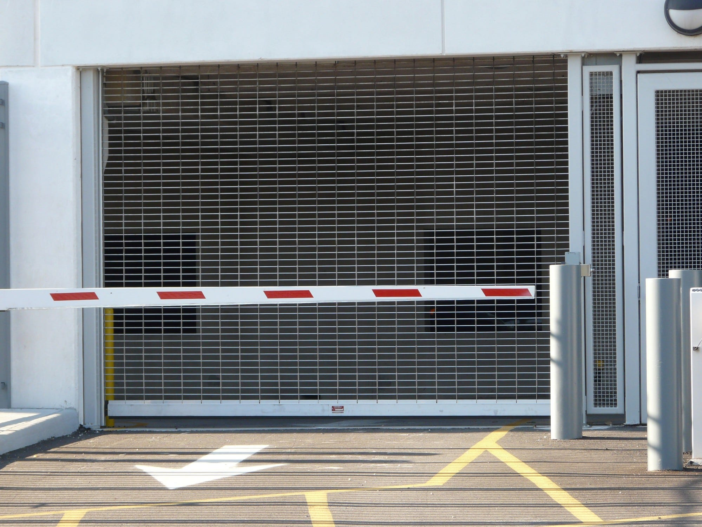
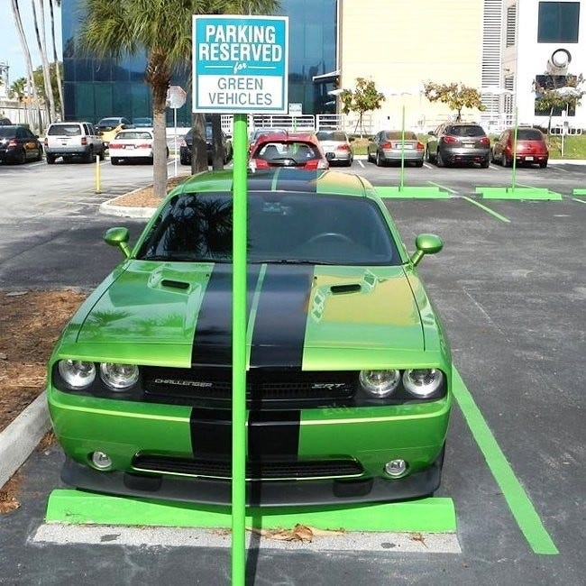
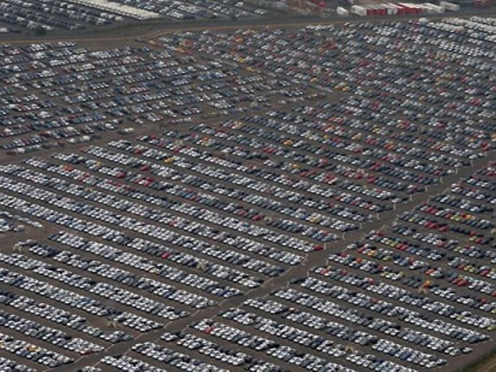
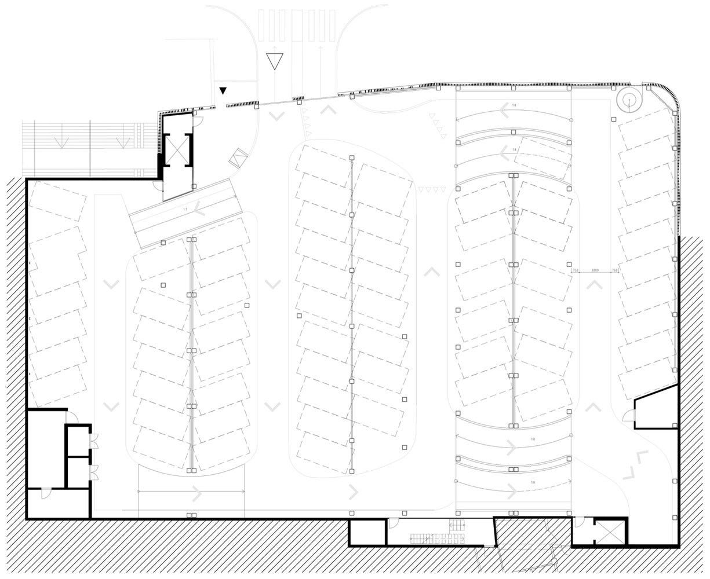
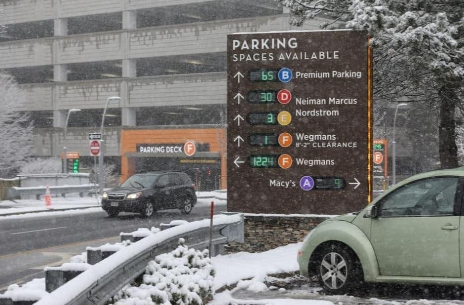
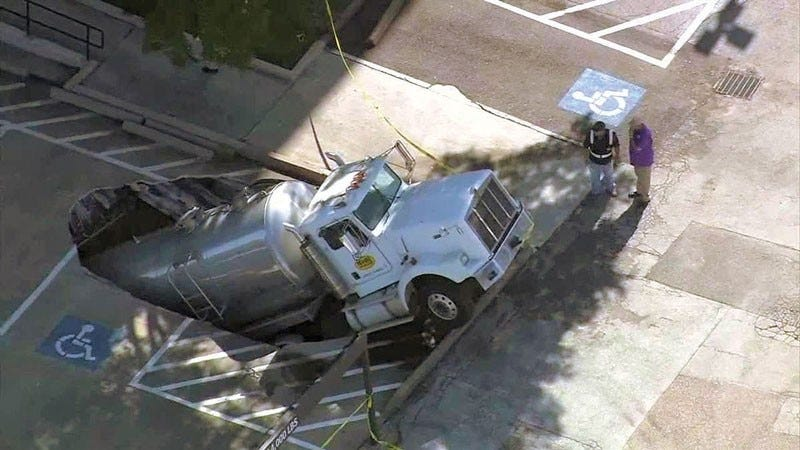
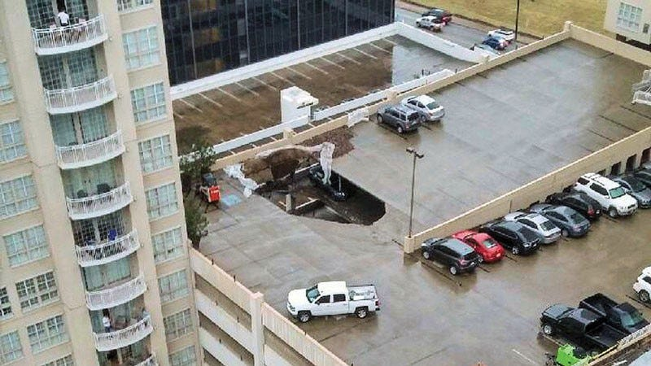
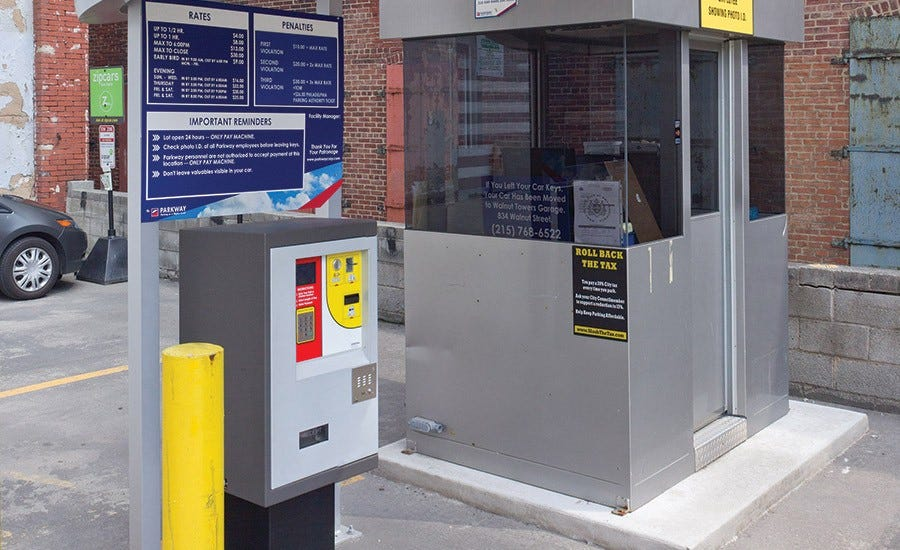

An ISEy Parking Garage: A metaphor
Originally published on March 25th, 2020 on LinkedIn. Turns out, it’s still a relevant article!

The views and opinions expressed in this post are those of the author and do not necessarily reflect the official policy or position of my employer, or any other agency, organization, or company. Assumptions made in this post are not reflective of the position of any entity other than the author — and, since we are critically-thinking human beings, these views are always subject to change, revision, and rethinking at any time.

As part of my job, I am asked to describe Cisco Identity Services Engine (ISE) fairly frequently. One of my favorite ways of explaining technical capabilities is to use metaphors as a way to communicate what the technology is for, from a business perspective, and what the technology does, from a features perspective.

Here’s how I like to describe Cisco ISE — to use the example of a parking garage with a single entrance (the exit is not very relevant to the metaphor). In the metaphor, the garage is your corporate network — it consists of these three main elements: access, transport, and services.

- Access to the garage is like wired access via a switchport. Perhaps the rooftop deck is how wireless access is granted. Helicopters, drones, and UAVs can all land on top of the garage
- Transport within the garage is like your corporate network. There can and should be internal controls to limit access to the ‘3rd floor’, as an example. Because that’s where your company’s fleet parks and guests and contractors should not be parking there or accessing those services.
- Services are the spaces in the garage or the applications within your environment. These services hosted in your network are what users are trying to access.

So, what is Cisco ISE? ISE can fit into many places in this metaphor and here in this post, I will touch on a few of the major use cases as well as some special/advanced use cases that many organizations are looking to implement.

Let’s dive into this from the beginning. Imagine ISE being the gate arm mechanism and rolling door (as shown in the image below). This is the end state. Who do you think can access the parking garage if the gate arm is down and the rolling door deployed? Here are a few example of legitimate reasons:

- Employees coming to work for the day
- Guests who have a scheduled meeting with someone in your organization
- Executives of your organization
- Contractors using their company’s vehicle who are working in your office for the day
- Employees parking the fleet vehicle on the 3rd floor in numbered spaces

The examples above are use cases that are currently present today. Although unenforced, these are the business reasons for having a parking garage.

ISE controls access to the network (and the garage). This is why many people refer to the technology as network admission control (NAC). Now, what we need to do in order to get serious about the enforcement of who parks where (or which user/endpoint access which service), we need to start mapping two things out and thoroughly documenting them.

**The facts about the network**

In our parking garage example, these are roughly the use cases I listed above. In a network sense, there are other examples:

1. Employees using an Acme device to access corporate applications
2. Building control (i.e., IoT) devices accessing their controller and accepting connections from an HVAC vendor.
3. Guests using their own devices to access the internet.
4. Employees using their own devices to access the internet; no access to corporate applications.

**The business’ requirements, preferences, and policies**

In our parking example, the business requirements, etc. can be imagined as: the requirement for nighttime lighting, fire suppression, 24-hour video surveillance, and a parking lot attendant.

In the real world, ISE is enforcing the policies set up by the organization. An ISE engineer responsible for deploying the technology should combine the facts and the requirements to create a complete use case.

1. Employees using an Acme devices must present their device certificate to ISE upon connection thereby proving the endpoint belongs to Acme.
2. IoT devices should be profiled and categorized correctly given appropriate in- and outbound access based on least privilege. To be specific, the profiled building control devices should only have access to 192.168.10.88 (the controller’s IP address), and the network is given permission to allow inbound TCP/22 from the contractors remote access VPN subnet (172.16.1.0/24).
3. A sub-use case is when the contractor connects to Acme’s remote access VPN, her machine should be scanned for an acceptable anti-virus/anti-malware software package that has been updated within the past 10 calendar days. If that posture requirement is not met, a warning is displayed notifying the contractor that they should call Acme’s Service Desk.
4. Guests and their devices are untrusted and as such, granted access to the internet-only VLAN. Acme’s policy states that guest are allowed to connect wired and wirelessly.
5. Employees connecting their laptops to the switchport under their desk connects successfully, however a login portal is presented to the user and they must either register their device to access corporate resources, or simply register as a guest to access the internet-only network.

As mentioned, ISE has many use cases that can control access to your network, as well as provide posture checks, publish policy, and when integrated with eco-system partners, ISE can be the mechanism that quickly and automatically quarantines an endpoint on the wired, wireless, and VPN networks.

I plan on talking about my take on zero trust architectures (ZTA) in a future blog post, but to touch on it briefly, ZTA does require the parking lot attendant or even a security guard in some cases. The parking lot attendant is walking the garage 24x7x365 and is ensuring that a guest driving a personal vehicle is parking on the 1st floor and is also ensuring that employees are not parking on the 1st floor. The lot attendant is also ensuring that truck #8 in the fleet is parked in the stall labeled with an ‘8’. The lot attendant is monitoring access to services and ensuring identity and authentication are still valid, and providing one of the last stops for authorization.

Here’s the next step in the ISE deployment. The consultant and Acme have meet. Each of Acme’s stakeholders has had multiple opportunities to influence the final policy architecture. The fleet owner might want to advocate for short-term parking on the first floor — that is something the business could consider. But, perhaps not for employees using personal vehicles. The nuances are captured during a series of workshops that help identified what Acme must do and what Acme prefers — because it aligns with the business!

The consultant has documented each and every use case. The process has taken a few weeks, but we finally have the information we need to begin our ISE configuration. The gate arm operator connects their laptop to the mechanical device and is ready to start adding security policy. The technician enters in the following for the first use case (Acme fleet vehicles):

**IF**

- Acme fleet vehicle (Identification)
- Acme fleet team member must present drivers’ license (Authentication)
- Acme fleet vehicle must not have a full load due to weight restrictions on the 3rd floor (posture)
- Acme fleet vehicle must have working headlights, blinkers, and tail lights (posture)

****THEN** (Authorization)**

- Permit Acme fleet vehicle to park on the 3rd floor
- Re-assess (upon arriving to the 3rd floor, a second gate arm mechanism scans the windshield-mounted RFID tag and the gate opens)
- IF the parking lot attendant discovers a fleet vehicle on the 2nd floor, the pre-defined response is invoked

The technician enters the following configuration for the second use case:

IF

- Acme employee driving a personal vehicle (Identification)
- Employee’s personal vehicle has a windshield-mounted RFID tag that was provided by Acme for employee use; Acme gave each employee two RFID tags in case they have two vehicles (Authentication)

THEN

The last one we’ll go through in this post — because I’m sure you get the point — is the IOT device. The technician begins the configuration:

IF

- An autonomous car pulls up to the front entrance of the parking garage pulls up because it needs to park overnight for a battery recharge
- The autonomous car was assigned a unique tag to be mounted on the windshield; it is presented using RFID as well as recorded via video surveillance
- The autonomous car reported diagnostic issues wireless to the battery charging unit, a human technician is deployed to look further; the garage’s pedestrian gate allows for the technician to enter. The parking lot attendant is roaming around and watching closely. She has been notified that a autonomous car technician has been deployed and to be suspicious of any activity. Audio and visual recordings are also taking place

THEN

- Permit the car into the garage (it automatically drives to one of the twenty spots for used for green cars

The technician has completed configuring the parking garage gate arm and rolling door. For the next two weeks, the configuration will be active but the mechanical arm and door will remain open. This is to ensure that valid cars are not mistakenly denied access — if tuning needs to happen, information gathered in this time frame will be used to tune and optimize the gate arm configuration.

After two weeks, the gate arm is lowered as is the rolling door. From this point on, Acme’s policy is being enforced exactly as developed and tested.

That’s pretty simple if you only have a 3 story parking garage that support up to 300 parking spaces. However, most of my clients typically need to facilitate parking for tens of thousands of endpoints.

The nuance grows with the number of endpoints. The endpoints change frequently and it’s typically not possible to have a parking lot attendant on foot any more.

The questions become: how do we automatically onboard new devices, assess their risk, grant least privilege access, and ensure compliance? And, how do we ensure that If any one of those has been altered, a re-assessment is invoked and a change of authorization is issued based on the risk changes?

How do we go about operationalizing the technology? We didn’t need this when we built the garage — what changed? The number of cars and their inherent threat has changed — which means less parking for your fleet, executives, employees, and guests.

The parking garage architecture was built and implanted but the policy architecture development and deployments are happening now! Do you have a process for developing and deploying security policy in your access edge? How about the data center edge? Within the cloud? How about your remote workforce using the internet to connect?!

How do you plan and anticipate every kind of breach? Is it possible? Re-assessment of risk is key. Threat, vulnerability, and behavior can all be monitored and tracked. And they should be.

A pumper truck that was empty when it arrived, pumped water and when the tanker was leaving, it fell through the parking garage top deck.

A pile of soil was dropped off and placed at the corner of the parking garage. There was some rooftop improvements in this building and the soil was needed for a rooftop garden. That night it had rained and the soil soaked up a lot of water making it too heavy! The top deck failure created a pancake failure that took out 13 floors. Thankfully no one was hurt but many cars were damaged and the garage was shut down for 68 days. All cars were locked in for 68 days.

What is a policy with no enforcement? (I feel like there should be a funny answer to this! What do you think?!)

Can that car be towed? I’m not sure, is there a warning sign / did they sign the EULA? Is there a law (or policy) that prohibits that Beamer to park there? Is the owner of the Beamer the owner of that building? Context matters and needs to be evaluated often.

How do you deal with this?! Can you leave a comment on what your metaphor is for this?!

One final question on the parking garage metaphor… what if you want to collect payment? How do you ensure payment and compliance?

Enforcement.

Thanks for reading. I hope you enjoyed one of my favorite metaphors around Cisco ISE.

Before I end the post, I wanted to raise a few questions when we have other elements added. What if it snowed?

Here we can see a variety of tire tracks (or network traffic patterns) that can be used for multiple reasons. We can see what the source and destination was. We can see what kind of endpoint was driving through. We can see how long this network traffic has been present or if it’s a new track. We can see the direction or the traffic and understand the route.

So, yes… I had to write about a snowy ISE garage in a post. I hope you enjoyed and remember: we all leave tracks behind. Where will you go?

*Originally published at* [*https://www.linkedin.com*](https://www.linkedin.com/pulse/isey-parking-garage-metaphor-chris-perkins/) *on March 25th, 2020.*
