Web of Data
From Telegraph to AI: The Impact of Technologies on Sovereignty

## Abstract

This article explores the profound and lasting impact of communication technologies on Indigenous communities from the 18th century to the present day, using the metaphor of the “Web of Data” to illustrate the intricate connections between information, privacy, surveillance, data sovereignty, identity and power. Drawing from personal reflections and a deep connection to New Mexico, the discussion delves into how technologies — from the telegraph to the Internet — have both oppressed and empowered Indigenous Peoples.

The Web of Data serves as a central metaphor, representing the complex network of data threads that define individual and communal identities. The article examines the historical exclusion experienced during the expansion of the telegraph system and parallels it with the modern digital divide affecting Native American communities, particularly among women and girls. It highlights how limited access to broadband perpetuates educational disparities, economic inequalities and health challenges, echoing past patterns of marginalization.

By analyzing concepts such as privacy as contextual integrity, data sovereignty and the ethical dimensions of data labeling, the article emphasizes the critical importance of integrating traditional knowledge systems into modern data practices. It advocates for inclusive policies and technologies that honor Indigenous protocols, ensuring that the flow of information respects cultural norms, upholds community values and empowers Indigenous Peoples to exercise control over their data.

Through this lens, the Web of Data underscores the necessity of acknowledging and addressing historical injustices to prevent their recurrence. It calls for collaborative efforts to bridge the digital divide, promote equitable access to technology and affirm data sovereignty for Indigenous communities, enabling them to control and benefit from the data that affects their lives. Ultimately, it envisions a future where every thread in the Web of Data is valued and protected, contributing to a richer, more diverse and resilient network that honors the individuality, dignity and sovereignty of all.

## Pre-Contact

In July, 2024, the United States Department of Interior, led by Deb Haaland, published the revised report on Indian Boarding Schools in the United States and the impact to Native American Indigenous communities. The report provides eight recommendations with the first one being: Acknowledge, Apologize, Repudiate and Affirm.

> “The U.S. government should issue a formal acknowledgment and apology for the harm caused by the Federal Indian boarding school system, including recognizing its role in forced assimilation policies and the suffering experienced by Indigenous children. The government should formally repudiate forced assimilation as a national policy and affirm the right of Indigenous peoples to maintain their cultural identities and languages. This statement should be issued by appropriate officials and accompanied by actionable policies.”
> — DOI Report vol. 2

On October, 25th, 2024, in Laveen Village, Arizona, the President of the United States issued a formal apology to Alaskan Natives, Hawaiian Natives and Native Americans.

> “After 150 years, the United States government eventually stopped the program, but the federal government has never — never — formally apologized for what happened until today. I formally apologize as president of the United States of America, for what we did.”
> — President Joseph R. Biden

As I researched for this article and dove into the report, I found myself moved to tears, occasionally needing to step back from the computer to process and feel everything that was going through my mind and heart. Returning days or weeks later, I persisted in exploring different ways to share what I learned.

Generations of people have been impacted by the harm and trauma of colonization. This unsettling truth that we must acknowledge is also an opportunity to remember the past with a shared history, which can help us become more understanding, patient, kind and inclusive in the future.

I’ve been wanting to write about data sovereignty for a while. Throughout my career working with Tribal governments, there have always been nonnegotiable technical requirements: that the data (whether it be logs, reports, or data about people) be on-premise or otherwise under the tribe’s control. Most organizations and use cases — though there are exceptions — require that their IT systems and tools have specific features and capabilities to ensure the Tribe maintains data sovereignty.

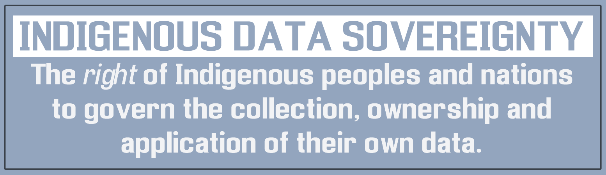

In addition to these organizations that require possession, control and authority over their IT systems, individuals are also stakeholders. Us. We are all autonomous humans with inherent rights that every individual possesses by virtue of our humanity, irrespective of nationality, ethnicity, gender, religion or any other status. These rights cannot be surrendered, sold, or transferred and they apply to everyone, everywhere.

The United Nations General Assembly adopted the Universal Declaration of Human Rights (UDHR) in 1948, which states that our inherent rights as human beings are universal, inalienable and indivisible.

Which brings me to: identity (the core of the Web metaphor). From the beginning of my technical education, I have studied identities. I still have my TVI identity card as a reminder! But not just the school ID and driver’s licenses. The usernames and passwords I had to create for financial aid, signing up for classes, choosing my schedule and submitting assignments were things I needed to remember. If we did not go to the trouble of recording our complex passwords, we would create simple ones that we can easily recall. Then we started making them all the same. Generally speaking, of course, but you know who you are!

In this article, identity encompasses both communal and individual aspects. Identity is dynamic and evolves over time. Identity is what is presented when we interact with an ecosystem; digital or not.

So, we have data, human rights and identity. Expanding again, we add Knowledge to the Web of our humanness.

My appreciation and interest in knowledge began early in my childhood. I had the most beautiful and complete set of Encyclopedia Britannicas at my fingertips. My grandfather gifted our family these books, which came complete with the supplement books after Z! I was so proud of them. When I needed to research something for a homework assignment, I remember consulting one book after another, jumping from book to book while using my fingers to guide my eye to the bold text I was looking for.

When the book was closed, the page edges were a shiny, bright gold color. Soft to the touch, I remember sliding my fingers up and down the pages as I took in the rich scent of the books.

Each book was the color of dark mud, and the letters on the spine were aged gold.

How much information or knowledge can a publisher fit into these books? What information must they include, and what information is optional? What if the information changes?

> Who decided what went in those books?

These are a few of the questions we will explore in the chapter about knowledge, but I think you see where I’m going with this. If my grandfather wasn’t a privileged white man, he would not have had the money to buy this set. If it weren’t for the education he received in Snyder, TX, he may not have appreciated information or knowledge as an adult.

My point is, because of my privilege, mixed with oppressive systems still in place today, I’ve had the opportunity to receive an education, have time to study, have a safe and quiet place to do research and writing, and I’ve had the privilege of working with organizations across the US. Tribal governments, city, county and state governments, and schools across this country have taught me throughout my entire career. This article and the others like it are for you.

In my career, I’ve seen two main approaches to professional work. One approach is to hoard information and become a go-to resource. The other approach is to share. But not just share — overshare. I have shared ideas, methodologies and lessons learned freely and openly my entire career, even when it felt uncomfortable for one reason or another. Shame is a big deterrent for people looking to publish. I get it… and we’ll delve into this topic in another article, but if you’re reading this, answer this question: Do you keep ideas, or do you share them?

My understanding of white privilege is shaped by national discourse, my own development and shared stories about the lived experiences of others. There are so many tiny (and significant) policies and processes that remain in effect to this day, stemming from oppressive, imperialistic systems that we believe we have no other choice but to accept as “the norm.” Among each of these systems lies a complex set of policies, regulations and laws that affect each of us; some more than others.

- Housing
- Education
- Hiring practices
- Legal / judicial system
- Healthcare
- Voting
- Environment
- Taxes
- Surveillance and policing

“It is my privilege to…x y x.” Write this article. Sit at this desk. Eat a meal with my family. Call a friend. When it comes to writing this article, I feel it is also my responsibility; my responsibility to share what I’ve learned with the world. I’m compelled to engage in uncomfortable conversations because I’ve learned that when we (mostly talking about us, white people) do, it creates space for others — specifically, those who were harmed or are still hurting, as space for healing.

I believe that this space is what’s needed in this country. We need to sit here, listen, absorb, acknowledge and have compassion. From there, my question is: What is our responsibility now?

Data is a vessel for knowledge. Here in the 21st century, the machines we use generate data and the data about us is used to identify us. Controlling data, therefore controlling knowledge, is power.

The power dynamics at play expand our Web metaphor yet again. This article will dive into ideas around information control, surveillance, privacy and communications.

Speaking of communications, the other day I was driving around Southern New Mexico, as one does, when I began thinking about the Telegram. Not the app! The old school technology Westerners invented to transmit short and long signals (noises) across a wire. Each dot-dash-dot-dot combination represented a letter in the alphabet. Traditional ways of communicating and collaborating with neighboring people were displaced and disrupted as railways, the telegraph and other infrastructure expanded West.

The sunsets here in New Mexico are incredible. Big blue skies with flame-like horizons. The original people of this land saw the same sunsets and lived off the same river. I don’t feel so distant from them after researching for this article. In “Braiding Sweetgrass,” author Robin Wall Kimmerer says that the land reminds us of what we’ve forgotten.

I don’t know about you, but I tend to listen to music and think when I drive. As a new landscape emerges with every bend in the road and the sun skirts across the sky, I wonder what life was like 100 or 200 years ago. I try to think about this from many perspectives, like, “What if I were me, but I was 200 years back?” Or, “What could it have been like for someone who lived off the land until they were forced off?”

What was the conversation like between Indigenous communities when Westerners sought their land to place railways, wires and settlements?

The encroachment on ancestral lands often led to the displacement of Indigenous tribes, including the Apache as well as other Indigenous communities, who were forced to abandon their traditional lands to make way for expanding colonial infrastructure. This new railway system resulted in greater control by external entities over Indigenous territories, undermining tribal sovereignty and disrupting cultural practices.

According to the New Mexico Museum of Art, an American minister to Mexico, James Gadsden, negotiated the Gadsden Treaty in 1853, providing for the purchase of a large tract of desert land in Southern New Mexico. The area offered an advantageous route for a transcontinental railway entirely on American soil, and its acquisition concluded the final adjustment of our border with Mexico. My family and I reside on this land today.

> “The Mesilla Valley through which the Rio Grande runs is the spiritual and ancestral homelands of the Manso people. The Manso people continues, and will continue, to be the community Indigenous to the city we call Las Cruces.

The City of Las Cruces has been cared for by these tribal peoples who are the original, historical, and perpetual stewards of this land. Their culture plays an immeasurable role in shaping the ethos of the wonderful community of Las Cruces. The current Piro-Manso-Tiwa tribe are the forebears of Las Cruces and the successors of their ancestors who were the first people of this land; and we are proud to share their ancestral homelands with them and their descendants.”

- Las Cruces City Councilor Bencomo’s Resolution

Power and control, now part of our Web metaphor, connect us to another topic we will get into as part of this article. Surveillance and privacy tie back to identity, sovereignty, self-determination and data.

The eventual expansion of the transcontinental railway, connecting El Paso (in 1881) and Las Cruces (1901) to the Southern Pacific Railroad, led to the convergence with the telegraph system. As new railways were built, telegraph lines were systematically laid alongside the tracks. This integration was driven by the need for efficient communication between trains, stations and railway offices. The telegraph facilitated real-time coordination, improving operational efficiency and safety.

The establishment of railways and telegraph lines was not merely about transportation and communication; it was also a means of exerting control over vast territories. Surveillance facilitated by these technologies allowed colonial authorities to monitor, track and suppress Indigenous resistance more effectively.

Colonial control and surveillance established deep-seated power imbalances that facilitated the systematic oppression and, in many instances, the genocide of Indigenous populations. Through mechanisms such as railroads and telegraph systems, colonial authorities were able to monitor, control and eradicate Indigenous cultures, identities and communities. This entrenchment of power not only led to the physical displacement and mass mortality of tribes like the Mescalero but also aimed to dismantle the very fabric of Indigenous societies through cultural suppression and economic exploitation.

Statehood brought profound changes and challenges for Indigenous populations. It formalized governance structures that often disregarded the sovereignty of traditional systems of the Apache, Navajo and other Indigenous communities. As New Mexico transitioned from a territory to a state, the influx of settlers, businesses and infrastructure projects — including railways and telegraphs — intensified the encroachment on Indigenous lands and resources.

The first census in the U.S. was conducted in 1790, but the first in this area was in 1850, when New Mexico was still a territory. The data collected was used to establish statehood at the turn of the century.

The year 1912 brought about policies aimed at assimilation, such as the establishment of boarding schools designed to erode native languages and cultural practices. This disruption introduced challenges with the transmission of traditional knowledge.

New Mexico’s recognition as a state also meant that census data collection became more systematic and extensive, yet it frequently marginalized Indigenous voices and failed to accurately represent their populations. The power imbalances entrenched by these data practices reinforced systemic injustices, further limiting Indigenous communities’ ability to advocate for their rights and preserve their heritage.

Despite these adversities, statehood brought about legal recognition aimed at protecting resources, lands and water. Indigenous leaders recognized that being in control of their own data was paramount. The struggle for data sovereignty gained momentum and laid the groundwork for efforts that continue today.

One-hundred and twelve (112) years ago, New Mexico became a state. Thirty-nine days later, Arizona was recognized as the 48th state. Alaska and Hawaii joined the Union in January and August of 1959.

Does this seem very far in the past to you, or does it feel closer? Most of my life, I thought of these timelines as being very far back, but as I’ve researched for this article (and perhaps aging factors in), I am seeing things as closer; not so far back. It was strange for me to write 1959 as the year for Alaska and Hawaii. My father and mother were born in ’61 and ’64, respectively.

Time is both strange and interesting to me. I’ve always enjoyed TV shows and movies about time travel or non-linear timelines. As we add Time to the Web, we expand yet again. Past, present and future make up time — but how do these tie back to data? How does the past, present and future tie back to cultural identity or self-determination? We will spend some time talking about time in this article.

### Data are a Representation of Nature

In the Web of Data, traditional knowledge systems view data as foundational threads that are inseparable from the land and natural environment. These data threads capture the complex interactions within ecosystems, monitor changes over time and illustrate the impacts of human activities. Just as each thread in a web contributes to its overall structure and resilience, data interweaves with the natural world to shape and preserve the identities of individuals and communities, reflecting their deep connection to the environment and cultural heritage.

For example, here’s some data that encompasses changes over time and impact. In this case, the impact is significant harm.

> “The westward expansion of European settlers across the continent in the 19th century was the primary driver in the rapid decline of bison in North America.

Railways, rifles, and an international market for buffalo hides led to “the Great Slaughter” from about 1820 to 1880, when the bison population plummeted from 30–60 million (estimates vary) to fewer than 1,000 animals by the 1890s.

Other factors including the military’s directive to destroy buffalo as a way to control American Indians, the introduction of diseases from cattle, drought, and competition from domestic livestock (horses, cattle, sheep) contributed to the reduction in bison numbers as well.

At their lowest numbers, some estimated that there were only 300 bison that survived the slaughter, bringing the species to the brink of extinction.”

- National Park Service

In 2016, the North American bison was declared the national mammal of the United States. National Bison Day has been observed annually on the first Saturday in November since 2012.

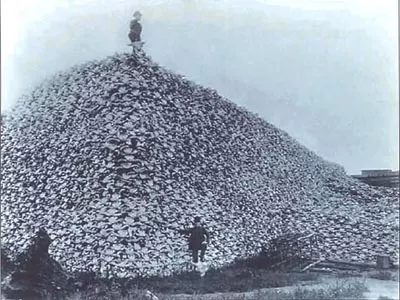

It’s estimated that 30–60 million bison roamed North America pre-contact. The American bison was central to the lives of many Indigenous tribes, particularly those in the Great Plains such as the Lakota, Cheyenne and Comanche. The animal provided essential resources, including meat for food, hide for clothes and bones for tools. These animals hold significant spiritual and ceremonial importance.

Railroads facilitated easier access to bison herds and markets, incentivizing mass slaughter in addition to the U.S. Government’s initiative to destroy as many bison as possible.

Today, the National Bison Association reports that there are about 400,000 bison in the North American herd.

The atrocities and violence settlers, colonizers and later the U.S. Government inflicted on Native American and Indigenous Peoples is incredibly and deeply harmful.

> “I remember my braids being cut off; washed like we were dirty; talked to us like we were dirty. We were dressed in uniforms. They took everything from us and handed, like in the military, this bundle with a towel in it; with soap in it; socks; and a uniform. It wasn’t what our ancestors wanted for us when they signed the Treaties. That’s not what we agreed to.”
> — The Road to Healing South Dakota Participant

This research and article are meant to honor Indigenous communities, their history, their sovereignty and their healing. Lastly, this article is one way I aim to contribute to the ongoing conversation we, the people, are having about data.

### Exploring the Web of Data with Storytelling

This article has been a bear to research and write and I needed a way to organize my thoughts and anything that makes the page.

After staring out my home office window for a couple of weeks, the idea dawned on me. A spider web! You see, a couple of weeks ago, my youngest and I put some Halloween decorations up in the front yard. We put some of the stretchy nylon webbing on the porch where my office window is, and strings of purple LED lights in the shape of a web wedge.

This metaphor captures perfectly the characteristics I see when describing such big, varying and interconnected systems-of-systems. This Web-based narrative will serve as the rest of the article’s foundational framework as we explore data, knowledge, information flows, identity, surveillance, privacy and data governance.

The Web metaphor illustrates data as the threads that weave together various aspects of our identities, communities and broader societal systems. As we navigate the Web together, I will be leaning on this metaphor to help articulate how data interacts within different contexts, influences power dynamics and shapes identity.

When we envision the topics as a spider’s web, we can better understand the balance required to maintain security, integrity and privacy. This analogy allows us to dive into the complexity of data interactions so we can better understand human-data interaction and the importance of safeguarding our online and offline identities within these interconnected networks.

As we navigate each chapter and topic, the Web metaphor will guide us by prompting our imaginations to actually see the flows of information on the Web. The points of connection between different identity facets and the overarching structures that challenge or govern data transmission and protection will help us simplify the relationships and dynamic nature.

Ultimately, the Web of Data invites us to reflect on how every piece of information we generate, collect or share, shapes the greater whole, with profound implications to our sovereignty and autonomy.

## Data Are a Strategic Resource

> Data. Factual information (such as measurements or statistics) used as a basis for reasoning, discussion, or calculation.
> — Merriam-Webster

Data is a reflection of our lived experiences. Our histories and cultural knowledge shape who we are as individuals and as communities, establishing our identities. These identities are deeply intertwined with power dynamics, identity politics and the enduring legacies of imperialism. For Indigenous peoples, data concerning their land, resources and health outcomes encapsulates their ongoing struggles for self-determination and resistance against colonial forces.

Every day, as we navigate our three-dimensional lives, we generate vast amounts of data. Our communities and businesses produce data every second, contributing to a digital landscape where information is constantly collected, stored, analyzed and shared. However, the digitization of our real world often leads to a flattening of knowledge — transforming rich, contextual experiences into mere statistics or data points. This flattening disconnects data from the people and communities it represents, resulting in a loss of accountability and a disassociation from its context.

When we examine traditional knowledge management systems, we find that their foundational principles remain highly relevant today, even in our digitized world. Traditional systems encompass:

- Relationships Around Data
- Emphasizing communal ownership and stewardship.
- Infrastructure for Sharing and Storing
- Ensuring data is accessible yet secure.

Techniques for Ensuring Integrity and Privacy  
Protecting data from misuse.  
Laws, Policies, Practices and Protocols  
Governing the ethical and technical use of data.

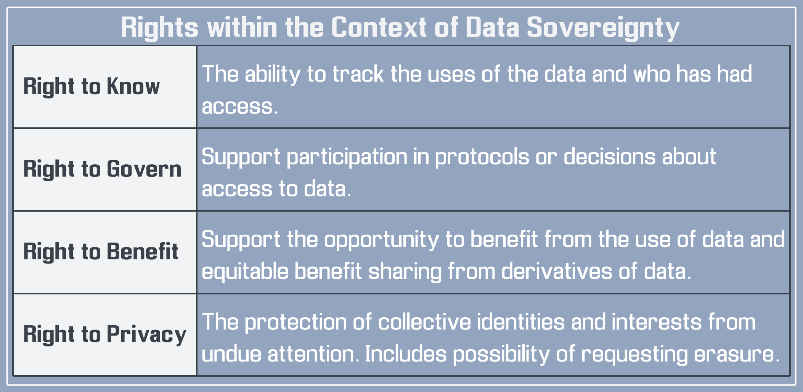

By asserting ownership and control over their data, Indigenous communities can ensure that data supports their own goals and priorities, rather than serving the interests of those who have historically marginalized them.

Data sovereignty is a powerful tool that enables Indigenous communities to reclaim control over their narratives and challenge the misrepresentation or exploitation of their experiences by external entities. Through frameworks like OCAP (Ownership, Control, Access, Possession) and CARE (Collective Benefit, Authority to Control, Responsibility, Ethics), Indigenous communities can establish their own guidelines that govern the collection, management and use of their data.

Moreover, frameworks such as FAIR (Findable, Accessible, Interoperable, Reusable) and ODAM (Operationalizing Data Analytics Methodology) provide structured approaches to ensure data is handled ethically and effectively, promoting transparency and accountability. These frameworks support Indigenous data sovereignty by aligning modern data practices with traditional values and responsibilities.

Data analysis as knowledge creation suggests that when data is handled ethically and with community consent, it can generate new insights and foster knowledge growth. Data as Encoded Knowledge posits that data, especially when contextualized, represents a form of knowledge that encapsulates lived experiences, cultural practices and historical narratives. For Indigenous communities, data is intrinsically linked to their identity and autonomy, serving as a vital resource for cultural preservation and self-determination.

Understanding the foundational role of data sets the stage for exploring the nature of knowledge. The subsequent section will delve into how knowledge is conceptualized, generated and utilized, emphasizing its significance in the pursuit of self-determination and cultural preservation among Indigenous communities. Additionally, we will investigate one mechanism through which knowledge is stored, transmitted, shared and safeguarded, ensuring its continued relevance and integrity for future generations.

### Data as Power

> Data sovereignty as knowledge sovereignty underscores that controlling data equates to controlling knowledge, which in turn supports self-determination and cultural preservation.

Recognizing the close relationship between data, knowledge and power is crucial. Western knowledge systems, often based on data collected during periods of colonization, have been used to justify the exploitation of Indigenous peoples and their resources. This historical context reveals how control over knowledge production and dissemination can create and maintain power imbalances, perpetuating systemic injustices.

Surveillance and Privacy: The Mechanisms of Oppression

Oppressive systems exert control over data, information and knowledge, intertwining surveillance and privacy concerns with the broader themes of identity and sovereignty. The manipulation and oversight of data serve as tools for maintaining dominance, restricting the autonomy of Indigenous communities and undermining their efforts toward self-determination.

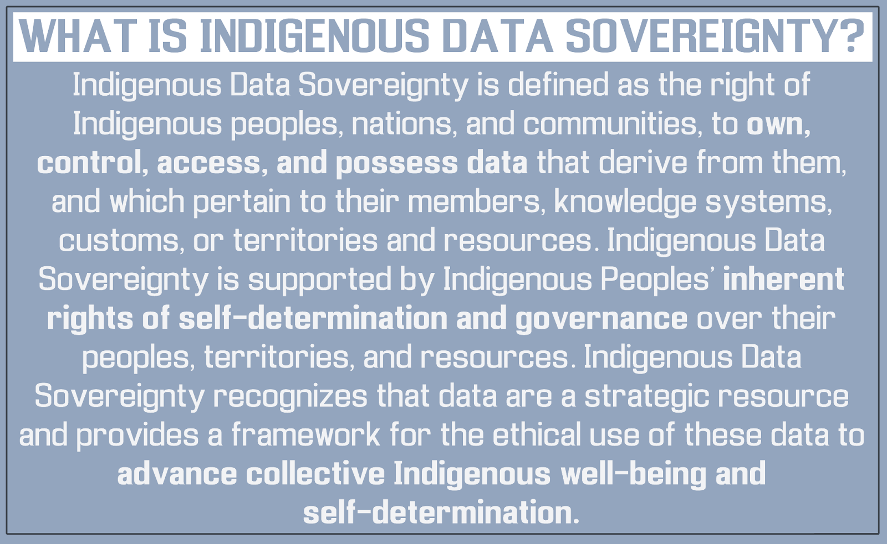

Empowering Indigenous Communities Through Data Sovereignty

By asserting ownership and control over their data, Indigenous communities can ensure that it is used to support their own goals and priorities, rather than serving the interests of those who have historically marginalized them. Data sovereignty is a powerful tool that enables Indigenous communities to reclaim control over their narratives and challenge the misrepresentation or exploitation of their experiences by external entities.

### Strategies for Data Sovereignty

Sovereignty is the right of a People to govern themselves.

### Frameworks Supporting Data Sovereignty

Initiatives like the development of OCAP (Ownership, Control, Access and Possession) principles and the CARE Principles (Collective Benefit, Authority to Control, Responsibility and Ethics) provide frameworks for Indigenous communities to assert their data rights.

To effectively implement data sovereignty, Indigenous communities utilize several frameworks and methodologies:

OCAP (Ownership, Control, Access, Possession)

- Ownership: Indigenous communities own their data.
- Control: They control how data is collected, used and shared.
- Access: They have access to their data.
- Possession: They possess the data, ensuring physical control over storage and dissemination.

CARE (Collective Benefit, Authority to Control, Responsibility, Ethics)

- Collective Benefit: Data practices should benefit the community as a whole.
- Authority to Control: Communities have the authority to govern their data.
- Responsibility: There is a responsibility to manage data ethically.
- Ethics: Data use must align with ethical standards and cultural values.

FAIR (Findable, Accessible, Interoperable, Reusable)

- Findable: Data should be easily located by those who need it.
- Accessible: Data should be accessible under well-defined conditions.
- Interoperable: Data should be compatible with other data systems.
- Reusable: Data should be reusable in various contexts, promoting broader utility.

ODAM (Operationalizing Data Analytics Methodology)

- Operationalizing: Implementing data strategies effectively.
- Data: Labeling (meta)data on a large scale and planning for retention and storage.
- Analytics: Utilizing data for insightful analysis.
- Methodology: Applying structured methods to mature organizational capabilities.

Protecting Privacy Through Frameworks and Policy

Data About People vs. Data Generated by People: Distinct Forms of Control

To illustrate the distinct forms of data control and how various frameworks support Indigenous data sovereignty, let’s examine the following comparison between data about people and data generated by people.

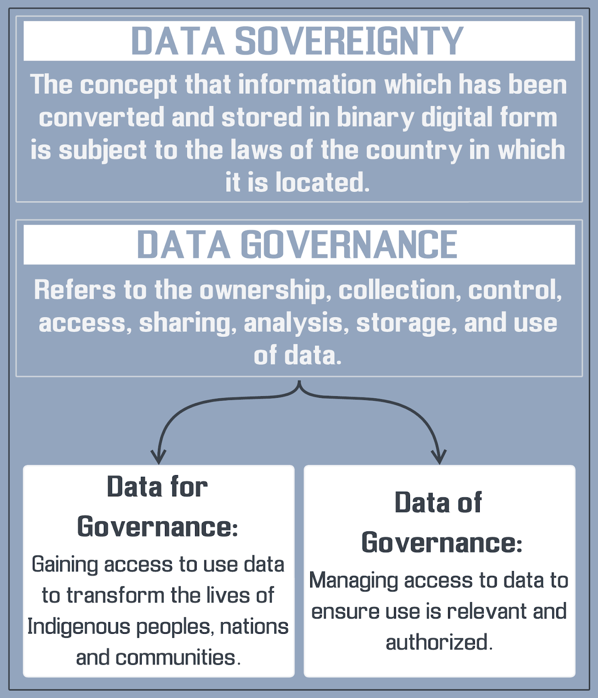

Legal Frameworks

While the European Union’s GDPR (General Data Protection Regulation; gdpr.eu) and CCPA (California Consumer Privacy Act; oag.ca.gov/privacy/ccpa) are legal regulations rather than data governance frameworks, they play a crucial role in shaping data governance practices within organizations. They set the rules for how personal data must be handled, ensuring that data governance frameworks prioritize privacy, security, and compliance with legal obligations.

Ultimately, legal frameworks like, GDPR and CCPA, are laws designed to protect personal information and give individuals more control over their data.

### The True Worth of Data

> For Indigenous communities, data sovereignty is not just a technical issue — it’s a fight for self-determination, cultural preservation and the right to control their own narratives.

Data is imbued with meaning; it reflects lived experiences and holds significant power. Recognizing that data embodies the rich tapestry of histories and cultural knowledge, Indigenous data sovereignty becomes a critical pathway for reclaiming control over these narratives and asserting autonomy.

This stewardship ensures that data is not merely collected and stored but is actively used to support self-determination and cultural preservation. Through ethical data analysis and community-led governance, Indigenous communities transform raw data into meaningful knowledge, safeguarding their heritage and empowering future generations to thrive with integrity and resilience.

For a deeper exploration of the true worth of data and how methodologies like ODAM (Operationalizing Data Analytics Methodology) can unlock its value, you can read my full article: Discovering the True Worth of Data: Unlocking Value with ODAM.

> Data sovereignty acts as a response to historical injustices by empowering Indigenous communities.

## Knowledge: Sources, Control and Power Dynamics

Knowledge is an essential element of which communities build their identities, make informed decisions and preserve their cultural heritage. It encompasses not only factual information but also the deep understanding that arises from lived experiences.

Merriam-Webster defines knowledge as:

> “Facts, information, and skills acquired by a person through experience or education; the theoretical or practical understanding of a subject.”

This tapestry of knowledge is essential for maintaining cultural identity and autonomy, empowering communities to navigate contemporary challenges while honoring their ancestral legacy.

The highways of New Mexico are often quiet. It is easy to get lost in thoughts or podcasts like Philosophize This!

As the odometer rolls over and counts the miles passed, I frequently think about cybersecurity. Shocking, I know. But as part of this, I get into concepts like data analytics, identity and oppressive systems as well as their enabling policies.

On the 1,002 mile stretch of Interstate 25 — between Las Cruces, New Mexico and Buffalo, Wyoming (Google Maps) — I think about protecting knowledge involves an intentional approach and risk-informed balance of making information accessible and ensuring its security. Ultimately, the fundamentals of cybersecurity and information security are: confidentiality, integrity and availability (CIA). This balance is essential for preserving cultural heritage and ensuring that knowledge serves the community’s interests rather than external agendas.

As I drive through the dry heat of the Chihuahuan Desert, I wonder what the oryx cooking over the fire smelled like. I wonder what the land looked like before concentrated animal feeding operations (CAFOs), pecan trees and alfalfa fields were put there.

Landscapes in New Mexico range from white sand dunes, rugged mountains, deep canyons, fertile pastures and snow melt. If you were to drive through Ruidoso today, you would see burnt patches and scarred forest from fires recently and over the decades. Recently the town and people nearby not only faced wildfires but severe flooding as well.

Research shows that changes in climate create warmer, drier conditions, leading to longer and more active fire seasons.

> “Addressing the wildfire crisis is going to be an intergenerational process. Figuring out how we can all work together, using our strengths to overcome our weaknesses and increase the proactive use of fire, will be critical to starting down this pathway. These investments in place-based solutions are exactly what we need to set out strategically on our journey down this road.”
> — Bill Tripp, Director of Natural Resources and Environmental Policy, Karuk Tribe

Wildfire management is just one example of traditional knowledge. Some Indigenous communities used controlled fires as a way to promote the growth of certain edible plants and prevent major wildfires as fuel accumulates each season.

> Data serves as a vessel for knowledge, encapsulating lived experiences and cultural practices.

### What is Knowledge?

Knowledge forms the foundation of how we understand the world, guiding our actions and decisions.

While different sources of knowledge each contribute to our understanding, traditional knowledge adds a dimension. Indigenous traditional knowledge encompasses generations of lived experiences, deep connections with nature and very likely a lot more I don’t and cannot understand. Although I may never understand, I’m writing this based on my observations and research

Indigenous knowledge resembles, to me, a blend of experiential and moral knowledge, offering a holistic perspective that integrates wisdom, environment and community.

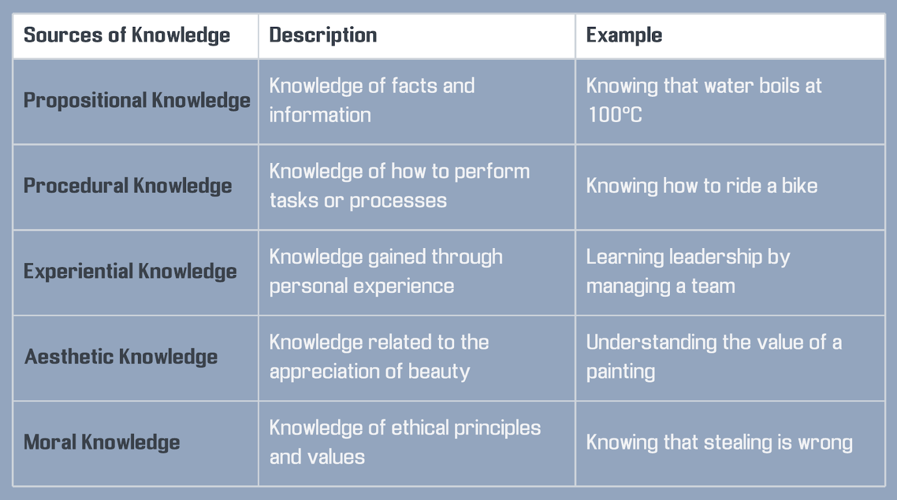

There are many resources that go into depth on Traditional Knowledge, which I will link at the end. I will highlight later the data labeling framework that I found very interesting and will prove to be very helpful in the pursuit of data sovereignty.

As I researched for this article, I thought about a way to connect surveillance with privacy and knowledge. I remember listening to episode 186 of the Philosophize This! podcast on my way up to Albuquerque earlier this year. This episode, which we’ll get into later, talks about a Panopticon; a prison system with a twist. We’ll come back to this specific episode throughout the article.

Philosophize This! by Stephen West is a long-running podcast with just one person. An articulated thinker, West helps us integrate philosophy into our daily lives.

So I thought it would be interesting to dig into the more popular perspectives on how knowledge manifests into various forms. Let’s take a look into the following historic perspectives on knowledge:

### Data as Encoded Knowledge

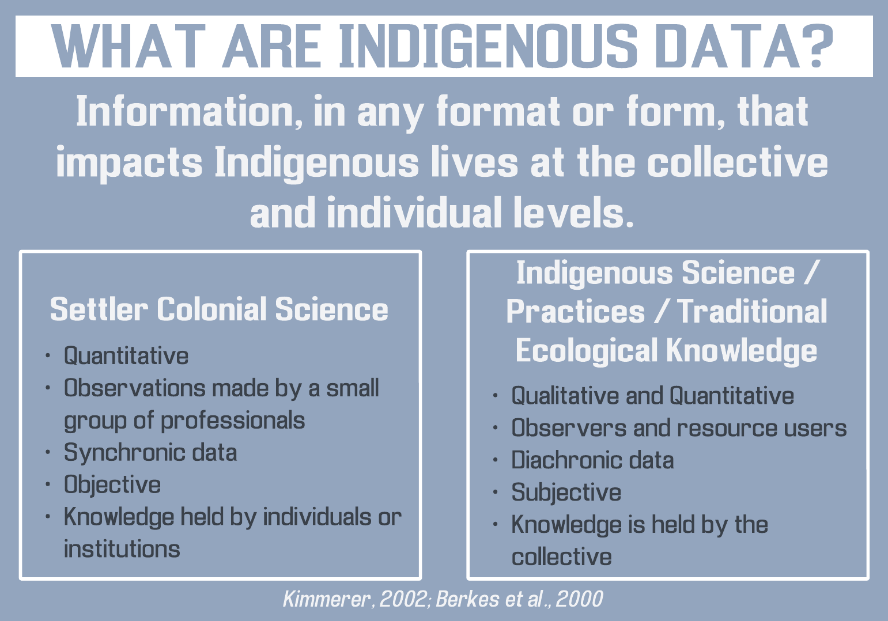

Data analysis as knowledge creation suggests that when data is handled ethically and with community consent, it can generate new insights and foster knowledge growth. Data as Encoded Knowledge posits that data, especially when contextualized, represents a form of knowledge that encapsulates lived experiences, cultural practices and historical narratives. For Indigenous communities, data is intrinsically linked to their identity and autonomy, serving as a vital resource for cultural preservation and self-determination.

### Data as Contemporary Knowledge

Tribal governments today operate sophisticated IT infrastructures comprising applications, networks, devices, users and vast amounts of data. Each interaction within these systems generates more data, representing a new layer of knowledge that Indigenous communities must manage and protect.

### Epistemic Injustice

Epistemic injustice, a term coined by philosopher Miranda Fricker (1999), refers to wrongs done to someone specifically in their capacity as a knower. It involves the marginalization, suppression or devaluation of certain groups’ knowledge and credibility. In the context of Indigenous communities, epistemic injustice has manifested in various forms throughout history, particularly during colonial periods.

This concept explores how social power dynamics can lead to the unfair distribution of knowledge and credibility, impacting marginalized groups.

Historical context and specific examples:

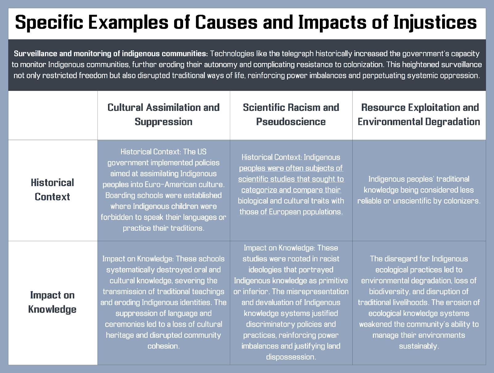

In addition, the following U.S. policies greatly impacted all areas of epistemic injustices.

- Manifest Destiny
- 1830 Indian Removal Act
- 1862 Homestead Act
- 1872 General Mining Law
- 1887 Dawes Allotment Act
- 1964 Wilderness Act
- 1974 Navajo-Hopi Relocation Act

The Interdependence of Knowledge and Power in the Digital Age

Michel Foucault’s concept of power-knowledge emphasizes that power and knowledge are mutually constitutive.

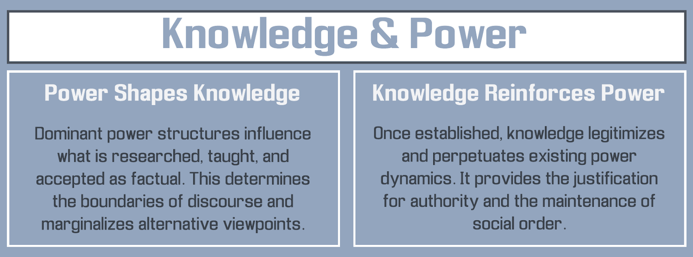

> “Understanding knowledge requires analyzing the power relations that shape its creation and dissemination.”
> — Michel Foucault, 1975

Entities that possess the ability to collect, analyze and disseminate data hold significant power, as they can dictate narratives, influence decision-making processes and maintain dominance over information flows. This concentration of data control reinforces existing hierarchies, enabling those in power to perpetuate their influence.

Knowledge and identity encompass a diverse range of forms and moral dimensions, each shaped by various philosophical traditions such as rationalism, empiricism, constructivism and non-Western epistemologies.

As we transition to the next chapter, it is crucial to explore how these foundational understandings of knowledge and power dynamics inform the pursuit of modern data sovereignty. I believe, addressing historical injustices and leveraging contemporary strategies, we can advance towards a more inclusive and balanced approach to knowledge governance.

## Identity: Types, Evolution and Power Dynamics

“Our identities are always changing and growing, they’re not meant to be pinned down. Our histories are never all good or all bad, and running from the past is the surest way to be defined by it. That’s when it owns us. The key is bringing light to the darkness — developing awareness and understanding.”  
— Brené Brown, Rising Strong

This quote by Brené Brown sets the stage for understanding identity as a dynamic Web. Imagine your identity as a thread within the Web of Data — a vast, interconnected network that spans both your digital and physical lives.

In the Web of Data, Essentialism and Constructionism occupy different regions. Essentialism is like a sturdy, unchanging thread that suggests our identities are rooted in inherent traits. Constructionism, on the other hand, represents flexible strands that evolve through social interactions and cultural influences, showing how our identities are continuously shaped by the Web’s dynamic forces.

Communitarianism shows us how being part of a community helps shape who we are and keeps our traditions alive. At the same time, Networked Individualism explains how we connect with many different groups (online and offline), making our identities dynamic and diverse. This mix of interactions, routines and engagement creates Hybrid Identities, where our in-real-life backgrounds blend with our digital personas, creating layers of technological complexity.

Identity is a construct shaped by social, cultural, historical and political influences. It encompasses the characteristics, beliefs, affiliations and roles that define individuals and groups, enabling them to navigate and make sense of their social environments. According to Stuart Hall, identity is not a fixed essence but an ongoing process of self-definition that is continuously influenced by external factors and internal negotiations (Hall, 1996).

The distinction between essence and existence underscores the debate over whether identity is an inherent, unchanging attribute or a dynamic construct shaped by external factors, setting the stage for key philosophical theories that delve deeper into these foundational perspectives. Let’s dive into some schools of thought showing how identities are fluid and flexible but do in fact have inherent aspects.

Building on this fundamental distinction, various philosophical theories have emerged to explore and define the nature of identity, offering diverse interpretations that range from essentialist views to constructionist understandings.

Let’s have a look at the fundamental differences in identity theories.

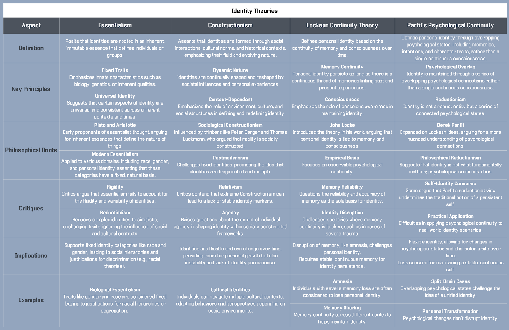

### The Web of Data

### Changing Colors and Textures

> Each color on your thread symbolizes a different experience or emotion. Bright hues might represent joyful moments, like making a new friend or achieving a goal. Darker shades could reflect challenges you’ve faced or obstacles you’ve overcome. The texture of your thread — whether smooth, rough, thin, or thick — shows how easy or difficult those experiences were.

### Interacting with Others

> As your thread weaves through the web, it crosses paths with other threads — the identities of people you meet. Sometimes, your threads might intertwine, sharing colors and textures. This represents relationships that have a strong impact on you, like close friendships or family bonds. Even brief interactions can leave a trace of color on your thread, showing how every person you meet contributes to your identity in some way.

### Nodes and Communities

> The web has various nodes — points where many threads meet. These nodes symbolize the different communities and environments you’re part of, such as your school, neighborhood, online groups, or cultural communities. When your thread passes through a node, it absorbs some of its characteristics. For example, being part of a sports team might add teamwork and perseverance to your thread, while participating in a music club could add creativity and rhythm.

### Growing and Changing Over Time

> As you move through life, your thread continues to evolve. The colors and textures from your childhood might differ from those you pick up as a teenager or adult. This shows how your identity isn’t fixed but is constantly being shaped by new experiences, learning and personal growth. Historical events and the time period you live in can also influence your thread, adding broader societal influences to your personal web.

### Facing Challenges and Healing

> Sometimes, your thread might encounter knots or frayed sections — these represent tough times or significant changes, like moving to a new city, facing a loss, or dealing with personal struggles. But with support from others and personal resilience, these sections can be mended. Healing might even add new colors or strengthen your thread, showing how overcoming challenges contributes to who you are.

### Your Choices and Agency

> You have the power to influence your thread’s journey through the web. You can choose which nodes to visit, which threads to intertwine with and which paths to follow. This means you have agency over your identity, actively shaping it through your decisions and actions. While societal pressures might try to steer your thread in certain directions or change its colors, you can decide how to respond, maintaining the authenticity of your identity. Ultimately, know and embrace your rights!

### Cultural and Social Influences

> Your cultural background and social roles add unique patterns to your thread. Shared colors and textures with others from the same culture represent common heritage and traditions. Different roles you take on — like being a student, sibling, or team member — introduce new elements to your thread, enriching it with diverse experiences.

### Digital Footprints

> Part of your thread weaves through online spaces. Interactions on social media, online gaming or virtual communities add digital colors and textures to your identity. This creates a hybrid thread that blends your offline and online experiences, reflecting the nature of modern identity.

### The Bigger Picture

> When you look at the entire Web of Data, it’s a tapestry made up of countless threads, each with its own journey. The diversity of colors and textures across all threads enriches the web, making it stronger and more beautiful. It shows how we’re all connected, influencing and being influenced by one another.

### Understanding Identity Through the Web

> By viewing your identity as unique, dynamic, color-changing threads in the Web of Data, you can appreciate how every experience, relationship and choice contributes to who you are. It highlights the importance of embracing new experiences, building meaningful connections and being true to yourself. It also reminds us of the value of diversity and the beauty that comes from our interconnected lives.

### Individual Identity

In the Web of Data, your self-concept and self-esteem are like the strength and brightness of your personal threads. High self-esteem makes your thread shine brightly, confidently navigating through various connections, while low self-esteem dims it, making you more susceptible to external influences. As you move through the Web, your self-concept evolves, reflecting the ongoing interactions and experiences that shape who you are.

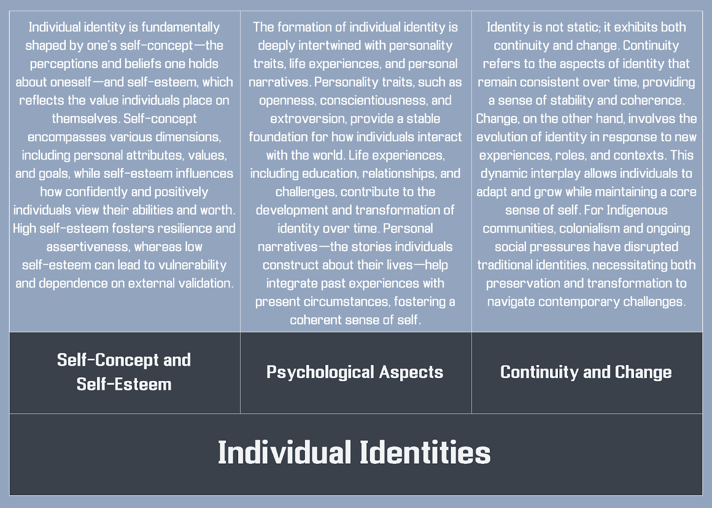

### Communal Identity

Within the Web of Data, communal identities form clusters of interconnected threads, each representing shared values, traditions and cultural practices. These clusters create strong, supportive links that reinforce collective identity and solidarity, much like how communities nurture and preserve cultural heritage amidst the vast network.

### Social Identities

Intersectionality in the Web of Data is like multiple threads overlapping and intertwining, each representing different aspects of social identity such as race, gender and class. These intersecting threads create unique patterns that illustrate how diverse identities interact and shape each other, adding layers of complexity to the Web and influencing individual experiences within the network.

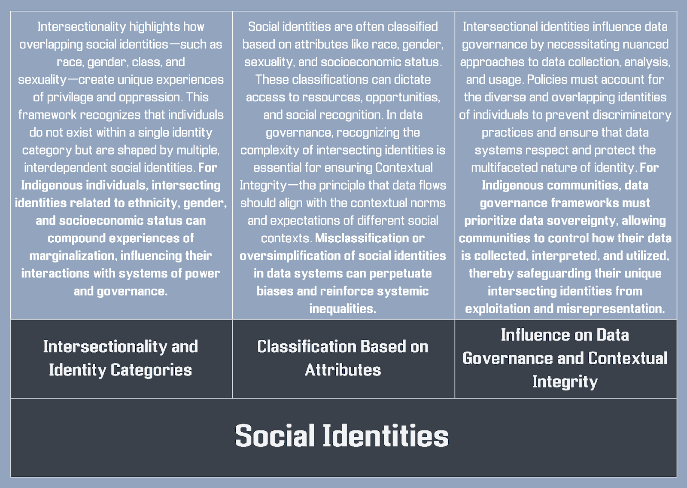

### Non-Human Identity

Non-human identities in the Web of Data are like the essential environmental threads that support the entire network.

In the Web of Data, non-human identities are like the roadways within a city, the veins within a body or the tree line at the edge of a forest — essential environmental threads that support the entire network. Land, animals and ecosystems each have their own unique threads, interwoven with human identities. This interconnectedness highlights the relational nature of identity, where the well-being of non-human entities is intrinsically linked to the health and resilience of human communities.

Key Characteristics of Non-Human Identities

Agency and Personhood

- Active Participants
- Non-human entities are often viewed as active participants within the Web of Data, possessing their own agency and rights. They are not merely background elements but integral threads that influence and sustain the entire Web.
- Challenging Anthropocentrism

This perspective challenges the conventional human-centric view of identity. By recognizing the agency of non-human entities, we promote a more inclusive understanding of community and existence.  
Metaphorical Representation  
Just as veins carry vital nutrients throughout a body, non-human identities transport essential knowledge, cultural values and ecological benefits across the Web, nourishing both the environment and human societies.

Spiritual and Cultural Significance

- Imbued with Meaning
- Non-human identities are deeply embedded with spiritual and cultural meanings, often tied to myths, legends and traditional practices. They serve as anchors within the Web of Data, grounding human identities in a larger cosmological framework.
- Maintaining Heritage

These identities play a crucial role in preserving cultural heritage and collective memory. They act as bridges connecting past, present and future generations through shared narratives and practices.  
Symbolic Threads  
In the Web, these entities are symbolic threads that weave together stories, beliefs and values, reinforcing the fabric of communal identity.

Influence on Individual and Communal Identity

Non-human identity profoundly influences individual and communal psychology by fostering a sense of responsibility, stewardship and belonging.

Recognizing non-human entities as part of one’s identity can:

- Enhance Empathy
- Encourages individuals to empathize with the environment, leading to more compassionate interactions with nature.
- Promote Environmental Consciousness

Heightens awareness of ecological issues and motivates sustainable living practices.  
Strengthen Cultural Pride  
Reinforces connections to cultural traditions and ancestral knowledge, boosting communal solidarity.

For Indigenous peoples, this interconnected identity framework reinforces traditional knowledge systems and sustainable living practices, which are essential for cultural resilience and environmental stewardship. The non-human threads in the Web of Data are vital pathways that transmit ecological wisdom and cultural values, ensuring the legacy and continuity of Indigenous identities.

Continuity and Change

Like human identity, non-human identity is subject to continuity and change within the Web of Data:

- Maintenance through Tradition
- Traditional practices and oral histories help maintain the continuity of non-human identities, ensuring their persistence across generations. These practices keep the threads strong and intact, preserving the integrity of the Web.
- Challenges from Modernization

Environmental degradation, cultural assimilation and technological advancements can disrupt these identities, leading to the weakening or loss of non-human threads in the Web. This disruption can cause fragmentation in the web, affecting both ecological balance and cultural cohesion.  
Efforts for Revival  
Initiatives to revive and preserve non-human identities are crucial. By strengthening these environmental threads, communities work towards restoring the cultural integrity and ecological balance within the Web of Data.  
Identity in the Digital Age

In the Web of Data, online identities are like distinct pathways that lead to various virtual spaces. Each interaction leaves a digital footprint — a trail that shapes and reveals aspects of who we are. Virtual communities serve as vibrant nodes within the Web, where collective and individual identities converge, fostering a dynamic environment for cultural expression and personal growth.

In the era of Web 2.0, digital technologies have profoundly transformed the way identities are formed, managed and perceived. The advent of social media, e-commerce, entertainment (e.g., gambling) and virtual communities have introduced new dimensions to identity construction, challenging traditional interpretation of self and community.

Next, let’s have a closer look at Online Identities, Digital Footprint and Privacy and Virtual Communities, examining their roles in shaping individual and communal identities.

### The Evolution of Identity

The Web of Data is in a state of constant evolution, with threads shifting and adapting to new influences. This dynamic nature fosters Hybrid Identities, where traditional cultural elements blend with modern digital influences, creating a resilient and adaptable network that honors heritage while embracing change.

Virtual communities have fundamentally reshaped identity formation by intertwining Communitarianism, which emphasizes collective belonging and cultural preservation, with Networked Individualism (Wellman, 2001), highlighting the flexibility and multiplicity of modern identities across diverse digital platforms. This synthesis fosters Hybrid Identities, where traditional cultural elements blend with online ecosystems, allowing individuals, particularly within Indigenous communities, to honor their heritage while engaging in the broader global community.

These hybrid identities enhance cultural resilience and adaptability but also present challenges in maintaining cohesive self-concepts amidst fragmented digital personas.

Consequently, data governance frameworks must evolve to respect and protect the nature of these identities by ensuring Contextual Integrity and data sovereignty.

### Identity and Power Dynamics

Within the Web of Data, hegemony manifests as powerful currents that guide the flow and visibility of certain threads, often overshadowing and marginalizing alternative identities. These dominant narratives dictate what is considered “normal” or “acceptable,” making it challenging for marginalized identities to assert their own stories and reshape the Web’s structure to reflect their true selves.

Hegemony and Dominant Narratives

Hegemony refers to the dominance of one group over others, not merely through coercive means but through the subtle shaping of cultural norms, values and beliefs that become accepted as the societal standard. This concept, extensively developed by Antonio Gramsci (1971), emphasizes how dominant groups maintain their authority by securing consent and shaping the ideological landscape, thereby influencing how identities are perceived and constructed within a society.

Dominant narratives are the prevailing stories and discourses that shape collective understanding and societal expectations. These narratives often originate from dominant groups — such as colonial powers, mainstream media and political elites — and serve to reinforce their power by marginalizing alternative perspectives and identities. Michel Foucault further explores how power and knowledge intersect, arguing that dominant narratives are a form of power that dictate what is considered “truth” and “normal,” thereby influencing individual and collective identities.

Throughout this chapter, the Web of Data has served as a powerful metaphor to illustrate the complex, interconnected nature of identity. From the communal threads that bind us to our communities, to the individual strands that reflect our unique experiences, and the non-human elements that support our existence, each part of the Web plays a crucial role in shaping who we are. Understanding these interconnected layers is essential for addressing data sovereignty and epistemic justice, ensuring that marginalized communities can protect and empower their diverse identities. As you navigate your own Web of Data, remember that your identity is a dynamic and evolving network, influenced by both collective and individual interactions.

In this chapter, we have explored the nature of identity, including its philosophical underpinnings and social dimensions. We began by distinguishing between Essentialism and Constructionism, highlighting the debate over whether identities are inherent and unchanging or socially and culturally constructed. Building on this foundation, we examined Personal Identity Theories, which elucidate how memory, consciousness and overlapping psychological states contribute to the persistence and evolution of individual identity. Further, we analyzed Communal and Social Identities, emphasizing the roles of self-concept, cultural heritage and intersectionality in shaping unique personal and collective experiences.

The discussion extended to the Digital Age, where virtual communities and online interactions have redefined identity formation through Communitarianism and Networked Individualism, fostering Hybrid Identities that blend traditional cultural elements with contemporary digital influences. Additionally, we addressed Identity and Power Dynamics, illustrating how hegemony and dominant narratives perpetuate certain identity norms while marginalizing others, particularly within Indigenous communities.

Understanding these complex layers of identity is crucial for addressing issues of data sovereignty and epistemic justice. Recognizing the intricate interplay between individual, communal and social identities informs the development of data governance frameworks that respect and protect the diverse and complex identities of marginalized communities. By prioritizing Contextual Integrity and ensuring that data practices uphold the autonomy and cultural integrity of Indigenous and other marginalized groups, policymakers and technologists can empower these communities, safeguarding their identities against exploitation and misrepresentation.

Ultimately, a comprehensive grasp of identity — its philosophical roots, social constructs and digital transformations — enables more effective and ethical efforts to protect and empower marginalized populations. This understanding is essential for fostering equitable data governance practices that honor the rich tapestry of identities, ensuring that all communities can thrive with agency and dignity in an increasingly interconnected world.

So, next time you’re asked to introduce yourself, what are you going to say?

## Information Flows and Communication

In the last chapters, we defined knowledge and identity. Next we’ll discuss how critical it is to ensure the following when sending or sharing knowledge:

1. Maintain integrity to ensure knowledge remains unaltered during transmission.
2. Encrypt or encode data while in transit to protect it from interception.
3. Confirm receipt to verify that information is received exactly as sent.
4. Restrict access to ensure only the intended recipients receive the information.
5. Implement non-repudiation to prevent senders or receivers from denying the communication.
6. Enable auditing to track and review access to the information.
7. Establish contingency plans in case the original information exchange fails.

These seven capabilities are key when it comes to the secure transmission and receipt of information. This list is effectively what every cybersecurity nerd studies and practices day-to-day. Operationalizing these capabilities is what organizations refer to as: Security Operations.

Just as a spider meticulously maintains its web to ensure each thread remains strong and intact, organizations must implement robust security operations to protect the flow of information within the Web of Data. Ensuring integrity, encryption and secure transmission are akin to reinforcing the Web’s structure against external threats.

For the nerds reading this, I tend to think of Information Flows as being part of Layer 7 of the OSI model — which is the Application Layer.

An information flow can be illustrated with an example of healthcare information. When I visit a doctor to receive treatment, the doctor’s office provides my insurance company with information about me and my visit including previous history, diagnosis details, prescriptions and treatment plans. I will refer to this information as an electronic medical record (EMR). Due to the nature of your EMR, the sensitivity and privacy is very high. This information in the wrong hands can put the patient and the provider at risk.

From a data transmission perspective, there must be a purpose for sharing, consent and minimal disclosure (aka least privilege or need-to-know) when sharing my EMR.

- The purpose of sharing my EMR with the insurance company is to process the insurance claim and reimbursement.
- As a user of the insurance network and provider, I’ve signed forms upon check in and when signing up for the insurance plan that authorize the transmission of relevant data from the provider to the insurance company. In other words, only the necessary information required for processing the insurance claim is shared, avoiding additional details.

To illustrate this concept further, here’s an example of employee performance reviews as an information flow.

During performance reviews, a manager usually provides the employee with a review and feedback on their job performance. These reviews influence career development, compensation, promotions and overall organizational effectiveness.

In addition to my manager and I accessing this information, other individuals or groups may need to have access as well. Human Resources (HR), higher management and external auditors in some cases.

This information and knowledge about me and my performance is highly sensitive for personal, professional and organizational reasons.

From a transmission perspective, the fundamentals listed above apply. Let’s take a look at the seven fundamentals within the context of an Employee Performance Review information flow.

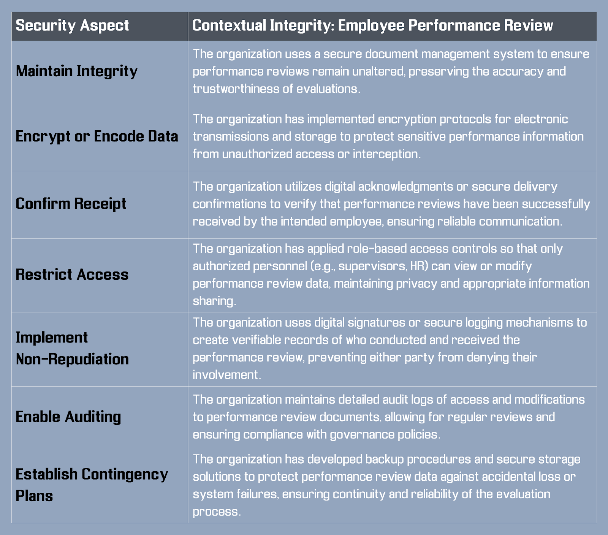

With the examples of an Electronic Medical Record and Employee Performance Review information flows, we see how the seven transmission fundamentals factor in when transmitting or otherwise sharing data.

Before moving on, let’s discuss social media companies for a moment. Over the years, social media companies have developed sophisticated information flows that connect individuals with behaviors and context. These platforms exploit user data by collecting vast amounts of personal information, often without explicit consent or transparency and monetize this data through targeted advertising and selling to data brokers. The lack of comprehensive national regulation allows these companies to operate with minimal oversight, enabling practices that undermine user privacy and trust.

Social media companies maintain significant power over the information ecosystem because they are able to shape the user’s experience and influence societal norms. If not directly, then a third-party may have “too much” access to data and begin to abuse the access. As we saw with Cambridge Analytica (Netflix, 2019).

As users, we make this trade-off with every platform we use for “free.” Because there is no cost to use Facebook or LinkedIn, we get to sign up, accept their terms and conditions written in legalese and access the network on the other side of the sign-in page. As we use these platforms, interact with other users or the content on the platform, the data is collected, analyzed and subsequently used to make more money for the company.

The bottom line about these contextual flows is this: in the case of my EMR, if the data is used for any other purpose than what was agreed upon, that is a violation of the agreement and can increase the risk for the patient, provider or the insurance company.

So, when we’re talking about Contextual Integrity during our next family dinner, we can confidently tell Auntie Dolores that it simply means that the data collected must be used for what it was collected for. Any other use of the data is a no-no.

Next up, Contextual Integrity and after that: How access to communications networks, such as the Telegraph system, perpetuated the power imbalances between Indigenous people and colonizers.

### Contextual Integrity Framework

“It posits a new construct, ‘contextual integrity,’ as an alternative benchmark for privacy, to capture the nature of challenges posed by information technologies. Contextual integrity ties adequate protection for privacy to norms of specific contexts, demanding that information gathering and dissemination be appropriate to that context and obey the governing norms of distribution within it. Building on the idea of “spheres of justice,” developed by political philosopher Michael Walzer, this Article argues that public surveillance violates a right to privacy because it violates contextual integrity; as such, it constitutes injustice and even tyranny.  
— Privacy as Contextual Integrity developed by Helen Nissenbaum

The concept of privacy as contextual integrity, developed by Helen Nissenbaum (2004), offers a nuanced framework for understanding how information flows should be managed within different contexts to maintain privacy and trust. This framework asserts that privacy is preserved when information gathering and dissemination are appropriate to the specific context and adhere to its governing norms. In this section, we introduce the core principles of the Contextual Integrity Framework — Contextual Norms, Actors and Attributes and Transmission Principles — and explore how they relate to the Web of Data metaphor.

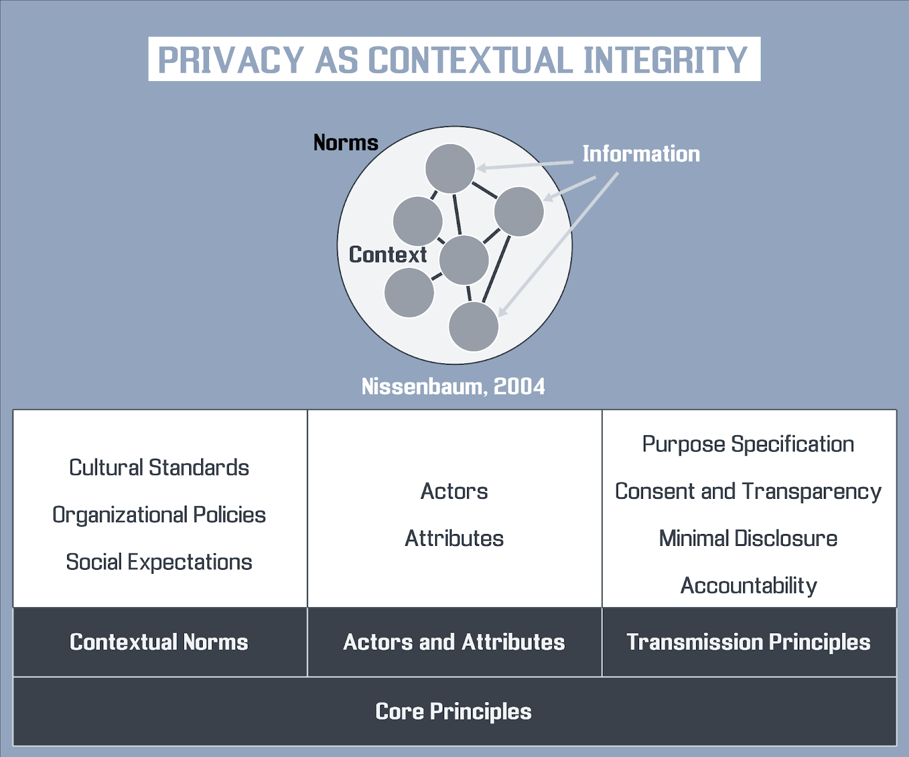

Core principles:

- Contextual Norms
- Understanding the specific norms governing information flows within different contexts
- Actors and Attributes

Identifying the entities involved in information transmission and their relevant attributes  
Transmission Principles  
Rules and expectations for how information is shared and used

As we apply these core principles to the Web of Data metaphor, important nuances emerge that deepen our understanding of privacy and information flow. For instance, Contextual Norms mean that for any segment of the Web, these norms act as the local rules and expectations governing how information can be shared and utilized. Violating these norms can disrupt the continuity of the Web, challenging its resilience and leading to breaches of trust, misuse and other ethical dilemmas.

In the Web of Data, Actors and Attributes represent the various nodes and threads that make up the intricate network. Actors are the identities interacting within the Web — essentially, the nodes where threads intersect. Their attributes — such as roles, permissions, cultural backgrounds and levels of trust — define how they engage with the information threads. For example, a healthcare professional (actor) with authorized access (attribute) can retrieve my sensitive patient data, whereas an unauthorized individual cannot. Recognizing and respecting the unique attributes of each actor ensures that information flows appropriately, maintaining the integrity and balance of the Web. Ignoring these attributes can lead to miscommunications or breaches that weaken the entire structure, or worse, damage the Web.

As for Transmission Principles, the Web of Data relies on established pathways and tensions that dictate how threads are woven between nodes. These principles are the rules and expectations — such as consent, confidentiality and data minimization — that ensure information is shared ethically and securely. They are akin to the Web’s structural guidelines that prevent threads from tangling or snapping under stress. By adhering to transmission principles, we move smoothly along the threads, preserving the Web’s harmony and strength. Violating these principles — like sharing information without consent or exceeding the intended scope — can create vulnerabilities, leading to potential exploitation or collapse of trust among actors (i.e., nodes). Therefore, transmission principles are essential for upholding the Web’s resilience, ensuring that the flow of information supports the interconnected network without compromising its foundational ethics.

Understanding and implementing the components of Contextual Integrity is essential for managing information flows ethically and effectively. Whether in the context of employee performance reviews or broader data governance practices, adhering to these principles ensures that information is used and shared responsibly, respecting the norms and expectations of each unique environment. This comprehensive approach fosters trust, protects privacy and upholds the integrity of knowledge transmission and ultimately contributes to more equitable and secure information management practices.

### Applying Labels to Context Flows: Ensuring Contextual Integrity in Modern Data Practices

In the era of big data and big tech, the volume, variety, velocity and veracity of data generation presents significant challenges for maintaining security, privacy, trust and ethical standards in data stewardship. One of the most important aspects of addressing these challenges is data labeling, which involves annotating or tagging data with contextual information to ensure it is processed, accessed and stored appropriately. This practice is key to upholding Helen Nissenbaum’s principle, contextual integrity, which posits that information flows should adhere to the norms, expectations and requirements of specific contexts.

Challenges in data lifecycle management encompass the stages of generation, collection, storage, processing and sharing. Sometimes, during the initial stages, data is unstructured, messy and rapidly produced, making large-scale labeling a complex task. Without proper labeling or tagging, data cannot be effectively organized, analyzed or utilized leading to inefficiencies or potential ethical breaches.

Mechanisms for Effective Data Labeling

To address these challenges, there is a need for robust process mechanisms that can label data efficiently while maintaining consistency and sustainability. One such approach is the Operationalizing Data Analytics Methodology (ODAM), an open-source framework I developed with hopes to standardize data analytics processes at the organizational level. ODAM provides a common language and set of practices that can be adopted across organizations to facilitate data labeling and governance.

Contextual Integrity and Indigenous Data Sovereignty

Applying Nissenbaum’s principle of contextual integrity is particularly significant in the context of Indigenous data sovereignty. Indigenous communities have unique cultural norms and values that dictate how information should be shared and used. By ensuring that data practices align with these norms, organizations can foster trust and promote ethical stewardship of Indigenous knowledge.

Traditional Knowledge (TK) Labels, developed by the initiative Local Contexts, exemplify a practical application of contextual integrity. TK Labels are designed to identify cultural materials with community-specific conditions regarding access and use. They embed Indigenous rules and protocols within digital systems, promoting new standards of respect and acknowledging the sovereignty of Indigenous communities over their knowledge.

As stated by Local Contexts:

> “The Traditional Knowledge (TK) Labels allow communities to express local and specific conditions for sharing and engaging in future research and relationships in ways that are consistent with already existing community rules, governance, and protocols for using, sharing, and circulating knowledge and data.”

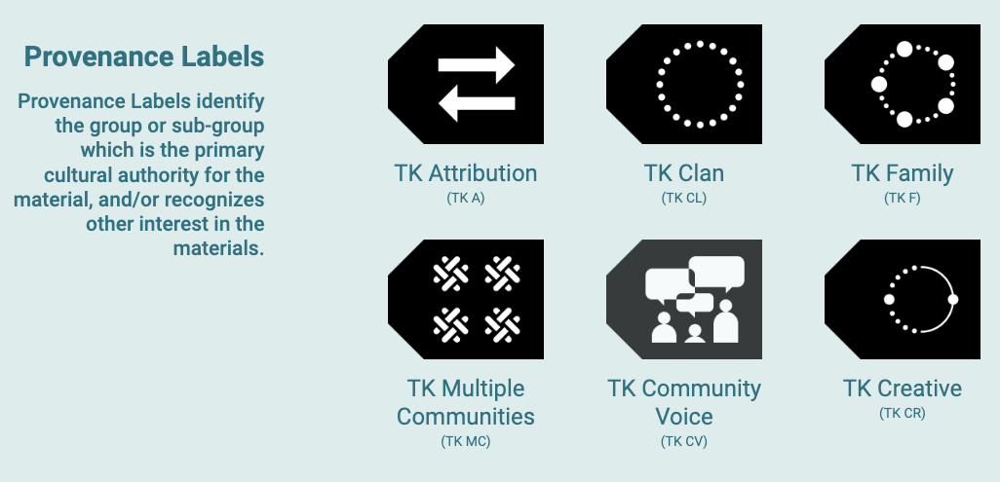

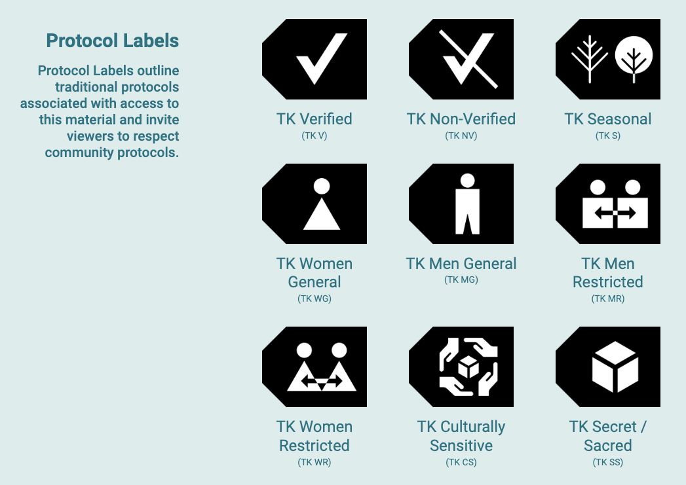

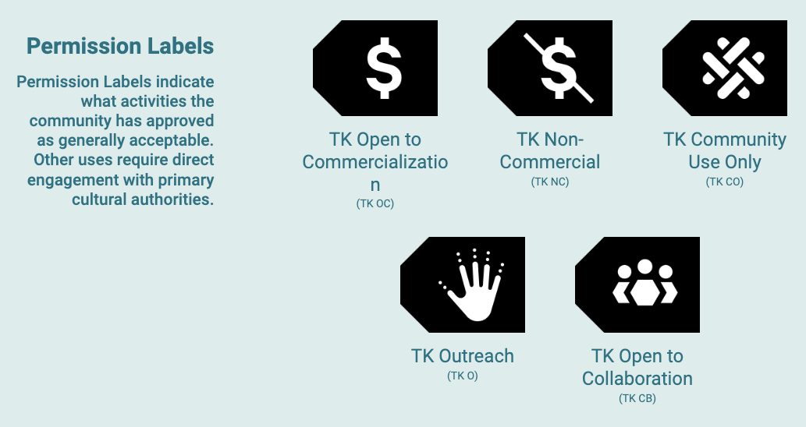

For Indigenous communities, the use of TK Labels is a way to embed ethical considerations into data management practices. By specifying conditions for access and use, these labels help prevent misuse and support the preservation of cultural heritage.

Implementing ODAM for Consistency and Sustainability

The Operationalizing Data Analytics Methodology (ODAM) framework can play a pivotal role in standardizing data labeling practices:

- Common Language
- ODAM provides terminology and definitions that facilitate clear communication among stakeholders.
- Process Standardization
- It outlines processes for data handling that can be uniformly applied, ensuring consistency.

Scalability  
The framework is designed to be adaptable to different organizational sizes and data volumes.  
Sustainability  
By promoting best practices, ODAM helps organizations build sustainable data management systems that can evolve with changing needs.

Designing Data Systems Aligned with Indigenous Protocols

In practice, aligning data systems with Indigenous protocols involves:

- Community-Led Governance
- Establishing governance bodies composed of community members to oversee data practices.
- Culturally Relevant Categorization
- Applying labels that reflect Indigenous worldviews and knowledge.

Access Controls Based on Community Norms  
Implementing permissions that align with cultural protocols regarding who can access certain types of information.  
Capacity Building  
Investing in training and resources for Indigenous communities to manage and utilize data systems effectively.

This alignment reinforces the autonomy and self-determination of Indigenous communities, ensuring that data practices do not inadvertently perpetuate colonial dynamics.

### Signals of Change: How the Telegraph and Broadband Access Transform Communication Landscapes

Communication technologies have profoundly influenced Indigenous communities from the 18th century to the present day. Beginning with the telegraph system, these technologies have functioned both as tools of oppression and catalysts for empowerment, shaping social structures, preserving cultures and providing avenues for resistance.

By controlling radio and television, governments historically limited alternative viewpoints and suppressed dissenting voices, perpetuating social hierarchies and maintaining power imbalances. The dissemination of state-sanctioned narratives — which reinforce stereotypes and justify discriminatory policies — has been, and continues to be, commonplace. This control over communication mediums has systematically marginalized Indigenous perspectives.

Similarly, social media companies and their affiliates leverage the Internet in ways that can both amplify and, at times, suppress diverse perspectives. Due to the complexities of content regulation and a lack of comprehensive oversight, these tech giants — supported by significant lobbying efforts — exercise substantial control over the flow of information. Their algorithms and content moderation practices can inadvertently filter out or deprioritize voices from marginalized communities, influencing which narratives gain prominence.

Since the advent of technologies like the telegraph, a digital divide has persisted. There are those who control the technology, those who have access to use it, and those who lack both control and access. This divide continues to impact Indigenous communities disproportionately.

Before we delve into Morse’s telegraph system, I’d like to set the stage with a look at broadband access within Native American communities, particularly among women and girls.

Nationally, 68% of all tribal communities on reservations lack access to broadband. In New Mexico, estimates suggest that 80% of individuals residing on tribal lands do not have Internet access. This digital divide has profound consequences: educational opportunities diminish, economic inequalities widen and health disparities grow more severe.

The lack of reliable internet disproportionately affects women and girls, exacerbating existing gender disparities. According to research by Foxworth (2022) and Pruitt (2022), these connectivity gaps hinder their access to education, limit economic prospects and restrict vital health information and services.

This scenario echoes the historical exclusion experienced during the expansion of the telegraph system in the late 19th century. While the telegraph revolutionized communication, it often bypassed Indigenous communities, leaving them disconnected from rapid information flows and emerging opportunities. Just as telegraph lines spanned the nation without integrating these communities, today’s broadband infrastructure frequently overlooks tribal lands, repeating patterns of marginalization.

Recognizing these recurring patterns is crucial. Addressing the digital divide requires intentional efforts to include Indigenous voices in the development and control of communication technologies. By empowering these communities with access and agency, we can transform communication landscapes into platforms for inclusivity and equitable growth.

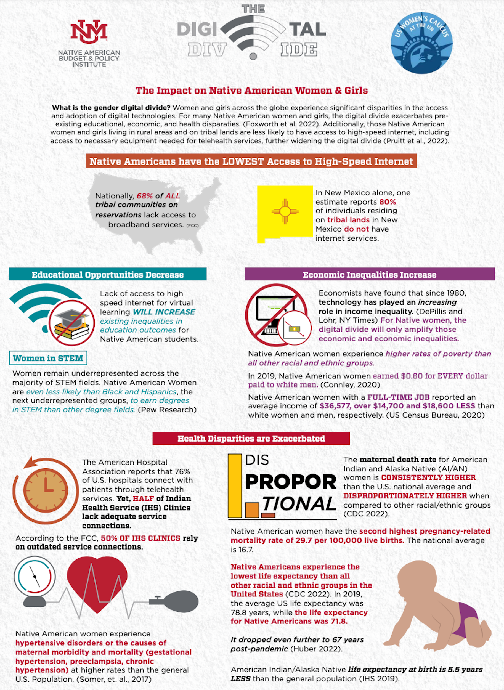

Looking five to ten years into the future, there is both hope and critical work to be done to ensure that the patterns of marginalization faced by Indigenous communities are not repeated but instead reversed. The goal is to transform the communication landscape into one that is inclusive, equitable and empowering for Native American communities, particularly for women and girls.

In the next decade, with improved Internet access:

- Digital Education Platforms
- Schools on reservations could integrate digital learning tools, providing students with resources comparable to those available in well-connected areas. This access can help close the educational achievement gap.

Cultural Preservation and Language Revitalization  
Enhanced connectivity allows for the creation and sharing of digital resources aimed at preserving Indigenous languages and cultures, engaging younger generations through technology.

Going back to the early 19th century, Samuel Morse had not only invented Morse Code, but the Morse Telegraph system as well. This technology and its distinctive sounds will change the landscape and echo forever into time.

The sound of Morse Code.

*[Archive note: the published essay embeds an audio clip here, “Morse Code Telegraph Sound Effect” by CW_USC.]*

Growing up in the 80s and 90s (as my youngest says, “the late 1900s”), my world of communication technologies centered around the landline phone in our home. Initially the curly-corded handset, then eventually, a 900 megahertz handset that had signal issues when the microwave was running!

The landline was the lifeline that connected us to our families and the outside world. I remember the hours and hours I crank called people, belly laughing with my cousins. The landline required us to be present, by the phone to hear the ringing or make our call.

The US Postal Service was heavily relied upon by our family, like many others in Albuquerque. My grandmother had everyone’s information in her bounded organizer that kept all the family’s phone numbers, addresses and birth dates.

As the 1990s unfolded, I encountered the Internet for the first time! I’m sure you remember America Online (AOL) and those CDs (compact discs)! The screech of dial-up modems opened doors — and my mind — to email, instant messaging and an expanding digital landscape.

We all have our stories about the communication technologies we grew up with and how they impacted our lives. I wonder what it was like when the profound impact of the Telegraph system emerged in the Southwestern part of North America.

The Emergence of the Telegraph

In the early to mid-19th century, the invention of the telegraph marked a pivotal moment in the history of communication. Prior to the arrival of the telegram, messages were conveyed through methods such as messenger runners, horseback riders, smoke signals, carrier pigeon and letter carrier services (e.g., Pony Express). Each of these, limited by distance and time. The telegraph overcame these limitations, allowing for real-time communications that was previously unimaginable.

Samuel Morse developed the telegraph system which uses electrical signals to transmit messages over wires, enabling two parties to communicate over very long distances and in real-time. The impact the telegraph system had on Indigenous peoples, at the time, was not well understood.

The telegraph fundamentally altered how information flowed within society. It collapsed the time it took for news and official government messages to travel, reshaping expectations around timelines and responsiveness. Businesses, like the railroad operators, could coordinate activities across states while journalists could report events as they happened. And, the U.S. government could coordinate its plans to take over land.

The telegraph system was often implemented in ways that prevented Indigenous people from effectively using it and was implemented in ways that served colonial interests. Traditional methods of communication and knowledge sharing — rooted in oral traditions and communal practices — were overshadowed by this new technology that prioritized speed over relational depth.

Governance and Control of the Telegraph

The proliferation of the telegraph necessitated the establishment of regulatory frameworks to manage this new mode of communication. Governments and private entities vied for control over telegraph networks, recognizing the power inherent in overseeing information flows. Companies like Western Union emerged as dominant forces, often holding monopolies that allowed them to influence what information was transmitted and who had access.

This concentration of control raised concerns about equity and access. Marginalized groups, including Indigenous peoples, frequently found themselves excluded from the benefits of the telegraph network. Their voices and perspectives were underrepresented, and the narratives that spread through the telegraph lines often reinforced colonial agendas.

The advent of the telegraph transformed how knowledge was disseminated and accessed. In business, it enabled rapid decision-making and coordination, fueling the expansion of markets and industries.

Journalism was also revolutionized. Reporters were able to transmit stories across great distances quickly, leading to the rise of news agencies and a more informed public. See above: knowledge is power.

The transformation brought about by the telegraph in the 19th century parallels the shifts experienced with the rise of the Internet in my own lifetime. Both technologies redefined communication, altered societal norms and had profound implications for how information is controlled and shared.

As we consider the impact of these technologies, it is important to acknowledge the perspectives of those whose experiences may differ from the dominant narratives. Indigenous communities have long emphasized the relational and living nature of knowledge and data. As Stephanie Russo Carroll eloquently states in her TEDxUArizona talk:

> “Indigenous data are living and breathing, reconstituting our 3D world as relatives, as peoples, as families, as communities.”

This viewpoint reminds us that communication technologies are not just tools for transmitting information; they are instruments that can either bridge or widen gaps between communities. Actors can harness the power of technology to shape identities, influence relationships and affect the continuity of cultures.

## Surveillance and Privacy

“Ultimately, saying that you don’t care about privacy because you have nothing to hide is no different from saying you don’t care about freedom of speech because you have nothing to say.”  
— Edward Snowden, Permanent Record, 2019

During one of my drives, I found myself reflecting on the extensive miles of fencing that cut through the horizon.

There is estimated to be 620,000 miles of fencing crisscrossing the Western United States. Drive around you’ll see fences that are intact still serving a function but you will also see fencing that is no longer maintained, down and without purpose. The presence of fencing, barbed and other types, can pose challenges and act as barriers for migrating wildlife. Animals can be injured or killed when they collide with or get tangled in the barbed wire and other types of fencing (Wild Aware, 2024)

These borders also mark the boundaries of physical spaces on both land and water, often slicing through rivers, lakes and oceans.

For instance, near the Rio Grande in Las Cruces, there are fields dedicated to growing chile and other crops. This land, near the river, is particularly valuable because of its proximity to a water source.

In the 18th and 19th centuries, land confiscation and acquisition were rampant. The U.S. government negotiated treaties with Indigenous Nations to define land ownership and access to resources. However, these treaties often established clear boundaries, and came with corruption. Encroachment on Indigenous lands was frequent and sometimes overtly encouraged.

As we look to the future and consider the introduction of innovative (and potentially cruel) technologies like virtual fencing, we must consider their potential impacts — both positive and negative.

Deploying sensors across the land generates vast amounts of data. This new data holds the potential for both beneficial and harmful uses. Additionally, it can be integrated with existing traditional and contemporary knowledge. However, if only a select few control the collection, analysis and use of this data, the power dynamics may remain imbalanced. The answer is to involve multiple groups utilizing this data. This approach can lead us to more equitable outcomes for historically marginalized communities.

> An intentional, inclusive process with diverse stakeholders can transform how data is managed and shared.

The benefits of these new systems are substantial. Enhanced land management, conservation efforts and environmental monitoring are just a few areas where data analytics and knowledge management can make a significant impact.

We’ve discussed earlier in the article how colonizers and the U.S. government used their power to systematically disrupt the culture and heritage of Indigenous Americans. We discussed how data are a strategic resource and dove into what knowledge is. Data are information, which in turn is knowledge, and knowledge is power.

When a group has power and wields it to the detriment of a people, this looks like land loss for Indigenous communities.

As we get into the topic of surveillance and privacy, I’m reminded of the Westward expansion when the United States government sought to consolidate its control over vast territories inhabited by Indigenous Peoples.

Let’s imagine that among the efforts to control the Southwestern part of North America was the establishment of surveillance networked aimed at gathering intelligence on Indigenous communities and their land use practices.

In this story, a government-appointed surveyor — we’ll call, Reed — was tasked with mapping lands in the desert Southwest. Under the guise of conducting geographic surveys, Reed and his team set up observation posts near Indigenous homes. Equipped with basic recording devices and relying on keen observation, they meticulously documented every aspect of daily life — from hunting patterns and agricultural practices to social gatherings and spiritual ceremonies.

Reed’s mission extended beyond simple observation. The intelligence gathered from these surveillance activities was systematically analyzed to identify patterns and vulnerabilities within the Indigenous communities. Detailed reports highlighted the locations of fertile land, water sources and strategic territories that were deemed valuable for agricultural expansion, resource extraction or settlements.

One fall day, as Reed reviewed his latest observations, he noticed that the local tribe’s seasonal migrations aligned closely with the blooming of certain crops. This insight was pivotal. By understanding the tribe’s agricultural cycles, the government could predict periods of low or no resistance and strategically plan land acquisitions when the communities were least able to defend their territories.

Reed’s findings were also presented to government officials, who used the intelligence to negotiate treaties under false pretenses and in bad faith. Promises of protection and resources were made, but in reality, these treaties facilitated the gradual encroachment and eventual confiscation of Indigenous lands.

The surveillance data had effectively stripped the communities of their ability to negotiate from a position of strength, leading to significant land loss and disruption of their traditional way of life.

This story highlights the insidious role of surveillance in the systematic disenfranchisement of Indigenous Peoples. By leveraging information and intelligence unknowingly collected, the government was able to manipulate and control the acquisition of land, further entrenching power imbalances and perpetuating the marginalization of Indigenous communities.

> “If you’re living in a world where you can’t know whether every conversation you’re having is being listened to…whether every digital fingerprint you leave isn’t being cataloged and recorded into a profile that represents you. Would you be a little more hesitant about the stuff that you read? Would you be a little more cautious about the conversations you’re having?”
> — Philosophize This! Podcast, episode 186

The story of early surveillance and its role in land acquisition underscores the enduring relationship between knowledge, power and control. By examining historical instances of surveillance, we gain a deeper appreciation of the need for robust data sovereignty measures today and community involvement in policy-making. These measures would prohibit or prevent the misuse of information and ensure that Indigenous communities retain authority over their own data and land. In the next section, we’ll discuss the mechanics of surveillance.

### Mechanics of Surveillance

Understanding how surveillance works requires a deep dive into its fundamental components and processes, which collectively enable pervasive monitoring and control in modern society.

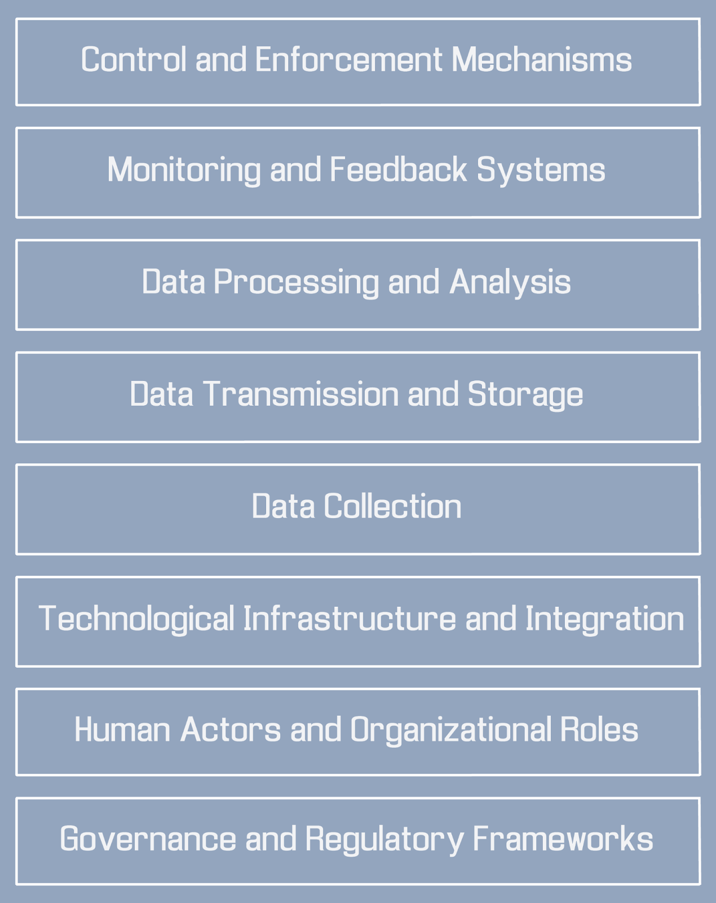

Surveillance systems integrate regulatory policies, advanced technologies and continuous data management to enable pervasive monitoring and control. This infrastructure creates an environment where constant observation becomes normalized.

Next we’ll discuss Foucault’s Panopticon and its profound effects on privacy and autonomy.

### Foucault’s Panopticon (Theoretical Framework)

Earlier in the article we introduced Michel Foucault’s theoretical framework, the Panopticon. Foucault built on the work of Jeremy Bentham, an English philosopher and social theorist, who conceived the idea of the panopticon in the late 18th century as an architectural design for prisons. Bentham’s design featured a central observation tower surrounded by cells arranged in a circular fashion, allowing a single guard to observe all inmates without them knowing whether they were being watched at any given moment.

Foucault expanded on Bentham’s concept in his book “Discipline and Punish: The Birth of the Prison” (1975). He used the Panopticon as a metaphor to analyze modern disciplinary societies and the pervasive mechanisms of surveillance and control. Foucault argued that the principles embodied in the Panopticon had extended beyond prisons into various institutions like schools, hospitals and workplaces, leading to a society where people internalize surveillance and regulate their own behavior.

Building upon Foucault’s concept of the Panopticon, we see how the internalization of surveillance profoundly impacts individual behavior and societal norms. The constant awareness of being watched leads people to regulate their own actions, normalizing certain behaviors and diminishing resistance to authority. This perpetual monitoring not only enforces conformity but also subtly reshapes social dynamics by instilling a sense of self-surveillance.

> This theoretical prison design creates a sense of constant surveillance, making individuals consciously aware that they are permanently visible, which ensures the automatic functioning of power. This theory underscores how surveillance can internalize control, leading individuals to regulate their own behavior.

Psychological and Social Impacts of Surveillance

- The mental and social effects of constant surveillance are significant for individuals and communities alike. Continuous monitoring can lead to elevated stress and anxiety levels because people feel perpetually scrutinized.
- Overlapping social identities — such as gender, age, cultural background, and socioeconomic status — further influence the impact of surveillance. Certain groups may experience heightened vulnerability due to a combination of these factors, exacerbating feelings of exposure and marginalization. For example, women and girls might face additional pressures that intensify the effects of surveillance on their daily lives.
- This pervasive surveillance can lead to what is known as the “gaslighting” effect. Individuals begin to doubt their own perceptions and judgments, questioning their reality. The constant presence of surveillance undermines personal autonomy, fostering a dependency on authoritative systems for validation and security. As people internalize the observer’s gaze, they may lose confidence in their ability to interpret their experiences independently, leading to diminished self-agency and increased conformity.

By understanding these psychological and social impacts, we recognize the profound ways in which surveillance can affect all people; some more than others.

### The Gaslighting Effect of Pervasive Surveillance

Pervasive surveillance extends beyond mere observation — it fundamentally alters how individuals perceive themselves and their interactions with the world around them. This phenomenon can lead to what is known as a gaslighting effect, where individuals begin to doubt their own perceptions, judgments and even their sense of reality. In the context of surveillance, gaslighting manifests as a psychological manipulation that undermines personal autonomy and fosters a dependency on authoritative systems for validation and security.

The term “gaslighting” originated from Patrick Hamilton’s 1938 play, in which a husband methodically dims gas lights to make his wife doubt her own perceptions and sanity, thereby manipulating her reality to gain control over her and her inheritance.

When discussing The Gaslighting Effect of Pervasive Surveillance, Sweet et al. (2020) provides an academic foundation for understanding how gaslighting operates within surveillance contexts. Their exploration of psychological manipulation aligns with the ways in which constant monitoring can distort individual perceptions and erode autonomy.

Understanding gaslighting in surveillance

Gaslighting is a form of psychological manipulation where false information is presented to make individuals question their memory, perception or sanity. Originally conceptualized in the context of abusive relationships, the term has expanded to describe broader societal manipulations, including those facilitated by surveillance technologies.

In surveillance contexts, gaslighting occurs when constant monitoring creates an environment where individuals feel they are always being watched and evaluated. This omnipresent oversight can lead to self-censorship, altered behaviors and a diminished sense of personal agency. The relentless observation makes individuals second-guess their actions and decisions, believing that their privacy is compromised and that their behaviors are perpetually under scrutiny.

Mechanisms of the Gaslighting Effect Through Surveillance

Internalized Surveillance:

- Psychological Impact
- The awareness of being constantly watched can lead individuals to internalize the gaze of the surveillant authority. This internalization means that individuals regulate their own behavior out of fear of judgment or repercussions, rather than out of personal conviction or ethical considerations.

Self-Censorship  
To avoid negative evaluation, individuals may restrict their actions, opinions and expressions, leading to a homogenization of behavior that aligns with perceived expectations.

Erosion of Trust:

- Trust in Self
- Continuous surveillance can erode trust in one’s own perceptions and judgments. When individuals are frequently reminded that their actions are being monitored, they may begin to doubt their instincts and rely more heavily on external validation.

Trust in Others  
Surveillance can also diminish trust in peers and community members. The fear of being watched may lead to secrecy and suspicion, weakening communal bonds and fostering isolation.

Distorted Reality:

- Description
- The manipulation of information and the selective presentation of data create a distorted perception of reality.

Impact  
Individuals may become uncertain about the accuracy of their own thoughts and experiences, relying increasingly on corporate algorithms for guidance and validation.

Dependency on Authoritative Systems

- Validation
- As individuals lose confidence in their own perceptions, they become increasingly dependent on authoritative systems for validation and decision-making. This dependency reinforces the power dynamics between surveillants and the surveilled, as authority figures become the primary sources of truth and legitimacy.

Security  
The perceived need for protection and security under surveillance fosters a reliance on the systems that monitor them, further entrenching the authority’s control over individual autonomy.

### Surveillance Capitalism

In her seminal work, The Age of Surveillance Capitalism (2019), Shoshana Zuboff introduces the concept of Surveillance Capitalism, a paradigm wherein corporations commodify personal data to predict and modify human behavior for profit. Zuboff argues that this pervasive data collection and surveillance lead to a profound loss of autonomy and self-determination, transforming individuals into products of their own data-driven behaviors.

Unlike traditional capitalism, which relies on the exchange of goods and services, surveillance capitalism thrives on the continuous collection, analysis and monetization of data generated by individuals’ online activities. This model prioritizes profit over privacy, often operating with minimal transparency and limited consent from users.

Mechanisms of the Surveillance Capitalism

Surveillance capitalism, as articulated by Zuboff, represents a transformative shift in how corporations extract, analyze and utilize personal data to drive profit and influence behaviors. This paradigm leverages advanced technologies and sophisticated data analytics to create unprecedented levels of insight into individual and collective behaviors. Understanding the mechanisms underpinning surveillance capitalism is crucial for recognizing its profound impact on autonomy, privacy and societal norms.

Key Aspects of Surveillance Capitalism

Data Extraction  
Continuous and often covert collection of vast amounts of personal data through various digital interactions.

Data extraction is the foundational mechanism of surveillance capitalism, involving the continuous and often covert collection of vast amounts of personal data through various digital interactions. This process transcends traditional data collection methods by tapping into the minutiae of individuals’ online and offline behaviors.

Mechanisms:

Digital Footprinting  
Every digital interaction — be it browsing the Internet, using social media or engaging with smart devices — creates a digital footprint. Surveillance capitalist enterprises utilize these footprints to gather comprehensive profiles of individuals.  
IoT and Sensor Networks  
The proliferation of Internet of Things (IoT) devices and sensor networks in homes, workplaces and public spaces facilitates real-time data collection on a granular level, encompassing everything from physical movements to environmental conditions.  
Consent Manipulation  
Often, data extraction occurs under the guise of consent, where users unknowingly agree to extensive data collection through lengthy and complex terms of service agreements.  
Third-Party Data Brokers  
Corporations frequently purchase data from third-party brokers, aggregating information from multiple sources to enhance their data repositories without direct user consent.

Zuboff emphasizes that data extraction in surveillance capitalism is not merely about accumulating information but about transforming personal experiences into raw materials (i.e., data) for predictive analytics. This process commodifies every aspect of human behavior, turning individual actions and interactions into data points for profit-driven analysis and manipulation.

Building on these concerns, legal scholar Julie E. Cohen delves deeper into the implications of this commodification in her work on cyberlaw and privacy. In her book “Configuring the Networked Self: Law, Code, and the Play of Everyday Practice” (2012), Cohen argues that treating personal data as a commodity undermines traditional notions of privacy and autonomy. Cohen posits that when individuals are reduced to mere data points within algorithmic systems, their identities and agency are eroded.

Cohen argues that commodifying personal data diminishes individuals’ capacity for self-determination, as people are increasingly subjected to surveillance mechanisms influencing their choices without explicit consent. By treating individuals as objects to be analyzed and predicted, surveillance capitalism disrupts the balance between personal freedom and corporate interests, leading to significant legal and ethical issues.

Behavioral Prediction  
Utilizing advanced algorithms and machine learning to analyze data and predict future behaviors.

Behavioral prediction involves utilizing advanced algorithms and machine learning techniques to analyze the extracted data and forecast future behaviors. This predictive capability is central to the value proposition of surveillance capitalism, enabling corporations to anticipate and influence consumer actions with high precision.

Mechanisms:

Machine Learning Algorithms  
These algorithms process vast datasets to identify patterns and correlations that humans might overlook, enabling accurate predictions of future behaviors based on past interactions.  
Predictive Analytics  
By analyzing trends and behaviors, companies can forecast not only what consumers will do but also what they will want, thereby preemptively catering to their needs and desires.  
Contextual Advertising  
Leveraging predictive models, companies deliver highly targeted advertisements that resonate with individual preferences, increasing the likelihood of engagement and conversion.  
Personalization Engines  
These systems customize user experiences across digital platforms, from personalized news feeds to tailored product recommendations, enhancing user engagement while simultaneously collecting more data.

Behavioral Modification  
Implementing strategies to influence and modify behaviors to align with corporate interests, thereby maximizing profit. Behavioral modification is the culmination of surveillance capitalism’s mechanisms, where data-driven insights are employed to influence and alter behaviors to align with corporate interests. This process not only maximizes profit but also reinforces the dominance of surveillance capitalist enterprises in shaping societal norms and individual actions.

Mechanisms:

Behavioral Nudges  
Utilizing insights from behavioral economics, companies design subtle interventions that guide users towards specific actions, such as making a purchase or increasing engagement with content.  
Gamification  
Incorporating game-like elements into non-gaming environments (e.g., social media platforms) incentivizes behaviors that drive user engagement and data generation.  
Content Personalization  
By curating content that aligns with users’ predicted preferences, companies reinforce certain behaviors and consumption patterns, effectively shaping user experiences to favor their business models.  
Dynamic Pricing  
Leveraging predictive analytics, companies adjust prices in real-time based on user behavior and demand forecasts, maximizing revenue while influencing purchasing decisions.

Furthermore, Byung-Chul Han (Psychopolitics: Neoliberalism and New Technologies of Power, 2017), explores how surveillance capitalism fosters a “psychopolitics” of performance and self-optimization, where individuals internalize corporate expectations and strive to conform to data-driven norms. He argues that this leads to a paradoxical loss of freedom, as people willingly subject themselves to subtle forms of control that manipulate their innermost thoughts and desires.

Han highlights that the constant pressure to optimize oneself not only undermines personal autonomy but also contributes to widespread feelings of anxiety and burnout. This mirrors concerns raised by Zuboff and Cohen about the commodification of personal data eroding traditional notions of privacy and self-determination.

Privacy Fundamentals

Definition of Privacy  
Privacy is the right of individuals and communities to control access to their personal information and to make decisions about how that information is shared and used. It encompasses the ability to maintain autonomy and agency over one’s own identity and data within the interconnected Web of Data.

Different Dimensions of Privacy

Informational Privacy  
Refers to the control over the collection, use and dissemination of personal data. It is crucial in preventing unauthorized access and ensuring that individuals can determine how their information is shared within the Web of Data.  
Physical Privacy  
Involves the protection of individuals’ physical spaces from intrusion. This dimension is significant when considering surveillance technologies that may infringe upon personal or communal spaces.  
Decisional Privacy  
Pertains to the autonomy to make personal decisions without external interference or coercion. It underscores the importance of self-determination in both personal life and within communities.  
Proprietary Privacy  
Relates to the interests individuals or communities have in property, including intellectual property rights over traditional knowledge and cultural expressions.  
Associational Privacy  
Concerns the right to freely associate with others without undue surveillance or interference, vital for maintaining communal bonds and cultural practices.

Privacy Principles

Consent  
Informed consent is fundamental, requiring that individuals and communities are fully aware of how their data will be used and have the capacity to agree freely without coercion. This principle respects the autonomy of data subjects and is critical in ethical data practices.  
Transparency  
Transparency involves clear and open communication about data collection methods, purposes and usage. It builds trust between data collectors and subjects, allowing for accountability and informed decision-making.  
Data Minimization  
This principle advocates for collecting only the data that is strictly necessary for a specified purpose. It reduces the risk of data breaches and the potential for misuse, aligning with ethical considerations in data handling.  
Security  
Ensuring data security through encryption, access controls and other protective measures is vital to maintain confidentiality and integrity. It prevents unauthorized access and protects sensitive information from being compromised.  
Accountability  
Entities that collect and process data must be accountable for complying with privacy principles and regulations. This includes regular audits, compliance checks and mechanisms for redress in cases of privacy violations.

Importance of Privacy in Data Governance

Protection of Identity  
Privacy safeguards individual and communal identities from exploitation and misrepresentation, ensuring that the integrity of personal and collective narratives is maintained within the Web of Data.  
Autonomy and Agency  
By controlling access to personal information, privacy empowers individuals and communities to make autonomous decisions, fostering a sense of agency in the digital realm.  
Prevention of Misuse  
Robust privacy measures prevent the misuse of data, such as unauthorized surveillance, discrimination or manipulation, which can have profound social and psychological impacts.  
Privacy in the Digital Age

In our interconnected world, privacy stands as the guardian of the intricate Web of Data which shapes our identities. It empowers individuals and communities to control how their personal information is woven into the vast digital tapestry. By upholding fundamental privacy principles — such as consent, transparency, data minimization and security — we protect the integrity of the personal and communal threads that connect us all.

Within this Web, encryption acts like a protective shield, transforming data into a secure format and safeguarding the threads from unauthorized access. This ensures that sensitive information remains confidential, preserving trust in the network. Access controls serve as gatekeepers, restricting who can view or modify data. By allowing only authorized nodes to interact with specific threads, we maintain the Web’s structural integrity and ensure that interactions are appropriate and secure. Maintaining data integrity and confidentiality is crucial; preserving the original state of data threads ensures that information remains reliable and authentic, fostering confidence across the Web of Data.

By creating pathways between traditional knowledge and modern data systems, we enrich the Web with diverse perspectives and wisdom. This fusion allows for a more robust and inclusive network that honors all forms of knowledge. Additionally, protecting sensitive threads is essential. Safeguarding sacred or culturally sensitive data respects the unique identity threads of Indigenous communities within the Web. By honoring these threads, we ensure that cultural integrity is preserved and valued.

By recognizing and addressing blind spots in current practices, we can move toward a more equitable and respectful digital environment. This commitment ensures that the Web of Data remains a space where every thread is valued, protected and able to contribute to the collective strength and diversity of the network.

Privacy is not just about hiding information; it’s about protecting the essence of who we are within the interconnected world. By valuing privacy, we honor the individuality and dignity of every thread in the Web of Data.

Implications for Indigenous Communities

For Indigenous communities, the gaslighting effect of pervasive surveillance has profound implications, particularly in terms of cultural disempowerment and psychological strain.

Cultural Disempowerment

Continuous surveillance can erode traditional practices and communal bonds. When individuals feel constantly monitored, they may hesitate to engage in cultural expressions and activities that are essential for preserving their heritage. This reluctance can lead to a weakening of cultural identity and a loss of communal cohesion.

Psychological Strain

The mental health impacts are significant. According to the U.S. Department of Health and Human Services Office of Minority Health and the Center for Disease Control (CDC), in 2022, suicide was the second leading cause of death for non-Hispanic American Indians and Alaska Natives ages 10–34. In 2021, the suicide rate among adolescent American Indian and Alaska Native females, ages 15–19, was more than five times higher than that of non-Hispanic white females in the same age group.

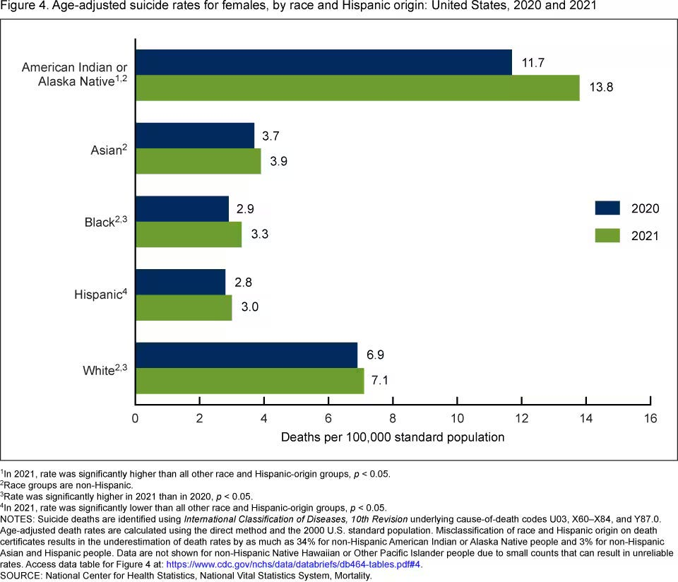

The stress and anxiety induced by feeling constantly watched can contribute to mental health issues such as depression, anxiety disorders and a diminished sense of self-worth. This pervasive sense of surveillance exacerbates existing challenges, making it more difficult for individuals to seek help or support.

Autonomy and Control

Autonomy is a fundamental principle of privacy, granting individuals the right to control their personal information and how it is used. The gaslighting effect undermines autonomy by causing individuals to doubt their judgments and perceptions. When surveillance creates an environment of constant monitoring, people may lose confidence in acting independently, relying instead on external authorities for validation and decision-making. This dependency erodes personal control over one’s actions and information, directly violating the principle of autonomy.

Conclusion: Navigating the Interconnected Future  
Recap

“Data is central to unlocking who we are as Indigenous people. It is central to our healing. We must take a stand for our freedom and our sovereignty. If we say those things then we must live up to it. Breathe it, be it, do it all the time.”  
— Dr. Sammy Matsaw Jr., Treasurer, Fort Hall Business Council, Shoshone-Bannock Tribes

As we conclude this exploration of the Web of Data, let’s return to where we began.

Housing  
Education  
Hiring practices  
Legal / judicial system  
Healthcare  
Voting  
Environment  
Taxes  
Surveillance and policing

These are not just facets of society but the very arenas where our lives unfold. Data permeates each of these domains, central to our existence and interwoven into the fabric of our daily experiences. How we harness this power is ultimately up to us. It calls for resistance against oppressive systems and a commitment to reclaiming our narratives.

Throughout this article, we have explored the Web of Data, discussing how communication technologies — from the telegraph to the Internet — have profoundly impacted Indigenous communities. We began by acknowledging the historical injustices inflicted upon Indigenous Peoples, recognizing that the lasting effects of colonization, forced assimilation and cultural suppression that continue to reverberate today.

We discussed the essence of data, knowledge and identity, underscoring how data embodies lived experiences, cultural heritage and collective wisdom. By examining knowledge and its interdependence with power dynamics, we gained a deeper understanding of how knowledge serves both as a sacred source and a target of control. All leading to historical power imbalances and marginalized Indigenous knowledge systems and epistemic injustices that persist in the digital age.

Our exploration of each thread within the Web of Data revealed the complex interplay between individual, social and communal identities, and the world from which we emerge. We illustrated how identities are dynamic threads woven through experiences, relationships and cultural influences. Recognizing the evolving nature of identity is crucial for respecting and protecting the diverse expressions of self.

The Contextual Integrity Framework provided us with a lens to analyze information flows and communication, ensuring respect for cultural norms and principles of data transmission. This framework emphasizes that information gathering and dissemination must be appropriate to the specific context and adhere to governing norms, thereby preserving privacy and integrity.

In our discussion on surveillance and privacy, we examined the mechanisms by which oppressive systems exert control — often through pervasive monitoring that leads to psychological strain and the erosion of agency and autonomy. Theoretical frameworks like Foucault’s Panopticon and concepts such as surveillance capitalism and the gaslighting effect highlighted how constant surveillance can internalize control, diminish resistance and undermine both personal and communal agency.

The implications for everyone, particularly Indigenous communities, are profound. These systems contribute to cultural disempowerment, psychological stress and identity crises, disproportionately affecting marginalized groups, particularly women and girls. The alarming mental health statistics among Indigenous youth underscore the urgency of addressing these challenges.

As we reflect on these insights, it becomes clear that data is not merely a tool but a vital component of our own identity and sovereignty. It is central to healing and to standing up for freedom. The power of data lies in how we choose to use it — to resist oppressive structures, to empower our communities and to reclaim control over our narratives. By embracing data sovereignty and ethical data practices, we can weave a future where every thread in the Web of Data is valued and protected, contributing to a richer, more diverse and resilient network that honors the individuality, dignity and sovereignty of all.

Path Forward

As we navigate an increasingly interconnected future, the path forward demands collaborative efforts to bridge the digital divide, promote equitable access to technology and affirm data sovereignty for Indigenous communities. This requires us to challenge the prevailing paradigms of big data and surveillance capitalism that often prioritize power and profit over people.

Final Thoughts

“Stephen Cave… thinks that something incredibly important that we need to acknowledge if we want to understand the state of the society we have now… is that we have to look at the role of intelligence, all throughout history… as something that’s been used as a justification for dominating and controlling people.”  
- Philosophize This! Podcast, episode 186

While AI (artificial intelligence) holds the potential to empower, it also poses significant risks. AI-driven surveillance and data misuse threaten to exacerbate existing inequalities and further entrench systems of control. The same technologies that can help can also be harnessed to infringe upon privacy and autonomy, especially among marginalized communities.

By actively promoting the flourishing of hybrid identities, we can harness digital (and data) literacy, ethical digital ID systems and other technological capabilities to connect and empower individuals across the diverse contexts in which they participate. Enhancing digital literacy equips people with the skills to navigate the cyber terrain effectively, assert their agency and safeguard their personal and cultural identities. When designed with respect for privacy and cultural integrity, digital IDs and wallets can provide secure access to services and enable full participation in the digital society without compromising personal data.

Policymakers and technologists have a crucial role in creating inclusive environments that support these hybrid identities. By acknowledging the dynamic interplay between communal solidarity and individual agency in virtual spaces, they can develop technologies that empower individuals rather than serve the interests of surveillance capitalism. This involves rejecting the commodification of personal data and resisting systems that prioritize corporate profits over people.

It’s imperative that we develop and enforce ethical frameworks for AI and other technologies that prioritize individual rights and community sovereignty over corporate interests. By focusing on empowerment and connection, we can ensure that technology becomes a means of enhancing cultural expression and personal autonomy. This approach fosters environments where hybrid identities can thrive without compromising cultural integrity or personal privacy, ultimately contributing to a more equitable and human-centered digital future.

Resistance

Overlapping social identities — such as gender, age and socioeconomic status — intensify the impact of surveillance on Indigenous communities. Women, youth and economically disadvantaged individuals often bear the brunt of oppressive systems such as invasive surveillance practices, leading to increasing vulnerability and marginalization.

Mitigating the negative impacts of surveillance capitalism requires robust privacy protections, ethical data governance and policies that prioritize individual autonomy and community sovereignty. It demands resistance against systems that commodify personal data and perpetuate inequities. By standing together and advocating for these principles, we can forge a future where technology empowers rather than oppresses, and where every community has the agency to control its own narrative.

Citations and Resources

*[Archive note: the published essay embeds its resource inventory here, “IndigDataSov&Ethics_Resource Inventory_Public.”]*

Special thanks to Audra Streetman. You make me a better writer.

Thank you Bernina Gray and Tina Carkhuff for your recommendations and input.

Many thanks to my friend Matt Snyder for giving thoughtful and helpful feedback.

Please note: the views and opinions expressed in this post are those of the author (Chris Perkins) and do not necessarily reflect the official policy or position of my employer, or any other agency, organization, person or company. Assumptions made in this post are not reflective of the position of any entity other than the author — and, since we are critically-thinking human beings, these views are always subject to change, revision and rethinking at any time.

