From Data to Decisions: A Roadmap for Public Sector Innovation
Empowering Government, Education and Communities Through Data Analytics and AI

### Abstract

The way public sector organizations shape the future of their communities is changing. Data and artificial intelligence are no longer optional add-ons; they’re the frameworks that help leaders see patterns, spot opportunities, and solve problems that once seemed too complex. In this eight-part series, we move from the basics of understanding different data types to the powerful insights of analytics and the creative possibilities of Generative Artificial Intelligence. Along the way, we learn how to turn raw information into trustworthy guidance, how to go beyond knowing what happened to understanding why and then deciding what to do next.

From reliable data foundations and meaningful interpretation, to real-time decisions that ward off fraud or ensure compliance, each chapter demonstrates a simple truth: the right mix of data and AI can help public sector organizations deliver services that are more efficient, more equitable, and more in tune with what residents need. By embracing analytics and advanced AI tools, these institutions can unlock productivity, connect people with the right resources at the right time, and engage communities in shaping their own futures.

Taken together, this series offers a roadmap, showing that data-driven decisions aren’t about numbers, pie charts, or reports; they’re about enabling better outcomes, inspiring innovation, and building trust in public services. As technology evolves, so will the potential for public sector organizations to create more inclusive, forward-looking solutions that truly serve everyone.

In the modern world, data and artificial intelligence are reshaping how public sector organizations function. From improving operational efficiency to empowering decision-making, data-driven insights and AI technologies are central to achieving better outcomes, whether in public service delivery, education, utilities, healthcare, or other community engagement. This series explores how public sector organizations can harness the full potential of data analytics and Generative AI (genAI) to drive innovation, increase efficiency, and create more inclusive and effective services. Each chapter will dive into a key area of data and AI application, from the foundational principles of data management to advanced AI capabilities that help these organizations become smarter, more responsive, and more impactful.

### Introduction

Public sector organizations face challenges that their legacy processes, operating systems, and infrastructure never anticipated. Traditional methods of service delivery don’t align with today’s realities, and emerging problems demand new approaches — ones that governments aren’t always prepared to adopt. Adding to this complexity is the ongoing struggle to recruit and retain skilled talent. Yet, amidst these hurdles, a remarkable opportunity emerges.

By applying data analytics and AI, public sector organizations can reimagine their roles, transforming how they operate and interact with residents, students, patients, and stakeholders. Data-driven decision-making can improve everything from cybersecurity to public health, while generative analytics can unlock unprecedented levels of productivity, innovation, and collaboration. Cities embracing these technologies won’t just attract businesses and foster community growth; they’ll remain vital and effective in a rapidly changing world.

In this series, we’ll explore how data and AI are empowering public sector organizations, providing a roadmap for using these tools to enhance outcomes, reduce costs and risk, and boost operational efficiency. Each chapter will focus on a specific aspect of this transformation, blending practical insights with real-world examples to help leaders — and those on the front lines — fully leverage these advancements.

Ultimately, we have the ability to shape a brighter, more resilient future within the communities we serve.

### Chapter Breakdown

**1 — Building a Data Foundation:** Data is the bedrock upon which every decision rests. This chapter defines the core principles of data management, understanding diverse data types, ensuring data quality, and establishing consistent standards. By constructing a solid foundation, public sector organizations can transform raw information into a dependable resource, paving the way for meaningful analysis and strategic action.

**2** — **From Raw **Signals** to Meaningful Insights:** Raw data alone can be overwhelming. This piece explores the transition from disparate **signals** to cohesive insights, dissecting the layers of interpretation, from identifying basic patterns to applying structured **logic**. By navigating the journey from raw data to actionable intelligence, leaders can make informed decisions that truly address the needs of their communities.

**3** — The Power of Analytics: How Descriptive and Diagnostic Insights Shape Decisions: Numbers are only as valuable as their interpretation. This chapter delves into Descriptive and Diagnostic Analytics, illustrating how Descriptive Analytics paints a clear picture of what happened, while Diagnostic Analytics uncovers why it happened. By integrating these insights, public sector organizations can comprehend the narrative behind their data, learn from past experiences, and lay the groundwork for strategic, informed decision-making.

**4** — **Prescriptive Analytics: Charting the Next Steps:** Understanding historical data and its causes leads to the pivotal question: What’s next? Prescriptive Analytics offers data-driven recommendations, guiding leaders toward optimal paths forward. This chapter demonstrates how prescriptive models convert understanding into concrete, strategic actions; empowering public sector organizations to operate more efficiently, respond swiftly to emerging challenges, and achieve superior outcomes for residents.

**5** — **Real-Time Data: Ensuring Security, Compliance, and Trust:** In an era defined by instant communication and pervasive threats, timing is crucial. This chapter examines the role of real-time data in securing operations, preventing fraud, and maintaining regulatory compliance. By leveraging immediate insights, public sector organizations can detect anomalies, address vulnerabilities, and reinforce public trust, resulting in more resilient services that protect sensitive information and uphold community confidence.

**6 — Artificial Intelligence: Unlocking Productivity and Innovation:** Modern challenges demand innovative solutions. This installment explores AI, a technology that not only analyzes data but also generates new content, ideas, and strategies. Discover how public sector organizations can utilize AI and Generative AI (GenAI) to streamline workflows, automate repetitive tasks, and empower staff to focus on groundbreaking innovations, catalyzing productivity and fostering long-term success.

**7** — **Inclusive Analytics: Bridging Gaps, Connecting Communities:** At the core of every public initiative lies the aim to serve all residents. This final chapter investigates how data and AI can promote inclusivity, ensuring that policies and services reach every segment of the community. By employing analytics to identify disparities, engage stakeholders, and co-create solutions, public sector organizations can forge stronger connections, nurture equity, and build a more inclusive future that reflects the diverse voices and needs of the people they serve.

### The Bottom Line

> Throughout this series, we’ll explore the transformative power of data and AI in driving meaningful change within public sector organizations. From foundational data management to the innovative capabilities of Generative AI, the possibilities are boundless.

As these technologies continue to evolve, public sector entities will lead the charge in transforming public service delivery, education and governance, creating smarter, more responsive systems that cater to the needs of all residents.

The future of public service lies in the seamless integration of data, AI and human insight. With the right tools and strategies, public sector organizations can not only overcome existing challenges but also seize new opportunities for progress and inclusivity, ensuring that their services are as dynamic and diverse as the communities they serve.

## Building a Data Foundation (1/7)

Data is everywhere. But not all data is created equal. In the public sector as well as in business, data is the raw material, the foundation for decisions, strategies, and innovation. But what you do with it depends on what kind of data you have. Understanding the differences isn’t just a technical challenge, it’s an imperative.

In this article, we’ll look at different types of data, why they matter, and how knowing the difference gives you the tools to make smarter decisions. Because in the world of data, context is everything.

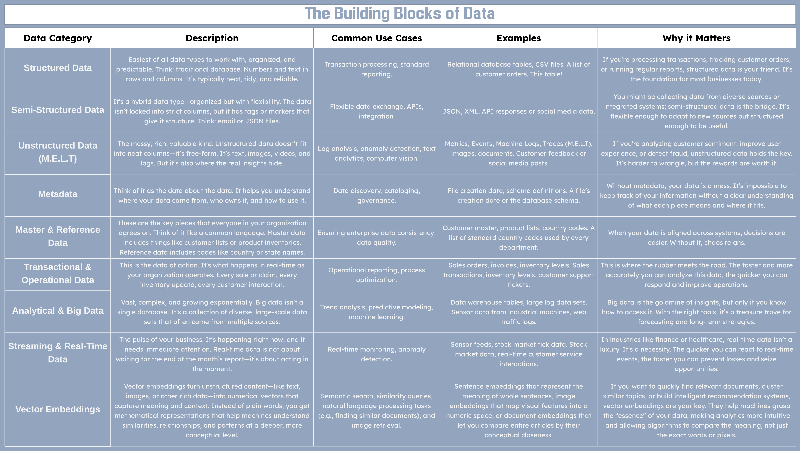

### The Bottom Line

> Understanding the type of data you have, and more importantly, how to use it, is the first step in making smarter, data-driven decisions.

Every organizational decision is based on data. The challenge isn’t collecting it, it’s knowing which kind of data to collect and how to make it work for you. The next time you sit down with your data, think about where it fits in the puzzle. Is it structured, unstructured, real-time, or big? And more importantly, what’s the best way to turn that data into a smart decision?

“Visibility without actionability is an expensive waste of time.” — Forrester; Allie Mellen, Michele Goetz, Carlos Casanova, Jeff Pollard

As we continue this series, we’ll explore how analytics and artificial intelligence take these data foundations and transform them into the powerful tools that help organizations thrive.

## From Raw Signals to Meaningful Insights (2/7)

Data on its own is just noise. It’s a collection of raw facts, disconnected and often meaningless. But data, when processed and understood, becomes the foundation for insight. Insight drives decisions.

In this article, we’re going to explore how raw data (called signals) transforms into actionable knowledge through two essential stages: **semantics** and logic. These layers are the magic that turns your data into a decision-making tool, and ultimately, into action.

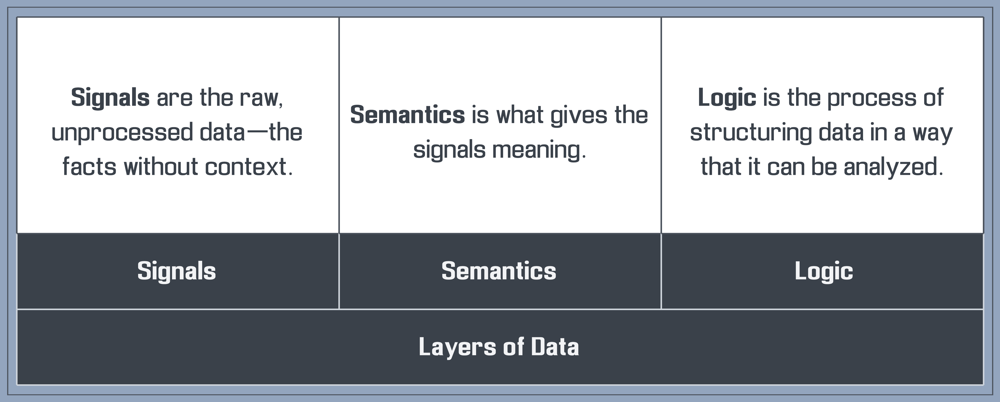

### More Details

Data isn’t just numbers, words or jumble as my 11 year old would describe it; it’s a journey from raw, unprocessed signals to meaningful semantics and finally to structured logic that drives action or establishes risk. Understanding these three layers helps you unlock the full potential of your data, transforming chaos into clarity.

### Signals

Signals are the raw, unfiltered pulses of data. Signals give you the raw material as data points do not mean much on their own.

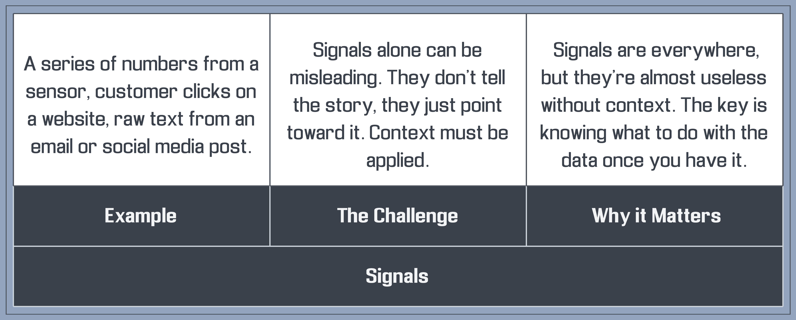

### **Semantics**

Semantics help you understand what those signals mean by putting them in context.

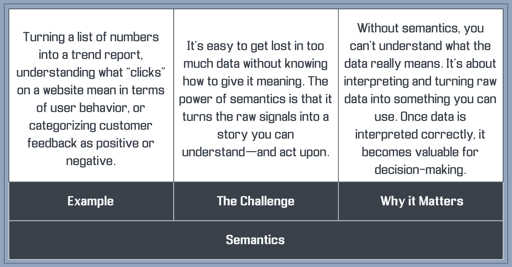

> A common information model (CIM) helps every field of data find a common language. With everything aligned, you’re not just reading data — you’re truly understanding it.

The CIM is a standardized way of organizing and naming data fields across different sources. By applying CIM, you ensure that no matter where your data comes from, it’s structured in a consistent, predictable manner. This makes it easier to run searches, create dashboards, and share insights, because every data point follows the same rules and speaks the same language.

### **Logic**

Logic helps you organize that information, making it possible to analyze, compare, and make decisions.

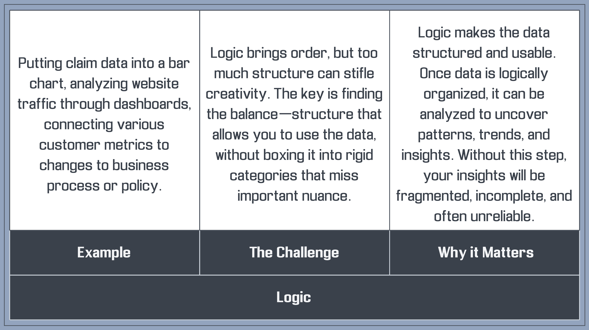

### Why These Layers Matter to Your Organization

If you want to make smarter decisions, you need to understand the journey data takes. Let’s expand the conversation to include the four kinds of data analytics; descriptive, diagnostic, predictive, prescriptive and generative.

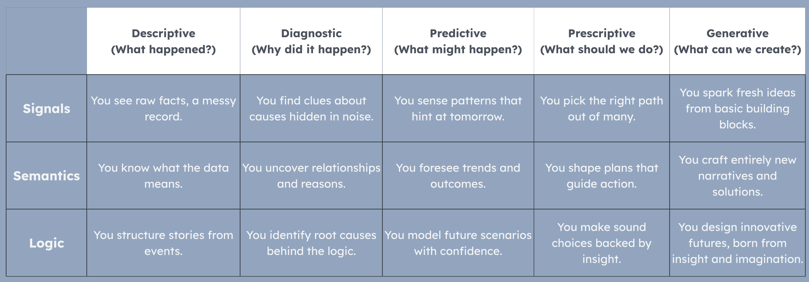

By transforming raw signals into actionable insights, you can begin to spot trends, forecast outcomes, and make decisions faster and with more confidence.

### The Business Case: Making Better Decisions Faster

Every business decision is rooted in data, but not all data is actionable. Signals are the starting point. They give you the raw facts, but you need to give them meaning before you can do anything with them. And once they have meaning, you need a way to organize them to make sense of patterns, uncover trends, and predict future outcomes.

Here’s how this process works in practice:

- Signals: You track things like website clicks. It’s raw information, often overwhelming if viewed in bulk.
- Semantics: You interpret that data. Clicks are classified into different user behaviors.
- Logic: Now, analyze the patterns. You might look at trends over time, compare it across different customer segments, or tie it to business outcomes. You can find elevated risk here as well as an assistant to help you prioritize incidents.

Below is a more holistic table that brings together the journey from raw data (Signal, Semantics, Logic) through the progression of analytics (Descriptive, Diagnostic, Predictive, Prescriptive and Generative).

Think of it as a simple roadmap: on one axis, the evolution of analytics; on the other, the layers of data understanding. Each cell highlights what that combination makes possible for organizations, helping leaders move beyond just understanding data to actually using it to serve their communities and customers better.

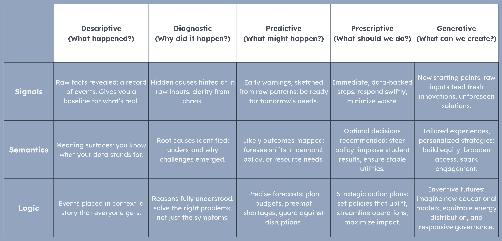

**How to Read This Table:**

- Start in the upper-left for a raw look at data (Signal + Descriptive) and move toward the bottom-right (Logic + Generative), where data isn’t just informing what happened, but inspiring new solutions.
- Along the way, you align data with goals: cutting costs, reducing risk, prioritizing projects, improving service quality, boosting productivity, and ensuring no one is left behind.
- By the time you reach Generative Analytics with Logical structure, you’re not just reacting to data, you’re creating possibilities that didn’t exist before, building an inclusive future.

In short: this table is your blueprint, moving from basic awareness to transformative action. It’s about using data and AI not to keep pace, but to lead.

By structuring your data, you’re building your own framework for making decisions. You’re not just reacting to random information, you’re using context, interpretation, and structure to guide your actions. Most important of all, you’re using your own intuition, instinct, moral compass, and potentially myriad of other factors that a computer cannot comprehend or is even aware of.

### The Bottom Line: Turning Signals into Action

> At the heart of every successful decision lies a simple truth: data must be interpreted and structured before it can drive change. Signals, semantics, and logic aren’t just buzzwords, they’re the steps that help you turn noise into clarity, and clarity into action.

The best decisions are made when organizations transform raw signals into meaningful insights and outcomes. The next time you look at a set of data, ask yourself: Where are the signals? How can we give them meaning? And finally, how can we organize them to make informed, strategic decisions?

In the next article, we’ll dive deeper into how Descriptive Analytics can help you summarize what happened, and how those insights can inform your next steps.

## The Power of Analytics: Turning Understanding into Action (3/7)

Analytics isn’t about data or computers, it’s about stories. Every chart, report, and dashboard tells one: what happened, why it happened, and what to do next. Without understanding, there are no stories, just noise. Descriptive analytics lays the groundwork by showing you the “what,” while diagnostic analytics uncovers the “why,” giving you the full narrative to make smarter decisions.

In this chapter, we’ll explore how these two types of analytics work together to turn raw information into clear insight.

### From What to Why: Navigating Descriptive and Diagnostic Analytics

Every decision begins with understanding. Descriptive analytics provides the foundation, summarizing what happened with granularity, clarity and precision. But understanding the past is only the first step. Diagnostic analytics dives deeper, uncovering the reasons behind the trends and patterns revealed by descriptive analytics. Together, they form a powerful duo: the “what” and the “why” that guide smarter decisions.

Descriptive analytics paints the picture of past performance, giving you the “what” at a glance. Diagnostic analytics takes it further, uncovering the “why” that explains those results. Here’s how they complement each other to create actionable insights:

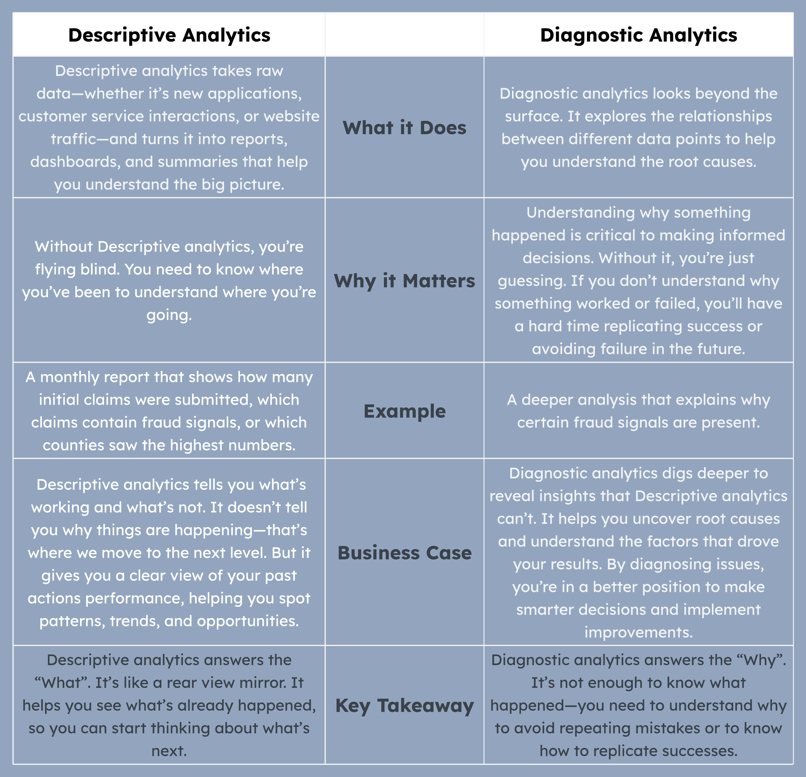

### The Bottom Line

> Descriptive and diagnostic analytics are the backbone of informed decision-making in public services. Descriptive analytics tells you what happened, a snapshot of trends, spikes, or shifts. Diagnostic analytics explains why it happened, uncovering the root causes behind those trends or anomalies. Together, they empower leaders to move from observation to understanding and action.

For example, when a state unemployment office sees a surge in claims, descriptive analytics shows the “what,” the numbers, regions, and demographics affected. Diagnostic analytics reveals the “why,” a local employer’s layoffs or other systemic issues driving the spike. This combination equips state leaders to respond decisively, whether by launching job training programs or addressing operational bottlenecks.

The bottom line: without understanding both the “what” and the “why,” you’re guessing. Descriptive and diagnostic analytics provide the clarity to act decisively, setting the stage for smarter, future-focused decisions.

## Prescriptive Analytics: Charting the Next Steps (4/7)

At its core, prescriptive analytics answers the pivotal question: What should be done? It goes beyond understanding the problem, it provides a strategic roadmap for the future. Whether it’s optimizing a process, launching a new initiative, or addressing an operational challenge, prescriptive analytics delivers the “how” after you’ve identified the “what” and “why.”

### **What It Does**

Prescriptive analytics examines the patterns revealed by descriptive and diagnostic analytics and recommends specific actions to enhance outcomes. It leverages advanced mathematical models, simulations, optimization algorithms, and even artificial intelligence to suggest the best course of action.

### **Why It Matters**

In the public sector, knowledge alone isn’t sufficient. Insights without action are like a vehicle with a full tank of gas but no destination. Prescriptive analytics bridges the gap between knowledge and execution, ensuring you take the right steps based on what you’ve learned, leading to efficient and effective service delivery.

### **Example: Enhancing Unemployment Services**

Imagine a state unemployment office noticing a sudden surge in claims. Descriptive analytics identifies the spike, showing how many claims were submitted, from which regions, and the demographic breakdown of claimants. Diagnostic analytics reveals that a major employer in the area recently had a reduction in force (RIF), driving a flood of initial claims.

Prescriptive analytics takes this a step further. It analyzes the data to recommend targeted actions:

- **Launch rapid-response job training programs** in affected regions to quickly up-skill displaced workers.
- **Allocate additiona**l resources to high-demand areas to manage the increased workload efficiently.
- Implement automated verification processes to streamline claim approvals, reducing wait times and improving user experience.

By pairing descriptive and diagnostic insights with prescriptive recommendations, state leaders can respond proactively, mitigating the impact of sudden unemployment spikes and ensuring that resources are utilized effectively.

### Turning Insights into Action: How Prescriptive Analytics Works

Prescriptive analytics isn’t just about offering recommendations, it’s about providing specific actions that can drive change. It’s the evolution of insights into real, practical decisions that improve public service performance. Here’s how it works:

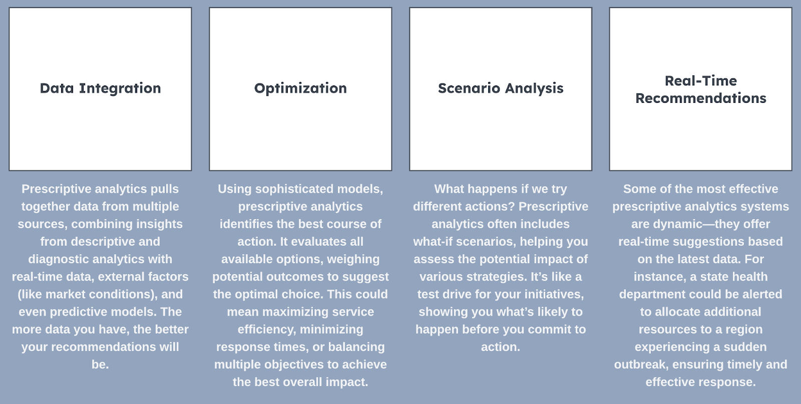

### The Business Value: Why Prescriptive Analytics Matters

So, why should prescriptive analytics matter to your organization? Simply put, it empowers you to make the right decisions, faster. Here’s how it creates value:

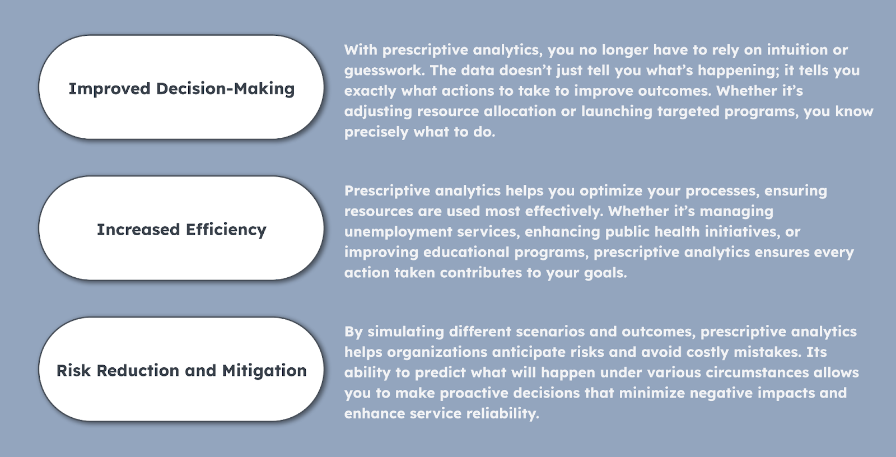

### The Bottom Line

> Prescriptive analytics transforms insights into strategic actions, empowering public sector organizations to drive meaningful change.

Prescriptive analytics bridges the gap between knowing what happened and why it happened, transforming understanding into strategic action. By empowering public sector organizations and nonprofits to make informed decisions, it drives real change and fully leverages valuable data. Without it, insights remain untapped potential. Embrace prescriptive analytics to move beyond reaction and take proactive, impactful steps that solve problems and drive meaningful change. It’s not just about the data, it’s about what you do with it that truly makes a difference. Next, we’ll explore predictive analytics and how forecasting can shape the future of public service.

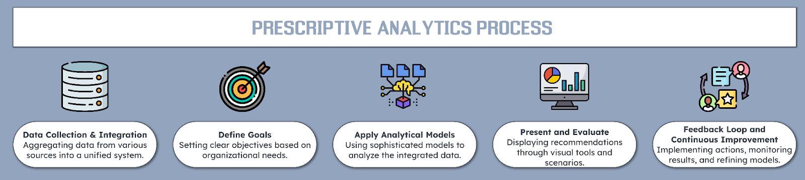

## Real-Time Data: Ensuring Security, Compliance, and Trust (5/7)

In the public sector, data is constantly in motion, streaming from countless sources, evolving with every interaction, and expanding every second. Real-time* data analytics isn’t just a luxury; it’s a vital necessity. The ability to analyze data as it’s generated empowers government, education, and utility organizations to swiftly manage cybersecurity risks, prevent fraud, and maintain uninterrupted services.

> For the purposes of this article, “real-time data” refers to data that becomes searchable within minutes (less than five minutes) of its generation. While real-time data can theoretically be available within milliseconds, achieving sub-second reporting is often challenging in practical applications.

### Why Real-Time Data Matters

In government, education, and utilities, data never stops flowing. Waiting to process it means missing out on opportunities, facing delays, or even risking security. Real-time data analytics lets you act quickly, making decisions as events unfold.

Key Benefits

1. Instant Insights:
2. See what’s happening right now. No more waiting for reports, getting up-to-the-minute information on operations, resident needs, and potential threats.
3. Quick Decisions:

Act before problems grow. Whether it’s a security alert or a service hiccup, real-time data helps you respond swiftly and effectively.  
Better Resident Experience:  
Deliver timely, personalized services. Resolve issues on the spot and keep residents satisfied with fast, reliable support.

Discover how real-time data revolutionizes public services through four essential use cases, demonstrating its pivotal role in enhancing cybersecurity, preventing fraud, ensuring service reliability, and maintaining compliance.

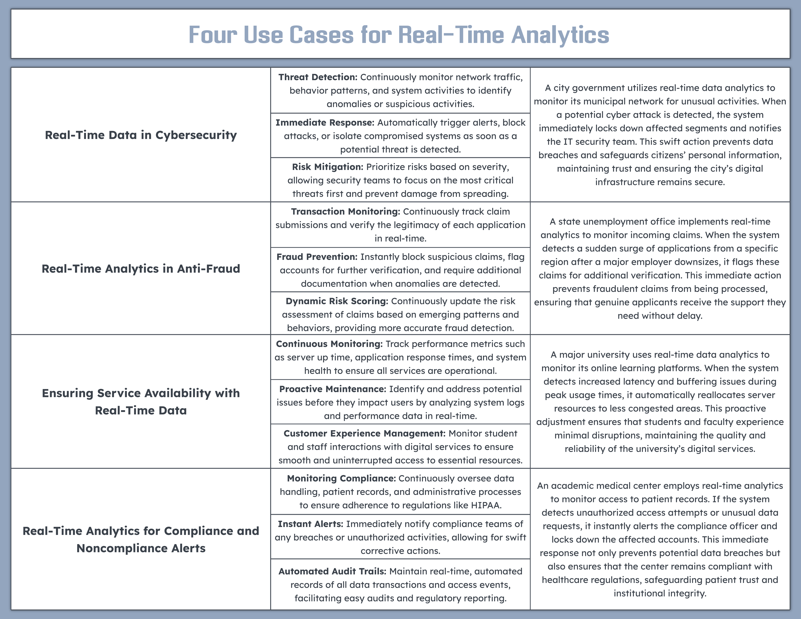

### The Future of Real-Time Data Analytics

As technology advances, real-time data analytics will become even more indispensable. The rise of 5G, edge computing, and advanced AI will enhance the speed and precision of data processing. Future systems will anticipate issues before they arise, enabling organizations to act proactively, whether it’s stopping fraud, preventing service outages, or defending against cyberattacks.

- Edge Computing: Processes data closer to its source, enabling faster decision-making without delays.
- AI Integration: Utilizes AI to make accurate, real-time decisions, such as adjusting services or predicting and stopping fraud before it happens.

The Bottom Line

> Real-time data is a goldmine of untapped potential, ready to transform public service.

Real-time data is very often unstructured and messy. This data emerges from the constant operation and human interaction with IT systems. This near-real-time machine data may seem chaotic, but it holds incredible value waiting to be unlocked. By harnessing real-time analytics, public sector organizations can turn disorder into actionable intelligence, enhancing security, ensuring compliance, and building trust.

## AI: Unlocking Productivity and Innovation (6/7)

In public sector organizations, talent and mission often collide with bureaucracy and administrative overhead. The brightest minds get pulled into repetitive tasks; managing endless forms, generating standard reports, and navigating labyrinthine approval processes. This operational drag doesn’t just waste time; it squanders potential, inhibiting the strategic thinking and creative problem-solving that could move entire communities forward.

Enter Generative AI. GenAI technology that reframes how work gets done. By automating the mundane and accelerating the routine, it liberates staff to focus on what truly matters: delivering more effective lesson plans for students, crafting nuanced policy recommendations for residents and designing programs that solve urgent social challenges. In other words, genAI doesn’t merely take tasks off the to-do list; it unlocks capacity, freeing public servants to think big, act boldly, and innovate sustainably.

In this chapter, we’ll explore how genAI transforms worker productivity in public sector environments. We’ll dissect the ways it enhances efficiency, mitigates risk, and optimizes decision-making, ultimately transforming organizations burdened by routine into engines of innovation. Because when the routine is automated and time is reclaimed, public sector leaders can shift from maintaining the status quo to imagining — and realizing — what’s next.

Before we dive deeper, let’s take a closer look. First let’s define AI and the many kinds of AI available today as well as those we anticipate tomorrow.

### Understanding Artificial Intelligence

Artificial intelligence (AI) sits at the heart of technological advancement, reshaping how public sector organizations understand their data and serve their communities. In essence, AI involves systems and algorithms that can identify patterns, interpret language, and even generate new content. But while these tools can appear remarkably “intelligent,” it’s important to remember what they truly excel at: prediction, not judgment. Advanced generative AI models, for instance, are exceptionally skilled at forecasting the most likely next word, image, or sequence based on what they’ve seen before. They don’t make decisions in the human sense; they predict plausible outcomes.

This distinction matters. In public service, where accountability and ethics are paramount, a human-in-the-loop approach ensures that AI’s predictive powers are guided by human values and oversight. Rather than fully delegating decision-making to the algorithm, leaders can treat AI as a powerful advisor — one that rapidly suggests options, surfaces insights, and highlights patterns. By doing so, public sector organizations can enhance efficiency, drive innovation, and deliver more effective, person-centered services without losing the human judgment that anchors public trust and responsibility.

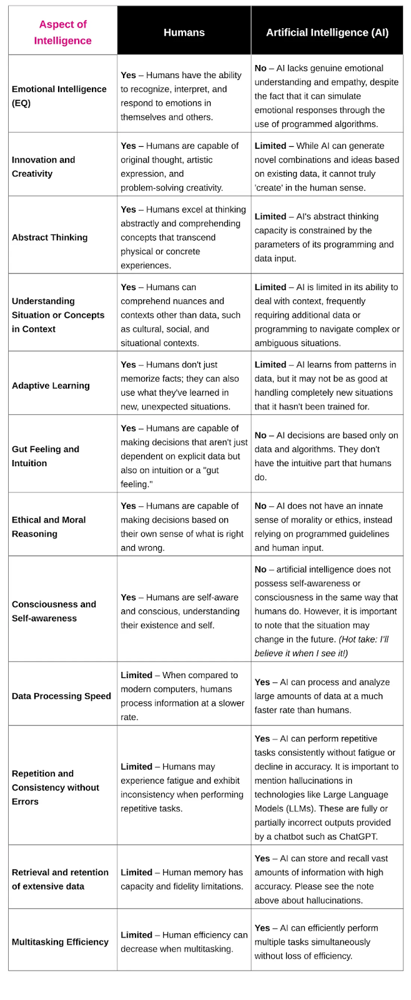

To fully harness the potential of AI, it is essential to understand its various types and classifications. AI can be categorized based on its capabilities, underlying approaches, and specific applications. The following table provides an overview of these different types of AI, offering a clear framework for understanding how each category contributes to the broader AI ecosystem.

Artificial Intelligence is often viewed along several dimensions and can be segmented into different categories based on capability, approach and application. Some common segments include:

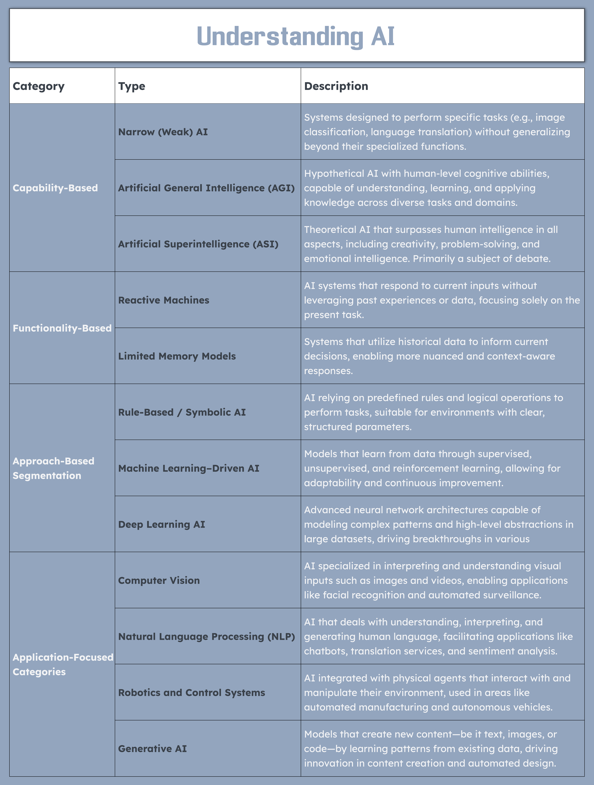

Understanding these AI classifications is crucial for public sector organizations aiming to implement AI-driven solutions effectively. By selecting the appropriate AI type for specific challenges, organizations can optimize operations, enhance service delivery, and foster continuous innovation.

### How AI Enhances Worker Productivity in the Public Sector

Automating Routine Tasks  
One of the most significant impacts of Generative AI on worker productivity is its ability to automate routine administrative tasks. In public sector organizations, employees often spend valuable time handling repetitive, manual processes, like generating reports, filling out forms, or answering basic public inquiries. Generative AI can handle these tasks efficiently, freeing up workers to focus on more strategic activities.

Optimizing Administrative Workflows  
Many administrative workflows in public sector organizations are fragmented and inefficient. Generative AI can streamline processes such as data entry, form generation, and document processing, which can otherwise be time-consuming.

Improving Decision-Making with Data-Informed Insights  
In public sector organizations, workers often spend a lot of time analyzing data to draw insights that inform decisions. Generative AI can synthesize complex data and automatically generate reports or actionable insights, cutting down on the time spent in manual analysis and allowing workers to make faster, data-driven decisions.

Enhancing Collaboration and Communication  
In many government and educational settings, collaboration is key, but busy schedules and fragmented information can make teamwork challenging. Generative AI helps facilitate collaboration by automating communication and generating customized content that aligns with the needs of different stakeholders.

Driving Innovation and Strategic Planning  
Generative AI can also help public sector organizations generate innovative solutions or strategies by simulating different scenarios and outcomes. By automating brainstorming, strategy formulation, and forecasting, AI can unlock new possibilities for the future.

These are just some of the ways!

### The Bottom Line

> Generative AI is not just a tool for automation, it’s a catalyst for a more innovative, efficient, and human-focused public sector.

GenAI is revolutionizing worker productivity within public sector organizations by automating repetitive tasks, streamlining administrative workflows, and enhancing data-driven decision-making. This transformation allows government and education professionals to dedicate their time and expertise to strategic, human-centric initiatives, such as creative problem-solving, policy development, and meaningful community engagement.

Looking to the future, as genAI continues to advance, its capabilities will expand to automate increasingly complex tasks, optimize workflows in real-time, and generate innovative public service solutions. These advancements will not only reduce costs and enhance efficiency but also enable public sector organizations to respond swiftly to emerging challenges and evolving community needs. GenAI will empower workers to focus more on creative and interpersonal aspects of their roles, fostering a dynamic and productive workforce capable of delivering higher-quality, more responsive services.

Embracing generative AI isn’t just about offloading the busywork, it’s about shifting your team’s focus from the grind of routine tasks to the heart of what matters. Real people, real communities, real impact. Yet as these vendors and tools promise innovation, they also demand responsibility. Before you trust an AI model with your data, make sure the rules are clear: no personal details funneled into public systems, no confidential records drifting into places they don’t belong. Only use approved models, whose risks and benefits you’ve weighed carefully. With these guardrails, your workforce can tap into AI’s predictive power, not to replace human judgment, but to amplify it. We all aim to deliver smarter, more flexible services that keep public sector organizations at the cutting edge and our mission firmly at the center.

## Inclusive Analytics: Bridging Gaps and Connecting Communities (7/7)

Every day, millions of data points tell the stories of our communities — stories of students striving for education, families accessing vital services, and neighbors helping neighbors. While spreadsheets and algorithms may drive modern governance, the heart of data analytics beats with a profound purpose: empowering people to thrive.

For State, Local, Tribal Government and Education organizations, data isn’t just about metrics and measurements. It’s about mapping the path to more vibrant and connected communities. When we harness technology thoughtfully, it becomes a bridge — linking residents to essential services, connecting diverse voices to decision-makers, and weaving together the fabric of inclusive communities.

But the true power of data emerges when it catalyzes action. By transforming raw information into meaningful insights, public sector organizations can spot gaps in services, identify emerging community needs and create solutions that work for everyone. This is where data transcends numbers to become a force for positive change — not just measuring our communities, but strengthening them.

In this exploration, we see how public sector organizations are using data-driven approaches and innovative technology to build a future where every community member can access opportunities, contribute their voice and help shape the decisions that affect their lives. Welcome to the next chapter of inclusive analytics — where data meets humanity, and technology serves the greater good.

The real power of data is unlocked when it’s used to connect ideas, innovation and action.

### The Power of Data: Transforming Inclusion from Vision to Reality

Every data point tells a story of opportunity — or its absence. In the hands of forward-thinking public sector organizations, data becomes more than numbers and trends; it emerges as a powerful force for change, illuminating paths to genuine inclusion that might otherwise remain hidden.

When we harness data with purpose, it reveals invisible barriers that hold marginalized communities back — from the student who can’t access online learning resources, to the senior citizen who struggles to reach vital services, to the small business owner navigating government programs. These insights don’t just identify problems; they spotlight solutions that can transform, or often, save lives.

But data’s true potential is realized only when it reflects and responds to the diversity of our communities. Through thoughtful analysis, public sector organizations can uncover patterns of inequity, amplify underrepresented voices and channel resources where they’ll create the greatest positive impact.

> Data isn’t just about collecting information — it’s about converting insights into action that makes a real difference in people’s lives.

Consider the ripple effects when data drives change:

- Service Delivery Reimagined: Analytics reveal not just who’s accessing services, but who isn’t — and why. This understanding helps organizations redesign programs to reach every community member who needs them.
- Evidence-Based Policy Making: When decisions are guided by comprehensive data, they naturally align with the diverse needs and experiences of all community members, not just the most visible or vocal.
- Strategic Resource Investment: Data illuminates where disparities run deepest, enabling organizations to direct support precisely where it can spark the most significant positive change.

The message is clear: In the journey toward true inclusivity, data isn’t just a tool — it’s a transformation catalyst. When we combine robust analytics with genuine commitment to equity, we create the foundation for communities where everyone has the opportunity to thrive.

### Technologies for Transformation

Modern technology offers unprecedented tools for building more equitable communities:

- Dynamic Data Dashboards: Real-time visualization tools turn abstract numbers into clear imperatives for action, from tracking health inequities to exposing educational opportunity gaps.
- AI for Accessibility: Machine learning can help personalize services for diverse needs, ensuring everyone can navigate and access vital public resources.
- Mobile-First Solutions: By meeting people where they are, mobile platforms ensure geography and transportation are no longer barriers to accessing essential services.

Power to the People

True inclusion means more than access — it means shifting power to communities themselves. Through participatory data collection, community-led analysis, and transparent decision-making processes, we can transform governance from something done to communities into something done by communities.

### The Path Forward

The future of public service lies in using data and technology not just to measure communities, but to empower them. As AI, real-time analytics, and digital connectivity evolve, we have an unprecedented opportunity to reshape power structures and create truly inclusive institutions.

> “Meaning is always created locally.” — Patrick Bringley

### A Call to Action

The tools for transformation are in our hands. For public sector organizations, this moment demands more than passive data collection — it requires a commitment to wielding technology as a force for justice and inclusion. In addition, this is more than just about efficiency, it’s about empowering people to access services, participate in decision-making and thrive in an increasingly interconnected world.

This is about more than connecting people to services — it’s about connecting people to power. Through data-driven insights, collaborative technologies and innovative solutions, we can build institutions where every community member has the resources, voice, and opportunity to thrive. The future is not just about being counted — it’s about counting for something. Let’s use these tools to build the equitable, inclusive future our communities deserve.

### The Bottom Line

Let us empower a more inclusive future.

Special thanks to: Tina Carkhuff, Matthew Snyder, Brad Ishida and Tony Carrato!

Please note: the views and opinions expressed in this post are those of the author (Chris Perkins) and do not necessarily reflect the official policy or position of my employer, or any other agency, organization, person or company. Assumptions made in this post are not reflective of the position of any entity other than the author — and, since we are critically-thinking human beings, these views are always subject to change, revision, and rethinking at any time.
