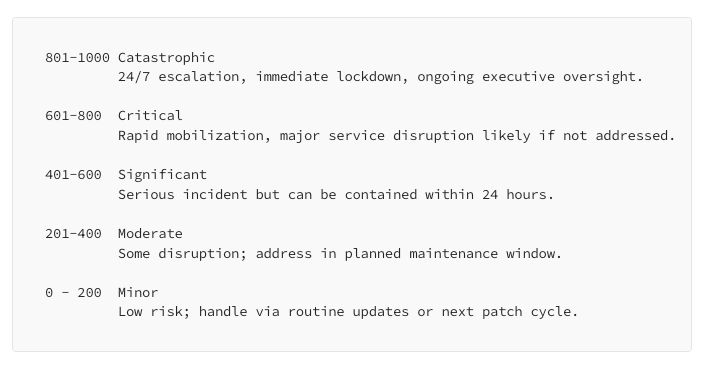
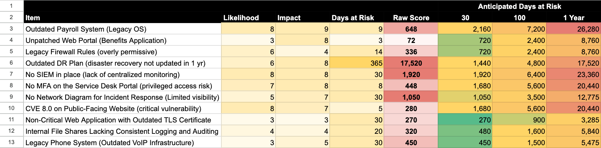

Days at Risk: How Complacency Fuels Catastrophic Outcomes
From Wildfires to Data Breaches — How One Minor Spark Can Ignite Widespread Disaster

## Introduction: Setting the Scene

**This article:**

1. The Reality We Face
2. The Systemic Problems
3. The Call to Action
4. Building the Future

As cybersecurity professionals, we are familiar with the terms “firefighting” and “putting out fires,” among others.

This article is about exactly that. With the [California wildfires](https://www.fire.ca.gov/) and the breach of education software provider’s student information system (SIS), we will draw some analogies from these situations.

We’ll discuss it in the context of “Days at Risk.”

> “Days at Risk” is a modern risk assessment model.

It takes only a minor spark to set off a billion-dollar blaze or a single budget cut that opens the door to a massive data breach. Yet again and again, we let “unimportant” vulnerabilities, lack of funding and poor practices linger, hoping they won’t escalate. This refusal to act serves as a slow fuse.

Do we *really* value prevention?

In this article, we’ll quantify prevention. Specifically, we’ll quantify the days we are at risk alongside likelihood and impact.

**Pre-2025 Risk Equation**

```
Risk = L x I //Likelihood times Impact
```

**2025+ Risk Equation**

```
Risk = L x I x Days at Risk //Likelihood times Impact times Days
```

If you haven’t already, please check out this article that breaks down this new metric, “Days at Risk” and how to use it.

In 2006, my roommate was smoking weed in his walk-in closet. He occupied the primary bedroom in a townhome we rented. Will (we’ll refer to him as) had a lovely Golden Retriever named Jobie. She was such a sweet dog. Will, Jobie and I lived in our forest green-carpet, heated-floor townhome with the landlord living just on the other side of a shared wall.

Will decided to come home for lunch one day and usually smoked in his bedroom. Long story short, he ended up ashing his bong in a wastebasket near a giant pile of cardboard boxes. He had done a lot of eBay business so there was an unusually large amount of cardboard boxes nearby.

Longer story, short, Will left shortly after eating and taking his bong rip. After ashing in the wastebasket, he left. Jobie and I were there just living our lives until we noticed the heavy smoke coming from the door jam leading to his bedroom.

As soon as I noticed the smell, the smoke alarm in the hallway started squealing. I opened his bedroom door to see a ton of smoke coming from his walk-in closet.

I remember like it was just yesterday. I immediately ran to the front porch to grab the hose. After connecting the hose to the spigot, I turned it on as much as I could and ran back in with a 3/4-inch hose worth of water to face a column of fire coming from his closet.

There was about 3 inches of clear air at the bottom of the room. I laid on my belly with the hose clutched in both hands. Looking back, my twenty-three year old hands were treating this garden hose as if it were a hose from a fire truck. It wasn’t.

Throughout my life I have respected fire and have been afraid of it. I know it is a tool and its volatility can be used for power.

I have friends who have lost everything in Colorado, New Mexico and Arizona fires. My father suffered 3rd degree burns on his face, chest and arms from a house fire explosion in our laundry room **when** I was about eight-years-old. I have also been branded (as in: fire and metal)… by choice. That is my relationship with fire.

This article is deeply personal as I feel for those who are losing their homes, neighborhoods and communities as we speak.

This article is also about burning down the status quo.

## The Reality We Face

### Complacency Over the Edge

We tell ourselves stories about safety. Some of us prepare for the worst by storing food, clean water and other supplies.

As a society, we also tell ourselves stories that comfort us. Like, how we’ll get to patching that vulnerability next week or will clear out that brush by May 1st. These are comfortable stories, wrapped in the warm blanket of routine and cushioned by the absence of immediate consequences.

Years of “we’ll get to it soon” are catching up and catching up fast. Although it seems like we are being blind-sided, we are not. The catastrophes arise through mundane decisions, usually through the path of least resistance.

- A cooking fire on Pacific Coast Highway → Most of Malibu burns → $50 billion+ in losses, lives lost
- A skipped MFA requirement → K-12 district breach → 60,000,000 student records exposed
- A postponed pipeline inspection → Major leak → City’s water supply contaminated
- A missed security patch → Hospital ransomware → Emergency rooms diverted and lives lost
- A default password unchanged → Power grid breach → Cities go dark
- A misconfigured firewall → Healthcare database breach → Million patient records leaked
- A single compromised password → Election system breach → Voter database accessed, propaganda about election insecurity spreads

These aren’t accidents. They’re not bad luck. They’re not even surprises.

They’re the predictable harvest of systematic complacency, the natural conclusion of a thousand small surrenders to convenience over protection, to short-term savings over long-term security, to the comfortable fiction that tomorrow will be just like today.

This is the edge we’re walking: between the **illusion of safety** and the **reality of accumulated risk**. Every day we choose comfortable stories over uncomfortable actions, we step closer to that edge. Does living in this comfort make it easier to live in denial?

The time for comfortable stories has passed and the edge is closer than we think. Our complacency is pushing us toward it with the inexorable patience of gravity.

### Days at Risk: The Kindling We Keep Adding

Risk doesn’t sleep. It grows.

Every morning, we wake up to more unpatched systems than the day before. More unreviewed alerts, more unchanged passwords, more untested backups, more users without training, more devices without updates, more code without review, more configurations unchecked.

Each passing day piles another layer of kindling onto our digital terrain.

We track time in fiscal quarters and budget cycles, yet risk accumulates by the hour. While we schedule next month’s planning meeting, attackers are testing our perimeter. While we draft next year’s security roadmap, threat actors are moving laterally through our networks. While we debate the ROI of basic security controls, our attack surface expands like drought-parched brush.

This is what we keep missing: Every day we do nothing isn’t a simple delay — it’s an active choice to increase our risk exposure.

Risk isn’t static — every day we hesitate is another day the fuel builds up. Whether it’s uncleared brush in fire zones or unpatched vulnerabilities in our networks, we seem to be consciously (or unconsciously) choosing to let the kindling accumulate.

### Disproportionate Risk, Disproportionate Cost

The math of catastrophe is brutally simple.

```
Risk = L x I x DaR
```

Catastrophe = Risk greater than 801

Anything about 801 is considered catastrophic.



When a single spark leads to billion-dollar losses, we have to ask whether we truly value prevention. The match that starts the blaze costs nothing, yet the inferno it ignites can consume entire neighborhoods, communities and in the case of the recent California fires, it can cost lives. In digital terms, the lack of prevention can expose thousands of children’s personal data by not having a second factor for authentication (something you know, have, or something you are).

## The Systemic Problems

Somewhere, right now, someone is reducing human safety and human life to a decimal point.

> *Spreadsheets don’t scream. Numbers don’t bleed. Budgets don’t burn.*

### Reduced to a Line Item

The dangerous oversimplification of security means that we persist in this comfortable fiction: that we can capture catastrophic risk in cells B-through-E, that we can balance human safety against quarterly targets, that we can reduce the unthinkable to the nearest decimal point.

This isn’t just an oversimplification. It’s a form of institutional self-delusion.

We wrap devastating potential in comfortable abstractions: “acceptable risk levels,” “risk tolerance thresholds,” “cost-benefit analyses.” We distance ourselves from consequences with bureaucratic language, until breaches become “incidents” and devastated lives become “impact metrics.”

But reality doesn’t respect our spreadsheets, does it?

When we reduce security to a line item, we do more than oversimplify — we deceive ourselves about the nature of what we’re protecting.

### Where Does the Money Go?

Follow the money and you’ll find our true priorities, stripped of rhetoric and good intentions.

We spend without question on incident response teams but skimp on prevention. We budget generously for crisis management but pinch pennies on proactive controls. We’ll approve millions for emergency response but scrutinize thousands for basic security.

The truth is in the transactions: We’re not investing in preventing tomorrow’s catastrophes. We’re just setting aside funds to sweep up the ashes.

### A Question of Priority

There’s a cultural dance in the halls of power: Leaders stand at podiums declaring cybersecurity is “critical to our mission,” while their calendars and budgets tell a different story.

The mathematics of priority is merciless.

It doesn’t care about good intentions or public statements. It measures only actions, resources and time invested. By this objective calculus, our true priorities become crystal clear.

> What is prevention’s true place in your hierarchy of concerns?

In the end, priorities aren’t what we say they are. They’re what we prove they are, day by day, decision by decision, dollar by dollar. And right now, we’re proving that we prefer to fight fires rather than prevent them (figuratively and actually).

### Guarding Against Short-Term Thinking Bias

> Just as we can’t prevent wildfires by responding faster to them, we can’t secure systems by only improving incident response. Prevention requires long-term thinking.

Faster fire trucks don’t reduce forest fuel, and better breach containment doesn’t patch systemic security gaps.

Hero stories always bring a tear to my eye. I enjoy movies where the underdog is courageous and overcomes their situation and becomes the hero. We love our heroes. The firefighter emerging from the smoke with a child in their arms. The IT team working through the night on an incident. The emergency responders rushing toward danger while others run away. These are powerful images, compelling stories and moments of genuine courage.

But think about it: we pour resources into faster fire trucks while ignoring the underbrush beneath our power lines. We invest in high-end incident response but leave critical systems unpatched. We drill endlessly for emergencies but skim on prevention. It’s like training Olympic swimmers to rescue people under a broken-guardrail bridge — rather than simply fixing the rails in the first place.

## The Call to Action

### A Call to Torch the Status Quo

Incremental change isn’t enough. Half-measures fail in both wildfire prevention and cybersecurity because they never tackle underlying vulnerabilities, only their surface symptoms.

### We Can Do Better Than This

A vast valley exists between our capabilities and our execution. We know how to minimize forest fuels, enforce brush clearance, and deploy modern security controls — yet we seldom apply these solutions at scale or with consistency. The greatest missing ingredient is not knowledge but will.

### The Price of Postponed Prevention

A quick story…

A small school sits at the edge of a brush-filled canyon — peaceful on the surface, yet dangerously unprepared. Fire marshals had sounded the alarm for years: “Clear the brush, especially around that aging wooden fence by the playground.” Administrators acknowledged the risk, checked their budget, and always concluded: “Next quarter. It’s not urgent.”

> **Nature doesn’t wait on budgets.**

One afternoon in January, 2025, a spark leapt the fence and ignited the tinder-dry grass. By sundown, flames tore through classrooms and homes alike, forcing firefighters into a battle that never should have happened. And the damage? Shocking but predictable:

- Classrooms reduced to ash
- Emergency funds drained for temporary structures
- Water damage from firefighting efforts
- Legal / insurance claims piling up

**We don’t choose whether we pay** — only when and **how much**. We can plan it on our terms (preventive, manageable) or pay it all at once on disaster’s terms (urgent, excessive and destructive).

> Doing nothing now practically guarantees that we’ll pay twice — or ten times as much — later.

## Enough with the Smoke and Mirrors — Do the Work

It’s time to move from performative to effective action:

- **Clear the Underbrush:** Implement structured prevention for wildfires — clear dangerous brush, build robust firebreaks and continuously maintain them.
- **Strengthen the Infrastructure:** Train security teams, apply multi-factor authentication and patch known vulnerabilities.
- **Follow Through:** Stop admiring the problem; concrete, daily efforts reduce the risk.

We don’t need more endless meetings or toothless resolutions. We need to act with urgency and resolve — removing the hazards that feed these crises before they ignite. By investing in real prevention work, we minimize the disasters we’d otherwise scramble to contain.

### Building Consensus with Time-Aware Scoring

When every day adds to the danger, my hope is that a shared deadline unites us in urgent action. Using time-aware scoring metrics creates a common framework that drives collaboration and prioritizes what truly matters to the organization and its stakeholders.

> *When everyone sees the same data, we can finally aim for the same solution.*

## Building the Future

### Forecasting Consequences

The challenge isn’t predicting the fallout — it’s acting on what we already know. We can pinpoint where the next fire will start or the next breach will occur. The real obstacle is convincing people to take preventative action before the first spark ignites.

### Incentivizing Long-Term Solutions and Accountability

As long as rewards are tied to short-term wins and accountability measures don’t have any real teeth, we’ll remain stuck in a cycle of crisis response.

> Boards won’t choose people over profits until they and their peers start serving jail time instead of paying fines.



## Conclusion

Lucky for me and our family, my dad knew what to do. He knew how to put out the fire that blasted him through a closed door flat on his back on the back porch.

He instinctively knew that the garden hose would be his best bet. My eight-year-old brain thought to get the iced tea pitcher from the kitchen cabinet and fill it up with water to dump on the fire.

It took him as long to bring the hose to the other side of the porch as it did me to bring one pitcher of water to the blaze. He successfully put out that fire. After picking himself up off the floor, he possessed the wherewithal to dump as much water as possible on that fire in the shortest amount of time.

Halloween was soon after this explosion and he was Freddy Kruger because of his charred face. He wore the creepy sweater and leather gloves with real blades to boot. He’s a butcher, so finding five thin finger blades was pretty easy for him. Needless to say, he scared everyone that Halloween.

After I realized the garden hose was no match for the column of fire I was dealing with, I left the hose, ran to the backyard and grabbed Jobie. I called 9–1–1 and seven minutes later, the Albuquerque Fire Department showed up to extinguish the flames. Will and I eventually moved back into a house a few miles away.

**Special thanks to:** Frank Myers, [Matt Snyder](https://medium.com/u/67dd1fc18753), Kristen Sanders and [Audra Streetman](https://medium.com/u/fa0e5738f06a) for your reviews, comments, and feedback. ❤

Please note: the views and opinions expressed in this post are those of the author (Chris Perkins) and do not necessarily reflect the official policy or position of my employer, or any other agency, organization, person or company. Assumptions made in this post are not reflective of the position of any entity other than the author — and, since we are critically-thinking human beings, these views are always subject to change, revision, and rethinking at any time.
