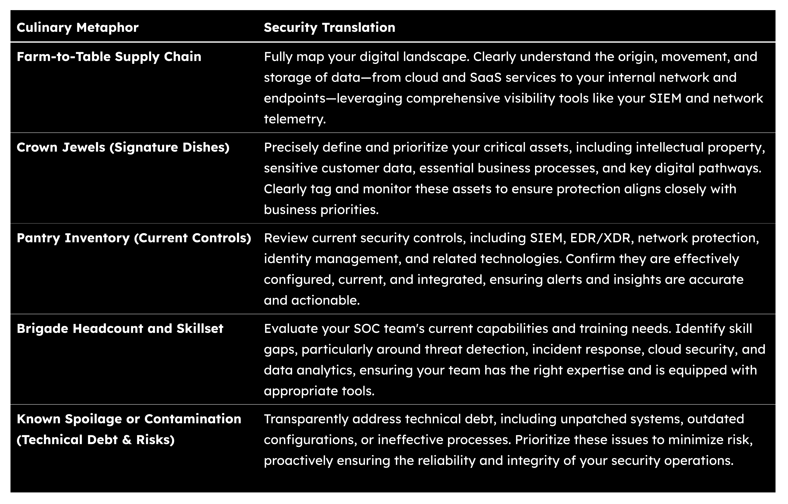
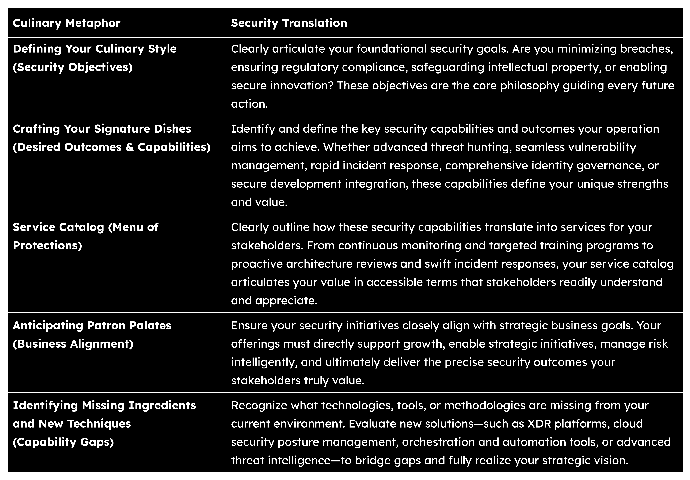
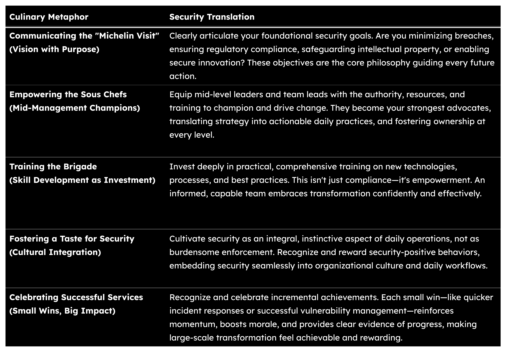

The SOC Ecosystem: Lessons from “Le Grand Gambit”
Building a Future-Proof Security Operation on Pillars of Trust, Culture, Orchestration, Unified Governance, and Partnerships.

## Opening of Service: A Note From the Chef

### Le Grand Gambit and the SOC Ecosystem

Cybersecurity people spend 40 minutes per day purely thinking about food. That’s more than 240 hours per year, or 10 full days. We make more than 200 food-related decisions each day, though most of us estimate we only make 15.

I’m clearly not alone in my food obsession. Last week, while writing some technical documentation (very boring stuff), my youngest was watching a cooking show. That’s when it hit me. The best SOCs (Security Operations Center) run just like a Michelin-star restaurant. They both contain and control the chaos and the same invisible systems hum in the background: trust, culture, orchestration, governance, and partnerships.

So, I’m trying something different here. Part thought experiment, part field guide, and pure fun! Consider this article my attempt to explain what makes a great security operation actually work, told through the lens of an imaginary restaurant.

Welcome to Le Grand Gambit!

Picture this: An adobe building off a dusty New Mexico highway. From outside, it looks like any other local spot. A bit worn and a bit fixed-up, but once inside, everything changes. The kitchen hums with precision while servers glide between tables in the historic, multi-room, building. It’s French technique meets Southwest soul — and somehow, it just works.

Two Michelin stars already earned, with the third hanging in tonight’s balance.

After years of building SOCs, I know they demand meticulous planning and preparation. There’s actually a perfect French cooking term for this: “Mise en Place” — everything in its place.

This is where our story begins: 5:30 PM. The Chef de Cuisine is deep in preparation for tonight’s service. Word has spread that a Michelin judge will arrive promptly at 7pm to evaluate Le Grand Gambit for their coveted third star. Every detail must be perfect. But perfection is fragile — one broken sauce, one missing ingredient, one overwhelmed station, and the whole system can collapse into chaos. As the night’s service unfolds, we’ll explore each dish and how the Chef’s vision of Trust, Culture, Orchestration, Unified Governance, and Strategic Partnerships come out of the chaos and onto your plate.

### The Evolution: Why Traditional Approaches No Longer Work

Time is the enemy in both kitchens and security programs.

In the old, “center-based” model, every decision flows upward (or inward as it were). An expensive security tool notifies an analyst to suspicious activity at 2am. They escalate to their manager. The manager needs the security director’s approval. The director consults with IT leadership. By the time anyone can act, hours (or even days-at-risk) have passed.

It’s like running a kitchen where a line cook needs the Chef’s permission to grab the fire extinguisher when the sauté pan catches fire.

We’ve all lived this nightmare. A ransomware attack that could have been contained to one workstation instead its blast radius grows larger and larger with time. Not because your team didn’t know what to do — they knew exactly what to do. They just couldn’t do it fast enough.

Data tells us the story of what happened. Traditional SOCs average 4–6 hours from detection to response. In that time, sophisticated threat actors can traverse your entire network, exfiltrate critical data, and establish persistence. Every minute costs money; every hour risks being a news headline.

The shift to distributed decision-making isn’t about losing control, it’s about gaining speed. When your line cooks can adjust seasoning on the fly, when your analysts can isolate threats immediately, when your teams operate with clear principles instead of rigid hierarchies, everything accelerates.

The evolution we’re all part of requires more than tools. Yes, Splunk SOAR mechanically automates responses but the people, processes, and data must all work in harmony with technology. The real transformation happens when you trust your people to act, when your culture supports rapid decisions, and when your governance provides clear guardrails instead of roadblocks or flaming hoops!

Just as modern kitchens empower each station to deliver excellence independently while maintaining overall harmony, modern SOCs distribute authority to compress the entire incident lifecycle — from prevention through detection, investigation, and response.

The results speak for themselves. Organizations that embrace this new way of operating see response times drop from hours to minutes. Alert fatigue plummets. Team morale soars. And most importantly, they stop attacks before real damage occurs.

But how do you make this transformation? That’s where our five pillars come in.

### Five Pillars of Excellence

- Trust: The invisible foundation
- Culture: Where passion meets purpose
- Orchestration: Controlled chaos in harmony
- Unified Governance: Clear direction, total accountability
- Strategic Partnerships: Your extended ecosystem

### The Chef’s Secret: Start Small, Dream Big

Dreaming of Michelin stars or a world-class SOC can feel overwhelming. Trust me, I’ve stared at that mountain too.

Every great chef knows that excellence begins in the smallest ways. You don’t start by attempting a 20-course tasting menu, you start by perfecting your knife skills. Then your signature sauces, then proper seasoning, then plating. Each small victory builds toward something bigger.

> “Great things are not done by impulse, but by a series of small things brought together.”

The same principle applies to building your SOC. Pick one thing to do well. Then another. Maybe it’s reducing false positives on your highest-volume alert. Maybe it’s getting your tier-1 analysts comfortable making isolation decisions without escalation. Maybe it’s finally documenting that one critical playbook everyone knows but no one’s written down.

Perfect that one thing… measure it… celebrate the win. Then pick the next thing.

I’ve watched teams transform by getting on the same page. Looking at each system and how they facilitate the confidentiality, integrity, and availability of the end user’s connection. A common / shared understanding the digital environment is key, especially when the business context and user journey are overlays.

Faster decisions improves response times. Better response times catch leadership’s attention. Leadership support can fund better tools. Better tools attract better talent. See how it compounds?

Our restaurant didn’t earn two stars overnight. We started by sourcing better tomatoes. Then we trained the prep cooks to julienne with precision. Then, timing the kitchen’s service. Each of these small improvements rendered better outcomes for our patrons.

### Tonight’s Service: The Michelin Moment

It’s 6:47 PM.

In thirteen minutes, a Michelin judge will walk through our doors. Or maybe they won’t. Maybe they came last Tuesday during lunch or they could arrive next week. That’s the thing about these judges — you never really know.

What we do know is they always arrive at reservation time and they notice everything.

- The warmth of the greeting
- The pace of service
- Whether the butter is perfectly tempered
- How quickly water glasses are refilled

The entire week at Le Grand Gambit has been electric. Every service could be the service. Every plate leaving the kitchen carries the weight of three stars. The team moves with heightened precision, not from fear, but from readiness. We’ve prepared for this moment for years.

Sound familiar?

Your SOC faces these same invisible evaluations. A routine Tuesday becomes a ransomware event that tests every process you’ve built. An unannounced audit arrives just as your senior analyst goes on vacation. The new CISO wants a full architecture review… by Friday.

We rarely get advance notice when the Michelin moment arrives.

The judge isn’t coming to see you perform miracles or get lucky under pressure. They’re coming to see if excellence is your normal. If your team executes with precision not because someone’s watching, but because that’s just how it is, by default.

Tonight at Le Grand Gambit, we’re ready. Not because we might be judged, but because we’ve build something worth judging. Every station knows their role, every ingredient specifically chosen, and every system hums with purpose. Every decision flows from deeply ingrained principles.

Let’s follow tonight’s service, course by course, and discovery how to build the same readiness in your organization.

The doors open in seven minutes. Time to cook!

## Tonight’s Tasting Menu: Five Courses in Operational Excellence

### First Course: Strategic Mise en Place

Everything in its place. Know your assets, your data flows, your critical systems. Build your foundation before service begins.

### Second Course: Strategic Stakeholder Alliances

Know your guests. Security that speaks business language, prioritizes what matters, and delivers value they can taste.

### Third Course: Precision and Operational Excellence

The controlled burn. Transform alerts into intelligence, chaos into clarity, minutes into seconds.

### Fourth Course: Trusted Suppliers

You’re only as good as your ingredients. Choose partners wisely, verify everything, secure the supply chain.

### Fifth Course: Seamless User Experience

Invisible excellence. Security so smooth your users forget it’s there — until they need it.

> Forget the menu for a moment; let’s talk about what you truly need. That’s the secret ingredient here.

Each course builds on the last. Miss one, and the entire experience falls apart.

Ready? Let’s begin with our first course, Mise en Place.


## First Course: Mise en Place Stratégique

From the Kitchen: Every ingredient has been checked multiple times by multiple people. Roasted Hatch chile from the Young Guns farm and pecans from Richard’s orchard in Mesilla Valley, each measured and ready. We know this because we’ve mapped everything. In your SOC, this means knowing every user, every asset, every data flow, and every critical process before the first alert fires. No assumptions, just readiness.

The Plate: A deceptively simple presentation arrives. Clean lines and perfect balance deliberately placed. You sense the hours of preparation in every detail. This is what confidence tastes like — when preparation is so thorough that execution appears effortless. This course is a tangible promise that everything to follow has been considered with exceptional care.

Notes from the Field: Last year, a state CISO called us in crises mode. They had 47 security tools but couldn’t answer “what are we protecting?” They were drowning in their own complexity — a classic case of being “in the weeds” before service even started. We spent three days mapping out their crown jewels (Internet-facing systems, critical applications, end users, and data) — it turned out that 80% of their monitoring covered non-critical systems while the payment component of the benefits system ran nearly blind. After implementing mise en place, they were able to detect incidents and determine root-cause within 72 hours during an upgrade-gone-sideways. The CISO later told me: “we were monitoring and protecting everything except what mattered.”

Key Ingredients:

- Mapping the Digital Terrain: Complete visibility into your digital landscape
- Creating the Perfect Menu: Strategic security objectives aligned with business
- Leading Change: Transforming vision into daily practice

### Mapping the Digital Terrain

Before crafting any menu, a chef must know their ingredients intimately. Every morning at Le Grand Gambit starts with the walk-through: checking deliveries, tasting sauces, testing equipment. For your SOC, this means brutal honesty about your current state.



The real transformation happens when you turn raw data into business context. In Splunk, this means enriching your events with your asset data, user identity data from AD and your MFA tools, mapping to service criticality, and the MITRE ATT&CK framework. A simple lookup transforms ‘IP 10.2.3.4’ into ‘payment processing server — CRITICAL.’

Quick win: Start with your most critical business service. Map every system that touches it, pull every procedural thread, and classify the data as part of this service. You’ll be surprised what you find.

### Creating Your Strategic Menu

> “We’re not just serving food, we’re serving ideas.”

With your terrain mapped, you design your security experience. Not a collection of tools, but a coherent strategy that tells your security story.



I’ve seen too many organizations build their security menu backwards — starting with tools, not outcomes. Many organizations out there purchase every leading (“best of breed”) security product visualized on a quadrant but still suffer from breaches, weekly fires, and struggles with audit/compliance. Why? They have never defined what “good” looks like.

After we helped them create their strategic menu — focused on protecting the benefits application — they actually retired six tools and improved their security posture. Less can be more when you know what you’re cooking with.

### Leading Transformation

The hardest part isn’t the technology — it’s bringing your team along.

> “The role of leadership is not to come up with all the great ideas, but to create an environment in which great ideas can happen.”

At Le Grand Gambit, when we introduced vibe coding, half the kitchen rebelled. “That’s not real cooking!” they said. But we didn’t mandate change. We let curious cooks experiment. We celebrated small wins and within six months, they were teaching others.

Let them cook!



The Reality Check: Transformation takes time. It might take 12 to 18 months to fully implement these changes… but, it’s worth it.

- Mean time to detect: 6 days → 4 hours
- False positive rate: 78% → 12%
- Analyst turnover: 45% → 8%
- Most importantly: team morale is up and people are excited about work again

Your First Step Tomorrow: Don’t try to boil the ocean. Pick a critical business process, map it completely, understand who owns it and who uses it, and document the impact of the service going down. Build your mise en place from there.

Remember, even Le Grand Gambit started with one perfectly seasoned pot of pinto beans.

As our first course concludes, you understand why mise en place matters. Every great meal — and every great security operation — builds on this bedrock. Without it, you’re just reacting to whatever crises walks through the door.


From the Kitchen: The order ticket says “veg.” But the real intel comes from our servers: “Table 5, anniversary. She mentioned loving citrus. He’s gluten-free.” Now their salads becomes something tailored for them; no bread garnish and extra romantic plating. In your SOC, an alert saying “failed login attempt” means nothing without context. Is it the city manager trying a new device? A researcher accessing patient data from a conference? That context transforms generic alerts into strategic responses.

The Plate: This isn’t just food delivered, it’s understanding served on dinnerware. Every element speaks directly to your needs, some you didn’t even know you had. The security team has clearly been listening, learning, anticipating. This is what partnership tastes like.

Notes from the Field: A customer recently asked me: “Why security always slow down our research?” Their security team was technically excellent but completely disconnected from the academic reality. Researchers couldn’t collaborate internationally without month-long security reviews. Grant deadlines were missed because of “security processes.”

We spent a month embedding security analysts with different departments — from the medical school to the particle physics lab. The turning point? When an analyst said, “Oh, THAT’s why you need to share 10TB datasets with researchers in Milan at midnight.” Understanding prevented them from drowning in false positives — from getting lost in the weeds of alerts that didn’t matter.

Six months later, those same researchers were championing the new secure collaboration platform. The security team went from “Grant Killer” to “Grant Enabler.” All because they fully understood their guests and had local decision-making authority.

Key Ingredients:

- Knowing Your Guests: Understanding which data, users, and systems that matter most
- Personalized Service: Tailoring security to each stakeholder’s reality, making it part of the fabric of business
- Proving Value: Making security outcomes visible and valuable
- Risk Sommelier: Guiding decisions with nuanced expertise in full alignment with the business
- Service Models: Finding the right operational approach and knowing how to grow/mature/refine that approach

### Knowing Your Guests: Data, Users, and Essential Systems

There’s a feeling of belonging and home that comes from the smell of roasting green chile. That same sense of deep familiarity should infuse how your SOC knows your organization.

One way I think about it is this: A great maître d’ doesn’t just know names — they know that Council Member Johan needs accessibility accommodations, that Dr. Carkhuff has a shellfish allergy, that the water utility crew always needs to eat fast during storm season. These aren’t details found on any lists; they’re absorbed understanding.

For your SOC, this means moving beyond basic inventories to genuine comprehension of knowledge and wisdom.

The ODAM Approach (PDF Overview):

1. Map Business Processes using the IT Service Blueprint Methodology

- City Government: From issuing permits to handling emergency services
- University Hospital: Patient care from admission through billing
- Water Utility: Ensuring water quality from source to tap

Each step reveals critical systems you might have missed.

2. Classify Your Crown Jewels

Ask key leaders: “What’s our most critical data?” Expect answers like criminal justice records, unpublished research, or critical infrastructure maps. Those insights define your priorities.

3. Understand User Behavior Patterns

- City Planners using GIS systems on mobile devices
- Medical Researchers needing secure international collaboration and ability to securely move large datasets
- Utility crews accessing SCADA during emergencies

Each pattern helps separate normal from suspicious

4. Map System Dependencies Clearly

- Identify critical interdependencies so you can prioritize protection effectively

5. Quantify Business Impact and Risk Appetite

- Translate technical risks into clear business outcomes — financial loss, regulatory penalties, or trust/reputational damage. Align risk management directly with organizational priorities.

By leveraging the IT Service Blueprint approach, your security strategy evolves from generalized defense into strategic precision, perfectly aligned with the realities of your business.

### Orchestrating Service Delivery: Prioritizing, Personalizing, and Proving Value

As renowned restaurateur Danny Meyer said, “The most important thing you can do is make the distinction between customer service and guest hospitality. You need both things to thrive, but they are completely different.” Similarly, your SOC shouldn’t just respond; it should thoughtfully orchestrate its services:

- Prioritize Strategic Responses: Focus on resources on incidents with the greatest business impact or highest risk, not just the loudest alarms. Avoid the trap of suppressing as tuning / detection engineering.
- Personalize the Experience: Tailor security practices to fit the unique realities and risk appetites of different departments.
- Clearly Demonstrate Value: Regularly communicate security outcomes in language stakeholders understand — reducing risk, improving efficiency, ensuring continuity, and facilitating compliance.

This integrated, strategic approach ensures your SOC not only handles threats efficiently but also visibly contributes to your organization’s resilience and success.

As our second course wraps up, you see why knowing your guests matters. Exceptional security — like memorable hospitality — depends on deeply understanding the people we serve. Without it, we’re simply delivering generic responses to nuanced challenges.


From the Kitchen: Friday night. 7:43pm. The printer won’t stop. Orders are piling up like an unconfigured SIEM. Every burner is occupied, six timers going off, one oven running too hot, and three dishes need plating NOW.

We call this being “in the weeds.”

It’s not about volume — we’ve handled 300 covers on a good night. It’s about the collision of circumstances that shatters your rhythm. That new expediter freezing at the pass. The printer running out of paper mid-rush. Two prep cooks calling in sick. Suddenly, your beautiful choreography become a desperate scramble.

In your SOC, it’s the same suffocating feeling. It’s that Monday morning when three “critical” vulnerabilities drop, your senior analyst is on PTO (paid time off), the CISO wants an emergency brief, and overnight accumulated 3,000 alerts because someone forgot to test the new version of a detection.

The real tragedy isn’t the temporary chaos — it’s what this does to people. Watch a talented analyst after six months of drowning in false positives. Their sharp eyes dull. Their curiosity fades. They stop asking “what’s unusual about this?” and start asking “how quickly can I close this ticket?”

A young analyst once told me, “I became a security professional to hunt threats and protect people. Instead, I spend my days as a glorified click-farmer, harvesting false positives.”

But here’s what separates good kitchens from great ones: We don’t just survive the weeds. We’ve built systems to prevent them, and when they happen anyway, we know how to fight our way out.

The Plate: What arrives is considerably calm. Each element precisely placed, temperature perfect, flawless timing. You’d never know the controlled chaos and noise that created it. This is operational excellence: the swan gliding gracefully while paddling furiously beneath.

Notes from the Field: Picture a Water Utility’s SCADA system starts throwing anomalies at 2am during a freeze warning. One million residents depend on water pressure every day. The junior analyst on duty has seen this pattern before — in training.

She doesn’t panic. Doesn’t escalate immediately. She executes the playbook: isolate the affected PLCs, switch to manual control, verify physical plant status. Within 7 minutes, she’s identified compromised credentials from a vendor laptop. Eight minutes later, the threat is contained.

Her manager arrives later that morning to find a complete incident report, remediation in progress, and zero service disruption. Her managers asks how she stayed calm and said, “we drill this every month. It was just like practice, except real.”

Operational excellence is making the extraordinary look routine.

Key Ingredients:

Contextualized Intelligence: Transform noise into meaning  
(data →information →intelligence →knowledge →wisdom)

- This is how you prevent being in the weeds. That organization with 47 different security tools? Each with its own interface, its own alerts, its own special way of describing the same threat? Their analysts spent more time translating between tools than actually analyzing anything.

Instantaneous Response: Speed with precision, not panic

- When you’re in the weeds, every second compounds the chaos. Technical debt — that server running Windows 2012, those firewall rules nobody understands — becomes anchors dragging you deeper. The solution isn’t working harder. It’s having the courage to stop, simplify, and fix the foundation.

Continuous Refinement: Every incident makes you stronger

- The path out of the weeds isn’t dramatic. Start small. Fix one broken process. Eliminate one redundant tool. Give one analyst permission to make decisions without escalation. Excellence exists on the other side of admission that we’re lost. Choose a direction. Take the first step. Even in the deepest weeds, the next response can be flawless.

Seamless Integration: Tools that work together, not against each other

- Great kitchens have a single source of truth — the pass where every dish comes together. Your SOC needs the same. This is where unified platforms become essential, bringing order to the chaos of disconnected tools.

### The Context of Flavors: Making Sense of Alerts

> “Knowledge is knowing a tomato is a fruit; wisdom is not putting it in a fruit salad.”

In the public sector, context isn’t just a nice-to-have, it’s critical. That “suspicious login” might be:

- A city council member at an emergency meeting
- A researcher collaborating with colleagues in France
- A utility worker responding to a 3 AM water main break
- Or actual threat actors targeting your infrastructure

### Data Ingestion That Understands Your World

> For City Operations:

```
Raw Alert: "Multiple failed authentications - IP 192.168.1.50"
```

> For Healthcare/Research:

```
Raw Alert: "Large data transfer - 10TB to external IP"
```

### Building Your Context Engine

```
1. Asset Context That Matters:
```

Real Implementation: A state university reduced false positives by 82% after mapping academic calendars to their SIEM.

- Finals week? Expect library systems at 200% normal load
- Spring break? That “unusual” login might be faculty at a conference
- New student enrollment? An administrative change to the cloud infrastructure created a bottle neck at the database

### Instantaneous Response: Public Service at the Speed of Need

When the power grid is under attack or patient data is being held ransom, you don’t have time for committees.

> The Ideal Speed Framework for Public Sector

```
DETECTION → ASSESSMENT → CONTAINMENT → COMMUNICATION
```

Forget the old model where everything escalates up the chain. When citizens’ lives hang in the balance, your front-line responders need authority to act.

### Runbooks That Actually Run

Most runbooks read like tax code. Here’s what actually works:

The 2 AM Test: Can your newest analyst execute this half-asleep?

> Example — Ransomware on Municipal Network:

```
1. SEE ransomware indicator → ISOLATE affected segment (0-30 sec)
```

> Power Grid runbook:

```
IF anomaly detected:
```

No philosophy. No email back-and-forth. Just confident action.

### The Integration Reality

Your security tools often fight each other more than the threats themselves. Here’s what an organization might realize when integration is a priority:

How they did it:

1. Started with the most critical workflows: phishing investigation and ransomware response
2. Connected just three tools initially (SIEM → SOAR →Ticketing)
3. Added one integration per month
4. Measured success by time saved, not tools connected

Their secret? They started with small steps, alignment to the business, and a clear vision.

### The Continuous Improvement Loop (That Actually Happens)

Most “lessons learned” meetings are where good ideas go to die.

How about an approach that mirrors debriefing techniques used in other high-stakes fields, such as healthcare and aviation, where structured post-event discussions are integral to performance improvement?

The 15-Minute Friday Review:

- What broke this week?
- What almost broke?
- What did we detect?
- What did we respond to?
- What mitigations did we put in place?
- What did we fix?
- What’s ONE thing we’ll improve next week?

The Chef’s Secret: In kitchens that earn their third star, they do something called “Better Bites” — 5 minutes after service where everyone shares one thing that could be better. No blame. Just better.

Your SOC needs the same ritual.

Speed in the public sector isn’t about recklessness — it’s about readiness. True readiness means being so thoroughly prepared that when a crisis hits, process, instinct and training take over. Your newest analyst should be able to confidently protect your city’s water supply at 3 AM, half-asleep, even on Christmas morning.


From the Kitchen: 6 AM. The delivery truck’s backup beep alerts me to their arrival as they back up to our loading doc. Our sous chef doesn’t just sign and move on. She cuts open boxes, smells the produce, checks for bruising, and verifies origin certificates. Doesn’t like the temperature of a box and rejects it. Sent back, no discussion.

Your SOC calls for the same discipline. That new start-up SIEM vendor promising “AI-Powered magic” or the endpoint company promising a holistic view?

If it’s not impeccable, it doesn’t enter your environment. Period.

The Plate: What arrives appears simple — perfectly prepared corn soup. But behind this simplicity lies a complex web of trust. The farmer who harvested it, the distributor who packaged and transported it, the prep cook that truly listened to his ingredient (get it? ear?). Each link in this chain has been personally verified, tested, and proven. This isn’t just food; it’s a trust network made edible.

Notes from the Field: A big city learned this lesson at 2.7 million dollars per week.

Their parking meter system, which was outsourced to a vendor, got ransomwared. Not the vendor’s main systems but a sub-contractor of a sub-contractor. Four layers deep in the supply chain, someone clicked a phishing link.

Resulting in shattered trust and 6 weeks of free parking citywide. Revenue loss was nearly $16.2 million dollars.

The vendor had passed all the audits. Had all the certifications. But no one had asked, “who are your vendors?”

Now the city requires full supply chain mapping. Every vendor. Every subcontractor. Every dependancy. An exhausting but necessary part of the process.

Key Ingredients

- Selecting Producers: Choose partners like lives depend on it (they often do)
- Guaranteed Traceability: Know where every component comes from
- Securing the Chain: Protect the entire journey, not just the source and destination

### Choosing Producers: Selecting Our Partners with Rigor

> “Knowing your farmer, your producer, is knowing the foundation of your food. It’s about trust, relationships, and shared vision.” — Alice Waters

Real-world vendor selection is challenging-especially in the public sector, where you’re often bound by lengthy procurement processes and budget constraints. Yet protecting your organization’s data, systems, and users remains non-negotiable.

Just as a chef personally selects fresh produce from trusted farmers, your security operation demand meticulous scrutiny of technology vendors, ISAOs, service providers, intelligence sources, and commercial organizations. These partnerships are more than functional-they’re foundational to your organization’s integrity and resilience.

Here’s how you realistically manage vendors and reduce risk:

Selecting Producers: Choose partners as if lives depend on it — because often, they do.

- Look beyond standard questionnaires; seek transparent breach histories, clearly defined limits, proven capabilities, and solid references from comparable organizations.

Guaranteed Traceability: Know exactly where every component comes from.

- Require detailed software bills of materials (SBOMs), clear data provenance, and regular audits of third-party vendors to ensure uncompromised authenticity and integrity.

Securing the Chain: Protect every step of the digital journey, not just endpoints.

- Clearly outline responsibilities with cloud and SaaS providers, enforce rigorous encryption standards for data in transit and at rest, and continuously monitor configurations to prevent missteps.

Ultimately, exceptional partnerships are rooted in ongoing collaboration, transparency, and adaptability — ensuring your organization’s security posture remains robust and trusted.

As our fourth course concludes, you understand why selecting and managing vendors with rigor matters. Exceptional security — like exceptional cuisine — depends on choosing trusted partners, ensuring transparency, and safeguarding every link in the chain. Without this careful selection and oversight, even the best-intentioned security strategies are vulnerable.


From the Kitchen: Final plate. 8:47pm. As the last plate leaves the pass, I watch the server’s hands. Steady. Confident. They know this dish won’t spill, won’t need explanation, won’t confuse the guest. Every element is exactly where it should be.

That’s your SOC’s signature — security so natural, your users don’t even notice it’s there. Until they need it. Then it’s everything.

The Plate: Notably simple. Three perfect elements on white porcelain. But touch the plate — it’s the exact right temperature. The garnish isn’t just beautiful, it’s edible. The sauce doesn’t pool; it stays where placed. This is thousands of invisible decisions made visible in one effortless moment.

Notes from the Field: The call came at 10:47am. The state tax department, serving over 400,000 residents and half that in businesses, went down and filers couldn’t file their returns.

“We followed security best practices,” the CISO insisted. “Complex passwords; changed every 3 months; MFA on everything; three security questions.”

What actually happened was the following. Tax filers got frustrated with new security “features” as part of their filing process. They overwhelm the call center requesting help.

Attackers figured this out, called in claiming to be confused elderly taxpayers, got passwords reset, and changed direct deposit info.

Six months later: Single sign-on. Biometrics for mobile. Plain-English security questions. Help desk callbacks for verification. Tax filing up 34%. Fraud down 91%.

Key Ingredients

- Empathetic Design: Build for humans and our habits, not for robots or audits
- Frictionless Flow: Make the secure path the easy path
- Clear Communication: No jargon, no confusion
- Active Listening: Your users will tell you what works
- Unified Identity: One identity, properly secured

### Designing Security with User-Centric Principles
