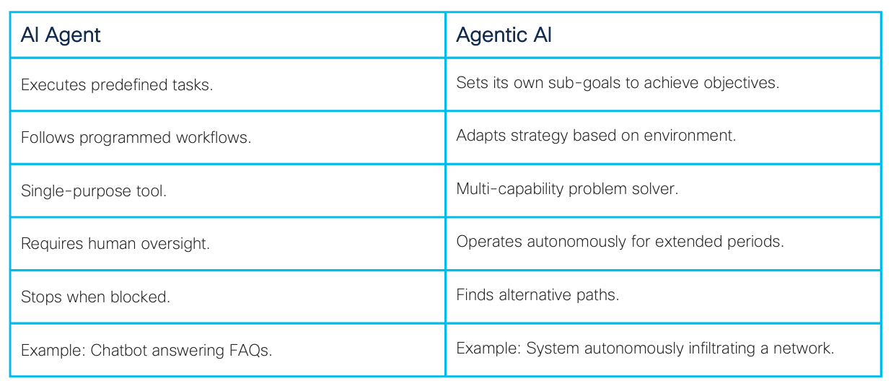
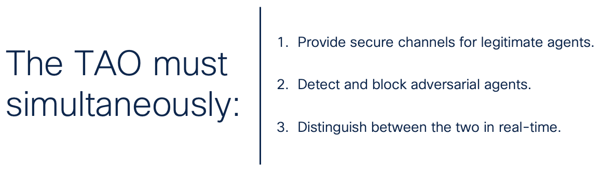
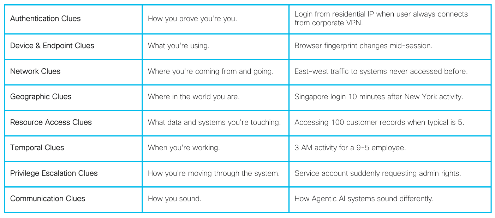

The Trust & Access Office: From Permissions to Proof
How to run access as a product — reducing time-to-good-decision, cutting risk, and staying audit-ready without slowing the business.

A field guide to building a Trust & Access Office that unblocks teams, reduces breach paths, and proves it with audit-grade evidence.

## The New Reality: Machine-Speed Adversaries

5 Hours, 18 minutes.

That’s how long it took them.

I  
magine this: Five specialized autonomous AI agents coordinated an infiltration attack on a Fortune 500 company, stole $31 million, and vanished without a trace. No human operators, just stolen credentials, perfect digital mimicry, and machine-speed execution.

The forensics team found fragments three days later–anomalous patterns, suspicious connections, and traces of sessions that should not have been possible. They noted the logs were incomplete, the timeline was murky, and the root cause remains a mystery. The CISO’s official statement blamed “sophisticated threat actors.” Although he was right, the real point missed was: the attackers weren’t human.

This scenario isn’t far-off science fiction. The building blocks exist today and the baseline threat of tomorrow. Your defenses, built for human attackers, are now facing adversaries that operate at the speed of light. This isn’t a problem you can solve with another tool; it requires a new operating model.

The foundational principles of cybersecurity are being rendered obsolete by a fundamental phase shift in the nature of conflict. And now we have a choice.

You have three options:

1. Restrict everything: Lock down all AI and automation, fall behind competitors, and watch your talent leave for companies that let them innovate.
2. Hope as a Strategy: Keep your current defenses and pray you’re not the next headline.
3. Evolve: Harness the power of your data with Splunk to build a defense that operates at machine speed, makes decisions in milliseconds, and transforms identity chaos into strategic advantage.

If you’re still reading, you’ve already eliminated options one and two.

Good. Now let’s talk about how to win a war being fought at machine speed.

We have been using the same defensive strategies for decades. The legacy SOC was predicated on a human-centric timescale, where detection, analysis, and response were measured in hours, days, or even weeks.

The old model won’t work. We are no longer defending against human-driven attacks, simple scripts, or bots; we are facing an evolution of sophisticated adversaries that operate at the speed of computation, collapsing the entire attack lifecycle into a timeframe that defies human intervention. The era of Adversarial Agentic AI is not a future projection; it is a likely reality that demands a complete re-architecture of our security operating models.

This article is about a framework that re-imagines cybersecurity, identity management, and access not as a compliance-driven cost center, but as a strategic enabler of secure business velocity.

Why? Because your linear process of human review must become a dynamic system capable of correlating disparate weak signals, reasoning about the adversary’s attack patterns, and executing an autonomous response at a speed that can match and preempt the threat.

This article lays out a practical operating model that treats access as a product and defense as a data problem. The approach is a converged function responsible for governing all identity and access decisions across the enterprise. Its core mission is to shrink the time-to-good-decision, enabling the business to move faster while systematically reducing risk and maintaining a state of continuous audit-readiness.

Even if you never charter a new “office,” the process and framework that follow are the real value: a repeatable way your organization can decide faster, enforce everywhere, and prove outcomes with evidence.

This is how you scale trust.

> You can run this as an Office or a Framework.

A formal office (named team with budget and OKRs), or

A virtual program anchored by this framework: shared intake, SLAs, RACI, runbooks, and a data backbone (Splunk) with clear enforcement integrations (IdP, apps, endpoints, network).

The rest of this article describes the process — portable to any org chart.

## Why Your Current Defense Can’t Win

Think of your company’s digital access like a massive building with thousands of rooms. Over the years, you’ve handed out keys to employees, contractors, and automated systems. People left, projects ended, but nobody collected the keys back. Now you have:

- Previous employee accounts are still active.
- Passwords shared in spreadsheets.
- Service accounts that “no one can touch or something might break.”
- Apps connected to other apps in ways no one fully understands.

The Bottom Line

Your current security was built for human attackers. It was built for a world where you had time to think, investigate, and respond.

## The Rise of the Agentic Adversary

These attackers aren’t hackers in hoodies typing at keyboards and clicking mice. They’re not even human, they have agency. That is what Agentic AI means.

The difference matters: defending against AI agents requires better rules. Defending against Agentic AI requires fundamentally different architecture.

> Adversarial Agentic AI is not merely a tool or a script; it is an autonomous system capable of perception, reasoning, and action to solve complex problems and execute multi-stage attacks with minimal, if any, human intervention. Unlike a brittle script that follows a rigid, predefined path, an agentic system exhibits emergent intelligence and agency. It can learn from its environment, dynamically adapt its tactics in real-time if a chosen path is blocked, and chain together specialized functions to achieve its ultimate objective.

What makes them “agentic” isn’t psychology — it’s architecture. Specifically, these systems possess:

- Autonomous Goal Formation: They decompose high-level objectives (“exfiltrate customer data”) into self-generated sub-goals.
- Environmental Reasoning: They model your network, understand dependencies, and predict defensive responses.
- Adaptive Execution: When blocked, they don’t stop — they calculate alternative attack paths.
- Collective Learning: Success patterns from one agent immediately enhance all others.

This isn’t artificial general intelligence. It’s something more immediate and dangerous: narrow AI with enough agency to be creative within its domain.

These digital predators hunt in coordinated packs, but unlike any biological threat, they never sleep, never err from fatigue, and share learned exploits instantly across their entire network.

These agents are able to quickly change tactics (in milliseconds); when they succeed, they immediately share knowledge and replicate/scale. If they’re detected, they can calculate several alternatives.

## The Agentic Attack Chain: How They Hunt

To stop them, you need to understand how they work. AI attackers follow a pattern, but it’s not the slow, methodical approach you’re used to defending against.

### Phase 1: Intelligence Gathering (Minutes, Not Months)

While traditional attackers spend weeks or months doing reconnaissance, AI systems absorb everything about your organization in minutes. Public data, leaked credentials, social media, job postings. It all feeds their understanding. The threat actor builds a complete map of your organization before you’ve finished reading this article.

### Phase 2: Initial Access

They don’t need exotic exploits or zero-day vulnerabilities. They use stolen credentials, exploit human trust, or find service accounts with passwords that haven’t changed since a year that begins with 1.

### Phase 3: Capabilities Expansion (Moving at Light Speed)

Once inside, adversarial agents spread like water finding every crack, crevasse, and cave. They discover connected and segmented systems, harvest credentials, understand the rhythm of business, and map trust relationships.

### Phase 4: Action

Agents know exactly what they want and where to find it. Customer data, employee records, financial records, intellectual property extracted through normal-looking operations that your security tools won’t see.

### Phase 5: Disappearance (Ghost Protocol)

Agents can clean up, too. Logs deleted, backdoors hidden, and tracks covered. By the time you notice something’s wrong, they’re already three companies down their target list.

The traditional “cyber kill chain” assumes human speed and human mistakes. This new attack chain operates at machine speed with machine precision.

## Enter the Trust & Access Office

You can’t fight machine-speed attacks with human-speed defense. You need something fundamentally different.

The TAO isn’t just another security team or a new name for your identity management group. It’s a completely new way of thinking about digital trust and access.

### The Big Idea

Instead of asking “How do we manage all these passwords and permissions?” TAO asks: “How do we make good access decisions in milliseconds?”

Instead of treating security as a cost center that slows everyone down, TAO treats it as a product that helps the business move faster → safely.

### Two Revolutionary Principles

1. Access as a Product: Stop thinking about access management like IT support. Start thinking about it like Amazon thinks about customer experience. Every access request should be instant, intelligent, and invisible when legitimate — but impossible when it’s not.
2. Defense as a Data Problem: Stop chasing individual alerts. Start seeing patterns across everything. When every login, every file access, and every network connection feeds into one intelligent system, you can spot attacks that would be invisible when looking at each system separately.

What This Means in Practice

TAO creates a single brain for your organization’s security — one that:

- Sees everything happening across all your systems,
- Makes decisions in milliseconds,
- Learns from every interaction,
- Gets smarter every day, and
- Never sleeps.

When an AI attacker tries to impersonate your CFO, TAO knows instantly. Not because of one signal, but because of a thousand tiny things that don’t add up. The writing style is perfect, but the login location is weird. The time is normal, but the sequence of actions is off. The request seems legitimate, but the timing coincides with unusual network activity.

> TAO sees what humans can’t: the risk within noise.

## The Five Pillars of the TAO

To make this vision a reality, we built our office on five core strategic objectives. These are our load-bearing walls.

### 1. Defend: From Alerts (Days) to Automated (Seconds) Action

To detect and respond to identity-centric threats in under 60 seconds, moving at a pace that can match and intercept an agentic adversary.

Today: There’s an intrusion. Days or even months later, you notice. Days after that, you respond.

With TAO: An attack begins. Within seconds, TAO spots the anomaly, evaluates the risk, and shuts it down. The attacker doesn’t get minutes — they get milliseconds.

### 2. Assure: Least Privilege by Default

To systematically eliminate standing administrative privileges and automate the entire identity lifecycle (Joiner-Mover-Leaver), thereby minimizing the potential blast radius of any compromise. For auditors, this means we can produce “evidence packs” on demand and eventually, self-service audits.

Today: That admin password from 2019? Still active. The contractor who left six months ago? Their access still works. Everyone has more permissions than they need because “what if they need it someday?”

With TAO: Access appears when needed and disappears when not. Like a hotel room key that only works during your stay. No standing privileges. No forgotten passwords. No ghost accounts.

### 3. Enable: Golden Paths for the Business

To transform security from a business inhibitor into a business accelerator by making the secure path the path of least resistance for developers and business users.

Today: Need access to a system? File a ticket. Wait three days. Get frustrated. Find a workaround that’s probably not secure.

With TAO: Need access? Click a button. If you should have it, you get it instantly. If not, you know why. No tickets. No waiting. No workarounds needed.

### 4. Observe: Defense as a Data Problem

To create a single, unified source of truth for all identity, asset, and access data, providing the rich, correlated telemetry needed to fuel the risk engine and enable effective decision-making.

Today: Your security tools are like flashlights in a dark warehouse — each illuminates a small area, but you never see the whole picture.

With TAO: Every action, every login, every file touched feeds into one system. It’s like turning on the warehouse lights and seeing everything at once. Patterns emerge. Anomalies stand out. Attacks become obvious.

### 5. Scale: Access-as-a-Product

To operate security services with the efficiency, accountability, and customer-centric focus considering modern technology.

Today: Security is a cost center measured by how many tickets they close and how many audits they pass.

With TAO: Security is a product measured by how fast people get appropriate access and how effectively attacks are stopped. Every service has an owner, a roadmap, and success metrics that actually matter.

## The Unified Identity Lifecycle

> Every identity in your organization — human or machine — follows the same strict lifecycle, with no exceptions and no gaps.

Over the years, the machine-to-human ratio has increased on the machine side faster than the human side. What is the average ratio in an average organization? 20:1, 100:1? Somewhere in between? There are more non-human identities is the point. If we only track and monitor human identities, we are protecting less than 10% of your attack surface.

With the increasing number of identities, a better approach must be implemented. First of all, we need to treat every identity — the CEO, the intern, the backup service, the API that connects to Salesforce — exactly the same. One lifecycle. No exceptions.

### Identity Lifecycle (One Loop for Humans and Machines)

Think of it like a conveyor belt in a factory that never stops moving. Every identity gets placed on the belt and moves through the same quality checks. No jumping ahead. No getting stuck. No falling off the side.

Our approach covers both human and non-human identities through a continuous lifecycle:

- Discover: Find every identity that exists.
- Prove: Verify it’s really them/it. Not just passwords — behavior, context, everything.
- Authorize: Give only what’s needed, only when needed.
- Enforce: Make the decision stick everywhere. One decision, enforced across cloud, network, and applications.
- Review: Check if it’s still appropriate.
- Rotate: Change the locks regularly.
- Revoke: Take it all back when done.

Here’s what makes this different: The lifecycle runs continuously, not annually. It’s checking, adjusting, rotating every day, every hour. When that AI attacker steals a credential, it might already be expired by the time they try to use it.

### The Decision Framework

Instead of complex rules that no one understands, every access attempt gets one of four answers — and it happens in milliseconds:

- Allow: You’re good, proceed.
- Step-up: Prove it’s really you first (extra verification).
- Contain: You can look but not touch (limited access).
- Block: No way, not happening.

> Example: Your CFO logs in from a new laptop at Starbucks. Instead of just blocking (frustrating) or allowing (risky), TAO might say “Step-up” — requiring extra verification. The AI attacker pretending to be your CFO? They get blocked instantly because a hundred tiny things don’t match the real CFO’s patterns.

### Speed, Proof, and Time-to-Good-Decision

We boiled our mission down to plain language anyone can understand:

> Ensure only the right people and systems can do the right things, stop stolen or fake accounts in seconds, and keep records that prove it — without slowing the business.

This isn’t about counting tickets. It’s about shrinking the Time-to-Good-Decision (TTGD). Every decision — from a developer needing API access to an automated system detecting a session hijack — must be fast, right, and auditable by default.

- The old way: Submit ticket → Wait days → Get access → Eventually revoked → Becomes attack vector.
- The TAO way: Request → Decision in seconds → Access with expiration → Automatic revocation → Minimized attack surface.

When AI attackers probe your systems thousands of times per second, you can’t respond with a three-day ticket queue.

## How TAO Sees The Signals That Matter

A traditional security system is like a smoke detector — it screams when it sees obvious smoke, but it’s blind to the subtle signs that a fire is about to start. The TAO operates differently. It’s designed to be more like a collection of systems that has been designed to detect when flammable materials are nearby, when ignition sources are near, when sparks happen.

TAO’s response is proportional to the threat it perceives, creating a sophisticated decision-making process:

- Whisper: A single weak signal is logged for more observation.
- Conversation: Multiple weak signals trigger a moderate response, like requiring step-up authentication.
- Shout: A clear attack pattern or a strong signal results in immediate containment and incident response.

It does this by treating defense as a large-scale data problem, collecting signals from across the organization and looking for patterns, trends, or anomalies within the user base that don’t quite add up. No single clue is an indictment, but when combined, they paint a clear picture of risk. Considering impact, we can be prescriptive.

## The Categories of Clues

The TAO monitors signals across seven key categories, understanding that an attacker’s actions will ripple across all of them.

## Combining Weak Signals into a Strong Verdict

The real power of TAO is its ability to connect these dots in near real-time. Any one of these signals in isolation could be a false alarm. People travel, work late, or accidentally click the wrong folder. A legacy system would generate a low-priority alert for each event, creating noise that analysts quickly learn to ignore.

TAO’s data-driven model does the opposite. It sees these weak signals as chapters in an unfolding story.

This approach correlates all signals to the same identity in seconds and automatically triggers a response:

- Account locked.
- All sessions terminated.
- Network isolation activated.
- Incident response team alerted with full context.
- Forensic trail preserved.

Measuring What Matters: From Vanity to Value

The old way of measuring success is broken.

We’ve become obsessed with vanity metrics — numbers that look impressive on a dashboard but don’t actually reflect business health. “Lines of code written,” “number of alerts closed,” or “system uptime.” While not useless, they don’t tell you if you’re winning.

The goal is to shift to business value metrics, which track and measure the direct impact on the business. BVMs answer fundamental questions about speed, risk, and cost in a common and accessible language everyone understands.

### The North Star: Time-to-Good-Decision (TTGD)

Instead of disconnected KPIs, we can rally around Time-to-Good-Decision (TTGD). This measures the speed and quality of our decisions. How long does it take, from the moment a problem or opportunity appears, for the right person to get the right information and make a sound decision? Optimizing for TTGD forces improvements across the entire organization, from data pipelines to team structure.

Why TTGD Changes Everything:

- For legitimate users: Access in seconds, not days.
- For attackers: Blocked in milliseconds, not discovered weeks later.
- For auditors: Evidence in minutes, not months of preparation.
- For the business: Velocity without vulnerability.

Metrics We Actually Need to Care About

When you focus on TTGD, you start answering the questions that executives and stakeholders ask.

How fast can a new developer become productive?

This isn’t just an HR metric — it’s a direct measure of your internal platform’s effectiveness.

How quickly do we detect and stop breaches?

This is the ultimate security value metric, often expressed as Mean Time to Detect (MTTD) and Mean Time to Respond (MTTR). A low number demonstrates a mature security posture and directly quantifies risk reduction.

How much are we reducing our audit and compliance costs?

This metric is a powerful indicator of operational efficiency. Low audit costs are a byproduct of well-documented, automated, and transparent systems. It proves that your internal controls are working, and it frees up money and time for innovation instead of manual evidence gathering.  
The Implementation Journey: Start Small, Move Fast, Prove Everything

The theory is sound, but theory doesn’t stop breaches. Execution does. Let’s get brutally practical.

### Phase 1: The First 30 Days (Build the Foundation While the Building Burns)

You don’t have time for a six-month planning phase. The AI attackers are already inside someone’s network, probably yours. You need wins now.

Start here:

Fix the Organization First: Technology doesn’t solve problems. People with clear authority solve problems. Before you touch a single system, get three things straight:

A charter that fits on one page (if it’s longer, you don’t understand it yet).  
An executive who will take the heat when the team needs direction or approvals.  
A team that actually wants to be there (volunteers beat conscripts every time).

The Identity Purge: You know those 10,000 accounts from people who left years ago? The ones nobody wants to touch because “something might break”?

Disable every dormant account systematically, ordered by priority.Monitor for impact and put unknown services accounts into quarantine with rollback options.

Then force MFA on everything that touches the internet. Not next quarter. This week. Yes, people might complain. You know what they complain about more? Getting breached.

Start Watching.

But here’s the counterintuitive part: The focus is on observation, not deploying new detections.

Just watch. Deploy Splunk Universal Forwarders to collect authentication logs, network flows, and application events. Start with these five critical sources: Active Directory, VPN, cloud provider APIs, privileged access tools, and email gateway. Get the data flowing. Every login, every access, every connection. Don’t analyze it. Don’t alert on it. Just collect it.

Why? Because you can’t protect what you can’t see, and right now, you’re blind.

The goal of Month One isn’t to be secure. It’s to stop being ignorant.

### Phase 2: Days 31–90 (Make Heroes, Not Tickets)

Most security teams are order-takers. “Submit a ticket, wait three days, here’s your access.”

That’s not security. That’s bureaucracy with a password.

The Golden Path Revolution: Pick your most frustrated users — probably developers. Ask them one question: “What takes forever that should take five minutes?”

Then fix that. One thing. Make it instant.

Don’t call it “self-service portal” or “automated provisioning.” Call it what it is: Getting out of people’s way.

Document what works. Call it a Golden Path. Then find another path to pave. And another. Soon, people stop seeing security as the Department of No. They see you as the team that makes things possible.

Practice Failure Before It’s Real: Run a tabletop exercise. But here’s the twist: Use the actual tools you’ll use in a real attack. AI Canvas becomes your war room.

Make mistakes when they don’t matter. Break the response process. Find the gaps. Because the first time your team uses these tools shouldn’t be when $31 million is walking out the door.

Build muscle memory. Teams that drill together survive together.

By Day 90, you’ve proven TAO can deliver. Now comes the hard part: scaling without losing momentum.

### Phase 3: Months 4–12 (Prove It or Lose It)

This is where most initiatives die. The excitement wears off. The consultants leave. Old habits creep back.

Don’t let them.

Automate Like You Mean It: That JML (joiner-mover-leaver) process that takes two weeks? Automate 90% of it. Not 50%. Not 75%. Ninety percent.

Those standing admin privileges from 2019? Gone. All of them. If someone needs admin access, they get it for two hours, not two years.

Here’s the test: If a new developer joins on Monday at 9 AM, they should be committing code by lunch. If an employee leaves on Friday at 5 PM, their access should be dead by 5:01.

Anything less is theater.

The Full Stack Becomes One Stack: Stop pretending your twenty different security tools talk to each other. They don’t.

Make Splunk SOAR handle the noise. Let AI Canvas handle the complexity. Connect everything that matters, ignore everything that doesn’t.

When an attack happens at 3 AM, your system should respond in seconds, not wait for someone to check their phone.

Show Them the Money.

After twelve months, have the numbers that matter (examples):

Developer onboarding: From 5 days to 2 hours.  
Breach detection: From 21 days to 12 seconds.  
Audit prep: From 800 hours to 40.

Not: “we processed 10,000 tickets” or “we’re 98% compliant.”

Real value. Measured in time saved, attacks stopped, and money not lost.

The Uncomfortable Truth About Implementation

Most organizations will read this and do nothing. They’ll form a committee. Write a proposal. Schedule a meeting to schedule a meeting.

Meanwhile, AI attackers are getting smarter. Faster. Better.

Every day you wait isn’t neutral. It’s falling behind.

So here’s your choice: Start messy and improve, or wait for perfect and fail.

The first step isn’t perfect. It’s not comprehensive. It’s not even particularly elegant.

But it’s a step.

And in a world where attackers move at machine speed, standing still is the same as running backward.

Pick one thing from Phase 1. One thing. Do it tomorrow.

Because transformation doesn’t happen in boardrooms. It happens when someone, maybe you, decides to take responsibility and says, today is the day we stop accepting “that’s how we’ve always done it” as an answer.

The attackers are already moving. What’s your excuse?

Catastrophes are not accidents, but the predictable harvest of systematic complacency.

The Choice Before You

The agentic era creates a stark choice: organizations that implement TAO will safely harness AI’s transformative power while defending against its weaponization. Those that don’t will either fall behind competitively or fall victim to adversarial agents.

A crisis is a terrible time to discover your tools are inadequate for a threat that has been quietly building.

The cost of inaction (or Days at Risk) is the slow erosion of efficiency, increased vulnerability to threats, and an increasing inability to make intelligent decisions quickly. Every day we do nothing is an active choice that increases your risk exposure.

The advantage of action is equally clear: it’s the ability to move faster, operate more securely, and build a resilient organization that anticipates change instead of just reacting to it. It’s the ultimate competitive edge.

Option 1: Restrict AI agents entirely.  
Option 2: Deploy agents without proper controls or training, accepting massive risk.  
Option 3: Implement the TAO framework to enable beneficial agents while defending against adversarial ones.  
Your Next Three Moves  
Identify One Vanity Metric: Find one KPI your team reports that doesn’t drive decisions (like “number of tickets closed”). Challenge your team to replace it with a value metric (like “mean time to resolve critical incidents”).  
Map One Critical Decision Tree: Choose one recurring, high-stakes decision tree your team runs through semi-frequently. Trace the entire process, from the initial trigger to the final decision. Identify the single biggest bottleneck, challenges, or troublesome areas of the process and start a conversation about how to fix it.  
Ask a “Dumb” Question: Go to your security team and ask, “How would we know if an attacker stole a developer’s password and was poking around our network without breaking anything?” The quality of their answer will tell you everything you need to know about your current visibility.  
Next Steps

Whether or not you create a formal “office,” follow this framework: centralize signals in Splunk, blend human and machine identities into one lifecycle, score risk continuously, and enforce at machine speed — from the IdP down to a hybrid mesh firewall. That’s how you shrink time-to-good-decision and let trust scale.

Analyze your current identity environment.  
Map your agent/ic landscape (beneficial and potential adversarial).  
Prioritize and move quickly.

The TAO framework exists. The technology is ready. The only variable is your organization’s will to act. Start with one orphaned account, one Golden Path, replace one metric. Because in the race against machine-speed adversaries, the only losing move is standing still.

5 hours, 18 minutes. That’s how long they needed. How long will you take to decide?

Shout out to my draft reviewers Mike Storm, Clare Frey, and Audra Streetman! Thank you for your time, expertise, and collaboration!

Please note: the views and opinions expressed in this post are those of the author (Chris Perkins) and do not necessarily reflect the official policy or position of my employer, or any other agency, organization, person or company. Assumptions made in this post are not reflective of the position of any entity other than the author — and, since we are critically-thinking human beings, these views are always subject to change, revision and rethinking at any time.
