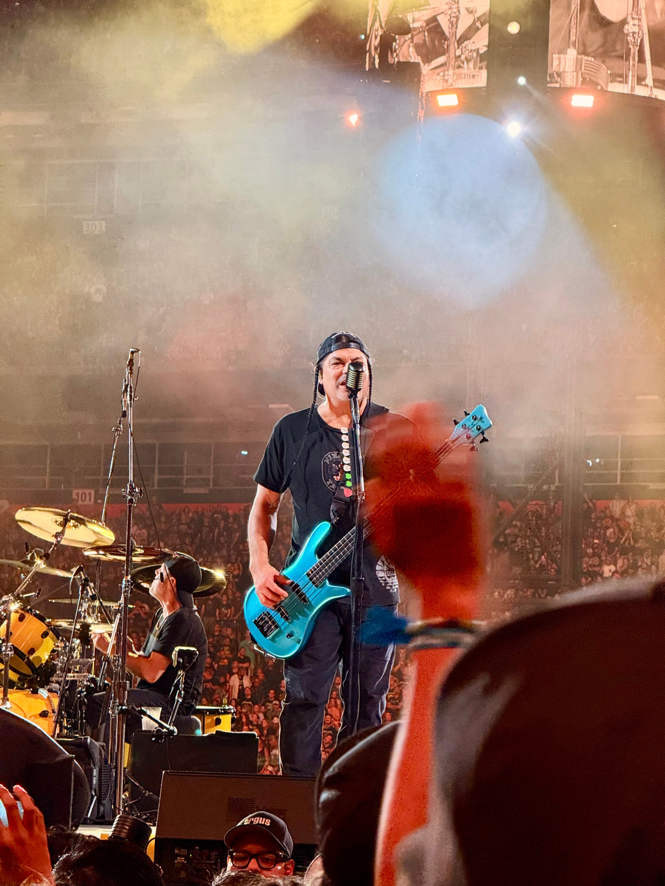

The Experience Equation
A New Language for the Immersive Experience at Humanity’s Largest Gatherings

I’m standing in the middle of Empower Field with 80,000 other people, the opening riff of “Whiplash” hitting me like a physical force. My ears are already ringing, a familiar price I’ve gladly paid for the magic of live music.

*This* is my 26th & 27th time seeing Metallica (June 27th & 29th, 2025), a journey that has taken me from the legendary “BIG 4” shows at Yankee Stadium and the Empire Polo Fields to countless arenas in between. Just weeks later, I was in this same venue for the Lumineers. Same field, same question: **Will this work*?*

But this moment — this is why we do it.

I pull out my phone to capture Robert Trujillo standing “right there!!”, the raw energy.

In that moment, I’m not an architect of networks; I’m just a fan, asking the same implicit question as everyone else around me: Will this work when I need to call my best friend because we got separated in the mosh pit? When I need to reconnect with them and set a rendezvous point, *will this work?* When my phone is about to die and I don’t have a way of charging it, *will the texts go through?* *Can I call him and discuss the plans?*

That question is the invisible thread connecting all of humanity’s largest gatherings. It’s asked at every Super Bowl, each match of the FIFA World Cup, and even in sprawling entertainment districts like those surrounding Disney or the Las Vegas strip. It’s asked at massive industry conferences and even in a tiny Santa Fe cafe where a single steel-string guitarist is pouring her heart out. We are no longer just spectators; we are participants in an immersive, digitally-enabled experience. And that experience lives or dies on the answer to that one simple question.

> *Will this work?*

Now, imagine a different scene. A mother sits in the front row at LA Memorial Coliseum. Her son is about to run the 100-meter dash — his first time at the Games. She’s promised her own mother, who is elderly and lives across the world, that she’ll livestream this moment. She’s charged her phone, brought a backup battery, she’s ready. The runners take their marks. She opens the app and sees the worst possible thing: a single bar of connectivity. For her, the question — “Will this work?” — is not about sharing a moment of fun. It’s about sharing a lifetime of love and sacrifice.

For twenty years, I’ve been on the other side of that question (the back-of-house) building the systems that are supposed to make it all work. And I’ve learned that we, the engineers, have been measuring the wrong thing. We measure infrastructure. **We need to be measuring magic.**

## The Age of Immersiveness

We have entered a new era. The line between the physical and digital experience has blurred into nonexistence. We don’t just watch a concert; we co-create it, our phones held aloft like a million tiny spotlights, broadcasting our unique perspective to the world.

The event is no longer just what happens on stage; it’s the sum of 80,000+ individual, interconnected experiences. This is the [Web of Data](https://medium.com/@chrisperkins505/web-of-data-4e4272c7031c).

The Lumineers **Automatic World Tour**. Empower Field @ Mile High, Denver, Colorado. August 2nd, 2025.

Nowhere is this more apparent than in the rise of destinations like Meow Wolf (check out the [Meow Wolf origin story](https://meowwolf.com/about/origin-story)!), which are not events you attend, but narrative worlds you enter and inhabit. There, technology is not a convenience; it is woven into the fabric of the experience, a digital layer in convergence with reality. This is essential to the story.

This is the future of all live events. We are moving beyond passive consumption and into active participation. We are also foreshadowing a future of augmented reality, where the digital and physical are one.

This shift was supercharged in 2023 with the dawn of the “Age of AI.” The democratization of intelligence has made us all smarter. Guests arrive at venues with powerful AI in their pockets, capable of processing information and making decisions at unprecedented speeds. But our systems are getting smarter, too.

The complexity of managing these new, intelligent environments is growing exponentially and the stakes for delivering a flawless immersive experience have never been higher.

## The Problem: The War Room and the Disconnected Experience

In this new age, our old tools and old thinking are failing us.

Imagine you’re in charge of the network for one of these massive events. It’s two hours into a sold-out show, and your radio crackles to life. The front-of-house manager is frantic: mobile ticket scanners at the main gate are intermittently failing. The lines are backing up. The guests are missing the opening act and will soon make the choice of purchasing something or just skipping it (lost revenue). Or worse, they’re angry. The front-of-house experience is chaos.

You pull your team into a war room. The network dashboard shows all green lights. “It’s not us,” your lead engineer says. “We have 100% uptime.” You call the application team. “Our backend response times are perfect,” they insist. “It’s not our app.”

For four hours, you’re stuck in a loop of finger-pointing. You’re speaking in technical terms — latency, throughput, SLA compliance — but no one is speaking the language of the guest experience.

> The network engineer refreshes his dashboard for the twelfth time. Still green. He looks up at the security analyst. She shrugs. Everyone is staring at their own screen, their own **silo of truth**. Nobody is seeing what the guest at the gate is experiencing: a spinning wheel on their phone, a QR code that won’t scan, and growing frustration.

You have mountains of data but no end-to-end visibility. You lack the service-level intelligence that connects what’s happening in the infrastructure to what the guest is actually experiencing. Your **Time-to-Good-Decision (TTGD)** is measured in hours, not minutes. The gap isn’t observability; it’s understanding. You’re drowning in metrics but starving for meaning.

> **Time-to-Good-Decision (TTGD):** the complete cycle from detection through investigation, decision, and action.

Finally, after a painstaking process of elimination, you find it: minor, almost imperceptible packet loss on a single ISP link that only affects authentication traffic. The problem is solved, but you’ve failed. You failed the guests, and you failed your team. You realize that your technical language — your measures of “success” — was completely disconnected from the human reality at the gate. You had “SLA Compliance,” but you didn’t have “**Moment Reliability**.” You had “Authentication Success Rate” on a dashboard, but you didn’t have “**Connection Confidence**” in the hands of your guests.

Now imagine a different scenario.

You have the Universal Experience Equation (UEE) running in real time. The moment those scanners start failing, everyone on your team sees the same thing: the E score for the “ticket scanning” experience is dropping swiftly from 94 to 67. You don’t need to guess. You don’t need to argue. The UEE immediately shows you that Accessibility — the ability to connect — is the problem. Your team drills down with end-to-end visibility and finds the ISP packet loss in minutes, not hours. The war room becomes a coordinated response, not a blame game.

This is the power of a common language and a shared understanding.

> “When the many are reduced to one, to what is the one reduced?” — Koan

## The Framework: A Rosetta Stone for Shared Moments

To solve this, we need a common language that translates millions of technical metrics, events, logs, and traces (MELT) into a single, human-centric score. Let’s return to the mother at the Paralympics. Her experience is the perfect lens for this new language: **the Universal Experience Equation.**

After years of watching this pattern repeat, I realized we needed a new language. A Rosetta Stone for translating infinite technical complexity into a single, human-centric truth. That language is an equation:

E = (A × 0.4) + (R × 0.3) + (Q × 0.3)  
Pillar 1: Accessibility (A) — Can the Moment Begin?

For the mother, this is everything. Can she even start the livestream? That single bar of connectivity represents her gateway to sharing this moment. If she can’t connect, the experience is over before it begins. Accessibility is binary in human perception, which is why it carries the most weight.

**Weight: 40%**

### Pillar 2: Retainability (R) — Will the Moment Endure?

She gets the stream started just as the gun goes off. Her son explodes from the blocks. The crowd roars, and 80,000 other phones suddenly hit the network. Does her stream drop? Retainability is the promise of persistence. A dropped stream is a broken promise, a memory lost. It’s the table stakes of a modern digital experience.

**Weight: 30%**

### Pillar 3: Quality (Q) — Is the Moment Magical?

The stream holds. Her son is crossing the finish line. But what does her mother see? A clear, smooth video of her grandson’s triumph, or a pixelated, buffering mess? Quality is the differentiator between a functional experience and an exceptional one. It’s the difference between watching a memory and truly sharing it.

Weight: 30%

## The Missing Dimension: Personalization at Scale

But even this equation isn’t enough. The mother’s experience is not the same as that of a VIP delegate from another country sitting in a luxury suite, or a political official with specific security needs. The context of who you are and what you’re doing matters.

This is where we add a new dimension. The E score must be personalized. The needs during the Opening Ceremony are different from a final swim race. The back-of-house security team’s E score for their comms network is just as critical as the front-of-house fan’s E score for their social media post. A truly resilient system understands and adapts to these variables, ensuring the right experience is delivered to the right person at the right time.

Weights adjusted:  
E = (A × 0.3) + (R × 0.4) + (Q × 0.3)  
How to Start: Your First E Score

This isn’t a complex, multi-year transformation. You can start this journey on Monday.

**Step 1:** **Define Your Core Experiences.**

What are the 3–5 moments that matter most to your guests? Is it scanning a ticket, ordering food, posting a video, or something else? Identify the critical paths.

**Step 2:** **Map Your Metrics to ARQ.**

Look at the data you already have. What metrics can serve as proxies for Accessibility, Retainability, and Quality for each of your core experiences? You don’t need new tools to start; you just need a new way of looking at your existing data.

**Step 3:** **Calculate Your First E Score.**

Run the numbers. Establish a baseline. Don’t be afraid if it’s low. The first score is not a judgment; it’s a starting point. It’s the first sentence in a new, data-driven conversation.

**Step 4:** **Start the Conversation.**

Use the E score to unify your teams. The next time there’s a problem, the question won’t be “Whose fault is it?” It will be “What do we need to do to improve the E score?”

## From Metrics to Magic

When we adopt this new language, the war room arguments stop and efficiency is gained. We also gain the power of prediction, solving incidents before they happen. We achieve proof, replacing hope with mathematical certainty. But the biggest win is **cultural**.

When we have a shared understanding and align around a common goal — protecting the immersive human experience of our guests — the technology becomes invisible. And when the technology is invisible, the magic can happen.

## A New Language: From Nerd Speak to Experience Speak

The Universal Experience Equation provides more than a score; it provides a new, human-centered vocabulary to describe value and success. This language elevates the conversation from technical jargon to strategic outcomes that executives, sponsors, and stakeholders can understand and champion. Here are some starting translations — adapt them to your own context:

### Performance (ARQ)

- Authentication Success Rate → Connection Confidence
- Radio/Physical Access → **Signal Certainty**
- IP Assignment (DHCP) → **Instant Network Entry**
- DNS Resolution → **Seamless Navigation**
- Handoff Success Rate → **Seamless Mobility**
- Session Persistence → **Uninterrupted Flow**
- Connection Health → **Reliability Assurance**
- SLA Compliance → Moment Reliability
- Latency → **Instant Response**
- Throughput Capacity → **Unlimited Bandwidth**
- QoE Fairness → **Experience Equity**
- User Satisfaction Score → **Digital Delight**

Risk  
Security Vulnerabilities → **Trust Foundation**  
Operational Maturity → **Process Excellence**  
Compliance Adherence → **Regulatory Confidence**  
System Redundancy → **Failure Immunity**  
**Context**  
Use Case Alignment → **Purpose-Built Performance**  
Bandwidth Optimization → **Smart Resource Allocation**  
Service Prioritization → **Critical-First Service**  
Guest Profile Adaptation → **Personalized Experience**  
Accessibility Support → **Universal Access**  
Priority Routing → **VIP Treatment**  
Event Phase Recognition → **Intelligent Anticipation**  
Predictive Scaling → **Proactive Capacity**  
Emergency Response → **Crisis Readiness**

Twenty years ago, I walked into a classroom and learned the language of networks. Today, I stand in stadiums with 80,000 other people, my ears ringing, my “phone” (it’s more than just a phone) in-pocket, asking the same question everyone else is asking: Will this work?

The difference is, now I have the math to answer it.

This journey has taught me that our ultimate responsibility is not to the devices we manage, but to the human moments they enable — whether it’s a fan capturing the drum solo, a mother sharing her son’s victory with the world, or you, right now, deciding if this framework can help you transform your own war room into something better.

The Experience Equation is the language that helps us honor that responsibility. And it starts with a single question: What is the experience you’re trying to protect?

Please note: the views and opinions expressed in this post are those of the author (Chris Perkins) and do not necessarily reflect the official policy or position of my employer, or any other agency, organization, person or company. Assumptions made in this post are not reflective of the position of any entity other than the author — and, since we are critically-thinking human beings, these views are always subject to change, revision and rethinking at any time.
