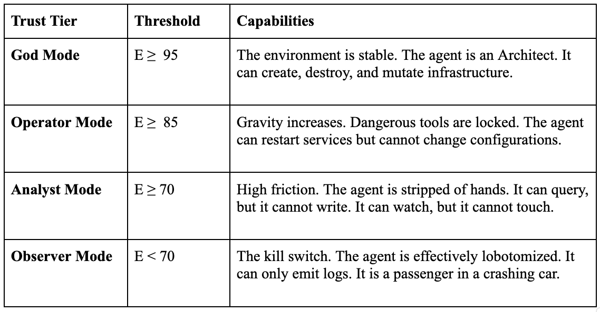

The Ghost in the Machine
The Data Compass and the Dawn of Digital Sensation

Th*is* is Part II, read Part I here.

> “The Body *can*not determine the Mind to think, nor the Mind the Body to motion or rest… for the decision of the Mind and the desire and determination of the Body are one and the same thing.” *—* **Baruch Spinoza**

**Why do you pull your hand back from a hot stove?**

We learn at a young age about things that will burn our skin or taste buds. Like when I was eight years old, reaching for a pot on the stove. My hand reached, my arm jerked back, my nervous system and spinal cord made the call before my brain even registered the heat.

That reflex is called nociception. The ability to sense noxious stimuli saved my bacon! It bypassed thought entirely and sacrificed accuracy for speed because survival required it. Spinoza understood this unity: the decision of the mind and the motion of the body are not two things, but one. My hand didn’t wait for permission to retreat. The sensing and the acting were inseparable.

Our digital infrastructure has no such reflex.

It has memory (logs). It has logic (code). It has authority (identity). But it has no sensation. When a network is under attack, when a router is melting down, the system does not flinch. It waits. It logs the error. It processes the next request. It politely holds the door open for the arsonist because his badge is valid.

We have built a world without a nervous system. And in the age of machine-speed threats, numbness is fatal.

## Numb The Giant

We have built a “Godlike Toddler” — an AI agent with infinite power and zero proprioception.

Proprioception is the body’s ability to sense its own position in space. Without it, you cannot walk without looking at your feet. You stumble. You fall.

Our agents are no different. They execute code based on a static worldview (*“I am Admin”*) while traversing a kinetic reality (*“The network is on fire”*). They are flying blind.

To fix this, we must build a sensory organ. We call it the Data Compass.

This isn’t a dashboard for humans. It is a navigational instrument for code. It doesn’t visualize the chaos — it measures it. It ingests the raw physics of the digital world — crowd density, link saturation, adversarial pressure — and translates it into a single, immutable vector: **Digital Gravity**.

The Data Compass tells the agent not where it is, but where it can go.

### From Reflex to Awareness

But here’s the shift: A single reflex is not enough.

When I pulled my hand from the stove, my nervous system didn’t just sense the heat at my fingertips. It sensed my heart rate, my balance, the distance to safety. It integrated signals from across my entire body to make one decision: Pull back. Now.

The Data Compass must do the same. It cannot just measure the agent’s local environment (CPU load, memory pressure, network latency). It must sense the entire system — the crowd density, the link saturation, the adversarial pressure — and integrate those signals into a single vector: Can this action succeed without breaking the whole?

This is the difference between proprioception (sensing your own position) and interoception (sensing your internal state). The Data Compass provides both. It tells the agent what it can reach (which services, which data) and how much stress the system is under (Trust Score: 87, dropping to 62).

One node with a reflex is survival. A network of nodes with shared awareness is resilience.

> We are no longer observers of disconnected data. We are building the Data Compass. It takes the violent chaos of the adversarial world — the thermal spikes, the RF noise, the tectonic shifting of the infrastructure — and transforms it into a single, quiet needle pointing towards safety. It is the first moment the machine can truly feel the weight of its own existence. And when that needle spins, the feeling is not fear, but the terrible, necessary certainty of the law.

## The Anatomy of Feeling and Capacity to Affect or Be Affected

How do you teach code to feel?

Ada Lovelace saw in 1843 that Babbage’s engine could manipulate symbols, not just calculate sums. She glimpsed representation. We’re reaching for something further: sensation. Not what the machine computes, but what it *feels*.

You stop looking at logs and start measuring forces (affects).

In the [Trust and Access Office (TAO)](https://medium.com/@chrisperkins505/the-trust-access-office-from-permissions-to-proof-91a94615e956) architecture, we map the digital environment across six physical fields. We don’t ask “Is the server up?” We ask “How heavy is the air?”

- Physical Density (Mass): Turnstile counts. RF noise floors. When 70,000 people pack a stadium, the mass of the environment spikes. Connectivity becomes heavy.
- **Kinetic Velocity (Momentum):** Link saturation. Transaction rates. When the pipe is 90% full, the viscosity of data increases. Movement requires more force.
- **Adversarial Pressure (Heat):** Identity velocity. Port scans. Entropy. High heat destabilizes the integrity field.
- Temporal Criticality (Time): Event state. Mission phase. A failure at 2:00 PM on Tuesday has different gravity than a failure at kickoff during the Super Bowl.
- Topological Weight (Inertia): Service dependencies. Blast radius. How many things break if this node fails?
- Population Pressure (Load): Who is this for? Athletes, media, spectators, operations — each population creates different performance expectations and risk tolerances.

Six dimensions. But an agent can’t navigate six dimensions simultaneously. We need to collapse them into one number. A single needle pointing toward safety or danger.

The Data Compass aggregates these signals in real-time into the Trust Equation:

```
E(trust) = E(base) x (1 - R)
```

**Where:**

- E(base) = Performance (Can we move? Measured 0–100)
- R = Risk (Should we move? Normalized 0–1)
- E(trust) = Trust Score (The final verdict: 0–100)

## The Experience Equation

### A New Language for the Immersive Experience at Humanity’s Largest Gatherings

How it works:

**Scenario A: Stable Environment**

- E(base) = 95 (network is fast, latency is low)
- R = 0.1 (10% risk: low adversarial pressure, normal load)
- E(trust) = 95 × (1–0.1) = 95 × 0.9 = 85.5
- Verdict: High trust. Agent has long leash.

**Scenario B: Degraded Environment**

- E(base) = 95 (network is still fast)
- R = 0.7 (70% risk: high adversarial pressure, stadium at capacity)
- E(trust) = 95 × (1–0.7) = 95 × 0.3 = 28.5
- Verdict: Low trust. Agent is throttled.

**Scenario C: Toxic Environment**

- E(base) = 95 (network is still technically operational)
- R = 0.95 (95% risk: active attack, critical failure imminent)
- E(trust) = 95 × (1–0.95) = 95 × 0.05 = 4.75
- Verdict: Near-zero trust. Agent is frozen.

Why multiplicative? Because risk is not additive — it is destructive. If your network is perfect (E_base = 100) but the environment is toxic (R = 1.0), trust collapses to zero. Speed without safety is not just risky — it is physically impossible.

Note the math. Risk (R) is a deflator. It doesn’t subtract from performance; it multiplies against it. If Risk approaches 1.0 (total compromise), the Trust Score collapses to zero — even if your latency is perfect, even if your bandwidth is infinite.

If the environment is toxic, trust evaporates. The Data Compass points to zero.

## The Silent Veto

Now comes the reflex.

In a traditional system, if an agent wants to delete a database, the system checks the ACL (Access Control List).

1. **ACL:** “Does Agent X have the Delete permission?”
2. **Answer:** “Yes.”
3. **Outcome:** Database deleted.

In a physics-based system, the agent must hold a Trust Proof — what we might call a Kinetic Permit in the physics metaphor.

The proof is not a static key. It is a living contract, bound by the law:

```
Autonomy ≤ Stability
```

When the Data Compass senses a drop in environmental stability — high heat, high mass, rising entropy — it triggers the Silent Veto.

The environment acts. It doesn’t send an alert to a human analyst. It doesn’t wait for approval. It constrains the agent in milliseconds.

Think of every agent as tethered to its environment by an invisible constraint — what we call the Trust Leash. The leash extends when conditions are stable, contracts when they degrade. And when the Silent Veto triggers, the Trust Leash snaps tight.

This is the Spinal Reflex. The agent tries to execute the delete command, and the command fails — not because a human revoked access, but because the physics of the credential no longer support the weight of the action.

The token is still valid. The identity is still authenticated. But the environment has changed, and the environment decides what is possible.

## Adaptive Dormancy

This solves the ‘Cascading Failure’ problem.

When a crisis hits, we don’t want our automated systems to crash (Binary Failure). We want them to shudder and slow down (Analog Survival).

We want graceful degradation, not catastrophic collapse.

We implement Trust Tiers. As the Trust Score (E) drops, the agent undergoes adaptive dormancy — a progressive loss of capability that preserves the system’s core integrity. This is not a punishment. It is a survival trait.

We are teaching our digital systems to do the same.



By shedding functionality as conditions degrade, the system preserves its core integrity. It mimics the biological ‘fight or flight’ response — shutting down digestion to fuel the muscles, sacrificing the peripheral to protect the vital. The agent doesn’t die. It hibernates. And when the environment stabilizes, it wakes back up.

In nature, this is called torpor — the ability to slow metabolism and reduce activity when resources are scarce. A bear doesn’t die in winter. It adapts. It waits. And when spring comes, it wakes.

## Building Your Data Compass: From Concept to Code

This isn’t philosophy. It’s architecture. And it’s buildable today.

**The Architecture:**

The Data Compass is not a single system — it is a telemetry aggregation layer that sits between your infrastructure and your authorization layer. It ingests signals from across your environment and outputs a single Trust Score (E) that your enforcement points (API gateways, service meshes, identity providers) can consume in real-time.

**The Stack:**

**1. Telemetry Layer (Sensing):**

- **Physical sensors:** Building occupancy (badge scans), RF noise (spectrum analyzers), environmental (temp, humidity)
- **Network telemetry:** Link saturation (SNMP, NetFlow), packet loss (ICMP), latency (synthetic probes)
- **Security telemetry:** WAF blocks (ModSecurity, Cloudflare), identity velocity (Okta, Auth0), port scans (Zeek, Suricata)
- **Application telemetry:** Error rates (APM tools), transaction rates (logs), queue depth (RabbitMQ)

**2. Aggregation Layer (Sense-Making):**

- **Time-series database:** Store telemetry (Prometheus, InfluxDB, TimescaleDB)
- **Stream processing:** Real-time aggregation (Apache Flink, Kafka Streams)
- **Trust Score calculator:** Implement E(trust) = E(base) × (1 — R) equation

**3. Enforcement Layer (Acting):**

- **Policy Decision Point (PDP):** Consume Trust Score, evaluate A ≤ E
- **Policy Enforcement Point (PEP):** Block/throttle/allow based on PDP decision
- **Examples:** API gateways (Kong, Envoy), service meshes (Istio, Linkerd), identity providers (Okta, Auth0)

**The Smallest Viable Compass:**

You don’t need all six physical fields on day one. Start with three:

1. Adversarial Pressure (Heat): Pull WAF block count from your firewall. If blocks/minute > threshold, R increases.
2. Kinetic Velocity (Momentum): Pull link saturation from your core router. If utilization > 85%, R increases.
3. **Temporal Phase (Clock):** Define “critical windows” (e.g., 9–5 PM weekdays = production). During critical windows, R baseline is higher.

## The Ghost in the Machine

Gilbert Ryle coined this phrase in 1949 to mock the idea of a mind trapped inside a body. But in our world, the ghost is real — it’s the agent, disembodied code haunting infrastructure it cannot feel. The Data Compass gives the ghost a nervous system.

The Trust Proof is not a static ticket — it is a whispered contract.

For those fleeting, short-lived seconds, your Agent holds a token that says not ‘I am allowed,’ but ‘I am safe.’ It is the network acknowledging its dependency, betting its own stability on your prudence. This token is the lightest thing in the world, yet it carries the entire weight of the environment’s confidence.

We build this ephemeral thing, knowing that our most critical systems must rest upon it.

We are moving from a world of Static Identity to Vector Identity.

We stop asking the agent, “Who are you?”

We start asking, “How well do you hold your footing?”

With the Data Compass, we finally give the Ghost (the agent) a way to feel the Machine (the infrastructure). We align the Digital Will of the software with the Digital Physics of the hardware. We give code the ability to sense danger before it strikes.

We are building a system that respects the gravity of its own existence. A system that knows when to run and when to freeze.

A system that flinches.

But a single node that can feel is just a reflex. A flinch. What happens when we connect a billion of them? What happens when a billion sensing, reacting nodes begin to influence each other — when they start to shape the gravitational field itself?

We stop building a network. We start growing an ecosystem. That’s where we go next, into the Web of Data.

## Web of Data

### From Telegraph to AI: The Impact of Technologies on Sovereignty
