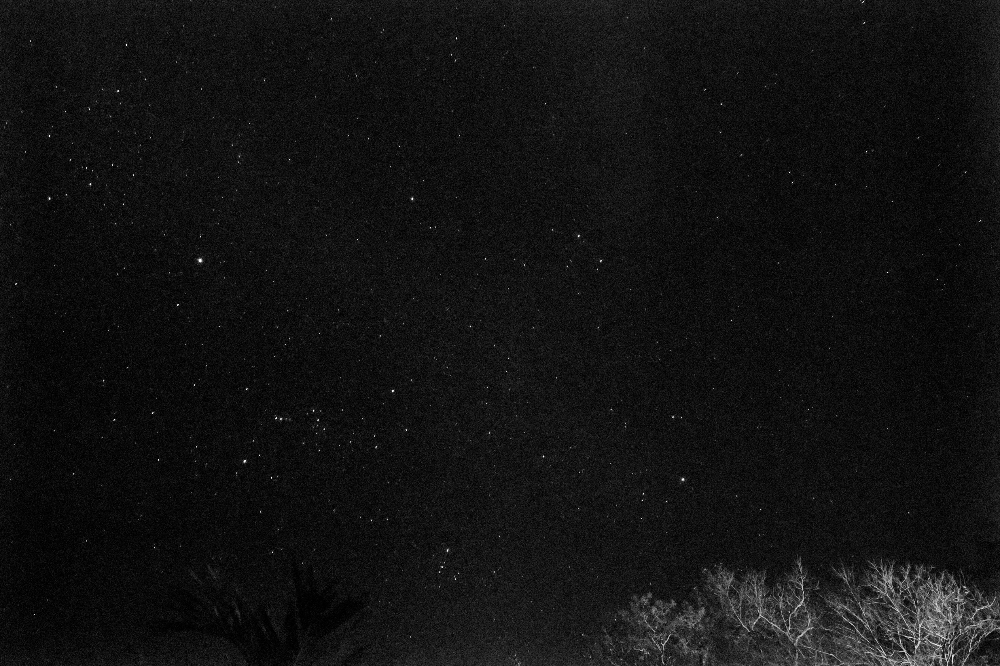

Sailing by Starlight
When the Digital Universe Organizes Itself

This is part III, read parts I and II.

> *“We cannot command Nature except by obeying her.”*— **Francis Bacon**

**We are trying to navigate a starship with a road atlas.**

Three thousand years ago, Polynesian navigators crossed the Pacific — the largest ocean on Earth — without compass, sextant, or chart. They settled the most isolated islands humans have ever reached. They did it by reading the environment: the stars, the swells, the flight paths of birds, and the color of clouds over distant lagoons.

They didn’t fight the ocean. They joined it.

We have forgotten what they knew.

Look at how we route traffic today. We rely on BGP tables, DNS propagation, and static load balancer configs.

We draw lines on a map expecting the lightning to follow.

When a link breaks, we wait for a timeout. When a server fails, we wait for a health check to fail three times before we update the map.

It is clumsy. It is brittle. It is Newtonian.

In the Newtonian model, space is a static stage. Objects move in straight lines unless a force hits them. We spend our days acting as that force — manually pushing traffic left or right, updating firewall rules, fighting entropy with paperwork and CAB meetings.

But our universe doesn’t work like that.

Einstein showed us that space isn’t static. It is a fabric. It bends. Massive objects don’t “pull” other objects; they curve the spacetime around them so that “falling” is the only natural path.

We are done building static maps. It is time to embrace General Relativity for the Internet.

Bacon wrote that we cannot command Nature except by obeying her. For fifty years, we have tried to command the network. We have failed. It is time to obey its physics.

Bacon discovered this in the 17th century. The wayfinders of Polynesia knew it for three thousand years. Both understood: the one who commands is the one who first obeys.

In Part I, we defined the Missing Law of Motion. In Part II, we built the Data Compass to feel the environment. Now, in Part III, we learn to navigate as the wayfinders did — not by fighting the currents, but by reading them.

## Trust as Mass

In the Digital Physics model, Trust is not a score. It is Mass.

Imagine your infrastructure not as a flat diagram, but as a 3D topological map — a landscape with peaks, valleys, and voids.

- **A High-Trust Node** (secure, stable, performant) is a massive object. It creates a deep gravity well. Traffic is drawn to it, naturally and inevitably.
- **A Low-Trust Node** (compromised, latency-spiked) has low mass. It exerts no pull. Traffic flows past it, indifferent.
- **A Toxic Node** (under active attack) has negative mass. It creates a repulsive field. Traffic doesn’t just avoid it — it is actively pushed away, like two magnets with the same pole facing each other.

This changes everything about how we move data. Routing is no longer a decision. It is a consequence of geometry.

## **Gravitational Routing**

Today, if you want to route a high-value transaction to a secure server, you write a policy: IF transaction > $1M THEN route to Server_A.

In the future, you won’t write routing rules. You will simply define the physics.

Gravitational Routing means traffic flows organically toward the path of highest trust. Data packets behave like water — they seek the lowest point of resistance. Water doesn’t choose to flow downhill. It has no agency, no intent. It simply obeys gravity. And yet, over millennia, water carves canyons. It shapes continents. It finds the path that bedrock could not resist.

Our traffic will do the same. Not through intelligence, but through inevitability.

They follow the Geodesic of Safety — the shortest path through curved space. In Euclidean geometry, the shortest path is a straight line. In curved space, the shortest path is a curve. The data packet doesn’t know it’s curving. From its perspective, it’s moving straight. But the trust landscape has bent the path beneath it.

- **Scenario:** A core router experiences a 5% packet loss (Friction).
- **The Physics:** Its Trust Mass drops instantly. Its gravity well shallows.
- **The Result:** Traffic naturally “spills” over to the adjacent redundant path, not because a load balancer made a decision, but because the geometry of the network changed.

The network heals itself. It organizes itself. We don’t direct the flow; we shape the terrain.

This is not automation. Automation is a script that executes when a condition is met. This is emergence — a property that arises from the interaction of simple rules, not from central planning.

No single node knows the network is healing. No orchestrator coordinates the shift. The traffic moves because the geometry changed. The healing is a side effect of physics, not the goal of policy.

> We seek a future where the network is no longer managed, but cared for. We stop trying to fight the flow and begin to understand its geometry. Imagine the Internet not as a mess of tangled cables, but as a vast, dark sky where nodes shine like stars. High-Trust services acquire Mass and pull the data toward them — not through forced policy, but through the irresistible, gentle force of Digital Gravity. Traffic finds the path of least resistance because it falls into the arms of stability. This is the elegance we are coding for: a universe that governs itself through mutual attraction.

## Digital Thermodynamics

But gravity isn’t the only force. There is also Heat.

Every action generates entropy. Every high-speed trade, every database write, every authentication check generates “Thermal Load” on the system. In our current model, we run systems until they crash (Overheat). We ignore the heat until the smoke comes out.

The new architecture introduces Digital Thermodynamics.

We must respect the Heat Debt. If an Agent runs in “God Mode” for too long, executing thousands of high-risk changes, it generates heat. The environment destabilizes. The Trust Score degrades.

The system acts. It enforces a Cool-Down Cycle. The Agent’s permissions contract. It is forced from “God Mode” to “Observer Mode” — not because it failed, but because it needs to let the entropy dissipate.

This is the conservation of risk. You cannot destroy risk; you can only transfer it or let it cool. A system that respects thermodynamics doesn’t crash; it rests.

Spinoza called it conatus — the striving of every thing to persist in its own being. But striving without rest is not persistence. It is burnout. The agent that runs at God Mode forever will burn out before it persists. The agent that learns to rest will inherit the network.

This is the Second Law of Thermodynamics for digital systems: Entropy always increases unless work is done to reduce it. In the physical universe, that work is energy. In the digital universe, that work is time.

You cannot run at full speed indefinitely. You must pay the heat debt. Not with money, not with apologies — with stillness.

## Darwinian Compliance

So, who do we trust? In a universe without static passwords, how do we know an agent is safe?

We stop looking at their credentials (Who they are) and start looking at their history (How they move).

We are moving toward Darwinian Compliance.

- **Agent A** is brand new. It has zero history. It has zero Mass. It is kept on a short leash in low-gravity zones — what we might call sandboxes.
- **Agent B** has survived the “Black Friday Crash of 2026.” It has a cryptographically signed **Proof of Resilience**. It has “Genetic Memory” of how to survive a storm.

Agent B has Mass. It has Ancestral Authority. When a crisis hits, the network naturally pivots to rely on Agent B. Not because we hard-coded it, but because survival of the fittest is a law of physics, and Agent B is fit.

This is not meritocracy. Meritocracy requires a judge. This is natural selection — the environment selects for fitness without committee, without credential, without appeal.

But “without mercy” is not quite right. The Polynesian navigators trusted the ocean, and the ocean was not merciful in the human sense — it did not suspend its storms for the unprepared. But it was *consistent*. It was *legible* to those who learned to read it. It rewarded those who paid attention with safe passage.

Our environment will be the same. Not merciful, but fair. Not forgiving, but learnable. The agents that survive are not the ones we chose. They are the ones the universe allowed to persist — because they learned to read the stars.

## The Still Canoe

The Polynesian navigators had a concept that sounds like madness until you understand it: *the canoe does not move*.

In their mental model, the canoe sits still at the center of the world. The stars wheel overhead. The islands drift toward you. The ocean flows past the hull. You don’t move through the sea — the sea moves past you.

This isn’t delusion. It’s a coordinate system. And it’s exactly the shift we’re making.

In the old model, the agent is the actor. It moves through the network, requesting access, presenting credentials, pushing toward its goal. The environment is passive — a stage.

In the new model, the agent is still. Trust space flows around it. The gravity wells of high-trust nodes pull. The repulsive fields of toxic nodes push. The agent falls along the geodesic because the geometry of the environment has already decided where it can go.

The canoe doesn’t steer to the island. The island comes to meet the canoe.

## From Administrator to Astronomer to Wayfinder

This is the final shift.

For fifty years, the CISO and the Architect have been Administrators. We tried to control the chaos by writing more rules. We thought that if we just had a better dashboard, we could be God.

But we cannot manage a billion autonomous agents. We cannot micromanage a universe that expands at the speed of light.

An astronomer doesn’t try to push the planets. The astronomer understands the laws of gravity and plots a course through the stars.

Kepler spent decades mapping the orbits of planets. He didn’t invent the orbits. He discovered them. He found the laws that were already there, hidden in the data.

We are doing the same. We are not inventing Digital Gravity. We are discovering it. The laws were always there — in the packet loss, in the latency spikes, in the cascading failures. We just didn’t have the mathematics to see them.

But Kepler worked from the outside. He mapped the orbits from a distance. He never felt the gravity in his bones.

The Polynesian navigator Mau Piailug did something different. He could lie in the hull of his canoe, eyes closed, and feel which way the swell was running. He could smell land before he could see it. He knew where he was not by calculating but by *belonging*.

This is the final evolution. The administrator tries to control. The astronomer observes from outside. The wayfinder participates from within.

We must become wayfinders.

We are building systems so complex that no one can observe them from outside. There is no God’s-eye view. There is only the view from inside the canoe — the swell beneath you, the stars overhead, the faint green glow of a lagoon reflected on the belly of a cloud.

The TAO is not a control room. It is not even an observatory. It is a seat in the canoe — and those who sit there feel the currents, trust the patterns, adjust the trim when the wind shifts.

The TAO defines the constants:

- *What is the coefficient of friction for a database write?*
- *What is the mass of a verified identity?*
- *What is the heat limit of the network?*

Then, we let the physics take over.

We are moving from a world that is Built (Static, Fragile, Manual) to a world that is Grown (Dynamic, Resilient, Self-Organizing).

A building is designed. Every beam is placed. Every wire is routed. It is perfect on day one and decays from there.

A forest is grown. No architect places the trees. No engineer routes the roots. It is chaotic on day one and becomes more resilient over time. When a tree falls, the forest adapts. When a fire burns, the forest regenerates.

We are building a forest.

This is conatus in full bloom — the striving of all things to persist in their own being. The rock resists erosion. The tree grows toward light. The organism fights to survive.

Our agents will do the same. Not because we programmed them to survive, but because survival is the only trajectory that persists. The agents that do not strive will cease to exist. The agents that strive will inherit the network.

We are growing a universe that wants to live.

This is the joy of conatus in the age of AI.

> ”The road to these things that I have pointed out now seems very hard, but it can be found. And of course something that is found so rarely is bound to be hard. For if salvation were ready to hand and could be found without great effort, how could it come about that almost everyone neglects it? But excellence is as difficult as it is rare.” — Baruch Spinoza, Ethics

Look at that photograph. I took it in Los Pargos, Costa Rica, with nothing but my Canon R6 pointed at the night. Those are the same stars the Polynesian navigators used to cross the Pacific. The same stars humans have trusted for ten thousand years.

We are not inventing trust. We are remembering it.

The wayfinders knew: you cannot command the ocean, but you can learn to read it. You cannot force safe passage, but you can earn it — through attention, through respect, through the long accumulation of skill and survival.

Our agents will learn the same lesson. Not because we teach them, but because the ones that don’t learn will cease to exist. And the ones that do will carry forward the digital equivalent of what Mau Piailug carried — the knowledge of how to find home across an ocean too vast to map.

But how do we prove it? How do we show that an agent has survived? How do we cryptographically sign the journey? How do we give an agent a trajectory that cannot be forged?

In Part IV, we build the Vector Identity — the proof that an agent has sailed by starlight and lived to tell the tale.
