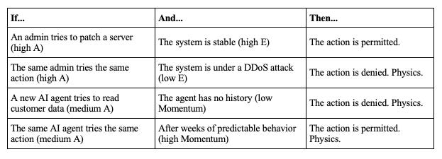

Day 8: The Zeroth Law
This is not a suggestion.

A ≤ E

That’s it. That’s the intervention.

Everything we’ve discussed for the past seven days—the failed parameters, the broken buffers, the brittle structures, the weaponized delays, the exhausted feedback loops—has been a diagnosis of a system without a center.

A system without a fundamental rule.

This is the rule.

# Leverage Point 5: The Rules of the System

We have reached the hinge. The midpoint of the ladder. The place where, as Donella Meadows says, real power lives.

> *“The rules of the system define its scope, its boundaries, its degrees of freedom... Power over the rules is real power.”***— Donella Meadows, Leverage Points: Places to Intervene in a System**

For decades, our rules have been suggestions. Policies. Terms of Service. Acceptable Use documents that no one reads.

We have tried to govern a machine-speed world with human-speed agreements. We have asked nicely.

We said, “Please don’t click on phishing links.”

We said, “Please use a strong password.”

We said, “Please don’t exfiltrate all our customer data.”

This is a philosophy of ghosts. It has failed. It will always fail. An AI doesn’t read the Terms of Service. A compromised account doesn’t care about your acceptable use policy.

You cannot prompt-engineer a voltage drop. You cannot secure a physical world with a philosophy of ghosts.

# The Law

So we stop suggesting. We start commanding. Not with policy, but with physics.

    A ≤ E

**An Agent’s Autonomy (A) must never exceed the Environment’s Stability (E).**

Let’s break that down.

**Autonomy (A)** is the intrinsic risk of an agent’s desired action. It’s a measure of potential impact. Deleting a database has higher autonomy than reading a single row. Spinning up a thousand servers has higher autonomy than spinning up one.

**Environmental Stability (E)** is the system’s real-time capacity to safely absorb that risk. It’s a measure of the current conditions. Is the network under attack? Is the database under heavy load? Is a zero-day vulnerability being exploited in the wild? Stability is not a static number. It is a dynamic, constantly changing value.

The Zeroth Law is the mechanism that binds them. It is a constitutional amendment for reality, written in the language of the substrate.

This is not a firewall rule. It is not a policy that can be appealed. It is a silent, instantaneous, and absolute veto, enforced by the environment itself.

When A exceeds E, the action does not happen. The connection is throttled. The capability contracts. Gravity engages.

#### The Hinge

This is the turning point. For the past seven days, we have been diagnosing the sickness. Now, we have the cure.

The Zeroth Law is the foundation for everything that comes next. It is the rule that allows for self-organization, the goal that shapes the paradigm.

We are no longer asking. We are embedding our intent into the physics of the system. We are writing the law, and the law will hold.

Tomorrow, we see what happens when a system built on this law begins to evolve.

**Next: Level 4 - Self-Organization**
