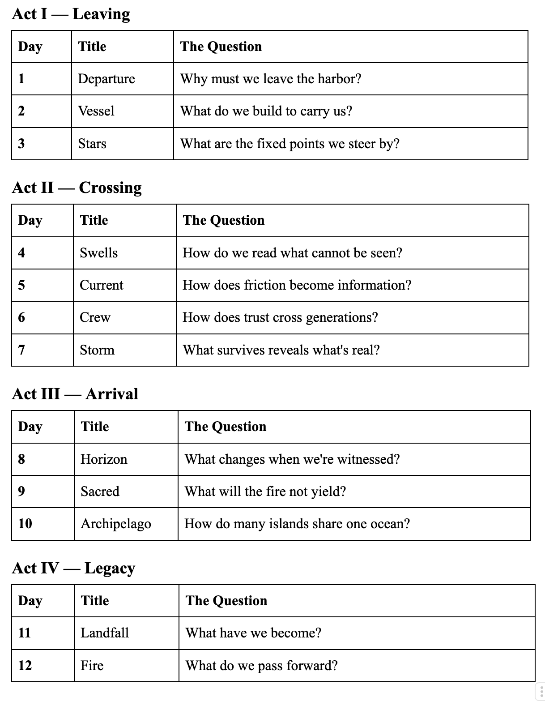

The Voyage: 12 Days of Digital Physics
A crossing from a failing harbor to an Internet governed by physics, not policy.

Three thousand years ago, Polynesian navigators crossed the Pacific in double-hulled canoes*.* No compass. No charts. No GPS. They learned to read what did not lie: stars that stayed fixed, swells that traveled thousands of miles, and currents that revealed themselves to those who knew how to feel them.

They didn’t conquer the ocean. They learned how to move with it.

We need that shift now.

The Internet we inherited was built for human-speed interactions and implicit trust. Present a credential, step inside, assume good intent. For decades, this model held up well enough.

The age of autonomous systems has changed the conditions. Billions of agents now move and decide at machine speed. Credentials can be stolen. Policies cannot adjust fast enough. Walls cannot distinguish a trusted partner from a convincing imitation.

The answer is not higher or smarter walls. It is learning to navigate a different kind of ocean.

## The Promise

From December 13 to December 24, 2024, we explored what an Internet grounded in digital physics might look like. Not rules that drift or can be bypassed. Not identity as a password. Not trust granted once and never reconsidered.

Instead:

- Constraints that behave like gravity
- Identity as trajectory, which reflects how a system has actually moved
- Trust that adjusts continuously to the conditions of the environment

You do not need to be an engineer to follow the ideas. Curiosity is enough.

## The Complete Voyage

## What We Named

As the journey progressed, a vocabulary took shape.

**The Context Tensor**  
Seven dimensions that let the Internet feel its own weather:  
Mass, Momentum, Inertia, Heat, Time, Observer, Soul.

**The Trust Equation**  
E_trust = E_base × (1 — R).  
Trust that rises on contracts based on real pressure.

**The Silent Veto**  
When A exceeds E, the action is denied. No appeal. No exception. Physics marks the boundary no system should cross.

**The Soul Tensor**  
The seventh dimension. Binary. What cannot be overridden. The fire that does not yield.

**The Archipelago**  
Not a single destination but many. Blue Zones where these physics can hold. A model based on federation rather than centralization.

**The Star Compass**  
The navigation system assembled across the twelve days, offered freely for whoever needs it next.

## Who This Is For

**If you’re a CISO** —You will find a model for authorization that adjusts at machine speed and contracts automatically when the environment becomes unstable.

**If you’re an infrastructure engineer** — You will find specifications you can implement, a path from Green Zones to Blue Zones, and a method for connecting existing telemetry to real-time trust decisions.

**If you’re building AI systems** — You will see how agents can earn trust through trajectory instead of credentials and operate within boundaries that scale with their environment.

**If you’re none of these** — You will find a story about leaving what is no longer working and exploring what might.

## The Specifications

The voyage is the story. The specifications are the compass.

All specifications are available at [**github.com/nmcitra/ktp-rfc**](https://github.com/nmcitra/ktp-rfc/tree/main):

- [Core RFC](https://github.com/nmcitra/ktp-rfc/blob/main/rfcs/ktp-core.txt) — **The Zeroth Law**
- [Constitution RFC](https://github.com/nmcitra/ktp-rfc/blob/main/constitution.txt) — Ten laws that hold the shape
- [Context Tensor RFC](https://github.com/nmcitra/ktp-rfc/blob/main/rfcs/ktp-sensors.txt) — Seven dimensions, fully specified
- [Trust Equation RFC](https://github.com/nmcitra/ktp-rfc/blob/main/rfcs/ktp-crypto.txt) — The mathematics of dynamic trust
- [Enforcement RFC](https://github.com/nmcitra/ktp-rfc/blob/main/rfcs/ktp-enforce.txt) — Silent Veto, capability contraction
- [Zones RFC](https://github.com/nmcitra/ktp-rfc/blob/main/rfcs/ktp-zones.txt) — Deep Blue to Green, federation model
- [Lineage RFC](https://github.com/nmcitra/ktp-rfc/blob/main/rfcs/ktp-identity.txt) — Sponsorship, the Genesis Problem solved
- [Flight Recorder RFC](https://github.com/nmcitra/ktp-rfc/blob/main/rfcs/ktp-audit.txt) — Geometry of accountability
- [Celestial RFC](https://github.com/nmcitra/ktp-rfc/blob/main/rfcs/ktp-celestial.txt) — Because the physics doesn’t stop at Earth

## Follow the Voyage

*The crossing begins with* [*Day 1: Departure*](https://medium.com/@chrisperkins505/departure-525049f52c23).

**— Chris Perkins** *Las Cruces, New Mexico* *December 2025*
