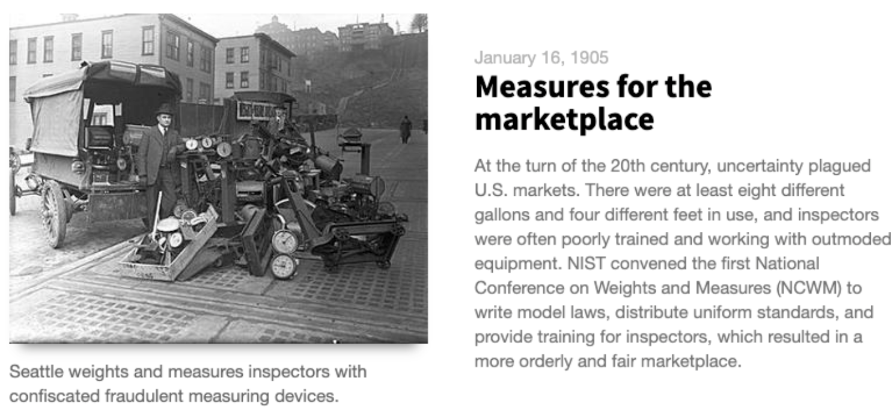
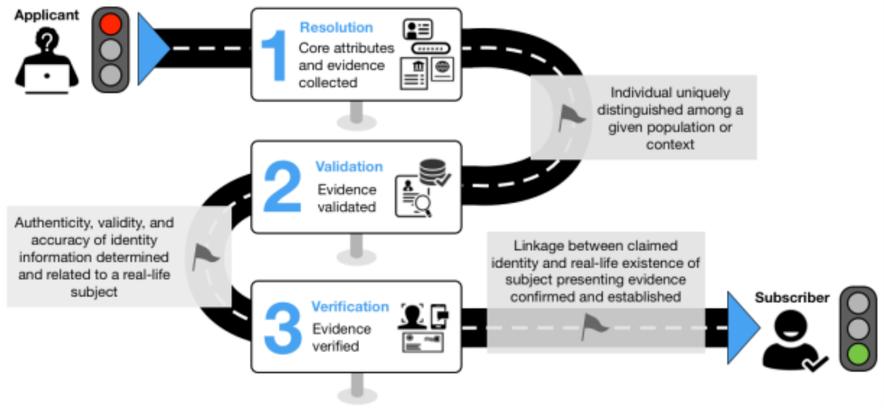

Pandemic Unemployment Assistance Fraud: Zero Trust (Part 1)
Originally published on LinkedIn on January 4th, 2021

If you are interested, please see the first [post]([*https://www*.*linkedin.com*](https://www.linkedin.com/pulse/pandemic-unemployment-assistance-fraud-zero-trust-part-chris-perkins/)/pulse/pandemic-unemployment-assistance-fraud-chris-perkins/) on [PUA fraud](https://www.linkedin.com/pulse/pandemic-unemployment-assistance-fraud-chris-perkins/) I wrote back in August, 2020.

As a continuation of the August 2020 post, this is the follow-up on the topic of Unemployment Insurance Benefits (UIB) and Pandemic Unemployment Assistance (PUA) fraud in the US. In this post, I will dive deeper into how we solve this problem given the challenges most states face. I will outline those challenges in the section dedicated to reviewing survey responses that the US Department of Labor (USDOL) sent out to US states and territories.

This post will also borrow a page from the NIST standard on Zero Trust (800–27) and reference NIST guidelines for digital identity (NIST SP 800–63–3). For those who have never heard of NIST — we’re talking about the federal entity that defines standards and guidelines for many aspects of technology, not just cybersecurity. The National Institute of Standards and Technology (part of the US Department of Commerce) was founded on March 3rd, 1901 ( [NIST timeline](https://www.nist.gov/timeline#event-774241)).

Soon after NIST was founded, uniform standards were developed for weights and measures

### A Brief Note on NIST

The National Institute of Standards and Technology (NIST) Special Publication [800–207](https://nvlpubs.nist.gov/nistpubs/SpecialPublications/NIST.SP.800-207-draft.pdf) defines Identity as one of the six basic tenants of Zero Trust Architecture (ZTA). The fourth tenant reads: Access to resources is determined by policy, including the observable state of user identity and the requesting system, and may include other behavioral attributes.

Trust has to be constructed for each session of digital transactions.

When a user becomes the subject of an authentication inquiry, a digital identity is built around that subject. This is the process of Identity Governance and includes authentication attributes, which are elements of data attributable to a user which may be cross-referenced and verified to ensure that the user has authorization to assert itself as a certain entity or person.

The concept of Zero Trust (NIST 800–27) in this post means:

- The state does not grant any IDs to humans if they cannot prove their identity
- The state does not process claims if the claim information cannot be trusted
- The state issues a stop-payment if the trust level for a claimant goes below a certain threshold

NIST 800–63–3 is referenced in this post because it is such a large part of the framework that I outline below. From here on, I will refer to the NIST standards by their number only. 800–63–3 is the most recent version of Digital Identity Guidelines and essentially breaks down into three (3) distinct components.

1. **Identity Assurance Level (IAL):** refers to the identity proofing process
2. **Authentication Assurance Level (AAL):** refers to the authentication process
3. **Federation Assurance Level (FAL):** refers to the strength of an assertion in a federated environment, used to communicate authentication and attribute information (if applicable) to a relying party (RP).

Each of the Assurance Levels has a spectrum of Level 1 to Level 3 and correspond to a NIST SP; IAL, AAL, FAL, are SP 800–63A, 800–63B, and 800–63C, respectively. All are fun reads if you’re looking for that type of fun! In context, states should not grant the claim until the applicant has gone through identity proofing (IAL) level 2 and secured their login at authentication (AAL) level 2.

I won’t go too much further into NIST in the rest of this post but having an understanding of where this framework has its roots is important as you read on.

**Why is this concerning?**

States have seen an unprecedented number of claims come in with a substantial number of those claims suspected fraudulent. The state of Colorado identified as much as 75% of inbound claims were fraudulent [1].

### My Backdrop

Many people have asked how I got into UIB fraud prevention. Here’s my answer. I’ve been consulting in cybersecurity for over 15 years and when I joined Splunk back in April 2020, I began thinking of ways states can optimize, innovate, and reduce fraud, waste, and abuse. Around this time, the pandemic was in full swing and I began asking the question ‘which state agencies are affected the most by the pandemic?’ We came up with a short list; the department of labor is at the top of that list. I started looking at the ways the agencies were affected by the pandemic and it was obvious to me that fraud was a problem that was getting exponentially worse as time went on.

I immediately started looking for anyone else in Splunk working on UIB, UIB fraud, or just fraud in general and found a small group. The team met consistently to put our thoughts and ideas together and in the following months, we had a data-driven approach to detecting UIB claims fraud early in the claims pipeline. The approach has evolved into a framework which I will outline below.

## The Framework

There are two main concepts to the framework: **identity and behavior.**

This [blog post](https://medium.com/3box/the-3-parts-of-identity-in-a-dynamic-world-f94724c2bae9) will refer back to either identity or behavior as determinants in approving, denying, or sending a claim to additional investigation.

### Identity is King

We are dealing with two entities when it comes to accepting, processing, investigating, and if all looks good, approving the UIB claim.

Let’s take a side road here — think back at when you last renewed your driver’s license or when you first got your passport. Do you remember how cumbersome the verification process was? Why is this process so difficult and time consuming? If we stop to think about what is actually happening here, we can sum it up to this: your likeness (hair/eye color, etc.) and personal information (i.e., name, address, DOB, etc.) are combined and the documents presented (i.e., evidence that you are you) are verified by the state or Agency providing identity verification.

Florida, Georgia, Nevada, Arizona, California, and Pennsylvania have outsourced their identity verification processes to a private-sector technology partner, ID.me [2], while some states have a consolidated verification system. ID.me provides secure identity proofing, authentication, and group affiliation verification for government and businesses across sectors.

Online enrollment and identity proofing of humans — as outlined in 800–63A — is an entire system that enables constituents to enroll and prove their identity. The identity proofing user journey is diagrammed below [3].

I’m not talking about social identities here, but they can be used for cross-matching during the enrollment and proofing process. The online identity used here is essentially the equivalent of your passport. A local, state, or federal agency certifies you as you based on proof (i.e., documentation). Many states have state-wide identity services for constituents and many have per-agency identity verification systems.

NIST 800–63A states that high-risk services (i.e., Unemployment Insurance Benefits) need a level of confidence that the digital identity accessing the service is the legitimate proxy to the real-life subject. In these guidelines, the digital identity is the unique representation of a subject engaged in an online transaction. Identity proofing establishes that a subject is who they claim to be.

In 800–63B, digital authentication establishes that a subject attempting to access a digital service is in control of one or more valid authenticators associated with that subject’s digital identity. The device (something you have), combined with who you are, comprises your digital identity.

With UIB’s requirement for weekly certifications, successfully authenticating each week provides reasonable risk-based assurances that the subject accessing the service today is the same as that which accessed the service previously.

Characteristics of an online human identity (mask):

- **PII:** documents with name, DOB/age, address, parents names, SSN, etc.
- **Social graph:** Facebook friends, LinkedIn contacts, public posts
- **Other identity information can include:** credit reporting history, tax information, MVD records, voter ID cards, and other state-related data sources

In Danny Zuckerman’s blog post, “The 3 parts of identity in a dynamic world,” he says, “This may be static or dynamic information, but it’s not ephemeral — it roots them in time and space. As we move to a more digital-first world, and hopefully soon [a self-sovereign world](https://medium.com/uport/entering-the-age-of-data-privacy-7c3451ed3a57), we talk often of capturing this contextual information as ‘attestations’ or ‘ [verifiable claims](https://www.w3.org/TR/verifiable-claims-use-cases/) ‘ to our root (reducible) identity, giving us a way to bring all the context about us together in a powerful, private, verifiable (trusted) way.”

Zuckerman goes on to say, “a reducible identifier and contextual identification provide a way to differentiate each other, to verify *who somebody is* and know some categorical details about them. But they do not tell you who somebody is. The richness of our identity is captured in the multitude of behaviors, preferences, relationships, interactions, histories and even thoughts. “

### Machine Identity

As IT professionals know, machine authentication has been around for a long time. In enterprise networks or the internet, a Certificate Authority (CA) is built and is the root of trust for things like machine identity certificates and encryption certificates. On the internet, CAs provide encryption certificates to websites (based on domain name ownership) so visitors visiting know they are actually at the banking website, for example, as opposed to being on a site that is hosted by a bad actor. These digital certificates are bound to entities on the network and internet and are used to authenticate the endpoint as it connects.

When the endpoints are not owned/managed by the enterprise or state agency, it is improbable to install a certificate on an endpoint. So, how do we determine the identity of an endpoint that has never visited the UI claims portal before? Its fingerprint.

Without going into gruesome details on this, each claimant or fraudster uses a web browser to interact with the state’s UI claims portal and weekly certification portal. It is here in this interaction that we can track and trace data provided by the browser. There are dozens of data dimensions that can be collected and analyzed to establish the endpoint’s digital fingerprint such as timezone and language settings. These same dimensions can be easily spoofed by fraudsters.

The metadata generated each time a claimant or fraudster visits the state’s website should be collected and analyzed with each visit. In fact, states are likely already collecting this metadata for cybersecurity purposes (e.g., IP address, machine type, user agent, ISP, etc.).

### Machine Behavior

As it relates to UIB, machine behavior is monitored along the claim lifespan. From the moment a claimant or fraudster lands on the home page of the state’s department of labor, logs are generated, collected, and analyzed. The speed in which a form is filled out, the user-agent presented, the cipher suite of the endpoint, and the frequency any one element changes over time.

### Human Behavior

In the fraudster’s interaction with the state’s UIB system, the referring page can provide the state with knowledge on how fraudsters even arrive at the UI claims portal in the first place or the path one takes while navigating the portal. You can also monitor typing speed, mouse cursor movement, and whether or not the person changed any profile information like bank account info or mailing address.

### Framework Summary

It comes down to behavior and identity of the machine and the human. These four categories need to be monitored and the data needs to go through multiple layers of investigation as part of a continuum of applied analytics.

Relying on human identity is not enough. States must also fingerprint endpoints accessing the UIB system and monitor behavior of the human and the machine.

### Nuke Bizzle

“Rapper” Fontrell Antonio Baines (aka Nuke Bizzle) was arrested in Las Vegas, NV in September, 2020. Baines (31) is charged with 1) fraud and related activity in connection with access devices, 2) aggravated identity theft, and 3) interstate transportation of stolen property.

The [criminal complaint](https://frankonfraud.com/wp-content/uploads/2020/10/Nuke-Bizzle.pdf) states that 92 debit cards loaded with a total of more than $1.2 million in benefits were mailed to addresses that Baines had access to in Beverly Hills and the Koreatown neighborhood of Los Angeles. Baines gained access to more than $704,000 through cash withdrawals.

Baines began frauding the California Employee Development Department (EDD) in June, 2020 and by the date of his arrest, had accessed $705,000 via ATMs, banking transfers (Cash App), goods and services, and via in-person tellers at bank branches in Los Angeles, CA.

On August 5th, 2020, Nuke Bizzle filed for his own unemployment claim using the same address of 74 other claims.

The rap video shows Nuke and another rapper, Fat Wizza, driving nice cars, using laptops to “get rich off EDD,” a reference to California’s Employee Development Department.

Baines used stolen identities, temporary addresses, and a network of money mules. The criminal complaint states that, Character Witness-1 “recalled that, after BAINES stopped renting the Carla Ridge address property, he would return to the property and wait for the mail to be delivered. BAINES appeared with approximately seven cars that were parked outside of the house at the Carla Ridge address. The occupants of the vehicles told CW-1 they were waiting for their ‘checks.’”

I am not sure if the two are related, but there was another fraud ring that was taken down in Beverly Hills in September. The Beverly Hills Police Department said Wednesday that it has arrested 44 people and confiscated 129 fraudulently obtained debit cards potentially worth more than $2.5 million in benefits issued by the state Employment Development Department. [4]

Since the pandemic shutdown began in March, the EDD has paid out more than $81.8 billion in unemployment benefits after processing some 12.6 million claims. [4]

California’s fraud does not stop there. The LA Times reported recently that up to $2 billion dollars has been lost to fraud. Including money sent to in-state prisoners, including to inmates on death row, and out-of-state addresses including addresses outside the US. [5, 6, 7]

The attack on UIB systems is happening in all states. California is not alone in this. There are many more examples of states uncovering, thwarting, and prosecuting fraud rings that I could have included in this post. As I pointed out in my first post on PUA fraud, there are three primary fraud groups at work here:

- **Criminal gangs / nation states** — this group is well organized and has sophisticated tools and processes.
- **Opportunists —** this group includes individuals or a network of individuals to coordinate fraud efforts across multiple states.
- **Individuals —** this group includes people using their own identity to claim PUA while getting paid cash under the table, for instance. This group makes up a small proportion of the fraud as compared to items one and two.

The amount of fraud in the UIB system is astronomical. We are under an active attack and onslaught by an electronic army, of sorts. It is not lost on me how that statement sounds like something an alarmist would say, but I do think that the scope and scale of this problem is massive and the potential loss is extraordinary.

MITRE recently published the report, Five Ways to Fight Fraud, Waste, and Abuse in $3 Trillion Coronavirus Relief Aid, that says government agencies have made $1.7 trillion in improper payments since 2003. The estimate for fiscal year 2019 alone was approximately $175 billion- an increase of $24 billion over the previous year.

> “Conventional wisdom says that 7% of government spending is subject to fraud, waste and abuse. This was an estimate often cited by Earl Devaney, the former chairman of the Recovery Accountability and Transparency Board (RATB) established to oversee the spending of stimulus money from the ARRA of 2009. This is an unacceptable percentage that when applied to nearly $3 trillion in spending represents potentially $210 billion paid out in error or to fraudsters.” — MITRE.org

To put that into perspective: the median household income was $68,703 in 2019. Two billion is roughly 29,110 households. Two hundred ten billion is roughly **3,000,000** households. The population of Los Angeles in 2019 was 3,979,576.

The US Department of Labor Office of Inspector General estimates the UIB improper payment rate is 10.61% every year.[8]

## US Department of Labor Audit and $100M Grant

The US DOL [published audit results](https://www.oig.dol.gov/public/reports/oa/2021/19-21-001-03-315.pdf) that answer the question: What steps are states taking to implement the PUA program and deter and detect fraud related to applicants’ self-certification?

They initial survey was sent to all 50 states and territories that had received PUA funds from the federal government. Of the recipients, 45 states responded to the survey and identified top challenges states faced implementing PUA.

States identified a lack of resources to address the high volume of claims, untimely and unclear guidance from the US Department of Labor (DOL) Employment and Training Administration (ETA), and incompatible legacy systems as top challenges

The US DOL also provided states with funding to assist with fraud prevention. The Unemployment Insurance Program Letter 28–20 (UIPL 28–20) provides funding for states to address fraud in the PUA and PEUC programs. “Many states have experienced a significant number of fraudulent claims in the CARES Act programs, including PUA and PEUC, and are working with federal, state, and local law enforcement to investigate, prosecute, and, in collaboration with banking institutions, recover identified fraudulent payments. As a result of the significant increase in fraud and the need for states to have additional funding to support fraud prevention, detection, and investigation activities, the Department is providing a total of $100 million in administrative funding targeted specifically at addressing fraud and identity theft in the PUA and PEUC programs as part of its responsibility to provide ‘such sums as… necessary’ for administration of the CARES Act programs.”[9]

States are permitted to use this targeted funding for staff or contract services to conduct fraud investigations and other fraud detection-related activities, or to implement tools to increase prevention, detection, and recovery of fraudulent improper payments in the PUA and PEUC programs. States may also work collaboratively to invest these funds to benefit multiple states.

## More Stimulus To Come

Before more financial stimulus arrives, states must work swiftly to:

- Evaluate the existing claim pipeline
- Identify data sources available to IT systems
- Implement analytics in every step of the claim pipeline; collecting data generated by interactions with the UIB system
- Layer on additional capabilities (machine learning, risk modeling) as soon as possible

Thank you for reading Chapter 2 Part 1. This is a very complex situation and it continues to evolve. Never did I think that on New Year’s Eve 2020 I would be putting the final touches on a blog post that outlines just one of the biggest challenges states face as a result of the pandemic.

In [**Part 2**](https://www.linkedin.com/pulse/pandemic-unemployment-assistance-fraud-zero-trust-part-chris-perkins-1c/), we will be discussing how to address fraud with Splunk, the framework, and existing processes within the state’s Department of Labor.

Thank you for reading!

Stay safe out there.

Please note: the views and opinions expressed in this post are those of the author (Chris Perkins) and do not necessarily reflect the official policy or position of my employer, or any other agency, organization, or company. Assumptions made in this post are not reflective of the position of any entity other than the author — and, since we are critically-thinking human beings, these views are always subject to change, revision, and rethinking at any time.

*Originally published at* https://www.linkedin.com.
