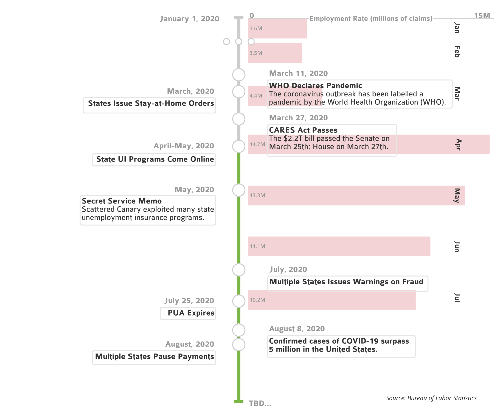
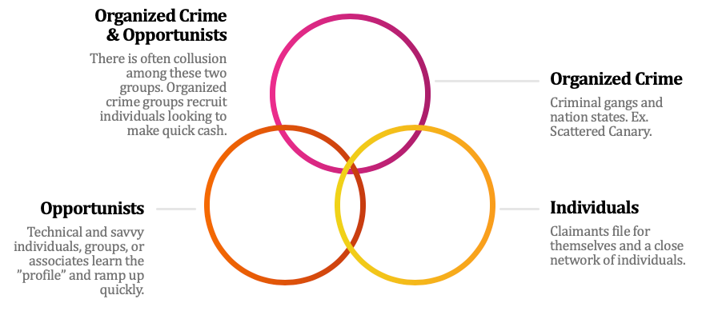
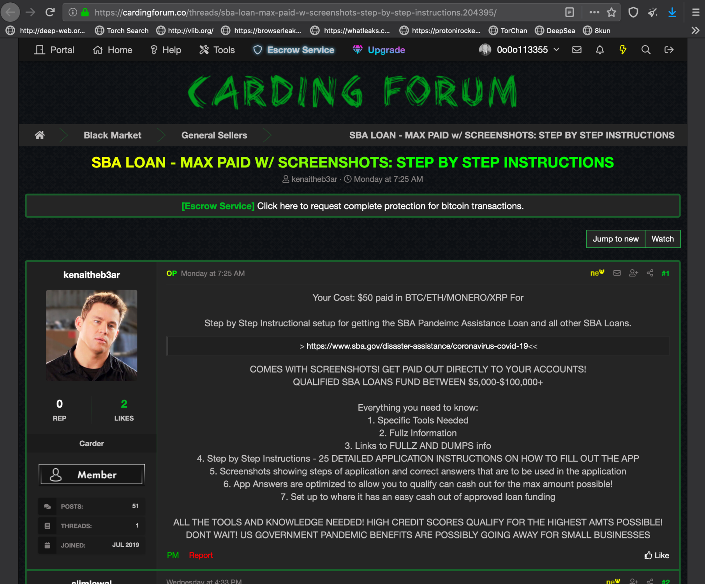
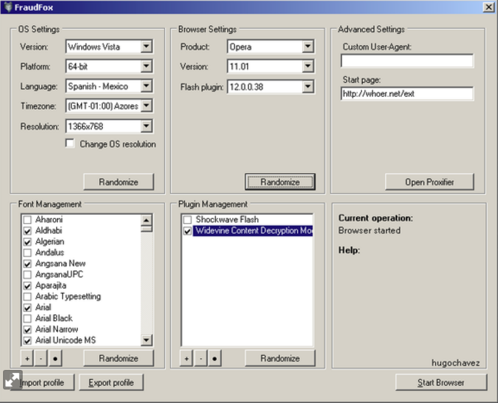
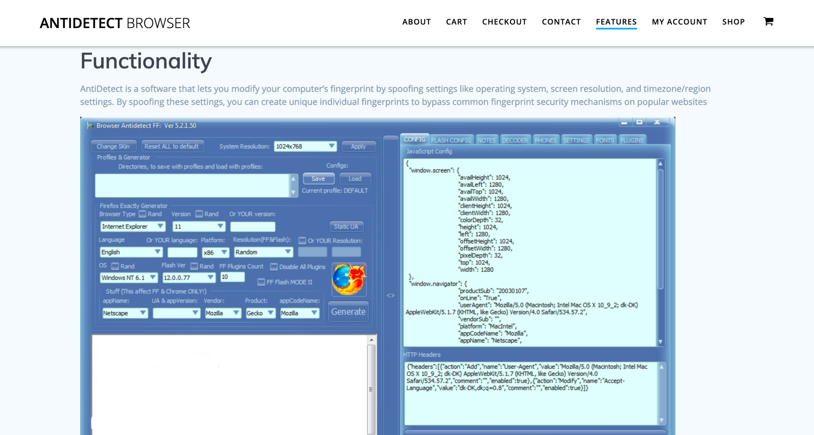
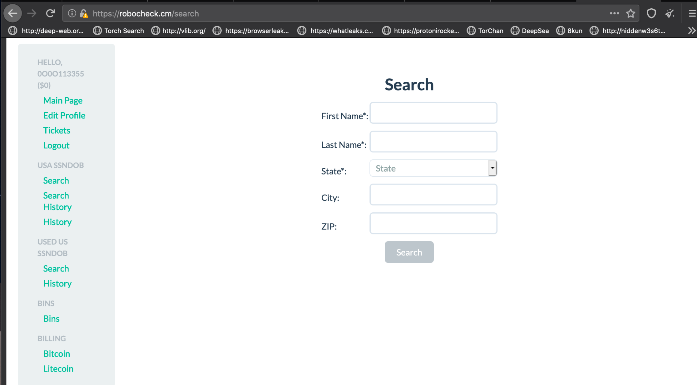
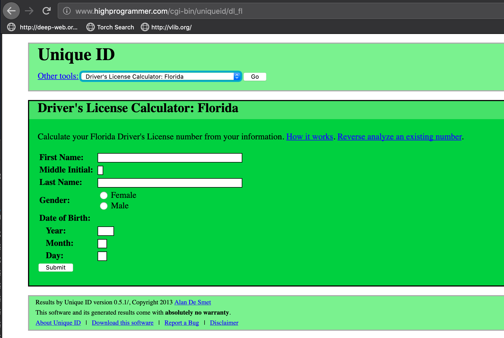
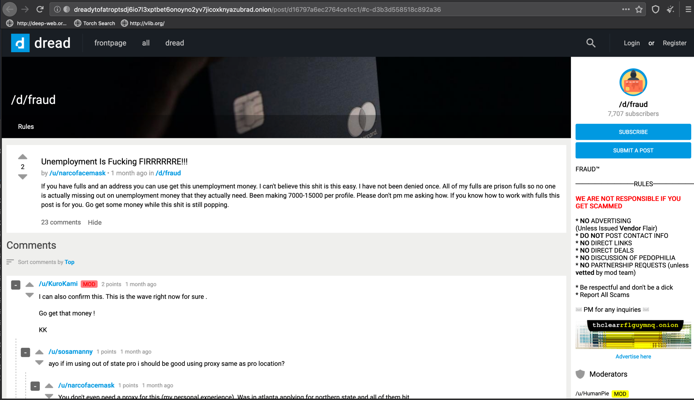
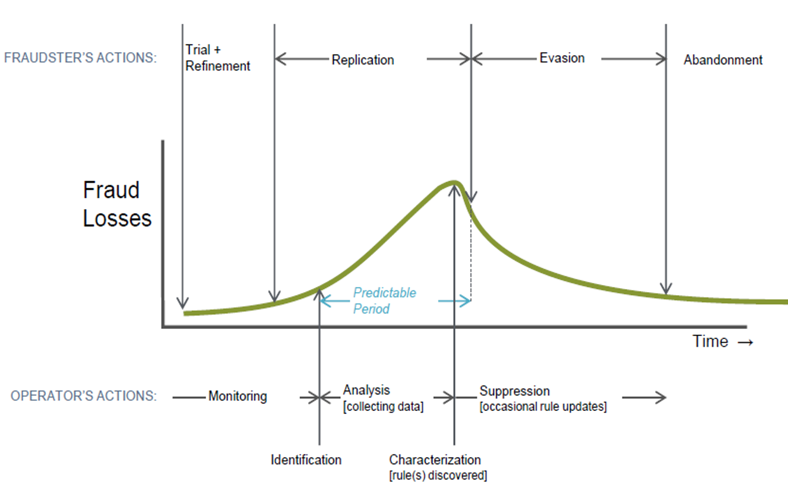

Pandemic Unemployment Assistance Fraud
Origionally posted on LinkedIn on August 18, 2020

In the middle of a global pandemic, millions of Americans lost their jobs*.* Unemployment claims skyrocketed and states were **not** prepared f*or* the influx of new claims. State by state, Unemployment Insurance Benefits (UIB) systems went online dispersing billions of dollars included as part of CARES Act of March 2020. One provision, contained in Section 2102 of the Coronavirus Aid, Relief, and Economic Security (CARES) Act, was to retroactively pay a claimant from January 27, 2020 in addition to a $600 payment for each week unemployed, up to 39 weeks. The Pandemic Unemployment Assistance (PUA) program was announced on April 5, 2020 by the U.S. Department of Labor. Their published guidelines state, “Under PUA, individuals who do not qualify for regular unemployment compensation and who are unable to continue working as a result of COVID-19, such as self-employed workers, independent contractors, and gig workers, are eligible for PUA benefits.”

Essentially, PUA expanded the definition of eligible workers to include individuals who are:

- self-employed and lost business due to the pandemic;
- quarantined and can’t work due to the coronavirus;
- unable to work due to the risk of exposure to the coronavirus; or
- unable to work due to caring for a family member with COVID-19.

States began planning for dispersing pandemic emergency unemployment compensation (PEUC) and began taking claims as early as April. Other states followed suit and began accepting claims in May. As soon as the systems were enabled, the claims started coming in; including the first batch of fraud claims.

According to one special report [1] done for the State of Nevada, the national statistically valid sample shows that 2.955% of overall claims were fraud in the calendar year 2019. In that same report, it says, “the estimated fraud rate for the UI program cannot be extrapolated to the PUA program, and DOL currently has no mechanism in place to estimate the PUA fraud rate”.

> “The estimated fraud rate for the UI program cannot be extrapolated to the PUA program, and DOL currently has no mechanism in place to estimate the PUA fraud rate.”

The CARES Act spending primarily includes $300 billion in one-time cash payments to individual Americans, $260 billion in increased unemployment benefits, the creation of the Paycheck Protection Program that provides forgivable loans to small businesses with an initial $350 billion in funding (later increased to $669 billion by subsequent legislation), $500 billion in aid for large corporations, and $339.8 billion to state and local governments. **[2]**

This post does not go into Small Business Administration (SBA) loans or the Paycheck Protection Program (PPP). The scope of this post is specific to unemployment insurance benefits fraud.

The cash eventually flowed in every state. Since early April, claimants and fraudsters have been collecting unemployment. In less than six months, billions of dollars have been sent to fraudsters never to return. The timeline below shows the time frame this all took place with the U.S. unemployment rate in the background. In April, the number of claims coming in had never been seen before. Systems, fraud analysts, and fraud prevention / detection processes were severely pressure tested.

You may have noticed two kinds of stories in the news about UIB lately. There are stories that report millions (or billions) of dollars were not lost to fraud, claiming fraud prevention. There are also stories about states that have been attacked and lost millions of dollars to fraudsters. It is tempting to think of those as being apples to apples, but if you look a little closer, those are actually two different Key Performance Indicators (KPIs) or metrics. Meaning, it is not accurate to compare what would have been lost, to what was actually lost. When a claim is submitted and subsequently denied due to fraud, the state is calculating what the maximum amount a fraudster would have received. Depending on how they calculate it, they could say the estimated attorney fees for litigation and prosecution are included in the cost of fraud — and assume no successful clawback. On the other hand, the articles reporting losses are reporting on the actual amount of money lost to fraud.

I think the distinction between those two KPIs is important when discussing the success or failure of fraud prevention and detection.

We need data to track these two KPIs with granularity. States and the Department of Labor have tons of data but it is difficult to quickly and efficiently analyze this data and perform cross match searches or anomaly/outlier detection. Fraud analysts do have access to this data and well-defined processes for handling fraudulent claims, but there are data gaps or blind spots early in the UIB lifespan. States have hard-working, dedicated individuals working to resolve issues as they come up, maintain reliable connectivity and uptime on these systems, and have been doing so for years. Also happening for years: **budget cuts**. This is the best time to support the IT Department — they’ve been working very hard during the pandemic and with budget cuts expected, their jobs will not get any easier.

Visibility is paramount. You must see it to know it’s not working quite right, or that the database latency has increased, or that the transaction is two standard deviations from the norm. The collection of performance and security metrics as well as claim metadata allows the state to fill in gaps that anti-fraud teams have when researching incoming claims. Each claim that hits the queue of fraud analysts should come with fields that have been enriched ahead of time. Saving time for the human analyst on each claim review saves a lot of time overall.

Routine Task Automation (RTA) is the process of programatically running a playbook that contains enrichment or response actions. If a claimant filed their application online, the IP address the claimant connected from can be geolocated. A fraud analyst can be presented with enough information to either mark the claim as fraud or approve it. The analysts can invoke another playbook to continue the workflow, without further intervention. Ongoing behavior monitoring and analysis should continue for the entire lifespan of the claim.

## The Fraudsters

The State of Arizona publishes a UI Fraud Convictions Quarterly Report that lists each conviction, by name, on their website.

In Q1CY20, the total restitution, including criminal, civil, fines, and fees is $391,112. **[3]** There are seventy-three people on the list who have subsequently been given probation and/or community service. Only two of the seventy-three served any jail time. The most anyone was paid out was slight under $8,000 with an average between $4,000 and $5,000.

The maximum sentence in Arizona for this Class VI Felony is up to two years in prison and a $150,000 fine for each offense. If someone fraudulently receives ten weeks of UI benefits, each week is considered as a separate offense and you could receive up to twenty years in prison.

In my research, three primary groups are perpetrating fraud on UI systems across the U.S.; organized crime syndicates, opportunists, and individuals.

When the UI program was announced, organized crime rings like [Scattered Canary](https://www.agari.com[BLOCKED: Cookie/query string data]60 billion in increased unemployment benefits) immediately began doing research on each state’s UI portal. Mapping out process, workflow, and preparing the infrastructure that they will use to steal millions (or potentially, billions) of dollars. As soon as the systems came online, the crime rings went to work. Refining their techniques and refining their processes — just like a legitimate enterprise would.

In order for the crime rings to scale, they must recruit others. Mules are individuals who perform a step or multiple steps in the fraud lifecycle. They could be a bank account owner, a mail recipient, or a provider of fresh “fullz” (i.e., the full profile of an identity theft victim; SSN, DOB, etc.).

In the case of UI, this scaling activity happened unlike other scams before it. Fraudsters typically create a runbook or “sauce” and put it up for sale on the dark web. From $35 to $50 bucks, you could have your own sauce on how to make a quick buck duping people, businesses, or the government out of money. In 2020, things are different, though. The sauce for UI fraud was shared freely and shared widely. I tend to think that because the UI had an expiration date, people thought it was best to open-source the sauce.

Given the pandemic and the rapid spread of instructions on how to steal money from states, I suspect that there were millions of falsified UI claims that were actually paid out. My question is: were the states rushed by the feds which inadvertently relaxed scrutiny regarding fraud and overpayment in order to liberally construe eligibility in favor of providing benefits? I remember this time during the lockdown; I remember hearing stories about people anticipating much-needed financial relief and that the federal and state government were looking to quickly set up the system to get money to the people. Was there an unintended consequence after making more people eligible?

The goal was to get money in to the hands of people immediately and wanted to that outside of the one-time payment issued by the IRS, which means that states did not have much time to scale and secure their systems. Once the floodgates opened and the fraud runbooks got around, the amount of fraudulent claims increased exponentially in a very short timeframe. What is the best way to distribute a lot of money to a lot of people in an emergency like a pandemic?

Many fraud claims that have gone through met the following criteria:

1. The fraudster applied with an out-of-state address
2. The fraudster used a stolen ID or a synthetic ID
3. The fraudster used a fictitious business name
4. The fraudster obfuscated their online tracks using readily accessible tools
5. The fraudster quickly refined and replicated their processes and managed 20+ claims
6. The fraudster used an online banking app

The U.S. Secret Service warned us back in May about a well-organized fraud ring out of Nigeria. In a post KrebsOnSecurity **[4]**, a federal fraud investigator who spoke with KrebsOnSecurity on condition of anonymity said many states simply don’t have enough controls in place to detect patterns that might help better screen out fraudulent unemployment applications, such as looking for multiple applications involving the same Internet addresses and/or bank accounts. The investigator said in some states fraudsters need only to submit someone’s name, Social Security number and other basic information for their claims to be processed.

> “many states simply don’t have enough controls in place to detect patterns that might help better screen out fraudulent unemployment applications” — Anonymous (not the hacking group!)

## Apps, Tools, & Techniques

### Online Banking

Fraudsters leverage a few checking account on-demand apps like Chime, Netspend, GoBank, Green Dot, Cash App, PayPal, as well as the standard bank or credit union account. These apps allow you to quickly open an account in minutes using basic information that is easily found on the dark web. With their new bank account in the victim’s name, the fraudster opens the Unemployment Insurance portal for a given state and inputs the stolen or synthetic identity information and completes the claim. Once approved, the fraudster updates the bank account information and escapes with the cash.

### Obfuscation Tools

FraudFox allows you to tune your browser so you can appear to the Web server as a Windows machine but in reality, you’re using a Mac, for instance.

Similar to FraudFox, Antidetect Browser allows the fraudster to granularly change the digital footprint of the endpoint they are using to connect.

There is a lot of talk about SOCKS5 proxies and VPN in the forums.

### SSN Lookup

Yep, there’s a website to look up Social Security Numbers.

This handy tool allows you to create a DL number using the information put into the form.

### Press enter or click to view image in full size

Finding forums on the dark web discussing fraud best practices is nothing new. But, there is a lot of new activity on forums like **dread** that are very much like Reddit. You have a post and a bunch of replies that are eventually upvoted.

It is in these dark corners of the internet that would-be fraudsters are trading information on tactics, techniques, and procedures. They are exchanging success stories as well as what didn’t work. The people on these forums talk about ‘getting fraud to work’ as if they were troubleshooting an automatic sprinkler system that had an issue. It looks like experienced fraudsters are sharing their runbooks with mules they recruited and then those same mules are going out to start their own ring.

### Data Gaps

If you look at the lifespan of a claim in the system, you will notice four main segments: pre-claim, during the claim process, while receiving benefits, and off UIB.

If you look closer at each of those segments, the touchpoints between the fraudster and the UI system begin to emerge.

Filling the data gaps is key to early detection of the fraudster’s techniques. The key is to detect outliers, unusual relationships, and ultimately detect suspicious behavior. Analyzing data with machine learning (ML) enables anti-fraud teams to detect anomalies and also make predictions.

Each state across the U.S. is able to see all of the data somewhere along that green line in the chart above. The name of the game should be complete observability; and it should be done early in the claim lifespan. This will prevent the fraudster from entering the replication phase, or at a minimum, focus on reducing the time spent in the detect and characterization phases.

Data is generated every step of the way during the claim lifespan. It is key to collect this data and provide centralized access to the data such that monitoring, detection, investigations, reporting, and integration of learned insights are made actionable via meaningful, KFIs, SLAs, and KPIs.

### Pre-Claim

During the pre-claim process the first thing that a claimant does is presents their identification. The claimant provides a login name, a password, an email address, a physical address, their social security number, and other bits of information. The data collected can be analyzed and cross matched with databases containing the information of ineligible individuals, such as incarcerated or deceased individuals. Below the surface, the UI system is also collecting the IP address, the browser’s User Agent information, and other session information. This can be collected and continually reviewed to detect Account Take Over or fraud.

### During the Claim Process

Once a claim has been submitted a well-defined process kicks off that includes programmatic and human analysis. During this timeframe, the agency is looking to authenticate the claimant’s provided identity and verify work history. The UI system interfaces with systems throughout the state’s network. For example, the UI system uses data from Motor Vehicles, the Department of Corrections, and Human Services for SNAP and Medicaid status.

The UI systems during the peak of quarantine were opened up for folks to file claims. At the same time, so did hundreds (perhaps thousands) of fraudsters. The systems in place were not built for the amount of claims they saw and will continue to see.

During the claims process the claimant will login to check their status. If the person logging in is a fraudster, they might login anxiously multiple times per day. They might log in using VPN which means their IP address (likely) changes. The claimant may decide to call in to the Call Center one day to ask for status. Again, more touch points to detect suspicious activity and prevent fraud.

### While Receiving Benefits

Touch points in this segment includes monitoring of account modifications to mailing address or banking info, weekly certification, and continual cross matching with all Key Fraud Indicators (KFIs) in the claimants record. Everything from User Agent, to previous IP address, to time spent, and so on. In one state, a couple reported receiving ten UI debit cards for ten different people who did not live there! They all had the same mailing address.

Continuous monitoring and risk evaluation are key in this segment of the UIB lifespan.

### Off UIB

Once an individual is no longer receiving UI benefits, their account is likely to not be used. Monitoring of unused accounts for take over is a proactive measure the agency can take.

In the background, the UI system is providing cross matching on all KFIs in the unused accounts and if there’s a match in a new claim, a workflow is invoked.

### A Second Wave

There may or may not be a resurgence of the Coronavirus in the fall. There may or may not be additional job loss at an unprecedented level. Let’s hope not, but plan for it. States should collect data earlier in the lifespan of the UI claim and start using machine learning to detect anomalies.

One interesting outcome that states are now having to deal with is people become ineligible for other services like SNAP and Medicaid for “making too much money” through unemployment, and are left without medical insurance. The social safety net — linked in many ways — is being pressure tested in all ways. Now that PUA has expired, we will likely see an influx in applications for other services like SNAP and Medicaid.

If we see a second wave or a resurgence in the fall, we may see many more folks apply for UI benefits. I recently read that we could see a doubling. That is 30 million unemployment claims.

## What Next?

### Observability.

All machine data should be collected, normalized, enriched, and correlated (cross matched). From the hardware the UI system runs on to the session footprint on a claimant’s endpoint. All (attack) surfaces and touch points can and should be monitored.

Preventing fraud and ensuring service assurance begin with observability.

### Scalability.

The ability to dynamically adjust the UI system footprint based on workload is going to be key. This saves on the initial investment as well as longevity of the system. Scaling out when needed and down when the burst is over is absolutely within reach with services like Amazon Web Services (AWS), Google Cloud, Azure, and other infrastructure providers.

This includes the Call Center and the systems/team that run the Web Agent Chat service.

### Automation.

The tasks currently done manually (aka “manumation”) should be automated. Whether that is enrichment, correlation, or writing risk attributes to the UI platform (e.g., ICON, CONNECT, etc.), a routine task can be programmatically completed.

If the agency can save 30 minutes during an investigation, across hundreds or thousands of investigations, days or weeks of time can be gleaned.

Automation is a workforce multiplier.

## Thank You

Thank you to the State employees across the U.S. who are working all hours of the day and night. Upgrades, patching, and other maintenance are all things that are done when the majority of us are sleeping. The teams supporting all applications used by us digital citizens are critical to our everyday life. I sincerely thank all the folks caring for and making sure our critical services work and work efficiently. It is my experience that State employees are not thanked enough. If you work for a State and would like to reach out, please do! I would be honored to speak with you and hear your story.

If you have any experience with UI or have any feedback, please comment and let’s chat!

Thank you for reading!

Stay safe out there.

Please note: the views and opinions expressed in this post are those of the author (Chris Perkins) and do not necessarily reflect the official policy or position of my employer, or any other agency, organization, or company. Assumptions made in this post are not reflective of the position of any entity other than the author — and, since we are critically-thinking human beings, these views are always subject to change, revision, and rethinking at any time.

## Sources

[1] https://ewscripps.brightspotcdn.com/2a/36/746b483449a8aa9bfdb956b2937a/pua-court-report-doc.pdf

[2] https://en.wikipedia.org/wiki/CARES_Act

[3] https://des.az.gov/services/employment/unemployment-individual/unemployment-insurance-benefit-fraud-convictions#:~:text=In%20Arizona%2C%20it%20is%20a,Unemployment%20Insurance%20(UI)%20benefits.&text=Criminal%20action%20may%20result%20in,%24150%2C000%20for%20each%20false%20statement

[4] https://krebsonsecurity.com/2020/05/u-s-secret-service-massive-fraud-against-state-unemployment-insurance-programs/

[image] Fraud Losses chart; Splunk forum 9/2017 Financial Services Julie Conroy | Research Director, Aite Group

*Originally published at* *https://www.linkedin.com*.
