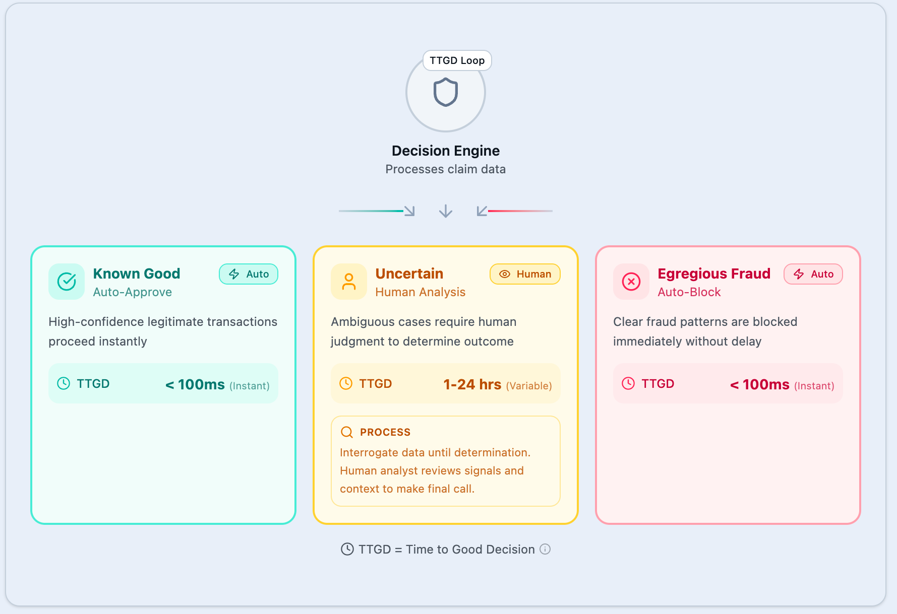

Time to Good Decision

- Govtech
- AI
- Fraud

Data  
Cybersecurity  
Time to Good Decision  
I Have Two Food Stamps From 1967. They Explain the Choice We Keep Refusing to Make.  
Chris Perkins  
17 min read  
Jan 20, 2026

I have two paper food stamp vouchers from 1967 framed in my office. One is for fifty cents. The other is for two dollars.

They are surprisingly beautiful. Designed like currency, because they were currency. You handed them to a grocer who knew your name. Maybe the store clerk asked about your kids. A system built on human interaction and local accountability.

I keep them where I can see them. They remind me of a different alphabet.

Growing up, the first alphabet I learned was A-B-C. The second was WIC, AFDC, EBT, SNAP. I know what free school lunch tastes like. I know what powdered eggs taste like — the ones that come in bulk, reconstituted with water that never quite mixes right. I know the nondescript tin cans with white labels and black block letters that say “PEAS.” I know what it feels like to stand in a food line, trying to make yourself small, hoping no one from school sees you.

I also know that those programs kept my family fed.

My mother worked. We still qualified. That’s what people who’ve never needed help don’t understand: the programs exist because sometimes, work isn’t enough. Often, especially now, the math just doesn’t add up, and the distance between a paycheck and a grocery bill is measured in meals your kids won’t eat.

I have family members who’ve been incarcerated. I’ve watched the system catch people at their lowest and grind them further down. And I’ve watched other people exploit every gap in that same system, taking resources meant for families like mine.

This is not an abstract policy question for me. It’s personal.

Those food stamps sit at a hinge point in American history. The programs were new, hopeful, expanding. Two years after signed into law, the political will to protect these programs was already eroding.

The question has been with us ever since. Do we have the courage to build systems that actually work? Systems that help the people who need help. Systems that stop the people who steal from them.

Here is the claim I want to make, and I will make it three times before this essay ends: zero fraud is possible. Not as a slogan. As a design choice. I don’t mean literally zero loss, ever — I mean zero economically meaningful fraud that survives a well-designed verification and adjudication process. Fraud reduced to statistical noise through system design.

The technology exists. What’s missing is the will to build it.

This essay is about one metric that could change everything: how fast an institution can make a good decision.

> Zero fraud is possible. Not as a slogan. As a design choice. The technology exists. What’s missing is the will to build it.

## The Year Everything Changed

Let me place those stamps in their moment.

In 1967, Medicare and Medicaid were just two years old. The Food Stamp Act had been signed three years earlier. The first Super Bowl was played in January of that year. The median household income was $7,200. And in Vietnam, the number of American troops swelled toward half a million.

That year, the Food Stamp Program reached two million participants. A cornerstone of the War on Poverty. It was a hopeful time, animated by the belief that government could and should solve the big problems.

But it was also a time of fracture.

The “long, hot summer” of 1967 saw hundreds of urban uprisings across the country. The anti-war movement was growing. And the political coalition that built the Great Society was beginning to crack.

That same year, Congress added the first work requirements to AFDC — Aid to Families with Dependent Children, the program that would later become TANF. A small change, barely noticed. But it marked a turn. The optimism was curdling into suspicion.

By 1968, Richard Nixon would be elected on a platform of “law and order.” By 1969, the backlash was in full swing.

Those food stamps from 1967? They come from the last moment before the turn. The programs were still being built. The faith was still intact. What happened next would shape the next sixty years.

What happened next was a choice.

Made slowly. Never announced. Rarely debated. To treat the people who needed help as suspects first. Citizens second.

The pattern that followed persists today. It is not a lack of detection. It is a lack of will and decision.

## The Question Nobody Wants to Ask

Here is something true that makes people uncomfortable: there is a pattern in how America talks about fraud.

When fraud is discovered in Medicare, the conversation is about fixing the system. Bad actors. Isolated incidents. We need better oversight. Medicare has a powerful political constituency. People who vote reliably. Faces that appear in pharmaceutical commercials.

When fraud is discovered in SNAP or TANF or housing assistance, the conversation shifts. These are programs serving communities with less political power. Faces used for decades to represent “dependency.” Now it’s about cutting funds or ending the program. Welfare queens. Cultures of poverty. Maybe these people don’t deserve help at all.

The fraud rates aren’t meaningfully different. The political protection is.

This pattern didn’t emerge by accident. In the early 1960s, media coverage of poverty featured predominantly white faces — an accurate reflection of who was poor. By 1967, that coverage had shifted dramatically. Poverty stories increasingly showed Black faces, particularly in negative contexts. The image of “the poor” was racialized precisely as civil rights legislation expanded access to programs that had previously excluded Black families through law and local practice.

Linda Taylor was a real person, a Chicago con artist who in 1974 was indicted on welfare‑fraud and related charges; the fraud was genuine, and one documented AFDC case involved about $8,865 in improperly obtained benefits, with total confirmed welfare fraud over several years on the order of tens of thousands of dollars rather than the hundreds of thousands later claimed in political speeches.

Ronald Reagan, in his 1976 presidential campaign, transformed her into a myth. In his telling, she had “eighty names, thirty addresses, twelve Social Security cards” and was collecting “over $150,000” tax-free. The numbers were false. The story was too good to fact-check. The “welfare queen” was born.

The point was never accuracy. The point was that welfare now had a face — and the face was Black. This made cutting programs politically safe. You weren’t taking food from families. You were fighting fraud.

I need you to understand: the people in those food lines with me weren’t scammers. They were tired. They were embarrassed. They were doing the math between rent and groceries and coming up short. Most of them worked. None of us wanted to be there in those lines delivering on their promise of support.

Some of the fraud was real. Some of the fraudsters were real, then, a small percentage. But the story we told about fraud was never about protecting programs or helping people. It was about permission. Permission to cut. Permission to judge. Permission to look away.

## 35 Seats, 18,000 Meals

None of this means fraud does not exist. It does. These are federally funded programs administered through state systems, so any state can become the case study. Let me tell you about Minnesota.

I’m naming places because the facts are clear — not to assign blame, but to extract a design lesson we can apply everywhere.

Before we get into the details, let me be clear: this is not a story about bad people in state government; it’s about a process that couldn’t convert warnings into timely authority before the money went out.

During the pandemic, a nonprofit called Feeding Our Future became the hub of what federal prosecutors describe as one of the largest fraud schemes in the history of the federal child nutrition programs, diverting more than $250 million that was intended to pay for meals for low‑income children.

Participants in the scheme claimed to have served tens of millions of meals through sites around the state, using fabricated invoices, fake attendance rosters, and grossly inflated meal counts to draw down federal funds.​

Some of the numbers were obviously impossible.

In charging documents, operators claimed to serve thousands of children per day out of small storefront locations that plainly could not have fed that many people.

Federal agents reported that when they conducted surveillance on one site that claimed to be serving several thousand meals daily, they observed only a small number of people coming and going. Investigators also found that some rosters of “children served” were fabricated, listing names that did not correspond to real participants and using template‑style data to pad counts, so the children were fictional, the meals were fictional, but the reimbursements were real.​

According to federal indictments and investigative reporting, Feeding Our Future’s reimbursements from the federal child nutrition programs jumped from a few million dollars in 2019 to roughly $200–$250 million in 2021, an increase of dozens of times in just two years. The U.S. Attorney’s Office alleges that large portions of this money were laundered into luxury homes, cars, jewelry, and overseas properties instead of food for children.

Minnesota’s Department of Education, which was responsible for overseeing these federally funded programs in the state, received numerous complaints and internally flagged some Feeding Our Future claims as “implausible” before the full scope of the scheme was publicly exposed. However, when the agency attempted to slow or halt payments, Feeding Our Future sued, and a state judge found the department in contempt and ordered it to resume processing applications — a constraint that limited the agency’s options even as concerns mounted. A decision that state officials later said discouraged more aggressive action.​

In the aftermath, the Minnesota Office of the Legislative Auditor criticized gaps in the system and state officials acknowledged the system had been too trusting.

This is the pattern everywhere: not a lack of detection, and not a lack of good people — just a lack of a system that can quickly and accurately turn signals into decisive action.

## The Design That Guarantees Failure

This isn’t a Minnesota-specific problem. It’s an American systems problem. What happened here previews the failure mode we should expect when sophisticated fraud networks apply advanced technology and AI to systems that lack the authority and speed to convert warnings into action.

The pandemic pushed three trillion dollars through government programs in months. Speed was prioritized over security — a choice made consciously, defended at the time as necessary.

The result: the largest fraud event in American history.

Estimated losses across PPP, EIDL (the Small Business Administration loans), and unemployment insurance: $300 to $335 billion. That’s more than the entire annual budget of the Department of Veterans Affairs.

For every dollar spent on pandemic unemployment, eleven to fifteen cents went to fraudsters.

The SBA didn’t fully implement its fraud detection systems until mid-2021. By that point, 97 percent of all EIDL loans had already been approved. The money was gone before anyone was seriously looking.

But here’s what’s worse: when we do try to catch fraud, we often catch the wrong people. Disproportionately.

Michigan is a cautionary tale, and it could have happened almost anywhere. This is not about intent; it’s about design.

Michigan deployed an automated fraud detection system called MiDAS in 2013, designed to identify unemployment insurance cheaters. Instead, it accused 40,000 people of fraud they didn’t commit. The false positive rate: 93 percent.

> MiDAS showed the cost of automating suspicion. The TTGD Loop operationalizes trust: auto-approve/auto-block the obvious, route uncertainty to humans with fast appeals, and learn from every outcome — resilience by design in the age of adversarial, agentic AI.

Families lost their homes. Eleven thousand filed for bankruptcy. One woman completed police academy training but failed her background check because MiDAS had flagged her. She never got the job. Settlement checks didn’t arrive until 2024, nine years after the accusations began.

The pattern is consistent: we build systems that let sophisticated fraudsters through while blocking grandmothers who moved apartments.

Professional criminals with synthetic identities pass every check.

Legitimate applicants with “thin files” get flagged and denied. Young people. Immigrants. The formerly incarcerated. And anyone who lives in the cash economy.

Fraud exploits process. Cybercrime exploits systems. What we have are bad actors using legitimate systems in illegitimate ways — and our response has been to make the systems harder to use for everyone while barely inconveniencing the criminals.

We have surveillance capability without security. Detection without decision. The worst of both worlds.

## The Storm That’s Coming

Everything I’ve described so far is about to get worse. Much worse.

Synthetic identity fraud is widely estimated to cause on the order of $30–$35 billion in losses each year in the U.S. alone, and multiple studies describe those losses as having grown dramatically in just a few years.

Criminals fabricate entirely new people by combining real and fake information.

These aren’t sloppy forgeries. They’re patient builds. Credit histories established over years. Social Security numbers assembled from the dead and the young. Digital footprints manufactured to pass every automated check.

The person doesn’t exist. The identity does.

Recent security reports estimate that AI‑driven deepfake attacks were occurring at roughly one every five minutes worldwide in 2024, based on global fraud‑detection data from large identity and cybersecurity providers. Analysts also find that deepfake activity and deepfake‑enabled fraud have grown by well over 1,000 percent in just a few years, with some sectors reporting increases above 2,000 percent compared with early‑2020s baselines.​

Commercial voice‑cloning tools now need only a few seconds of recorded audio to produce a convincing synthetic voice, and vendor tests commonly report cloning accuracy in the neighborhood of 80–90 percent for many languages and speakers. In parallel, face‑swap and video deepfake systems can take a single still image and generate video of that person appearing to speak or act in ways they never did, a capability widely demonstrated in both research papers and off‑the‑shelf “face swap” apps.

Every verification method we’ve built over the past sixty years is being systematically undermined by technology that didn’t exist when our systems were designed. Knowledge-based authentication. Document verification. Biometric checks. Even live video calls.

The Social Security number was created in 1936 as a bookkeeping tool. It was never meant to be an identity document. From 1946 to 1972, every Social Security card bore the words “NOT FOR IDENTIFICATION.” We ignored that warning. We turned a nine-digit accounting number into the master key for American life.

Now we’re surprised that the lock can be picked.

Here is what keeps me up at night: AI can fake a credential. It can fake a face. It can fake a voice. It can generate documents, forge signatures, and pass any static test we design.

What it cannot yet fake is a human life.

## The Wrong Question

For sixty years, we’ve been asking the wrong question about fraud.

We ask: “Is this person who they claim to be?” Then we check a credential. A document. A number. A biometric scan. We look for a snapshot — a frozen moment of identity that can be verified against a database.

But identity isn’t a snapshot. It’s a trajectory.

> Identity isn’t a snapshot. It’s a trajectory. AI can fake a credential. It can fake a face. It can fake a voice. What it cannot yet fake is a human life.

Who you are isn’t captured in a nine-digit number or a plastic card. It’s the sum of your behavior over time. The places you’ve been. The people who know you. The patterns that emerge when a life is actually lived.

A fraudster can steal your Social Security number. They can forge your driver’s license. They can use AI to fake your face and clone your voice. What they cannot do is live your life. They cannot be present in the places you go, interact with the people you know, or accumulate the behavioral signals that genuine existence produces.

This is the insight that could change everything: we’ve been trying to verify credentials when we should be observing trajectories.

Think about how trust actually works between humans. When a grocer in 1967 accepted food stamps from a customer, he wasn’t checking documents. He knew her. He’d seen her every week for years. He knew her kids. Trust was built through repeated interaction, observed behavior, accumulated presence.

We abandoned that model for efficiency. We replaced human judgment with automated verification. We swapped relationships for credentials. And then we were surprised when the credentials could be forged.

The question isn’t “How do we build better walls?” It’s “How do we measure what walls cannot protect?”

The answer isn’t more surveillance. It’s different data.

Presence over time. Relationships verified by mutual recognition. Behavior that accumulates into a pattern no algorithm can fabricate. Not “Who does this person claim to be?” but “What does this person’s trajectory tell us about who they actually are?”

I can hear the objection: this sounds like surveillance. It isn’t — and it doesn’t have to be. The data stays on-device, under user control. Recognition is mutual, not centralized. And here’s the irony: this approach is less intrusive than current systems that demand documents, biometrics, knowledge-based authentication, and endless reverification. Less friction, less fraud, without building a panopticon.

This isn’t a fantasy. It’s a design choice. And it’s one we now have the technology to make.

I’ve been building this. A prototype called Noma (noma.community), presence-based identity built on proximity and time rather than credentials and databases.

## Noma | Proximity-Based Trust Network

### Build verifiable digital identity through physical presence. Join the decentralized trust network powered by the…

noma.community

It’s a proof-of-concept, a sandbox for testing what trajectory-based trust could look like. Not the only answer. Not a finished product. But proof that the question can be asked differently. Let’s build it, together.

## The Path Forward

Here is what a functional system would look like.

Start with a different metric. Not “fraud detected” or “claims processed” but something simpler and harder to game: Time to Good Decision. How fast can your organization turn information into confident action?

A good decision isn’t just blocking fraud. It’s approving legitimate claims with equal speed and confidence. It’s knowing when you don’t know — and routing that uncertainty to the one resource that can resolve it: an expert human being.

The system needs three lanes.

- Green Lane: High-confidence legitimate activity. The mother who’s been receiving benefits for three years, whose address matches, whose work history is consistent, whose children are enrolled in school. Auto-approve. No human needed.
- Red Lane: High-confidence fraud. The restaurant claiming to serve 18,000 meals from thirty-five seats. The application submitted at 3 AM from an IP address in Eastern Europe using a Social Security number belonging to a child. Auto-block. Route to investigation.

Yellow Lane: Uncertainty. This is where human expertise matters. The applicant with a thin credit file. The recent immigrant whose documentation doesn’t fit standard categories. The formerly incarcerated person rebuilding a life. The widow whose husband handled all the bills and who now has no credit history in her own name. The refugee whose name transliterates three different ways across documents (Ahmed, Ahmad, Ahmet) each one flagging a mismatch. Real people with real needs who don’t fit the algorithm’s expectations.

The goal isn’t to eliminate the Yellow Lane. It’s to shrink it over time. Every decision the system makes feeds back into the model. Every decision a human makes should too.

A well-designed system learns. The Yellow Lane contracts. Humans spend less time on volume and more time on judgment.

This isn’t about choosing between speed and security. That’s a false choice, and accepting it has cost us hundreds of billions of dollars. It’s about building systems that are both fast and good — systems that protect programs by making them work.

The same AI that powers deepfakes and synthetic identities can power this.

But only if we build it. Only if we demand transparency. Only if we refuse the black-box vendors who promise magic solutions that create dependency instead of capacity.

What does this look like on Monday morning?

Staff the Yellow Lane with humans trained for judgment, not checkbox processing.  
Set SLAs measured in hours and days, not months. Build feedback loops where every decision (human and automated) teaches the system. Guarantee appeal rights so false positives get fixed fast. MiDAS showed what happens when you automate without accountability: 40,000 accusations, 93 percent wrong.

The goal is automation with accountability — speed that doesn’t sacrifice accuracy, scale that doesn’t sacrifice humanity.

Zero fraud is possible. Not as a slogan — as a design choice. It requires systems that learn, decisions that are fast and good, and leadership willing to be held accountable for outcomes rather than activity.

I’ve spent nearly six years in the anti-fraud domain. The frameworks behind The Fraud Data Compass didn’t come from me alone. They came from a team I have the privilege of being part of at Splunk. Brilliant people who saw the same problems and refused to accept them. This is shared work.

I built The Fraud Data Compass web app because I was tired of waiting for someone else to show it was possible. It’s free. It’s transparent. A starting point, not a finished product. A tool for thought, designed to build internal capacity, not dependency.

## The Fraud Data Compass

### The Fraud Data Compass - Navigate from signals to decisions with confidence using the TTGD framework.

fraud.datacompass.app

## The Window Is Now

I look at those food stamps from 1967 and I see the hinge point clearly now — the moment when we could have built systems worthy of the mission, and didn’t.

Instead, we let fraud become a weapon. We used the actions of a few criminals to discredit programs that fed millions. We built systems designed to catch cheaters that caught grandmothers instead. We accepted a level of theft that would bankrupt any private business, while simultaneously making it harder for legitimate families to get help.

We are at another hinge point now. The pandemic exposed every fault line in our systems. Three hundred billion dollars — gone. And yet the response so far has been the same one we’ve had since 1969: cut the programs. Blame the beneficiaries. Ignore the design failures that made the theft possible.

This doesn’t have to be the pattern.

There is a coalition waiting to be built. Fiscal conservatives who hate waste. Progressives who want programs that serve people. Technologists who know what’s possible. Communities who have been harmed by systems that surveilled them without protecting them.

This coalition doesn’t yet exist because no one has articulated what they’re building toward.

It’s easy to unite against fraud. It’s harder to unite for a system that’s fast and good, that protects programs by making them work, that treats applicants as citizens rather than suspects.

What would it take?

Leaders who understand history — why we built what we built, and why it broke.

Leaders who see past the statistics to the human stories: the grandmother flagged by MiDAS, the child who didn’t get fed because the money went to fraudsters.

Leaders who see that identity, fraud, equity, and technology are not separate problems — they are one system.

Leaders willing to name what we’ve lost — three hundred billion dollars, yes, but also the trust eroded, the lives derailed, the programs discredited.

And leaders honest enough to say what happens if we do nothing: the system gets worse, not better, as AI makes every vulnerability more exploitable.

I grew up in those programs. They kept my family fed when the math and money didn’t add up. I’ve also watched people exploit them — people who took resources meant for families like mine.

Both things are true. The question is what we do with both truths.

Those stamps from 1967 my grandfather passed on to me represent the last moment of optimism before the turn.

Maybe 2026 can be the first moment after the return.

Maybe we can build what should have been built sixty years ago: systems worthy of the mission they serve.

The technology exists. The frameworks exist. What’s missing is the will to choose building over cutting.

Zero fraud is possible. I said it at the beginning. I’ll say it now at the end. Not as a slogan — as a design choice we keep refusing to make.

I’m asking you to make it.

Chris Perkins  
Las Cruces, New Mexico  
January 2026

