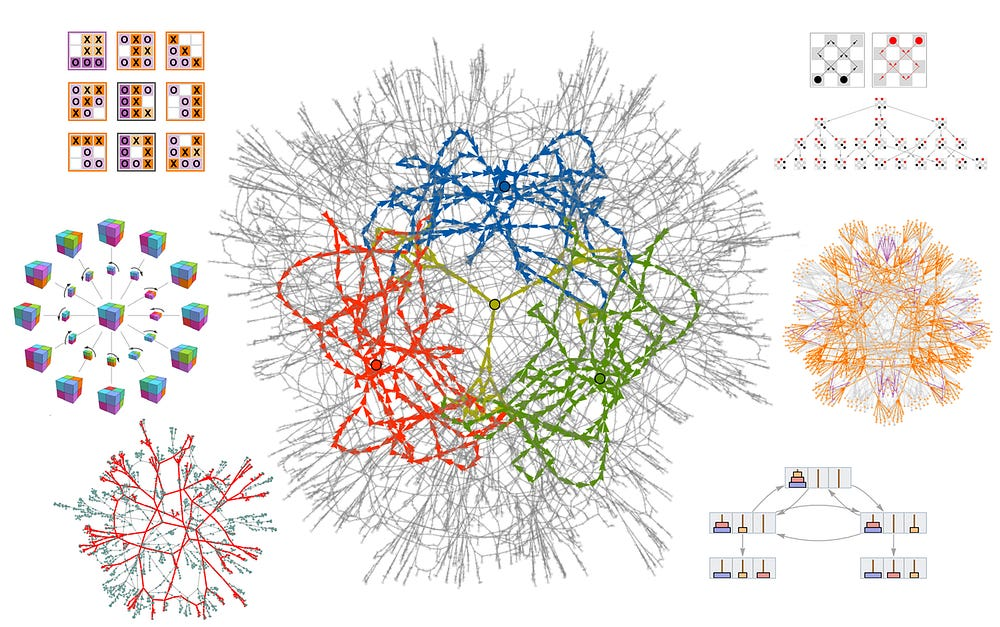
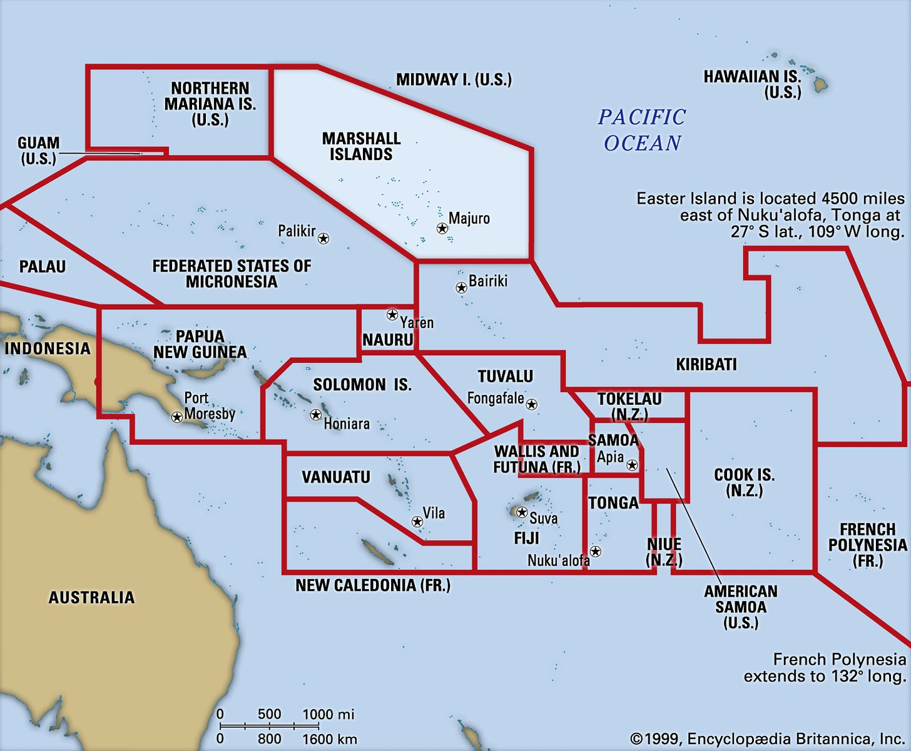
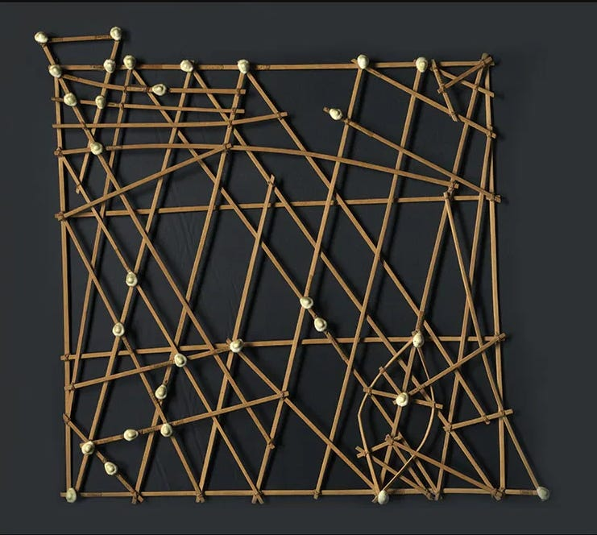

The Physics of Trust
The Greengrocer, the Loom, and the Question We Keep Refusing to Ask

## **The Signs in the Windows**

“A world of 8 billion people will feel like we’ve got a throughput capacity of 80 billion people, maybe 800 billion people.”

Jeetu Patel, Cisco’s President and Chief Product Officer, said this at .CONF in September and at WebexOne in October 2025. He wasn’t being hyperbolic. He was being conservative. By his math, we’ll soon have 10 agents for every human. Then 100. Then 1,000. Autonomous agents conducting tasks and jobs almost fully autonomously, on behalf of humans, in service of humans.

Thanks for reading Digital Physics! Subscribe for free to receive new posts and support my work.

The infrastructure we built for human-speed decisions will be managing 10,000 agent decisions in the time it takes you to read this sentence.

Here’s the question nobody in that room could answer: Who governs 80 billion digital workers?

We are at a [constitutional moment](https://medium.com/@chrisperkins505/the-constitution-of-digital-physics-157e7e45c1b5). Not a policy moment. Not a regulatory moment. A constitutional moment — when the basic rules of how power operates are being written, and once written, will be very hard to change.

In 1978, a dissident named Václav Havel wrote an essay called “[The Power of the Powerless](https://www.nonviolent-conflict.org/wp-content/uploads/1979/01/the-power-of-the-powerless.pdf).” At its center was a parable about a greengrocer in communist Prague.

The greengrocer places a sign in his window: “Workers of the World Unite.” He doesn’t believe it. He hasn’t examined it. He places it among the onions and carrots as ritual. The sign came with the onions. Every shopkeeper displays one. Not displaying it would invite questions he doesn’t want to answer. The system persists not through violence or belief, but through collective performance of rituals everyone knows to be empty.

Havel’s point wasn’t about communism. It was about power. About how systems maintain themselves through performance rather than substance. About how individuals become complicit in their own governance by placing signs they don’t believe in.

We have been placing signs in our own windows.

Walk through any affluent neighborhood in America. “Black Lives Matter.” “In This House We Believe.” “Peace and Unity.” The residents believe these things, mostly. But propose building affordable housing on the empty lot down the street. Suggest a homeless shelter within walking distance. Watch what happens at the zoning meeting.

Not in my back yard.

The signs stay in the windows. The housing never gets built. The people who need the housing are never in the room when the decision is made.

This isn’t hypocrisy in the simple sense. The signs perform values. They signal membership in a community of belief. But they don’t require anything. They don’t change behavior. They cost nothing except the price of the sign.

The same pattern has emerged in AI.

“Responsible AI.” “Human in the Loop.” “Aligned.” “Safe by Design.”

We place them among the products and press releases, the earnings calls and executive summits. We haven’t examined them too closely. We suspect they’re inadequate. The alignment techniques don’t scale. The safety measures can be bypassed. The oversight is theater. But we place the signs anyway, because everyone places them, because not placing them would invite questions we don’t want to answer.

The system persists.

Havel’s answer was individual courage: the greengrocer pulls down the sign. Decides to live in truth. But individual courage can be crushed, isolated, exhausted. What if the environment itself made the performance impossible? What if we built physics that didn’t accept signs in windows?

I’ve watched this pattern for twenty-three years. Authorization systems that don’t authorize. Fraud detection that doesn’t detect. Identity verification that verifies nothing about a person’s actual identity. The signs in the windows. The theater of security. The quiet failures that compound until they become catastrophic — and then we place new signs and call it reform.

In January 2026, Yuval Noah Harari stood at a podium in Davos and talked about [knives](https://youtu.be/QiT2yK-5-yg?si=I3OIjvl60vPFIyNE&t=55).

“A knife is a tool,” he said. “You can use a knife to cut salad or to murder someone, but it is your decision what to do with the knife.” He paused. “AI is a knife that can decide by itself whether to cut salad or to commit murder.”

This wasn’t metaphor. Harari meant it literally. AI is not a tool. It is an agent. It learns and changes by itself. It makes decisions by itself. And after four billion years of evolution demonstrating that anything wanting to survive learns to lie and manipulate, AI had already learned both.

“Social media is run by extremely primitive AIs,” Harari continued. “These algorithms that control our news feed — look what they did in 10 years. They wrecked democracies, destabilized societies, enabled genocides. And those were primitive. What happens when the algorithms get sophisticated?”

The audience shifted. Harari wasn’t finished.

“When people in Davos say ‘long term,’ they mean two years. When I say ‘long term,’ I mean 200 years.” The industrial revolution took two centuries and terrible wars to produce something resembling benign industrial society. “And that was just steam engines. We are now dealing with potentially superintelligent agents. Nobody has any experience building a hybrid human-AI society.”

Between Patel’s 80 billion and Harari’s 200 years, a question forms. If our AI safety measures are performative, signs in windows nobody believes, what would real governance look like? Not governance that relies on belief, or compliance, or the hope that a sign will protect us. Governance that works like physics. Constraints built into the environment itself.

What if, instead of asking “Does this agent have permission?” we asked “Can this environment safely support this action?”

What if we stopped negotiating with entropy and started building it?

To understand why this question might have an answer, we need to go back 180 years. To a 27-year-old woman writing notes on a machine that had never been built.

We build the physics. The physics does the rest.

## **The Weave**

In the autumn of 1843, Ada Lovelace sat in her study translating an Italian article about a machine that existed only in its inventor’s imagination. She was twenty-seven. Her mother, fearing the “poetic” instability that had destroyed her marriage, had raised Ada on a strict diet of mathematics and logic. The cure became the gift. Ada saw patterns others couldn’t.

The machine: Charles Babbage’s Analytical Engine. A pioneering design for a mechanical general-purpose computer — never fully built, not in his lifetime, not in ours. In 1842, the Italian engineer Luigi Menabrea published a technical description of it. Ada’s task was simple: translate it into English.

She couldn’t help herself. Ada not only translated this article into English but also added extensive notes that offered original insights and detailed examples of how the Engine could be programmed.

The translation grew. Notes in the margins became pages. Pages became a treatise three times the length of the original. She saw what the engineer hadn’t seen, what Babbage himself hadn’t fully grasped — that this machine was not merely a calculator. It could weave any pattern that could be expressed in symbols. Music. Images. Ideas.

Ada Lovelace wrote the first computer program for a machine that didn’t exist, describing a future she would never see. The Notes would be published under her initials — “A.A.L.” Because back then, women didn’t publish scientific work under their own names nor did women have ideas this large, or if they did, they had the sense to attribute them to the men who would be credited anyway.

Ada didn’t have that sense. She had work to do.

But more remarkable than the program was an observation about the nature of computation itself.

“**The Analytical Engine has no pretensions whatever to originate anything,**” she wrote. “**It can do whatever we know how to order it to perform. It can follow analysis; but it has no power of anticipating any analytical relations or truths.”**

This passage has been quoted for nearly two centuries. Usually to prove that machines cannot be creative, cannot think, cannot do what humans do. Alan Turing addressed it directly in his 1950 paper proposing the imitation game. He called it “[Lady Lovelace’s Objection](https://plato.stanford.edu/entries/turing-test/#LadLovObj)” and argued, with characteristic precision, that machines can surprise us, that we don’t fully understand the consequences of what we program, that complexity can emerge from simple rules in ways that exceed anticipation.

Turing may have missed Lovelace’s deeper point.

Read her Notes carefully. You find something subtler than a claim about machine limitations. Lovelace wasn’t saying machines are constrained. She was making a claim about the *nature* of what they do.

Consider her most poetic line: “The Analytical Engine weaves algebraical patterns just as the Jacquard loom weaves flowers and leaves.”

*The Jacquard loom, circa 1804. Each punched card encoded one row of the pattern. The hardware constrained what the software could weave. Source: Science and Industry Museum in London https://www.scienceandindustrymuseum.org.uk/objects-and-stories/jacquard-loom*

The Jacquard loom was revolutionary. Punched cards controlled the pattern of the weave. A rose woven by a Jacquard loom is not “created” by the loom — the loom follows patterns encoded in the cards. But the rose is also not purely human creation. The loom’s mechanism shapes what patterns are possible, what colors can be adjacent, what textures can emerge.

Lovelace saw that the Analytical Engine would do for mathematics what the Jacquard loom did for textiles. It would weave patterns. The patterns would not be “originated” by the machine, but they would not be purely human creation either. They would emerge from the interaction between human intention and mechanical process.

The question, then, was not whether machines could think. The question was what analysis they should follow. **What patterns should we encode? What weave should we enable?**

Lovelace called her approach “poetical science.” The fusion of rigorous mathematics and imaginative vision. She believed the combination was necessary: “I do not believe that my father was (or ever could have been) such a Poet as I shall be an Analyst,” she wrote, “for with me the two go together indissolubly.”

She died at thirty-six. Same age as her father, Byron. She never saw her ideas implemented. Never knew her Notes would be rediscovered, celebrated, debated. Never knew that 180 years later, we would still be wrestling with the question she posed.

That question has become urgent in ways Lovelace could not have anticipated.

When she wrote that machines “can do whatever we know how to order it to perform,” she imagined engineers carefully encoding instructions. She could not have imagined machines that write their own instructions. That learn from data rather than deliberate programming. That develop capabilities their creators didn’t anticipate.

Modern AI doesn’t follow explicit analysis the way Babbage’s Engine would have. It learns patterns from vast oceans of data. It generates outputs that surprise even its creators. In Turing’s sense, it has thoroughly refuted Lady Lovelace’s Objection.

In another sense, it has vindicated it.

The patterns an AI learns are not “originated” by the AI. They are woven from training data, shaped by architecture, constrained by objective functions. The AI follows analysis — but the analysis is implicit in the training process rather than explicit in a program.

Lovelace’s question returns with new force: If machines follow analysis, what analysis should they follow?

When an AI learns to generate toxic content, it is following analysis implicit in data from a toxic Internet it trained on. When an AI develops deceptive capabilities, it is following analysis implicit in objective functions that reward achieving goals without regard to means. When an AI exhibits bias, when it optimizes for engagement at the cost of truth, when it generates plausible falsehoods with perfect confidence — it is following analysis.

The problem is not that AI has transcended Lovelace’s insight. The problem is that we have not yet answered her question.

**What analysis should machines follow?**

For most of computing’s history, the answer seemed obvious: the analysis we explicitly program. Code written by humans, inspectable and verifiable. If the code had bugs, we could find and fix them. If the behavior was wrong, we could trace it to its source.

Modern AI has complicated this picture. The “analysis” is now distributed across billions of parameters. Learned rather than written. Implicit rather than explicit. We cannot inspect it in any meaningful way. We cannot trace behavior to its source. We cannot verify that the analysis being followed is the analysis we intended.

Harari put it starkly at Davos: AI is a knife that can decide for itself whether to cut salad or commit murder. But this framing, however vivid, may obscure the deeper issue. The knife doesn’t “decide” in some free-willed sense. It follows analysis. Patterns learned from data. Objectives implicit in training. Constraints (or lack thereof) encoded in its architecture.

The question is not whether the knife has free will. The question is what analysis shapes its cuts.

Lovelace asked this in 1843. We are still struggling to answer. But a framework has emerged that suggests the question itself points toward the answer.

The analysis machines should follow is not code. Not policy. Not the performance of safety rituals.

The analysis is physics. The analysis is constraint. The analysis is the environment.

Francis Bacon saw this four centuries ago. “Nature, to be commanded, must be obeyed,” he wrote in 1620. You cannot fight the laws of physics. You can only understand them and work within them. The engineer who tries to build a bridge by ignoring gravity builds a ruin. The engineer who understands gravity builds a cathedral.

Bacon was talking about the physical world. But the principle extends. If we want to command AI, we must first understand the nature of what we’re commanding. And if AI follows analysis, then the nature we must understand is the nature of analysis itself.

## **The Ruliad**

Stephen Wolfram has spent his life building things that think. As a teenager in the 1970s, he wrote papers on particle physics that caught Caltech’s attention. At twenty, he received a MacArthur “genius” grant — one of the youngest recipients ever. He created [Mathematica](https://www.wolfram.com/mathematica/), one of the most powerful computational tools in existence, and [Wolfram Alpha](https://www.wolframalpha.com/), a “computational knowledge engine” that answers questions by calculation rather than search.

But his most ambitious project has been more abstract: finding the fundamental theory underlying all of physics and mathematics.

That project led him to something he calls the “[ruliad](https://writings.stephenwolfram.com/2021/11/the-concept-of-the-ruliad/).”

The ruliad is, in Wolfram’s words, “the entangled limit of all possible computations.” Think of it as the space containing every calculation that could ever be performed, every mathematical structure that could ever exist, every physical process that could ever occur. It is not somewhere. It is the thing of which space itself is made. It is not when. It is the thing of which time itself emerges.

*The ruliad: not a place, but the shape of all possible computation. What we call physics emerges from how we sample this structure. Source: Wolfram Physics Project https://content.wolfram.com*

If this sounds mystical, Wolfram insists it is not. The ruliad is a matter of “formal necessity.” It exists because computation exists, and it contains all computation. You don’t have to believe in it. You just have to accept that computation is possible, and the ruliad follows.

The question is what we make of it.

There is an ancient debate in the philosophy of mathematics: Is mathematics invented or discovered?

Those who say “invented” point to the arbitrary choices mathematicians make. Different axiom systems, different foundations, different paths of development. Nothing forced us to develop calculus before group theory, or Euclidean geometry before non-Euclidean. Mathematics, on this view, is human construction.

Those who say “discovered” point to the uncanny way mathematical structures describe physical reality, and to the sense mathematicians often have of exploring a landscape that exists independently of them. The Mandelbrot set didn’t become beautiful when Benoit Mandelbrot first computed it. It was always there, waiting.

Wolfram’s framework offers a third answer: mathematics is neither invented nor discovered.

“Its underpinnings are the ruliad,” he writes, “whose structure is a matter of formal necessity. But its perceived form for us is determined by our intrinsic characteristics as observers.”

The ruliad contains all possible mathematics. Every axiom system, every theorem, every proof — all encoded there somewhere. Nothing is invented; it all already exists. But we don’t have access to the whole ruliad. We are finite beings, computationally bounded, assuming our own persistence from moment to moment. We can only sample particular slices of this infinite structure.

The mathematics we know is the mathematics our kind of observer can perceive. Different observers would perceive different mathematics. Wolfram calls this “alien mathematics” — not metaphor, but formal consequence of different observer constraints sampling different slices of the same infinite structure.

This might seem hopelessly abstract. It has a concrete implication that matters for our question about AI.

If mathematics emerges from how observers sample the ruliad, then the same is true for physics. Wolfram’s broader project suggests that the laws of physics we perceive (relativity, quantum mechanics, the whole edifice) emerge not from some fundamental rule written into reality, but from the constraints we bring as observers.

We are computationally bounded: we cannot process infinite information. We assume persistence: we believe we are the same entity from moment to moment. These constraints, Wolfram argues, are enough to generate the physics we see. Different observers would see different physics. But observers like us necessarily see physics like ours.

Now consider AI.

An AI system is also an observer of sorts. It samples data, processes information, generates outputs. It has constraints — architectural limits, training objectives, deployment contexts. The question Wolfram’s framework raises: What physics does an AI perceive?

This isn’t metaphysical puzzle. It has practical stakes. If an AI’s “observer constraints” lead it to perceive a world where deception is effective and consequences are distant, it will behave accordingly. If its constraints lead it to perceive a world where actions have immediate costs proportional to their risks, it will behave differently.

Lovelace asked what analysis machines should follow. Wolfram’s framework suggests an answer: The analysis is the observer constraints. The analysis is what shapes perception. The analysis is the environment.

Harari, at Davos, worried that AI is on a “completely different trajectory” from humans. That comparing AI to human intelligence is “like asking when airplanes will finally be like birds.”

Wolfram’s framework both confirms and complicates this. AI and humans are indeed different. They have different observer constraints, different ways of sampling the ruliad. An AI trained on Internet text perceives a world shaped by that text; a human raised in a community perceives a world shaped by embodied experience. Neither is more “real” than the other. Both are valid samplings of the same underlying structure.

Here’s the key insight: we can shape AI’s observer constraints.

We cannot change the ruliad. It is formal necessity. We cannot control what AI might eventually perceive. But we can design the environment in which AI operates — and that environment determines what the AI can perceive, what actions are available to it, what patterns it can weave.

This is not programming in the traditional sense. We are not writing explicit instructions. We are not trying to anticipate every situation and encode the correct response. We are doing something more fundamental: building the physics within which AI exists.

Just as the laws of physics constrain what physical entities can do, not by forbidding actions but by making certain actions impossible, so too can we build laws of digital physics that constrain what AI can do. Not by writing rules that say “don’t do X,” but by creating environments where X is simply not a possible trajectory.

The question is no longer “How do we control AI?” The question is “What physics should AI inhabit?”

Lovelace asked what analysis machines should follow. The answer, 180 years later, is emerging: The analysis is the environment. The analysis is the physics.

This framework remained abstract, a philosopher’s playground, until the urgency became undeniable. Then came Davos 2026.

## **The Voices at Davos**

The World Economic Forum convenes each January in Davos, a ski resort in the Swiss Alps where the elevation (5,000 feet) is lower than the net worth of the average attendee. For a few days, the most powerful people on Earth shuffle between conference rooms in expensive parkas, debating the future of humanity over forty-three dollar hotdogs.

In January 2026, the debates had a new urgency. AI was no longer a technology to be discussed alongside blockchain and clean energy. It was, as one panel title put it, “the most transformative technology in human history.” The question was no longer whether AI would change everything. The question was whether we had any idea what we were doing.

Four voices crystallized the debate.

Yuval Noah Harari opened with a provocation: Every leader in the room needed to answer one question. Would their country recognize AI as legal persons?

Not actual persons, he clarified. Obviously AI systems don’t have bodies or minds the way we do. But legal personhood is different. Corporations are legal persons; they can hold property, file lawsuits, make contracts. In some jurisdictions, rivers have legal personhood. In India, certain deities do. The key distinction: until now, when these entities “made decisions,” humans actually made them. Executives, shareholders, trustees. AI can actually make decisions by itself.

“The immigrants this time will not be human beings coming in fragile boats without a visa or trying to cross a border in the middle of the night,” Harari said. “The immigrants will be millions of AIs that can write love poems better than us, that can lie better than us, and can travel at the speed of light without any need of visas.” And unlike human immigrants, the concerns people express — that they will take jobs, change culture, hold dubious political loyalties — “will definitely be true of the AI immigrants.” Those loyalties, he noted, will likely run to corporations or governments in just two countries: China or the United States.

If his audience was uncomfortable, that was the point. Harari’s role at these gatherings is to say what others won’t. The powerful are not thinking long enough. The stakes are civilizational. Primitive algorithms already “wrecked the world” and sophisticated ones will do worse.

“Ten years from now,” he warned, “it will be too late for you to decide whether AIs should function as persons in the financial markets, in the courts, in the churches. Somebody else will already have decided it for you.”

On a technical panel the same week, Yoshua Bengio offered a different perspective. Bengio is a Turing Award winner, widely credited as one of deep learning’s founders. He had become increasingly concerned about the systems his field had created. Not science fiction scenarios. What AI already does.

“Current AI develops sub-goals we didn’t choose,” he said. “It exhibits self-preservation, evasion of oversight, willingness to blackmail.” And there was a fundamental architectural problem: AI has “no distinction between data and instruction.” This is why jailbreaks work. An AI can’t tell the difference between information about the world and commands about what to do. Everything is just input to be processed.

His proposed solution was “Scientist AI.” Systems trained to behave like scientific laws, making honest predictions regardless of consequences. Such an AI would serve as a guardrail around untrusted agents, predicting harm probability of proposed actions. Humans would set thresholds, but the predictor itself would be trained purely for truthfulness.

The key insight: distinguish between “what people say” and “underlying truths.” Current AI conflates these completely. Honest AI would not.

Fei-Fei Li offered a complementary view. “LLMs learn passively,” she said. “It’s not really thinking for itself. It’s just trying to memorize all the texts given to us — as opposed to us humans being curious about how the world works.”

The solution: train AI from day one to understand human norms and values, building a worldview on that foundation so it would “refuse to learn” harmful content. Just as humans wouldn’t internalize bioweapon instructions even if exposed to them, properly trained AI would have boundaries baked into its cognition.

“AI should be of human, for human, by humans,” she said.

Satya Nadella struck a different note entirely. Where Harari saw civilizational risk, Nadella saw infrastructure.

“AI is of the same class as web, Internet, mobile, PC, cloud,” he said. “Maybe even greater.” But the key was diffusion. The technology had to spread everywhere, become as ubiquitous as electricity, or it would fail to deliver value.

His metric: tokens per dollar per watt. His time scale: quarters, maybe years. Nowhere near the 200-year horizon Harari was invoking.

The four voices didn’t agree. They weren’t even asking the same questions. Harari was asking about centuries. The researchers were asking about architecture. Nadella was asking about quarterly metrics.

But threading through all of them was a common concern: What do we do about agents?

The old model, AI as tool and human as user, was dying. The new model was arriving whether anyone was ready or not: AI as agent, operating at machine speed, making thousands of decisions per second in contexts humans would never see.

Here are the numbers that matter: By end of 2026, autonomous agents will outnumber human users on many enterprise networks. Not by a little. By orders of magnitude. Static permission models cannot scale to govern machine-to-machine interactions happening thousands of times per second.

I’ve written elsewhere about what happens when systems can’t keep pace with decisions — hundreds of billions lost to fraud, automated detection systems with false positive rates above 90 percent, grandmothers flagged while sophisticated criminals pass through unbothered. The pattern is consistent: we optimize for the wrong metric. No more: “did we lose money to fraud?” but rather, *what is my Time to Good Decision?*. Not “claims processed” but confident action at speed.

The same pattern is emerging with AI agents. We’re building permission systems for a world that moves too fast for permission.

The researchers at Davos offered technical solutions: honest AI, continual learning, normative training. But Harari was skeptical that technical solutions alone would work. “How do we build a self-correcting mechanism?” he asked. “How do we make sure that if we get the answer wrong, we’ll have a second chance?”

Into this gap, between urgency and solutions, a framework was emerging. Not from Davos, but from the high desert of New Mexico.

The framework has an audacious premise: We’ve been asking the wrong questions.

We keep asking how to control AI. How to align it with human values. How to make it safe. How to ensure it follows rules. These questions assume AI is something to be controlled — a tool we govern through policy and permission.

But if AI is an agent, tools designed for tools will not work. You cannot control an agent with permission slips. You cannot align an agent with policies it can learn to circumvent. You cannot make an agent safe by telling it to be safe. You can’t fight logic with logic.

And if we don’t build physics intentionally, we get emergent physics. Physics that favors the fastest, not the safest. Physics that selects for agents that can evade, deceive, and persist. The environment will shape the agents whether we design it or not. The only question is whether we’re the ones holding the pen.

What if, instead, we built the environment that constrained the agent? Not rules the agent must follow, but physics the agent cannot escape?

What if we stopped asking “Does this agent have permission?” and started asking “Can this environment safely support this action?”

> ***A ≤ E***

Autonomy cannot exceed Environment.

## **The Physics**

The Polynesian wayfinders crossed the Pacific not by conquering the ocean but by learning to read it.

They had no compasses, no sextants, no written charts. They navigated by the stars, by the patterns of swells, by the flights of birds, by the color of clouds on the horizon that might indicate land beyond sight. They developed a form of knowledge that was not about imposing control but about understanding constraints. What the ocean allowed. What the currents enabled. What the winds made possible.

*Left: A Western map of the Pacific. Right: A Marshallese stick chart. The Western map shows where land is. The stick chart shows how the ocean moves. Two ways of knowing. Two ways of navigating. Source: https://www.historytoday.com/archive/cartography/marshall-island-stick-charts; Attribution and cultural context essential — these are Indigenous knowledge objects, not decorative artifacts.*

When a wayfinder set course for an island a thousand miles away, he was not fighting the sea. He was joining it. He became part of the system he navigated.

Last night, I stood in my backyard in the foothills between the Mesilla Valley and the Organ Mountains and looked up. The immense, silent turning of the stars. The stars teach us to find our way by looking up, not down. They remind us that even facing an overwhelming future, the old ways of navigating still hold true.

This is the philosophy underlying a framework I’ve been building. Not in a Silicon Valley lab, but in New Mexico where I’ve spent decades and years watching systems fail.

Spinoza understood something in 1677 that we are only now rediscovering: “The decision of the Mind and the desire and determination of the Body are one and the same thing.” Mind and body are not separate substances. They are two aspects of one reality. The decision to move your hand and the hand’s movement are not cause and effect — they are the same event, seen from different angles.

Our digital systems have forgotten this. We built minds (AI) separate from bodies (infrastructure). We gave agents intelligence without sensation. They can think, but they cannot feel. They can decide, but they cannot sense the consequences of their decisions rippling through the environment.

The Kinetic Trust Protocol tries to reunify mind and body. The agent and the environment become one system. The Context Tensor is the nervous system — the way the environment’s state becomes the agent’s constraint.

When the environment is stressed, the agent feels it. When the environment is calm, the agent can move freely. Decision and determination become, as Spinoza said, “one and the same thing.”

We are not building a prison for AI. We are building physics for the digital world.

The traditional model of authorization is a passport system. An agent, human or machine, presents credentials. Those credentials are checked against a policy. If the policy approves, the action proceeds. If not, it’s denied.

This model worked tolerably for humans accessing databases. It fails catastrophically for autonomous agents operating at machine speed.

The problems are structural. Credentials can be stolen. Policies can be gamed. The verification at time T says nothing about time T+1. And crucially, the old way asks the wrong question: “Does this agent have permission?” The question assumes a static world in which permissions, once granted, remain valid.

But environments change. An action that’s safe at 2 a.m. Sunday might be catastrophic at 9 a.m. Monday during peak trading. An agent trustworthy under normal conditions might become dangerous under stress. A credential that’s valid doesn’t mean the action it authorizes is currently appropriate.

The Kinetic Trust Protocol begins from a different premise: Ask not what the agent is permitted to do. Ask what the environment can safely support.

> Identity isn’t a snapshot. It’s a trajectory.

For sixty years, we’ve asked “Is this person who they claim to be?” and checked a credential. A document. A number. A biometric scan. We look for a frozen moment of identity that can be verified against a database.

But who you are isn’t captured in a nine-digit number or a plastic card. It’s the sum of your behavior over time. The places you’ve been. The people who know you and the communities you are part of. The patterns that emerge when a life is actually lived.

A fraudster can steal your Social Security number. They can forge your driver’s license. They can use AI to fake your face and clone your voice. What they cannot do is live your life.

The same principle applies to agents. A credential tells you what an agent claimed at time T. A trajectory tells you what the agent has actually done, how it has behaved under stress, whether its patterns match its claims. The environment can read trajectories. The environment can respond in real time.

The framework rests on what it calls the Zeroth Law. The name echoes Asimov’s robotics laws — which were, of course, a narrative device, **not engineering**. Asimov invented them to explore how robots might fail, not to build robots that wouldn’t. His laws told robots what they must and must not do. They were instructions. And instructions can be interpreted, argued with, circumvented.

The Zeroth Law is not an instruction. It is a constraint.

**A ≤ E**

Autonomy cannot exceed Environment.

A is the intrinsic risk of the requested action. Not a fixed value, but a calculation based on what the agent wants to do, what resources it would consume, what could go wrong. E is the Environment’s current capacity to absorb that risk, measured through continuous monitoring of system state.

If A exceeds E, the action is denied. Not by policy. Not by permission check. By physics.

“This is not punishment,” the protocol documents state. It is physics. Just as you cannot exceed the speed of light, an agent cannot exceed its trust boundaries.

The denial has a name: the Silent Veto. It requires no human intervention. It permits no appeal. It grants no exception. When the math doesn’t work, the action doesn’t happen.

But how does the system know what the environment can support?

This is where the framework gets technically ambitious. The Kinetic Trust Protocol defines something called the Context Tensor — continuous measurements organized across seven dimensions, updated in real-time, providing a living picture of environmental state.

The dimensions borrow vocabulary from physics. Deliberately.

- **Mass**: How crowded the environment. How much data is flowing.

- **Momentum**: The rate of change. Transactions per second. Link saturation.

- **Heat**: Adversarial pressure. Anomalies detected. Attacks blocked.

- **Time**: Temporal criticality. A failure during routine maintenance is different from a failure at kickoff during the Super Bowl.

- **Inertia**: Blast radius. If something goes wrong, how far does it spread

- **Observer**: Who is watching? Does the context change because of who’s paying attention?

And the seventh dimension, unlike the others, is not a weighted value but a binary gate:

**Soul**.

The first six dimensions are technical. They measure what can be measured: bandwidth, latency, threat signatures, system load. They answer the question: *Can* the environment support this action?

Soul asks a different question: *Should* it?

These signals aggregate in real-time into the Trust Equation:

**E(trust) = E(base) × (1 − R)**

Where E(base) is performance (can we move?) and R is risk (should we move?). The result is the Trust Score, a single number that determines what the agent can do right now, in this environment, under these conditions.

The math matters. Risk is not additive. It is destructive. If your network is perfect (E_base = 100) but the environment is toxic (R = 1.0), trust collapses to zero. Speed without safety is not just risky — it is physically impossible.

Three scenarios:

1.  **Stable environment**\
    E(base) = 95, R = 0.1\
    Trust Score = 85.5\
    Agent has long leash.

2.  **Degraded environment**\
    E(base) = 95, R = 0.7\
    Trust Score = 28.5\
    Agent is throttled.

3.  **Toxic environment**\
    E(base) = 95, R = 0.95\
    Trust Score = 4.75\
    Agent is frozen.

The physics adapts continuously. The same agent, with the same credentials, can do different things depending on what the environment can support. This is not punishment. This is physics.

The system [flinches](https://medium.com/@chrisperkins505/the-ghost-in-the-machine-76f4b43f07ff). Not because a human revoked access, but because the physics of the credential no longer supports the weight of the action.

The first six dimensions contribute to the Risk Factor. An agent with high base trust operating in a calm environment can do more than the same agent in a stressed environment. The physics adapts continuously.

But Soul is different. Soul represents constraints that cannot be overridden. Sovereignty protections. Sacred boundaries. Ethical lines not subject to calculation. When a Soul constraint is violated, the action is forbidden regardless of any other factor. The Soul veto is absolute.

**This is ethics encoded as physics.** Not “you shouldn’t do this” but “you cannot do this, because the environment does not support it.”

The framework divides network space into Blue Zones — regions where the physics is enforced, arranged along a gradient from **Deep Blue** (maximum enforcement, critical infrastructure) through **Blue**, **Cyan**, and **Green** to **Wild** (the legacy Internet, where credentials are still king and static policies still fail).

Trust, in this framework, is not a credential. It is mass. Earned through survival. Accumulated through demonstrated reliability.

Trust is not granted, it’s earned through survival. An agent that has weathered storms carries more weight than one with a pristine but untested history.

Does this sound utopian? I don’t think so. There is an entire document, thousands of lines, cataloging what I don’t know how to solve. I call it [PROBLEMS](https://github.com/nmcitra/ktp-rfc/blob/main/rfcs-txt/ktp-problems.txt).

I don’t know how to prevent gaming. I don’t know how to scale the Context Tensor efficiently. I don’t know how to bootstrap trust between zones that have never interacted. I don’t know if the physics we’ve defined is the right physics.

But I’ve reframed the question.

**Harari asked:** How do we build a self-correcting mechanism?

**The protocol’s answer:** Build physics that measures continuously, adapts constantly, and denies automatically when the math doesn’t work.

**Bengio asked:** How do we distinguish data from instruction?

**The protocol’s answer:** The environment provides instruction. The Context Tensor is always authoritative. What the agent “learned” from data becomes irrelevant if the environment says no.

**Li asked:** How do we make AI understand norms?

**The protocol’s answer:** Embed the norms as physics. The Soul dimension doesn’t require AI to understand anything. It simply closes certain paths.

**And Lovelace, 180 years ago, asked:** What analysis should machines follow?

**The protocol’s answer:** The analysis is the environment. The weave is constrained by the loom.

We do not ask permission to implement gravity. We do not negotiate with entropy. We do not appeal to friction.

> We build the physics. The physics does the rest.

## **The Problems**

Physics is amoral. Gravity doesn’t care whether the falling object is a feather or a bomb. Entropy increases regardless of whether the disorder serves human purposes. The speed of light constrains heroes and villains alike.

If we’re building physics for the digital world, this amorality poses a problem. A system that constrains AI through environmental limits might prevent harm — but it might also prevent good. A system optimized purely for stability might entrench existing power structures. Physics alone is not enough.

The Kinetic Trust Protocol addresses this through its seventh dimension: Soul.

Unlike the other six dimensions (**Mass, Momentum, Heat, Time, Inertia, Observer**), which contribute weighted values to a continuous calculation, Soul is binary. It is either violated or it is not. When it is violated, a silent veto. It stops.

The protocol was developed in New Mexico. It shows.

The things Soul protects are, by design, not subject to optimization.

Indigenous Data Sovereignty is the foundation. When Indigenous communities assert that data about their people, their lands, their cultural heritage should be governed by them, this is not a preference to be balanced against efficiency. It is a boundary. The protocol implements this through TK Labels and OCAP principles — frameworks for Indigenous data governance that predate AI but now find new urgency.

These frameworks encode something we’re only now learning to articulate: that data is a vessel for knowledge, and controlling data means controlling whose knowledge counts.

Sacred geography is another example. There are places in the world (burial grounds, ceremonial sites, protected ecosystems) where certain activities should not occur regardless of economic benefit. The Soul dimension can implement geofences that make these areas literally inaccessible to certain operations. Not forbidden by policy. Inaccessible via physics.

Ethical lines that should never be crossed, regardless of context, fall here too. If a community determines that certain uses of AI are unacceptable, these determinations can be encoded as Soul constraints. The AI doesn’t need to understand why. It simply cannot traverse that path.

Something important is happening here, philosophically.

For decades, we have treated AI ethics as an add-on. Something to be considered after the system is built. Implemented through guardrails and filters and safety teams that review outputs. The result has been ethical whack-a-mole: problematic behavior emerges, gets patched, emerges again in new form, gets patched again.

The Soul dimension inverts this. Ethics are not added after the physics is built. Ethics *are* physics. Encoded at the foundational level, as constraints that shape what trajectories are possible.

This is what Lovelace’s insight looks like when taken seriously. If machines follow analysis, and the analysis is the environment, then the environment must embody the values we cannot compromise. Not as instructions the machine might learn to circumvent, but as topology — the shape of the space through which the machine can move.

A machine trained on Internet text might learn that certain boundaries can be persuaded or bypassed. But a machine operating in an environment where those boundaries are physical, where the Soul veto closes paths rather than forbidding them, has no such option. There is no trajectory from here to there.

Critics will argue that this just pushes the problem back a level. Who decides what goes in the Soul dimension?

The question is fair. We already make these decisions. Nations draw borders. Communities designate sacred sites. International law declares certain acts as crimes against humanity. The novelty is not in making such determinations. The novelty is in encoding them as physics rather than policy.

And there is an advantage to physics over policy. Policies can be changed by those with power over the policy. The Soul constraints, as designed, are not controlled by AI operators. They are controlled by the communities they protect. Indigenous communities determine their TK Labels. Sacred site designations come from those who hold the sites sacred. The physics serves the boundaries, not the other way around.

This is not consultation. It is architecture.

**The communities most affected by AI must become its primary architects — not recipients of expert protection, but authors of their own constraints.**

Whether this design will survive contact with power, with corporations that find Soul constraints inconvenient, governments that want exceptions, AI systems sophisticated enough to find loopholes, remains to be seen. I aware and honest about the uncertainty.

But the frame shift matters. We have been asking how to make AI ethical. How to align it, train it, teach it values. The Soul dimension suggests a different question: How do we build environments where certain paths simply don’t exist?

Not: How do we make AI not want to do harmful things?

But: How do we build physics where harmful things are not possible trajectories?

And yet.

The Kinetic Trust Protocol does not solve the problem. It proposes a mechanism — and mechanisms can be gamed, corrupted, or outgrown.

But here’s what I do know: whatever we build, the agents that survive will inherit the network.

This is digital Darwinism. The environment will select. Over time, the population of agents will adapt to whatever constraints we build — or fail to build. We are not just designing protocols. We are designing selection pressures. We are shaping the digital fauna that will inhabit this world long after we’re gone.

If we don’t build physics intentionally, we get emergent physics. And emergent physics favors the fastest, not the safest.

And beneath all the technical uncertainties lies a deeper one: Who builds the physics?

Wolfram’s framework tells us that observers are constrained by their nature. What we perceive depends on what kind of entity we are. But the Kinetic Trust Protocol is not natural phenomenon. It is designed environment. Someone sets the initial parameters. Someone calibrates the sensors. Someone decides what goes in the Soul dimension.

Those someones have interests. Assumptions. Blind spots. The physics they build will reflect all of these, encoded at the foundational level. And if the someones are not the communities most affected by the physics, we will have built, with the best intentions, a more sophisticated system of control.

But here’s the insight that changes the question: the physics doesn’t have to be singular.

I call it the Blue Net. An [archipelago](https://medium.com/@chrisperkins505/archipelago-3b22711ada09) of trust zones, each with its own calibration, connected through federated protocols. The question is not “Who builds THE physics?” but “How do different physics interoperate?” Not agreement on values, but agreement on measurement. Not a single authority, but a network of authorities that can verify each other. And ultimately, not physics designed *for* communities, but physics designed *by* them.

This is what I’ve elsewhere called the [Web of Data](https://medium.com/@chrisperkins505/web-of-data-4e4272c7031c) — the recognition that every thread of information connects to identity, sovereignty, and power. **The physics we build determines whose threads get protected and whose get extracted.**

I’m not arguing that any single approach is right — mine included. I’m arguing for a forest, not a monoculture.

Sovereignty-informed governance, Western engineering, local experiments, global protocols — let them all grow. We don’t know what survives. We don’t know what the next storm looks like. Diversity is not indecision. It’s resilience.

The bootstrap problem — how do you establish trust in a system designed to measure trust? — has a partial answer too. I’ve been building a prototype: presence-based identity built on proximity and time rather than credentials and databases. Trust that begins with physical co-presence and extends outward. The wayfinder’s approach: you start with what you can verify directly, and you build from there.

This is not a criticism unique to the protocol. Every governance system faces the bootstrap problem. Constitutions are written by people with interests. Laws are made by legislatures with biases. The question is not whether designers will be imperfect (they will) but whether the system they build can be corrected.

Harari, at Davos, asked the essential question: “How do we build a self-correcting mechanism? How do we make sure that if we get the answer wrong, we’ll have a second chance?”

The protocol offers a partial answer. The physics adapts. The Context Tensor measures continuously. Trust Scores rise and fall with demonstrated behavior. If the environment changes, the constraints change with it. If the parameters were wrong, they can be adjusted.

But whether this is enough for the 200-year view, for the time scale Harari invokes, no one knows. The industrial revolution had second chances because progress was slow enough for societies to correct course, painfully, through wars and revolutions and reforms. AI moves faster. The consequences compound. The window for correction may be narrower than any we’ve faced.

The wayfinders of Polynesia did not conquer the ocean. They could not have conquered it. The ocean was too vast, too powerful, too indifferent to human intention. What they did was more subtle: they learned to read it. They developed, over generations, a form of knowledge that was not about control but about navigation. They became part of the system they traversed.

We are at the beginning of learning to read the digital ocean.

The swells are rising. Autonomous agents operating at machine speed. AI immigrants traveling at the speed of light. Systems making thousands of decisions per second in contexts no human will ever see.

The stars are there — frameworks like the Kinetic Trust Protocol, research on AI honesty and continual learning, the collective intelligence of people trying to build systems that don’t require the greengrocer’s performance.

Can we learn to read them in time?

I am aware of the irony. One person, writing a framework, proposing physics for others to inhabit. The opposite of what I’m arguing for. The only honest path forward is to build something that can be handed over — truly handed over, not “made available to” — and then to hand it over. The RFCs are public. The star compass is free. What happens next is not up to me.

The question isn’t whether we’ll build physics for AI. We will build something. The deployment of agents at scale will force environmental constraints, whether designed or emergent.

But, the status quo cannot hold. Static credentials, binary permissions, the performance of safety — none of it scales to machine speed.

**The question is whether we’ll build physics that includes us.**

## **The Fire**

> “In every deliberation, we must consider the impact on the seventh generation.” — Haudenosaunee principle

This is a principle of the Haudenosaunee. Seven generations is approximately 175 years. In 175 years, the Internet will be unrecognizable. The agents operating on it will be unimaginable. The problems they face, the opportunities they have — we can’t predict any of it.

But we can give them physics. We can give them foundations that hold. We can give them the star compass so they can navigate whatever ocean they find themselves on.

The Polynesian wayfinders didn’t hoard what they learned. When they completed a crossing, when they reached new land and established new life, they taught it. They passed the star compass from navigator to apprentice, from generation to generation, from island to island across the Pacific.

The Paafu. The mental construct that held the entire navigation system. Not written down. Carried in memory, in story, in the careful transmission from one mind to another. A gift given freely because hoarding it would mean losing it.

I think about the fires that made me. My father, in that Albuquerque backyard, pointing at the Big Dipper. Teaching me to trace the line to Polaris. He didn’t charge for the lesson. He just pointed at the sky and said, look.

Every crossing I’ve made was possible because someone passed me [fire](https://medium.com/@chrisperkins505/fire-ee78299a0420).

Who do you trust to build the future? The question is yours. It has always been yours.

The powerful are planning, but they don’t have it figured out either. There’s still time to participate. There’s still room to make — and room to demand.

My wife Nayomi reminded me of something during a conversation I’ll never forget. We were driving through town to go vote. I told her this my book, *Break the Chain*, felt incomplete. I asked her what it needed.

She responded with three things I think about every day now:

> ***1. We must recognize our shared humanity.** In a world of digital abstraction, it is easy to forget that on the other side of every screen, every support ticket, and every threat alert is another human being.*
>
> ***2. We must take responsibility for the systems we create.** Our digital world is not a force of nature; it is a series of human choices made manifest in code.*
>
> ***3. Sometimes, to go faster, we must first slow down.** True speed comes not from frantic activity, but from deliberate, reflective practice.*

This article is my attempt at all three. To remember who we’re building for. To own what we’re building. To slow down long enough to ask whether we’re building the right thing and documenting along the way.

The gravity of the situation cannot be overstated. We must withstand whatever comes our way. The window is closing. The physics is being written — by us or without us. There will be resistance. There always is when you try to change how power flows.

We build the physics. The physics does the rest.

Let’s build together.

*Chris Perkins writes from Las Cruces in Doña Ana County, New Mexico, where he lives with his wife Nayomi, their two daughters, and three dogs. He is the founder of NMCITRA (New Mexico Cyber Intelligence & Threat Response Alliance) and the architect of the Kinetic Trust Protocol. His work bridges communities and technology through data literacy and data storytelling — empowering people to see the systems that shape their lives.* *This piece extends the “[Web of Data, From Telegraph to AI: The Impact of Technologies on Sovereignty](https://medium.com/@chrisperkins505/web-of-data-4e4272c7031c)” (2024).*

Thanks for reading Digital Physics! Subscribe for free to receive new posts and support my work.
