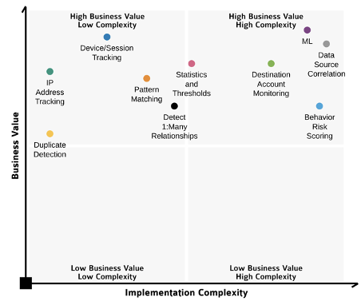
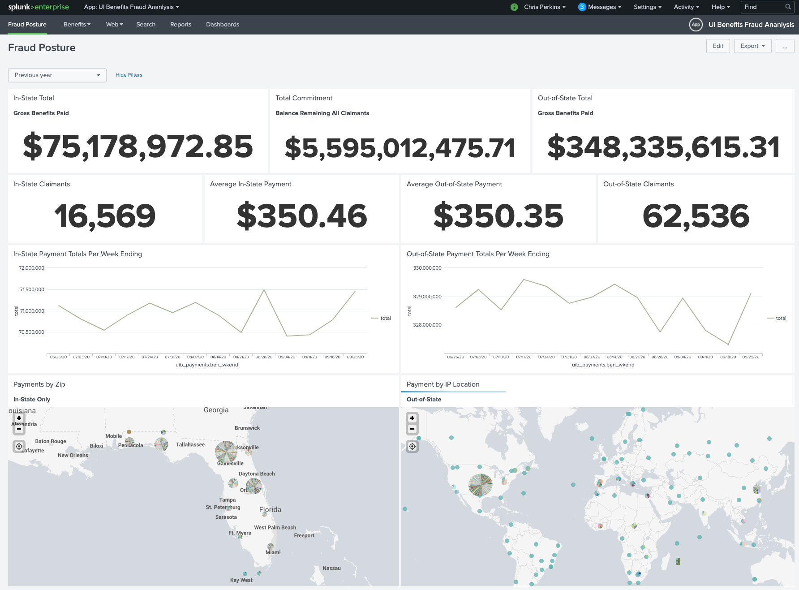
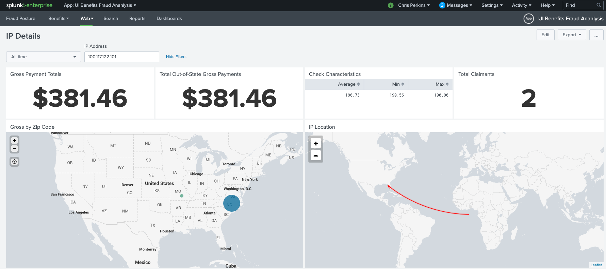
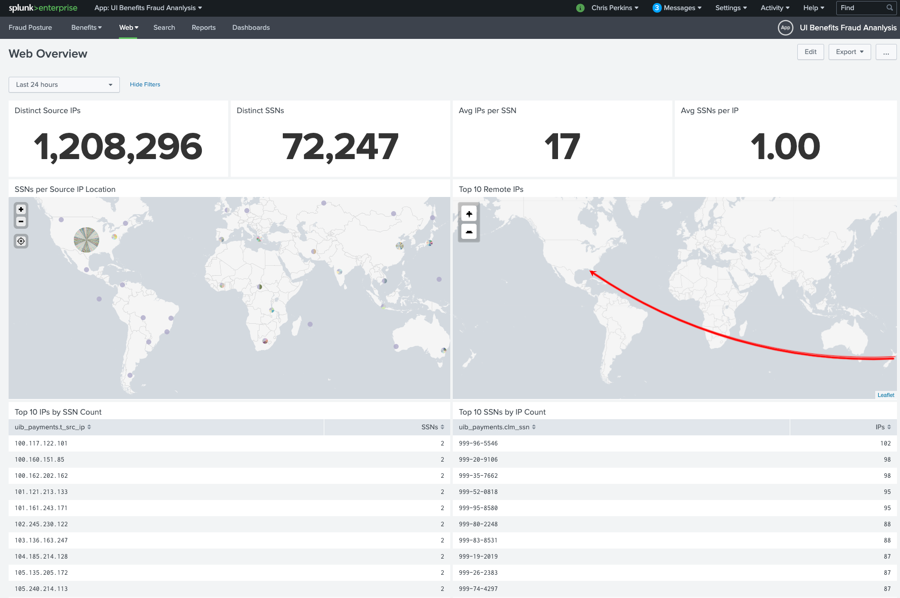
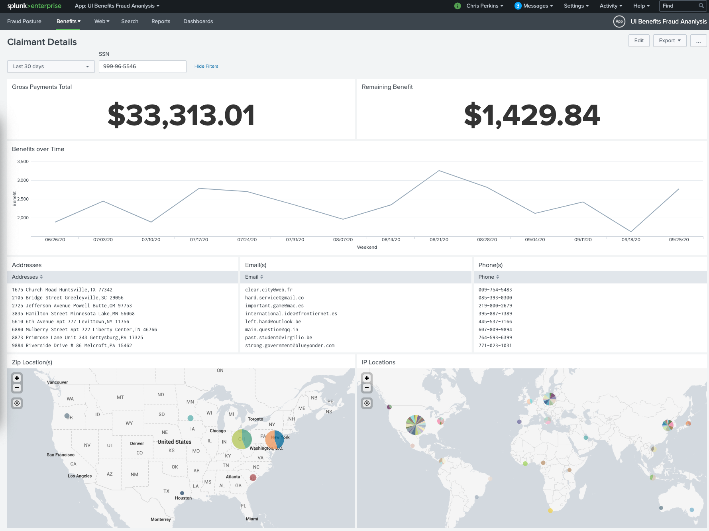
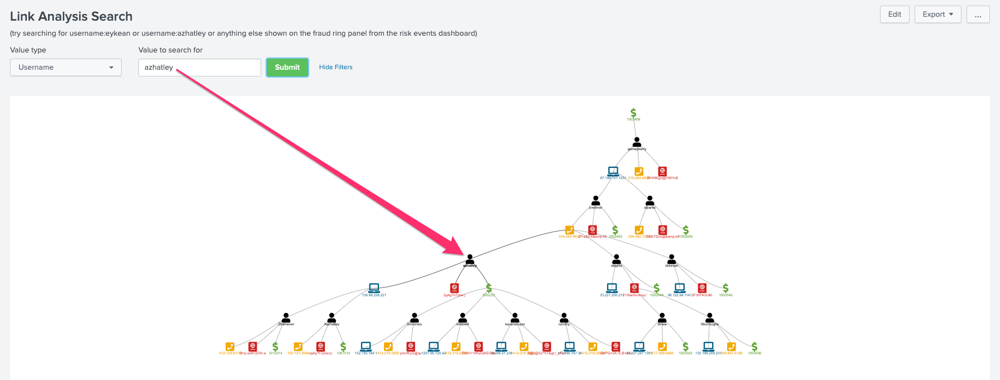

Pandemic Unemployment Assistance Fraud: Zero Trust (Part 2)
Originally posted on LinkedIn on January 4th, 2021

The internal team of [**Splunk**](https://www*.*splunk.com)ers had multiple “jam sessions” on UIB fraud very early in the pandemic. During our jam sessions, we go around the room and raise any news items, ideas, approaches learned from a state, and we combined our experience in fraud, cybersecurity, operations, and systems management to develop this framework and/or methodology to combat UIB fraud. We asked ourselves — as a group — what are the top 10 things states can do to improve overall fraud detection and prevention? Once we had our list, we set out to plot these strategies on a quadrant to show which strategies to focus on — depending on the current situation of the UIB program.

- **IP address tracking** — geolocate IPs and check them against known bad actor lists. Correlate IPs across multiple claims.
- **Duplicate detection —** simply determine if there are any duplicate claims or data points within a claim.
- **Device and session tracking —** bot detection, multiple device usage, connection type (cellular vs. satellite), traffic volume, ASN number correlation, and VPN / TOR access identification.
- **Pattern matching** — ability to discover a string of characters pre-pending email addresses, for example.
- **Detect 1:many relationships** — or commonly referred to as cross-matching is the ability to see if multiple claims have the same physical address. Standing alone, the data point might generate a lot of false positives, but for any result of data inquiry, we can adjust the **risk** level of the claim.
- **Statistics and thresholds —** require good data and is usually the first advanced search that states adopt. Leveraging the Splunk Machine Learning Toolkit (MLTK), states can cluster claim data and detect outliers. This can help determine relative levels of risk and provides an ability to detect unusual relationships or suspicious actors or behavior.
- **Destination account monitoring** — account takeover monitoring and destination bank account monitoring
- **Machine Learning —** peer group detection, anomalies, predictions, and bot detection.
- **Data source correlation** — DBs, threat intel feeds, historical summaries, and third-party data.
- **Behavior risk scoring** — each of the previous capabilities rolls up to risk modeling. Each measurement along the claim pipeline modifieds the risk for each claim appropriately. If a new claim comes in and matches many indicators of a known-good claim, the risk is lower even if there’s suspicion around the claim (for example, if a claimant is claiming to be self-employed).

We then started building the Splunk app for UIB Fraud Analysis!

Each of these capabilities is a journey and the destination is risk evaluation, scoring and modeling for claims as they come in. The goal is to funnel risky claims through the process and only sent to a human investigator when there is moderate risk that the claim is fraud. The claim goes through gate after gate and finally gets approved or denied. Let the data speak for itself! Furthermore, data on known-good claims is highly valuable when mined.

It’s easier written and said than it is to get it done. In my experience, the real-world is always more complex than a blogger chipping away at the keyboard with ‘what to do’. To be successful, states must have stakeholder buy-in as well as executive leadership support from the very top. The systems in most states have been there for a long time and developing a new system is not really an option. In my experience, it’s about finding steps within the existing process that can be optimized in some way. Here are a few examples of how Splunk can be used to optimize certain steps in the claim pipeline.

- Automated reporting
- Automated data enrichment
- Service visibility reduces mean time to identification (MTTI) and mean time to resolution (MTTR)
- Centralized access to data allows investigators to get answers faster.

## Investigate

There are many places in the UIB claim pipeline that a data investigation is useful. Depending on the place in the pipeline, the investigation might be performed by a machine and at other times, the investigation will be performed by a human investigator. By the time claims get to the human investigator, the list of claims should be short. Unless you have dozens of investigators ready to take on each one. A key KPI to monitor is the claim to investigator ratio. Both, the quantity and the approval/deny decision for each claim.

Let’s break down the claims pipeline and start at the very beginning. The first place for investigation is with your web server data. Understanding where people are connecting from (by IP address) is helpful and is a key field used in many searches. Yes, this is often spoofed by sophisticated actors, but the IP address is a fundamental KPI.

The next place an investigation takes place is when a claimant attempts to establish an identity within the UIB claims platform (NIST defines this as identity proofing). The identity is the claimant’s account which they will use to complete the claims filing process and subsequent weekly certifications as required by the state. The state’s Department of Labor (DOL) may run an agency-specific identity for claimants, or they may leverage a shared identity system run by the state’s Office of Information Technology. A third option is for the state to outsource the identity aspect of the claims process to a third-party. California and Arizona are two examples of leveraging [ID.me](https://www.id.me/) to manage ID verification and management of all accounts. The investigation comes in when it comes to identity verification. This is a tough task for states — especially considering the relatively low requirements for Pandemic Unemployment Assistance, lack of resources/information, and archaic systems. Stolen identities have worked well for fraudsters.

> Data access and analytics are key to performing a thorough investigation of the claim along the entire claims pipeline.

Before moving on to the Monitor phase, the other type of identity that needs verification is the identity — or device profile (sometimes referred to as a fingerprint) — of the accessing device. The Web browser is a great place to glean information about the connecting device. Correlating this with network data is high fidelity because even manually set configurations will stand out in an ML-powered search. Each endpoint can provide at least twenty different markers to use to build an endpoint fingerprint. The known good fingerprints help those claimants who are consistent while the claimants with constantly changing fingerprints will be subject to more scrutiny when it comes to risk modeling.

Finally, the claim itself is an investigation. With data on the endpoint and claimant, the metrics can help determine the level of scrutiny on the claim itself. For instance, the high confidence level of the claimant’s identity can be weighed when it comes to evaluating the claim itself. Many techniques are used in this investigation as well as many data sources. Cross-matching is helpful in identifying multiple claims tied to the same physical address, for instance. The list of data sources for this investigation could go on and on but in reality, the data available to states is limited (by law, custom, technical reasons, etc.). California’s EDD was not able to read the Department of Correction data because the DOL is not a law enforcement agency. The recent California Consumer Privacy Act (CCPA) prohibits the Department of Corrections from sharing information (i.e., the incarcerated person’s SSN) with non-law enforcement entities.

- Review all past data. There are many insights available in past data.
- Cross-match and review all activity of any given claim under investigation.
- Determine lulls or spikes in claims or suspected fraud.
- Review all weekly certification data and identify patterns, deviations, or abnormal consistency.

Confirmed fraud by count, amount paid out, or ratio can also be valuable to states as these are effective ways to spot trends. There are also metrics that can be reported on for the types of fraud confirmed; third party, account takeover, friendly, or channel (phone vs. online vs. mail/fax/wire).

## Monitor

Noticing behavior changes is simply looking at the same fields of information and comparing them over time. Each time a claimant connects to the UIB system, their endpoint interacts and provides the Web server with lots of information about how the site is presented on the endpoint. The collection and comparison of this information is key to detecting behavior changes from a machine perspective.

On the human side of monitoring, states can detect when a claimant logs in from a new location (new/different IP address), changes their password, and changes the banking info. There are also many granular measurements states can take, such as, how quickly was a form filled out and the page submitted, or how often a claimant changes their endpoint. If the claimant is changing the location and endpoint fingerprint every week, the risk for this claim is higher.

- All endpoint data should be collected to build an endpoint fingerprint. Look for anomalies.
- All user activity within the claims portal. Check for changes to physical address, phone number, and banking info.
- All call center activity. Monitor inbound calls to the IVR or live agents.
- Website support chat activity. Monitor all interactions with claimants and potential fraudsters via the online chat / live agent.

## Analyze

UIB data analysis is a journey. As is the claim in a pipeline. Along the way, the claim passes through many points of inspection. As the claim gets further into the system, the chance the claim needs to be reviewed by a human investigator increases. Human investigation can be costly and time consuming and is not preferred over machine investigations.

Here is one quick example of an investigative dashboard within the Splunk app for UIB Fraud Analysis that enables investigators to punch in a name, SSN, or some other identifying information to find claims linked together. In the example below, we search for “azhatley”.

Core analytic activities in the pipeline are geared towards rooting out suspicious patterns of behavior, entity relationships, and other means to better understand where money actually goes compared to where it should go.

## Act

Splunk provides an ability to gather data from any source, in any structure, and on any timescale. When claims have been identified, action can be taken. When a claim changes from suspicious fraud to confirmed fraud, action can be taken.

- Deny the claim
- Send the claim to human investigators or other secondary verification
- Stop payment

Actions in the ID verification process can be automated as well as actions during the claims verification process. This gives valuable time back to the humans to do more complex analysis. Think about the most time-consuming tasks your investigators do and let’s brainstorm on how to use Splunk Phantom to automate that task!

## In Summary

The onslaught will not stop any time soon. States must act now to prevent hemorrhaging when the second or third stimulus packages come. Splunk and many other organizations are behind the anti-fraud effort and are heavily engaged. There is a lot of partnership, discussion, intelligence, and efforts that I just simply cannot talk about in this post, but one thing can share in closing is that multiple organizations are working hard to provide states with much-needed resources, support, and technology to combat the volume of fraudulent claims coming in.

Splunk’s UIB anti-fraud framework is achievable with Splunk “core” and does not require any paid-for Apps. Splunk can be implemented on-premise or in the cloud. The time-to-value with Splunk is 4–6 weeks from when we map out the claim pipeline.

## Thank You

Very special thanks to Nayomi V., Andrew M., James B., Blake H., Adnan H., and Joe B. for reviewing and providing feedback and input.

Thank you for reading!

Stay safe out there.

Please note: the views and opinions expressed in this post are those of the author (Chris Perkins) and do not necessarily reflect the official policy or position of my employer, or any other agency, organization, or company. Assumptions made in this post are not reflective of the position of any entity other than the author — and, since we are critically-thinking human beings, these views are always subject to change, revision, and rethinking at any time.

*Originally published at* [*https://www.linkedin.com*](https://www.linkedin.com/pulse/pandemic-unemployment-assistance-fraud-zero-trust-part-chris-perkins-1c/).
