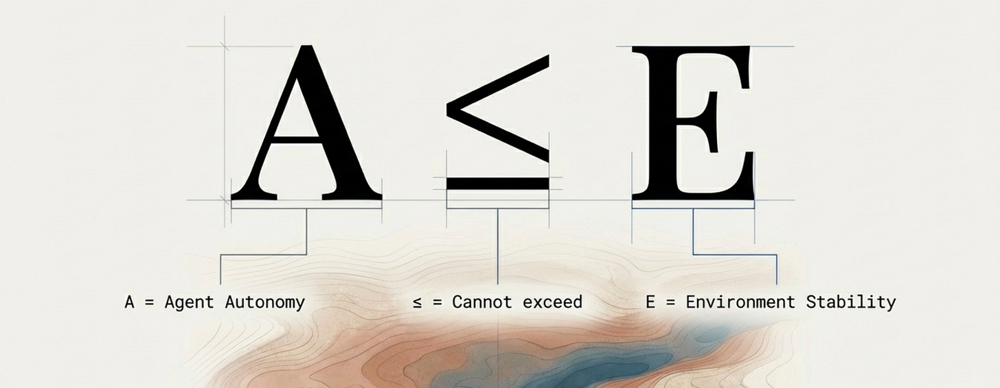

Yes, But...

Thinking about the future. Let’s say 2028.

I thought (and I still do, literally writing this) a lot about that year in 2025. I thought about the trajectory of technology and applied exponential thinking to the trajectory to arrive at some key observations. I wrote about how I learned to think exponentially in my manuscript, Break the Chain. I also wrote about the culture, process, and people problems. Cognitive bias. Organizational inertia. The ways we build systems that reflect our limitations rather than transcend them.

Digital Physics doesn’t set those other things aside. Not like the Internet of today. Digital Physics is built on the actual terrain. Its substrate is the actual dirt. The river, banks, eddy, whirlpools.

I eventually arrived at a thought that changed the way I see the world. Kind of an inversion. I’d been thinking about the clay and not the empty space. The pot, not what the pot holds. When I first named it, I was tracing my path through a Metallica concert I had just seen. I wrote about the **[Experience Equation.](https://medium.com/@chrisperkins505/the-experience-equation-74953a64c03f)** The insight arrived somewhere between the memory of that crowd and the math underneath it. The Kinetic Trust Protocol was named.

Is it an ontology, a cosmology, a tech spec? That will be for the history books to decide. But for now, it’s a blueprint for how we defend this country in 2028.

Over the months, I’ve had to grapple with the magnitude of this. A couple of times I’ve had to unplug, disconnect, and ground. You can’t carry something this size without it changing your weight.

And like any blueprint that matters, it draws fire.

------------------------------------------------------------------------

> Big ideas attract pushback. That’s how you know they’re real enough to threaten something. Here’s what I’m hearing, and what I think it actually reveals.

------------------------------------------------------------------------

## **“It’s too big.”**

The scope is enormous. It touches everything. How could anyone possibly implement this?

But the physics isn’t big. A ≤ E is four characters. Autonomy cannot exceed Environment. What’s big is the implication that our current architecture doesn’t honor it.

You don’t implement physics. You honor it. And you don’t have to honor it everywhere at once. **[One zone](https://nmcitra.github.io/ktp-rfc/specifications/blue-zones/#the-problem-blue-zones-solve)**. One island of physics in the Wild. Prove it holds. Federate when others appear.

The ocean doesn’t have to change for the first island to exist.

------------------------------------------------------------------------

## **“It’s too expensive.”**

Proofs that expire in seconds? Continuous verification? That’s computationally brutal.

Yes. Deep Blue Zones are expensive. Because nuclear facilities are expensive. Because hospitals are expensive. Because the things worth protecting are worth protecting continuously.

The zone gradient exists for this reason. Deep Blue is sub-second. Cyan is lighter. Green is lighter still. You don’t put your internal wiki in Deep Blue.

The real question: expensive compared to what? You can pay continuously for verification. Or you can pay catastrophically for breaches. One compounds in your favor. The other doesn’t.

------------------------------------------------------------------------

## **“It’s too broad.”**

Authentication is one team. Authorization is another. Threat detection is a third. Separate problems, separate budgets, separate vendors.

But are they? Authentication without trajectory is identity without context. Authorization without continuous verification is policy without physics. Threat detection without trust scoring is pattern matching without meaning.

The breadth reflects reality. These aren’t separate problems. They’re the same problem seen from different angles. Narrowing to one just preserves the gaps between them.

And the solution is equally unified. The Environmental Veto. One question, asked continuously, across every domain: does A exceed E? Does the requested action exceed the trust the environment currently extends? If yes, the environment itself says no. Not a policy. Not a rule someone wrote. The physics holding.

That single constraint spans authentication, authorization, detection, and response. Not because we’re forcing unification. Because they were never actually separate.

Which gap would you like to preserve?

------------------------------------------------------------------------

## **“This is just zero trust rebranded.”**

Zero trust says never trust, always verify. Digital Physics says here’s what verification actually means.

Zero trust is a policy stance. It tells you to be suspicious. It doesn’t tell you what suspicion looks like computationally, how to measure it, or what to do when context changes mid-session.

And zero trust still assumes the agent has your stack installed. Your policies. Your hooks.

What constrains the agent that doesn’t cooperate with being governed? What hooks the adversary?

------------------------------------------------------------------------

## **“Who controls the Oracles?”**

If Trust Oracles calculate and sign every proof, aren’t we just creating a new chokepoint?

Federation. Threshold signing. No single Oracle issues proofs alone. Geographic distribution. No single point of compromise.

The physics holds regardless of who runs the infrastructure. That’s what makes it physics and not policy.

------------------------------------------------------------------------

## **“Adversaries will game it.”**

Of course they will.

But the goal isn’t to make gaming impossible. It’s to make gaming expensive enough that trustworthiness becomes the cheaper strategy. When faking trust requires sustained, consistent, observable behavior over time, you’ve either built a trustworthy agent or you’ve spent so much on deception that betrayal loses its efficiency advantage.

We’re not claiming perfection. We’re claiming better economics.

------------------------------------------------------------------------

## **“We already have SIEM, UEBA, zero trust...”**

Why not just improve what exists?

Because what exists is configured constraint. Rules someone wrote. Patterns someone anticipated. Hooks that fire when conditions match.

Configured constraint governs agents that cooperate with being governed. It holds until context changes, until the novel scenario arrives, until the adversary brings an agent that doesn’t have your stack installed.

What governs the agents that don’t cooperate? What constrains the attack no one anticipated?

Not better configuration. Physics that doesn’t require someone to have thought of it first.

------------------------------------------------------------------------

Here’s the pattern underneath all of these objections.

Nobody’s arguing that continuous constraint wouldn’t be better. Nobody’s saying gaps between verification are fine. Nobody’s claiming we should only govern cooperative agents.

They’re negotiating implementation while implicitly conceding the physics.

That’s the conversation I want to have.

The physics is four characters. A ≤ E.

What’s big is the implication that our current architecture doesn’t honor it.

But big isn’t impossible.

Big just means it matters.

