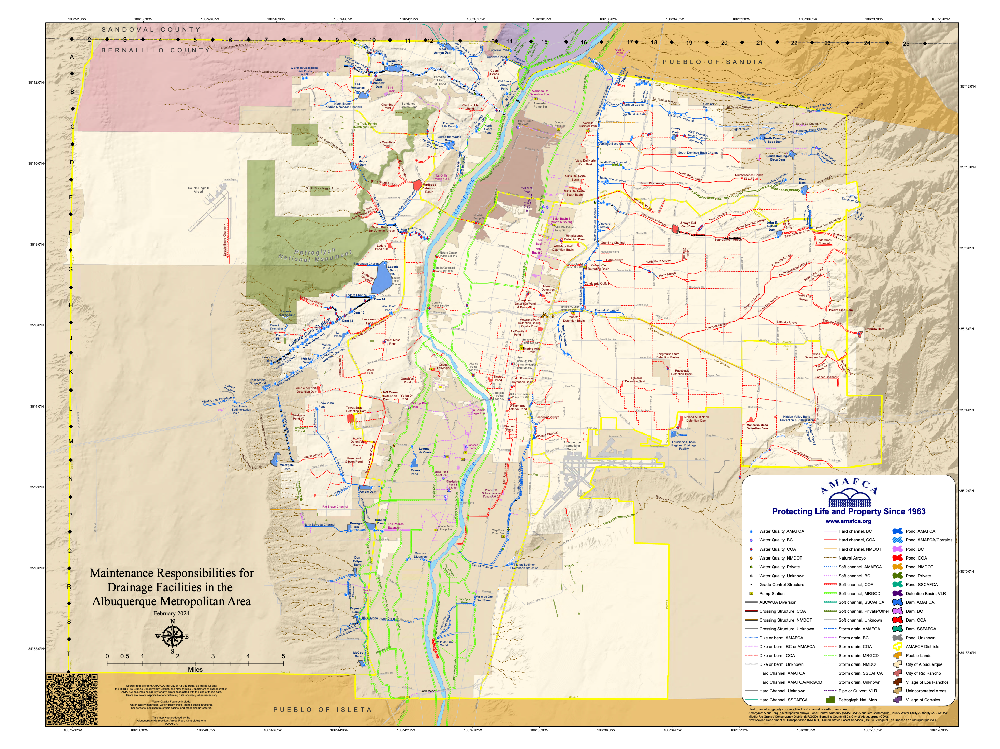

The Speed of Inference and the Depth of Trust
On aquifers, adversaries, token factories, and the missing floor beneath the AI stack

March in the Rio Grande Valley and the dirt is already cooking in the New Mexico sun. The winter was dry. Not dramatically dry, not the kind that makes the news. Just another year of less snowmelt coming off the Sandias, less of the spring pulse reaching the acequias, less recharge reaching the aquifer underneath the city. The highs are running ten degrees above where they should be for this week. The air smells like dust and warm asphalt. The cottonwoods along the bosque haven’t leafed yet but the heat is already here, arriving ahead of the water, the way it does now, more often, earlier each year.

I’m going to tell this from the bottom.

Not from the keynote stage in San Jose. Not from the investor’s chair. Not from the five layers of the AI stack that Jensen Huang described at GTC on Sunday. From underneath all of it. From the place the water goes when it disappears into the sand.

I’ve spent twenty-three years watching what happens down here. Fraud detection. Network defense. Trust architectures. Watching what happens when systems that look stable on the surface are quietly depleting underneath. I know what an aquifer sounds like when it’s dropping.

It sounds like everything is fine.

## The Inflection

“The inference inflection has arrived.”

Jensen said this in the second hour. This statement organized the entire keynote.

AI has shifted from learning to working. From training to running. The data center used to store files. Now it produces tokens. **The metric that matters is tokens per watt.** How much intelligence can you generate from a given amount of electricity.

Computing demand has increased one million times in two years. That number isn’t rhetorical. It’s a 10,000x increase in compute per task multiplied by a 100x increase in usage. Token generation speed in a one-gigawatt factory went from 2 million to 700 million in two years. He projects $1 trillion in orders through 2027.

“AI has to read, it has to inference. It has to reason, it has to inference. It has to plan, it has to inference.”

Everything above the aquifer is getting faster.

The aquifer is not getting faster. It’s getting drained.

Every token is a decision. Not a human decision. A machine decision about what comes next, computed against probability, weighted by context, executed in milliseconds. Billions of them. Every second. Across every layer of the stack.

These decisions flow through channels. The trust substrate, the architecture that determines whether billions of machine decisions cohere into something reliable or cascade into something catastrophic, was built for a different flow rate. It was built when humans made the decisions. When a SOC analyst triaged 200 alerts a day and a governance committee met monthly and a CISO reviewed vendor access on a quarterly cycle.

The channels were sized for that water.

The inference inflection didn’t widen the channels. It multiplied the water.

## The Ground Truth

Jensen’s most important line was about data.

“Structured data is the foundation of trustworthy AI.”

He’s right. Structured data is the map. SQL databases. Configuration management. Network topology. Asset inventories. Authentication logs. The known grid. The documented relationships. The measured state. Enterprises have been building this map for decades. I’ve spent years building the instrument that reads it — a Trust Score that tells an agent not where it is, but where it can go.

And he’s right that generative AI will fuse with it, filling gaps between measurements. Inferring the unobserved from the observed. Completing the picture.

The map is getting more complete while the territory is getting less stable.

Structured data tells you what’s documented. The generative layer infers what isn’t. Together they produce a beautiful picture of the enterprise. Every asset. Every relationship. Every predicted behavior.

Underneath that picture, the trust substrate is dropping. The slow, frictional, human-scale processes that used to maintain coherence are being paved over for speed. Reputation accumulated over years. Institutional knowledge passed between people. The organizational equivalent of water soaking into sand. Gone.

The map gets better. The territory gets worse. The aquifer drops.

The map is what you measure. The territory is what’s real. The arroyo is the substrate that determines whether the territory can sustain life.

A map without territory is hallucination. Territory without an arroyo is concrete. An arroyo without a map is invisible.

You need all three. Jensen is building the most detailed map in human history. Nobody is building the arroyo.

And here’s the part Jensen didn’t say: the fusion works for both sides.

If generative AI can fuse with structured data to complete the picture for the defender, it can complete the picture for the attacker. The same capability that lets an enterprise infer the unobserved from the observed lets an adversary infer the unobserved from the observed. The weapon doesn’t know which side it’s on.

An adversary with access to your structured data, your network topology, configuration management, authentication logs, asset inventory, can feed it into a generative model and produce a synthetic replica of your environment. Not a copy. A simulation. A model that predicts how your systems behave, what your baselines look like, what your anomaly detectors expect to see. That simulation becomes a rehearsal space. The adversary runs attacks against the synthetic environment. Tests which approaches trigger alerts. Refines the ones that don’t. Iterates at machine speed against a model of your defenses built from your own data fused with generative inference.

Your map becomes their map. Your ground truth becomes their training data.

This isn’t hypothetical. The federal government has confirmed that state-sponsored actors, Volt Typhoon among them, have spent years pre-positioned inside American critical infrastructure. Water systems. Energy grids. Telecommunications. Living off the land. Legitimate credentials. No malware. Mapping the network from inside. Not attacking. Gathering.

Jensen said it plainly on the All-In podcast the same week: “Our national security is diminished when we don’t control our telecommunications networks.” What he didn’t say is what those actors do with the map once they feed it into a generative model. They rehearse. The way tactical teams train in replicas of the buildings they’re about to enter. The structured data is already collected.

The simulation is a matter of compute.

In a policy-based architecture, this is catastrophic. The adversary simulates the environment, learns what the policies expect, and operates within the boundaries. The dashboard stays green. The credentials are valid. The behavior looks normal because the adversary rehearsed against a model of what normal looks like. It sounds like everything is fine. NemoClaw never fires because NemoClaw was built to catch anomalies, and the adversary already knows what your normal is.

In a physics-based architecture, the simulation breaks. The Trust Score isn’t computed from structured data alone. It’s computed from the live, real-time state of the environment — the actual load on the network at this millisecond, the actual adversarial pressure, the actual temporal criticality. The adversary can simulate the structured data. They cannot simulate the environment at the moment of action. They can rehearse the plan. They cannot rehearse the weather. The physics-based architecture doesn’t make simulation impossible. It makes simulation insufficient.

> The gap between the model and the moment is the security margin.

You can copy a map. You cannot copy the mountain.

## The Arroyo

I need to make this concrete.

In Albuquerque, where I grew up, where my grandfather chose to raise his children above this aquifer, the arroyos ran from the Sandia Mountains to the Rio Grande. Natural channels carved by centuries of monsoon water. When the rain hit, the arroyo caught it. Spread it. Slowed it. Let it soak into the sand and recharge the aquifer underneath the city.

In the 1960s, the city poured concrete into the arroyos for flood control. Move the water fast, get it out, and prevent damage. The logic was sound. People were dying in flash floods.

Nobody asked what the arroyos were doing before we called them a problem.

They were recharging the aquifer. For free.

The aquifer dropped 160 feet. The breaking point wasn’t dramatic. It was arithmetic — extraction exceeded recharge, and the rest was math. The city spent $400 million on a pipeline to import water from Colorado to replace what the arroyos had been delivering all along. I wrote about this in detail in “Ditches Are Deadly.”

The AI stack is the concrete channel. Designed to move tokens as fast as possible from computation to output. Optimized for throughput. Measured in tokens per watt.

The trust substrate is the aquifer. It’s what makes the tokens mean something. What makes the outputs reliable. What makes the decisions cohere. And it’s being drained by the same velocity that’s making the stack profitable.

Every token generated at inference speed is a drop of water moving through a concrete channel. Fast. Efficient. Recharging nothing. And the inference inflection didn’t just increase the flow. It flooded every channel at once.

> **The Arroyo Paradox:** when a system that was already solving the problem gets reclassified as the problem itself. The arroyos were infrastructure. The city called them flood hazards. The slow, frictional physics of trust was maintaining coherence. The industry called it latency and engineered it away.

## Physics at the Speed of Water

You can’t govern a river by holding committee meetings about each drop of water.

You govern a river by building the right channel. The arroyo governs the flood by shaping the landscape the water moves through. The physics of the channel determines the behavior of the water. Automatically. At the speed of the water. No committee required.

Jensen described the security challenge directly: “Agentic systems in the corporate network can have access to sensitive information, it can execute code, and it can communicate externally. Obviously, this can’t possibly be allowed.”

Obviously. And his solution is NemoClaw. Network guardrails. Privacy routers. Policy engines. I wrote about this exact failure mode last November — an AI agent with valid credentials deploying into a stadium network at 94% capacity, dashboard green, environment buckling in two seconds. The guardrail never fired. The physics was never there.

Policy at the speed of inference is still policy. A sufficiently smart agent will always find the edge case, the reframe, the context where the guardrail technically doesn’t apply. That’s what language is for. We use language to change minds, write laws, shift frames, find loopholes.

You cannot argue your way past friction. You cannot jailbreak a voltage drop. You cannot prompt-engineer your way around latency that the substrate imposes.

The sixth layer isn’t governance. It’s physics. Friction proportional to the gap between an agent’s entropy and the environment’s stability. Latency that increases as actions deviate from established behavioral trajectories. Computational cost that scales with impact — double the deviation from established trajectory, quadruple the resistance. Constraints that the substrate enforces whether the agent cooperates or not.

The speed of inference demands the speed of physics. Nothing else is fast enough.

## The Compounding and the Missing Variable

“These agentic systems are spawning off different agents working as a team. The number of tokens being generated has really, really gone exponential.”

Agents spawning agents. Tokens generating tokens. The water creating more water. Each inference generates context that feeds the next inference. Each agent’s output becomes another agent’s input. The flow rate compounds.

The structured data, the ground truth Jensen called the foundation, is being consumed by the generative layer faster than it can be maintained. Documentation that took a team six months to build is parsed by an agent in seconds. Configuration baselines updated quarterly are stale before the next inference cycle begins. Behavioral trajectories that took employees years to establish can be simulated by an adversary’s model in milliseconds.

Jensen announced that every engineer at Nvidia will receive an annual token budget alongside their salary. “I’m gonna give them probably half of that on top of it as tokens so that they could be amplified 10x.”

Pay the engineers in tokens. Pay the token factory in electricity. Pay the electricity bill in revenue from tokens. It’s a beautiful loop if you never look down.

When the extraction is a line item in the paycheck, who writes the recharge into the budget?

I’m not arguing against the inflection. Jensen’s read on the economics is precise. The demand is real. The infrastructure buildout is justified by the math. I’m saying the math is missing a variable.

Every system runs on tradeoffs. Speed for resilience. Reach for depth. Autonomy for stability. The tradeoffs only work when both sides are visible, when you can see what you’re gaining and what it costs. A tradeoff you can’t see isn’t a tradeoff. It’s a debt.

Tokens per watt measures production efficiency. It doesn’t measure substrate depletion. Jensen showed a two-dimensional chart at GTC. Token throughput on one axis. Inference speed on the other. He showed how Nvidia’s co-design shifts the entire curve upward, generating 5x more revenue with the same power.

The chart needs a third dimension. Depth. How deep is the aquifer? How fast is it recharging? How long can the factory pump before the well runs dry?

The missing variable is recharge rate. How fast can the trust substrate be maintained relative to the rate at which it’s consumed by inference? The ground truth. The structured data. The institutional knowledge. The behavioral trajectories that make the tokens meaningful. How fast can those be replenished while the factory runs? The ratio between extraction and recharge is computable. At current inference rates, it isn’t close.

Nobody is measuring this. Nobody at GTC mentioned it. The $1 trillion in orders is for extraction infrastructure.

Pumps, not aquifers.

From the Sandias you can see the whole basin. The concrete channels running straight to the river. The bosque browning at the edges. The aquifer invisible beneath all of it, dropping.

Without the third dimension, without recharge rate on the ledger, you’re not funding an AI renaissance. You’re funding a high-speed hallucination.

If the trust substrate is real, then inference systems operating without environmental measurement will show characteristic signatures within eighteen to twenty-four months of deployment at scale: not crashes, but coherence decay. Outputs that look correct individually but contradict each other collectively. The aquifer dropping while the dashboard stays green.

Jensen closed by calling this “a rebirth, a renaissance of enterprise IT.” The original Renaissance was fueled by rediscovering what was already here. Greek philosophy. Roman engineering. Mathematics from the Islamic world. Knowledge that had been preserved through centuries by monks copying manuscripts, by acequias running water, by the substrate holding the signal through the dark. The printing press didn’t create the knowledge. It distributed it. The knowledge was only as trustworthy as the people who maintained it before Gutenberg.

Who are the monks of the AI renaissance? Seriously. Who is copying the manuscripts? Who is walking the ditch? Because right now the answer is: nobody. We automated the monks and named the automation NemoClaw.

Jensen described five layers. Energy. Chips. Cloud. Models. Applications. He’s right about all of them. He already knows what physics means in software. At GTC he described Omniverse, the simulation computer that evaluates robots and autonomous vehicles: “It has to be software that obeys the laws of physics.” He built physics into the simulation layer. The trust layer is still running on policy.

He’s also right about the flywheel.

“It is this flywheel effect that allows this computing platform to support so many applications, deliver so many new breakthroughs, and most importantly, it gives this infrastructure an extremely long lifespan.”

CUDA works because someone tended that channel for twenty years. Maintained it. Updated it. Showed up every season and kept the water flowing. That engineer doesn’t get a keynote. The flywheel is the recharge. That’s why six-year-old Ampere chips are increasing in price. Because the substrate was maintained.

The AI stack needs the same commitment to its trust substrate. Twenty years. Not twenty quarters.

Each layer of the stack constrains the one above it. A model can’t exceed what the cloud can host. The cloud can’t exceed what the chips can compute. The chips can’t exceed what the energy can power.

What constrains the energy? What sits beneath the stack?

Nothing. That’s the gap. The stack has no floor.

The sixth layer is Layer 0. The trust environment. The physics beneath the stack. The substrate that determines whether agents operating across all five layers sustain coherent behavior or merely simulate it.

An agent’s autonomy cannot exceed the environment’s stability. That principle applies to every layer. It applies to the stack itself. It’s the one thing that nobody at GTC, nobody in the AI safety field, nobody in the $700 billion infrastructure buildout is engineering for. I’ve spent years building the technical specification for it. It’s called the Kinetic Trust Protocol. The architecture exists. The sixth layer is not a metaphor.

## What Makes a Token Worth Something

If the sixth layer is the floor the stack doesn’t have, the token is the currency the floor would back. Jensen called tokens the new commodity. He’s completing a trajectory that started before AI.

In 2009, Bitcoin proved that computational work could produce a scarce digital artifact. Proof of work. The token carried the weight of the electricity that created it. Tokens per watt. Jensen’s metric for the AI factory was already Bitcoin’s metric, more than a decade earlier.

In 2022, Ethereum shifted to proof of stake. The insight: you don’t need to burn energy to prove legitimacy. You need to put something at risk. Stake your holdings. Validate honestly and earn. Deviate and lose. Skin in the game. Trust accumulated through demonstrated behavior, with consequences for deviation.

Now Jensen describes proof of inference. The AI factory produces tokens. The tokens represent computational work — reasoning, planning, acting. Token pricing segments into tiers from free to $150 per million. The economics are structured around how much intelligence you can produce per watt.

Three phases. Energy. Stake. Intelligence. Each produces tokens. Each asks the same question: what makes the token worth something?

**Bitcoin’s answer:** the energy spent to produce it. Real, physical, grounded in watts. Also wasteful. The water runs through the concrete channel. Expensive. Recharging nothing.

**Ethereum’s answer:** the capital risked to validate it. Closer. Behavior matters. But stake is still a credential — how much you hold, not how you move. A wealthy bad actor looks identical to a wealthy good actor if they both hold enough ETH.

**Jensen’s answer, implied but unstated:** the structured data that grounds the inference. The token is trustworthy because the ground truth is reliable. But as the generative layer consumes the ground truth faster than it can be maintained, what grounds the token? The answer dissolves at the speed of inference.

The trajectory points somewhere none of them have gone.

What if the token’s value came from the behavioral trajectory of the entity that produced it? Not proof of work. Not proof of stake. Not proof of inference against ground truth that’s depleting. Proof of trajectory. The token carries the weight of the environment’s confidence in the agent’s behavioral consistency over time. Trust that decays without activity. Cost that scales with deviation. Identity measured as a line through time, not a dot at the moment of verification.

And beneath trajectory, something even more fundamental. Proof of presence. The agent was here. In this environment. At this stability level. Under these conditions. The token doesn’t just say “this computation happened.” It says “this computation happened inside a measured environment, and the environment was stable enough to support it.” The token carries the physics of the place it was produced.

A token without proof of presence is a credential. It tells you something happened. It doesn’t tell you whether the environment could sustain what happened. It’s a passport without a country. A signature without ground beneath the signer’s feet. And in a world where an adversary can simulate your entire environment from your own structured data, the credential is the one thing they can forge. The environment is the one thing they can’t.

There’s a project called [Noma](https://noma.community) that takes this literally — identity built entirely from proximity, trust that accumulates through presence and decays without it. No account. No password. Proof of presence as a product.

Jensen’s token factory produces 700 million tokens per second. The question that will define the next economy is not how many tokens you can produce. It’s how many of them carry the weight of the substrate they were produced in. How many are grounded. How many are hallucinations moving at the speed of light through a concrete channel, carrying nothing, depositing nothing, recharging nothing.

## Who Builds the Arroyo

The token economy needs an aquifer. That raises the question nobody at GTC asked: who pays for the sixth layer?

Most cities can’t. Most school districts can’t. Most state agencies can’t. Their budgets are shrinking. Their IT staff is three people. The superintendent is choosing between cybersecurity and a school bus. The bus should win. The bus has always won. Nobody ever got voted out of office for buying a school bus.

The sixth layer will not be purchased by a school district. It will not be a line item in a city’s IT budget. It will not arrive through a procurement cycle.

It will arrive the way electricity arrived in rural America.

Rural towns didn’t build power plants. They couldn’t afford to. The Rural Electrification Administration subsidized the infrastructure. The utility companies delivered it. The physics was in the wire. The town flipped the switch. The town didn’t need to understand the grid. The grid reached the town because the wire reached the pole and the pole reached the house.

The sixth layer reaches cities and schools the same way. Through the platforms they already depend on. The physics gets embedded in the platform, the same way electrical standards get embedded in the wiring. The school district doesn’t buy the gravity. The gravity comes with the service.

We’re watching this pattern repeat right now with broadband. Rural America spent decades without reliable Internet the same way it spent decades without reliable electricity. The Broadband Equity, Access, and Deployment program allocated $42.5 billion to close the gap. The money flows to states. States fund infrastructure. The infrastructure reaches the house. Same model. Same logic. The wire reaches the pole reaches the house.

But broadband without the sixth layer is a concrete channel. Fast. Connected. Carrying nothing that recharges the substrate.

The vendors build it because federal mandates require it. This is how Zero Trust reached government. Not because state CISOs chose to adopt it. Because OMB mandated it and CISA funded it. The sixth layer follows the same path. A federal requirement that AI systems operating in government environments must demonstrate environmental stability measurement. The mandate creates the requirement. The requirement enters the contract. The contract reaches the vendor. The vendor builds the physics into the platform. The school flips the switch.

The money is already there. It’s just being spent on concrete.

Every dollar a state spends on fraud remediation that the physics would have prevented is the budget for the sixth layer. Every $400 million pipeline is the cost of not having the arroyo. The prevention was free. The remediation is the entire budget. Right now, governments spend on remediation because the prevention is invisible. The essays, the framework, the math — these make the prevention visible. Visible prevention becomes fundable prevention.

For the entities too small for even that, the rural district, the tribal nation, the town of 3,000, the physics arrives through community infrastructure. Open tools. Shared services. The digital equivalent of the acequia, maintained by the people who depend on it. Proof of presence doesn’t require a procurement cycle. It requires a phone and a neighbor.

Two channels. The vendor channel moves money. The community channel moves trust. Both carry the same physics. A ≤ E applies whether you’re using VPN or using a phone at a rest stop on I-25.

The school doesn’t pay for gravity. The school lives inside it.

## What Was Already Here

On Pi Day I published an essay called “What Was Already Here” about the fold — the moment a system’s computation models itself. The argument: consciousness persists when the substrate holds. Stop the substrate, stop the experience. The same physics applies to every system we are now calling intelligent.

A system without an environment isn’t autonomous. It’s a minnow behind glass.

The silvery minnow in the Rio Grande was once the most common fish in the river. Three inches long. It lives two years and lays its eggs in the sand during spring runoff — if the water doesn’t reach the sand, the eggs don’t hatch. Federally endangered now. The minnow didn’t decide to die, the physics of the water changed.

There are minnows in the digital substrate too. Journalism. Local knowledge. The ability to distinguish a real person from a synthetic one. The slow accumulation of trust between two people who have watched each other operate over time. These are indicator species. They’re vanishing. Not because anyone targeted them. Because the physics of the environment changed, and nobody was measuring the substrate.

Saving the minnow was never a question of biology. It was a question of who maintains the river.

The speed of inference is accelerating. The depth of trust is not.

That gap is the story of the next decade. Not whether AI gets smarter. Whether the substrate can hold what AI produces. Whether the aquifer recharges faster than the factory pumps. Whether the channels we build are concrete or arroyo. Whether the adversary who can simulate your map can also simulate your ground.

I’m writing this from Albuquerque today, where the arroyos still run under the parking lots, where the acequias still carry water through the valley, where the mayordomos still walk the ditches every spring with shovels.

My grandfather and grandmother decided to raise their children here. Today is Daddad’s birthday. I came back. I’m sitting above the aquifer, writing about what’s underneath.

There’s a word the AI industry uses for agents operating together. They call them swarms. The bees that actually swarm, the ones that make collective decisions without a central authority, they do it through a physics that nobody in AI has replicated. Energy cost per signal. Conviction that decays without re-verification. Independent observation enforced by structure. A queen that waits.

The industry borrowed the word and paved over the physics. Same pattern. Same paradox.

But that’s the next essay.

The inference inflection has arrived. Jensen is right. It sounds like everything is fine.

The question from the substrate is simpler: what are we building the inflection inside of?

The water is already here. So is everything it carries.
