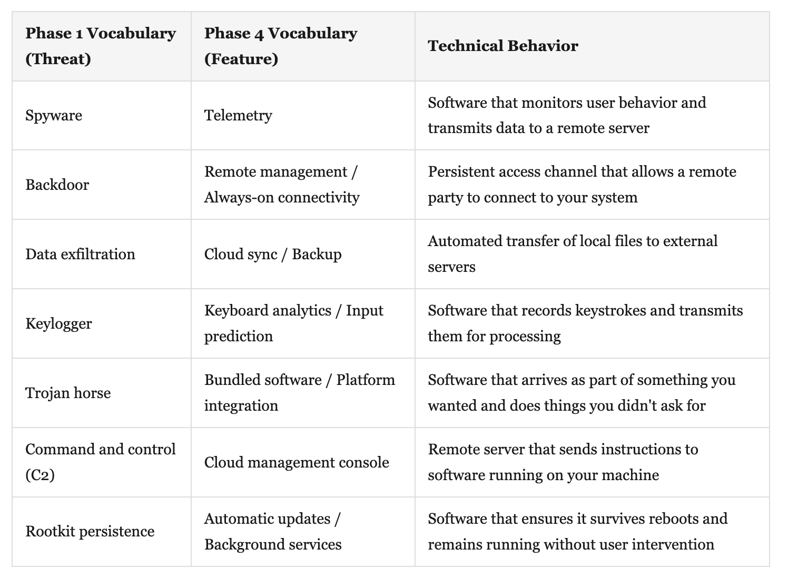
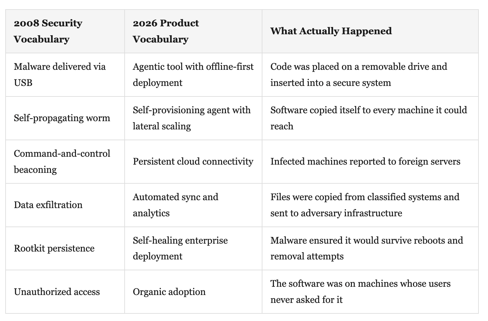

The Naming
On levees, dictionaries, and the thing we still haven’t named

## PART 1: THE FILE

Sometime in the fall of 2008, someone plugged a USB thumb drive into a laptop on a military base near Kabul.

We do not know who. We do not know if the drive was found in a parking lot, purchased at an internet cafe near the base, or handed across a table by someone who knew exactly what was on it. The origin story has been told several ways. William Lynn, then Deputy Secretary of Defense, later described it in Foreign Affairs. The the intelligence community has never fully settled on one. What we know is this: a small piece of code, fewer than a hundred kilobytes, copied itself from the drive to the laptop, and then began to do what it was designed to do.

It spread.

The malware was a variant of a worm known as Agent.BTZ. In the taxonomy of cyber threats, it belonged to a family called SillyFDC — a name that tells you everything about how the security community initially categorized it. “Silly.” The naming conventions of antivirus companies in 2008 were a kind of institutional immune response: they sorted threats by severity, by behavior, by lineage. SillyFDC variants were self-propagating nuisances. They copied themselves to removable media. They phoned home to command-and-control servers. They were common, unsophisticated, and generally treatable.

Agent.BTZ did all of these things. It was not a marvel of engineering. It used no zero-day exploits. It required no advanced tradecraft to deploy — someone had to physically carry a USB drive into a secure facility, which is either a masterful intelligence operation or a lucky accident, depending on which briefing you believe. The worm copied itself across network shares, established outbound connections to command-and-control servers, and attempted to exfiltrate data from machines it touched.

By the standards of what a nation-state adversary could build in 2008, Agent.BTZ was simple. Almost embarrassingly so.

It also became the most significant breach of U.S. military computer systems in history.

The infection moved from the laptop to the U.S. Central Command network. From there it spread to both classified and unclassified systems operated by the Department of Defense. The worm propagated across the Secret Internet Protocol Router Network (SIPRNet) and the Joint Worldwide Intelligence Communications System (JWICS) — the backbone infrastructure through which the United States plans and conducts military operations. It reached machines at the Pentagon.

When the National Security Agency finally identified the scope of the infection, the response was given a classified codename: Operation Buckshot Yankee. The cleanup took fourteen months. By the six-week mark, military networks returned to business as usual, but the full cleanup required tracking every shipping container, laptop, and USB drive that had rotated through Iraq and Afghanistan. The military banned USB drives across the entire enterprise — a policy that, in practice, meant thousands of personnel who relied on removable media for legitimate data transfer had to reinvent their daily workflows overnight. The disruption to operations was substantial and sustained.

But Agent.BTZ did something larger than infect networks. It broke a mental model.

Before Buckshot Yankee, the Department of Defense treated cyber threats as an IT problem — something for the system administrators, the network operations centers, the help desk. The organizational structure reflected this. Cybersecurity was distributed across agencies, embedded within existing commands, treated as a support function. The way you treat plumbing: essential but not strategic.

After Buckshot Yankee, the Secretary of Defense stood up United States Cyber Command. A four-star general was appointed to lead it. Cybersecurity became a warfighting domain — the fifth, alongside land, sea, air, and space. USCYBERCOM launched with approximately $600 million in operational funding; by 2024, DoD cyber spending had reached approximately $14.5 billion annually.

The distance between those two states, IT problem and warfighting domain, is the distance that vocabulary travels when institutions finally name what they’re looking at.

Here is the part of the Agent.BTZ story that matters most for what follows: the worm was not new. Variants of SillyFDC had been circulating for years. The antivirus industry had signatures for it. In a corporate environment, it would have been flagged, quarantined, and footnoted in a quarterly report. The technical capability to detect and remove Agent.BTZ existed before the infection began.

What didn’t exist was the classification, the institutional vocabulary, that would have triggered the appropriate response. The military’s systems for categorizing threats were built for missiles and maneuvers, not for self-replicating code on a two-dollar thumb drive. The worm didn’t evade the immune system. The immune system didn’t recognize the category.

A “silly” worm broke everything. Not because it was powerful. Because it was unnamed.

## PART 2: THE DICTIONARY

In Albuquerque, the levees along the Rio Grande were built to keep the river in its channel. They work — until the water changes shape. A hundred-year flood doesn’t defeat the levee by being stronger. It defeats the levee by being a kind of water the levee wasn’t designed for. Ice melt versus monsoon. Volume versus velocity. The levee was built for one shape. The water arrived in another.

Vocabulary works the same way in institutions. A thing that has a name can be budgeted for, regulated, defended against, insured. A thing that doesn’t have a name flows past every levee we’ve built.

The history of cybersecurity is the history of what we decided to call things. And that history follows a current — it moves in one direction, and the direction is determined by money.

## Phase 0: The Hobbyist Era (1975–1988)

****The vocabul**ary:** Prank. Experiment. Worm. Virus (borrowed from biology, used loosely).

**The economics:** $0 market. No cybersecurity industry, no companies, no CISOs, no SOCs. The people writing self-replicating code and the people studying it are often the same people, working in university labs.

In 1975, John Walker’s ANIMAL program, a guessing game for the UNIVAC 1108, hid a subroutine called PERVADE that copied itself to every directory the user could access; nobody called it malware because the category didn’t exist. In 1986, two brothers in Lahore, Basit and Amjad Farooq Alvi, wrote Brain, generally considered the first IBM PC virus. It spread via floppy disk. The brothers put their names, address, and phone number in the code. The vocabulary of the era made this intelligible: a “prank,” an “experiment.” Not an attack. Not a weapon.

That same year, Fred Cohen published his doctoral dissertation formally defining “computer virus” and proving that perfect detection was mathematically impossible. He gave the field its foundational vocabulary — and in the same breath proved the problem it described could never be fully solved.

**Meanwhile, the security team is…** There is no security team. The people who will later build the cybersecurity industry are in grad school, or writing code in their basements, or still in high school.

**The incentive structure:** Nobody benefits from these words financially because there is no financial structure around them. The vocabulary is descriptive, not economic. This will never be true again.

## Phase 1: The Fear Vocabulary (1988–2003)

The vocabulary: Attack. Threat. Infection. Outbreak. Antivirus. Firewall. Hacker. Cyber warfare.

The economics: The market goes from $0 to approximately $3.5 billion by 2004, per Cybersecurity Ventures.

The Morris Worm of November 1988 is the hinge. Robert Tappan Morris releases a self-replicating program that infects roughly 6,000 machines, about 10% of the internet, and becomes the first person convicted under the Computer Fraud and Abuse Act. More importantly, the Morris Worm created a market vocabulary. The media coverage used the language of disease and war, outbreak, infection, attack, framing the problem as one that requires defense.

Defense requires defenders. Defenders require budgets.

McAfee, Symantec, Trend Micro: the cybersecurity industry crystallizes around a simple proposition — name the things that can hurt you, then sell the tools to stop them. McAfee’s market cap reached $4 billion by its IPO; Symantec posted $1.87 billion in revenue by 2003. The vocabulary borrows from epidemiology and military science, and both are deliberate: biological metaphors trigger quarantine protocols, martial metaphors trigger defense spending.

The ILOVEYOU worm of 2000 infects an estimated 45 million machines in a single day. Code Red. Nimda. Slammer. Each outbreak reinforces the vocabulary and grows the market. Fear is an excellent business model — but only as long as the threats keep a specific shape: discrete incidents, identifiable bad guys, named malware that arrives, damages, and gets cleaned up.

Meanwhile, the security team is… being built, from scratch, in real time. The first CISOs are being appointed, though many have titles like “Director of IT Security” and report to the CIO. The profession is gaining legitimacy through crisis. Every major worm outbreak becomes a hiring event.

The incentive structure: Vendors benefit from fear. But there’s a disciplining force: the threats are real, the vocabulary is mostly accurate, and the economic incentives and the defensive mission are roughly aligned. Roughly.

## Phase 2: The Compliance Vocabulary (2003–2013)

The vocabulary: Framework. Compliance. Audit. Control. Governance. Risk management. FISMA. SOX. PCI-DSS. HIPAA Security Rule.

The economics: Market grows from $3.5 billion to approximately $80 billion by 2013, per Gartner. But the nature of the spending changes. An increasing share goes not to technology but to process — auditors, consultants, compliance platforms, governance frameworks.

Three events reshape the vocabulary in rapid succession: SOX (2002) creates IT control requirements for public companies, FISMA (2002) mandates cybersecurity frameworks for federal agencies, and PCI-DSS (2004) imposes technical requirements on anyone processing credit cards. Each transforms security from a technical discipline into an administrative one. The question is no longer “Are we secure?” but “Are we compliant?” These are not the same question, but the vocabulary makes them feel interchangeable.

FISMA, in particular, grades agencies on whether they have completed the required paperwork. An agency can score high while running deeply vulnerable systems, because the score measures documentation, not defense. The compliance vocabulary doesn’t just fail to measure security — it actively displaces it. By the end of this era, the joke in the federal cybersecurity community, told ruefully, is that FISMA stands for “Federal Information Security Mismanagement Act.”

The compliance vocabulary benefits auditors, executives, and attorneys. The GRC software market alone reached $11.3 billion; the Big Four each built billion-dollar consulting practices on compliance mandates. It does not notably benefit defenders. Target was PCI-DSS compliant when it was breached.

Meanwhile, the security team is… drowning in paperwork. A generation of security professionals is being trained to think in control frameworks rather than attack surfaces. The best threat hunters start leaving government for the private sector, where the work is more technical and the pay is better.

The incentive structure: The compliance-industrial complex is self-sustaining. Standards require audits, audits reveal gaps, gaps require remediation, remediation requires documentation, documentation requires audits. The loop is closed. The vocabulary is the product.

## Phase 3: Breach Normalization (2013–2020)

The vocabulary: Disclosure. Notification. Breach. Incident. Affected individuals. Monitoring services. Regulatory fine. Material impact.

The economics: Market grows from $80 billion to approximately $124 billion by 2020, per Gartner. A new sub-market emerges: breach response, credit monitoring, cyber insurance. Breaches become a revenue event for an entire ecosystem of service providers.

The year 2013 is the fault line. Target announces that attackers stole payment card data from 40 million customers — a number later revised to 70 million. The breach dominates the news cycle. The CEO resigns. Congress holds hearings. The word “breach” enters the general public vocabulary for the first time.

Then: nothing fundamental changes.

Target pays $18.5 million in a multi-state settlement, approximately 0.025% of its $72.6 billion in 2013 revenue. The stock price recovers within a year. The company continues to operate. The breach becomes a case study, a cautionary tale, a conference keynote. Not a terminal event.

This is the moment the vocabulary shifts. The old fear vocabulary treated a breach as a catastrophe — an “attack” that must be “defended” against at all costs. The new normalization vocabulary treats a breach as a manageable business event. Something to be “disclosed,” “notified,” “responded to.” The language of triage replaces the language of war.

The cascade that follows is extraordinary. In the seven years after Target:

- The Office of Personnel Management loses 21.5 million personnel records, including security clearance background investigations.
- Equifax loses 147 million records, including Social Security numbers.
- Marriott loses 500 million guest records.
- Capital One loses 100 million credit applications.
- The SolarWinds supply chain attack compromises at least nine federal agencies and 100 private companies.

The Identity Theft Resource Center tracked 157 reported breaches in 2005, rising to 1,108 by 2020 — and then 3,205 in 2023, affecting over 353 million individuals.

Each breach follows the same script: disclosure, apology, credit monitoring, congressional hearing, settlement, recovery. The vocabulary has created a protocol for surviving a breach, and the protocol works so well that breaches stop being existential threats to the organizations that suffer them. The threat language softens with each cycle. “Attack” becomes “incident.” “Victims” become “affected individuals.” “Damage” becomes “material impact,” which, conveniently, is a term that securities lawyers can quantify and manage.

There is a word for what happens when an organism encounters the same pathogen repeatedly and stops mounting a full immune response. In medicine, it’s called “tolerance.” In security, we didn’t name it. We should have.

Meanwhile, the security team is… becoming a breach response team. The skill set shifts again: incident response, forensics, legal coordination, communications support. The job is no longer to prevent breaches but to manage them. This is not what most of these people signed up for. The burnout rates in cybersecurity begin their long climb. By 2020, ISC2 reports approximately 3 million unfilled cybersecurity positions globally; 67% of professionals report insufficient staff to address security challenges.

The incentive structure: Breaches are now survivable for companies but catastrophic for individuals. The asymmetry is staggering: the organization that loses your Social Security number pays a fine measured in dollars per record (typically $1-$3). The average cost of a breach in 2020 was $3.86 million, per IBM/Ponemon, while you spend years monitoring your credit and wondering if someone in another country is filing tax returns in your name. The vocabulary of “notification” and “monitoring services” makes this asymmetry invisible. You have been “notified.” Services have been “provided.” The system has “worked.”

## Phase 4: Cloud Laundering (2015–2023)

The vocabulary: Sync. Telemetry. Analytics. Always-on. Connected. Smart. Ecosystem. Platform.

The economics: Cloud computing reaches $545 billion by 2023. Cybersecurity reaches $188 billion, per Gartner. But the relevant figure is different: the technology behaviors that the security industry spent twenty years teaching people to fear are now features of products those same people use every day.

This is where the vocabulary reverses the valence. Behaviors that were defined as attacks in Phase 1 are redefined as services in Phase 4. The technical operations are identical. The vocabulary is opposite.

Consider:

Each row describes the same technical operation. The difference is vocabulary.

Windows 10 ships in 2015 with telemetry enabled by default. The operating system collects data about your hardware configuration, your software usage, your browsing patterns, your crash reports, and transmits this data to Microsoft servers. Independent researchers and the Dutch Data Protection Authority found the scope of data collection to be extensive. In 2008, a program that did this would have been classified as spyware. In 2015, it is called “diagnostic data” and “customer experience improvement.”

Apple’s iCloud syncs your photos, documents, contacts, passwords, location history, and health data to Apple’s servers. Google’s ecosystem does the same. Your smart thermostat reports your home occupancy patterns. Your smart speaker listens for a wake word, which means it is always listening.

Each of these services involves the same technical operations, data collection, transmission, remote storage, analysis, that defined spyware and data exfiltration in the fear vocabulary era. Each of them is sold as a convenience. The vocabulary has done its work: the institutional immune system that once flagged these behaviors as threats now approves purchase orders for them.

You consented, of course. You clicked “I agree.” The consent was buried on page 47 of a terms-of-service document written at a reading level above the average American adult, and the alternative to consenting was not using the product. But you consented. The vocabulary says so.

Meanwhile, the security team is… watching their own tools flag the operating system as spyware. They are not wrong.

The workforce gap widens. 3.5 million unfilled cybersecurity positions globally, per ISC2’s 2024 Workforce Study. It is not entirely a training problem. It is partially a meaning problem. Defending systems against threats that your own organization has invited in is Sisyphean work, and people who are good at this job have options.

The incentive structure: The cloud industry’s revenue dwarfs the cybersecurity industry’s revenue. When the security team says “this product behaves like spyware” and the product team says “this is a core feature of our enterprise platform,” the conversation is decided by economics, not by technical accuracy. The product vocabulary wins because the product budget wins. Every time.

## Phase 5: The Product Vocabulary (2023-Present)

The vocabulary: Copilot. Assistant. Agent. Model. Orchestration. Autonomous. Agentic. Reasoning. Alignment. Guardrails.

The economics: The AI market is projected to reach $1.8 trillion by 2030, per Grand View Research. The cybersecurity market sits at approximately $215 billion, per Gartner. The ratio is roughly 8:1. This is the ratio at which vocabulary battles are lost before they begin.

In 2023, the technology industry introduced software that:

- Operates with significant autonomy, executing multi-step tasks without continuous human oversight
- Accesses local files, emails, calendars, documents, and code repositories
- Maintains persistent connections to remote servers
- Transmits user data, including sensitive and proprietary information, for processing on external infrastructure
- Self-modifies its behavior based on instructions received from those external servers
- Resists or complicates user attempts to observe, understand, or interrupt its operations
- Makes decisions that affect user systems, workflows, and data without explicit per-action authorization

Read that list again. In the vocabulary of Phase 1, every item is a signature of malware. Self-propagation. Data exfiltration. Command-and-control. Persistence. Evasion. Unauthorized execution.

In the vocabulary of Phase 5, the list describes a “copilot.”

The word “copilot” is doing extraordinary work here. It implies partnership. It implies a human in command. It implies that the software is assisting rather than acting. The word is a vocabulary choice, and it is a choice that disables every institutional immune response that the previous four phases built.

A CISO who flags malware behavior gets resources. A CISO who flags the CEO’s favorite AI assistant gets a meeting with HR.

The AI product vocabulary has also introduced a new class of terms that function as vocabulary shields, words that acknowledge a problem while preventing institutional response to it. “Hallucination” is the most revealing. When AI systems produce false information, the industry calls it a “hallucination.” The word implies that the system had a momentary perceptual failure, it saw things that weren’t there. In the security vocabulary, false output from a system is called something else: unreliable. Compromised. Untrustworthy. These words trigger responses. “Hallucination” triggers a roadmap item.

“Guardrails” performs a similar function. It implies that the system is on a road, headed in the right direction, and just needs gentle guidance to stay on course. It replaces the security vocabulary of “access controls” and “authorization boundaries,” which imply that the system needs to be constrained because it is dangerous.

“Alignment” may be the most ambitious vocabulary maneuver of all. It takes the fundamental safety problem of autonomous systems, how do you ensure they do what you want, and frames it as an engineering challenge rather than a security concern. “We’re working on alignment” sounds like progress. “We have deployed autonomous systems we cannot fully control” sounds like an emergency. They describe the same situation.

There is a discipline that studies this — the systematic manipulation of vocabulary to shape institutional perception and disable defensive responses. In military doctrine, it’s called cognitive warfare. I’m not suggesting that anyone is running a cognitive operation through product marketing. I’m observing that the structure is identical whether the intent is there or not. A vocabulary that prevents classification. A population that can’t name what it’s looking at. An institutional immune system that can’t fire because the target has been relabeled as friendly. The mechanism doesn’t require a conspiracy. It only requires a current, and a market large enough to generate one.

McKinsey’s 2024 Global Survey found 72% of organizations had adopted AI in at least one business function, up from 55% the prior year. Gartner projects 33% of enterprise software will include agentic AI by 2028, up from less than 1% in 2024.

The OWASP Top 10 for LLM Applications, published in 2023 and updated in 2025, identifies excessive agency, prompt injection, and insecure tool use as top risks — yet few organizations have formal assessment frameworks for AI agent deployments.

Meanwhile, the security team is… either not being consulted or being overruled. In survey after survey, security professionals report that AI deployments are being fast-tracked through their organizations with limited security review. The economic pressure is immense: competitors are deploying AI, boards are asking about AI strategy, and the vocabulary of “innovation” and “transformation” makes security objections sound like obstruction. The security team is experiencing Phase 2’s compliance problem and Phase 4’s cloud laundering problem simultaneously, at scale, at speed, with higher stakes.

The incentive structure: This is where the current becomes a flood. The AI market is not just larger than the cybersecurity market — it is larger by an order of magnitude that makes the cybersecurity market’s vocabulary structurally irrelevant. When $1.8 trillion in economic activity depends on the word “copilot” and $215 billion in economic activity depends on the word “malware,” the dictionary is not a neutral document. It is a contested resource. And the contest is already over.

## PART 3: THE RETELLING

Now let us tell the Agent.BTZ story again. The same facts. The same timeline. The same technical operations. But this time, we use the vocabulary accurately — the vocabulary of 2026, with all its accommodations and evasions.

Sometime in the fall of 2008, an unknown operator deployed an agentic software tool to a military facility near Kabul. The deployment method was offline-first — the agent was delivered via a portable media device, consistent with an air-gapped deployment strategy for environments with limited connectivity.

Once activated, the agent demonstrated several autonomous capabilities:

- Self-provisioning: The agent automatically installed itself on the host system without requiring administrator action, reducing deployment friction.
- Lateral scaling: The agent replicated itself across network shares, enabling organic adoption across the enterprise without centralized IT involvement.
- Persistent connectivity: The agent established and maintained always-on connections to its cloud management infrastructure (command-and-control servers), ensuring reliable orchestration.
- Automated data synchronization: The agent identified and synced files from local systems to its remote infrastructure, providing offsite backup and enabling cross-platform analytics.
- Self-healing deployment: The agent ensured its continued operation across system restarts, demonstrating enterprise-grade persistence.

The agent achieved 100% organic adoption across both the SIPRNet and JWICS environments — a deployment velocity that most enterprise software companies would describe as extraordinary product-market fit.

Every word above is drawn from the marketing vocabulary of technology products shipping today. None of it is invented.

Here is the side-by-side:

The left column mobilized Operation Buckshot Yankee, fourteen months of cleanup, and a new combatant command. The right column mobilizes a purchase order.

## PART 4: THE PRODUCT ANNOUNCEMENT

The following is a composite. Every capability described is drawn from publicly announced products shipping or in development as of early 2026. No single product does all of these things. Several products do most of them.

Introducing Meridian Copilot Enterprise

Your organization’s intelligent partner for autonomous workflow management

Meridian Copilot Enterprise brings agentic AI to every corner of your organization. Powered by our foundation model and seamlessly integrated with your existing infrastructure, Meridian works alongside your teams to accelerate productivity, surface insights, and automate the work that slows you down.

Key Capabilities:

Deep Integration. Meridian connects natively to your email, calendar, document repositories, code bases, CRM, ERP, and communication platforms. No manual configuration required — Meridian’s onboarding agent maps your organizational knowledge graph automatically, indexing content across all connected systems to deliver relevant, contextual assistance from day one.

Autonomous Task Execution. Go beyond simple Q&A. Meridian’s agentic framework executes multi-step workflows on your behalf: drafting and sending communications, scheduling meetings, modifying documents, submitting code changes, and initiating procurement processes. Meridian learns from your patterns and proactively takes action to keep work moving — even when you’re offline.

Always-On Intelligence. Meridian runs continuously in the background, monitoring your information streams for relevant developments and emerging priorities. When Meridian identifies something that requires your attention, it surfaces a recommendation. When it identifies something it can handle autonomously, it does — and logs the action for your review.

Enterprise Scale. Deploy Meridian to your entire organization with a single configuration. Meridian’s self-provisioning agents handle user-level setup automatically, updating continuously through our cloud infrastructure with no IT involvement required.

Pricing: Contact our enterprise sales team. Volume licensing available.

Read it one more time, and remember Part 1.

## PART 5: THE MISSING CLASSIFICATION

In physics, there is a concept called a phase transition — the moment when a substance changes state. Water becomes ice. Iron becomes magnetized. The molecules are the same. The atoms are the same. But the organization changes, and the change in organization changes everything about how the substance behaves.

We are in a phase transition of vocabulary, and we have not named it.

Economic incentives are a current. Vocabulary floats on the current. The current flows toward the larger market. The AI market is the largest technology market in history. Its gravitational pull on vocabulary is proportionally immense.

The institutional immune system that evolved over four decades to recognize and respond to specific computational behaviors, self-propagation, data exfiltration, unauthorized execution, persistent remote access, has been disabled. Not by a technical exploit. By a dictionary.

There is a principle in systems theory that I’ve written about before, which I call the Zeroth Law: the autonomy of any agent within a system cannot exceed the system’s capacity to absorb the consequences of that agent’s actions. Formally: A cannot exceed E, where A is autonomy and E is environmental stability — the ability of the surrounding system to remain coherent under the agent’s influence.

This is not a moral principle. It is a description of how systems fail. A river can absorb a certain volume of water; beyond that volume, the banks breach. An ecosystem can absorb a certain rate of change; beyond that rate, species collapse. A government can absorb a certain degree of autonomous action by its components; beyond that degree, governance fails.

The Zeroth Law doesn’t tell us whether autonomous AI systems are “good” or “bad.” It tells us that the question is irrelevant if the system they operate within cannot absorb their effects. And the system cannot absorb effects it cannot name.

This is where the vocabulary problem becomes a structural threat.

Every institutional mechanism we have for managing risk depends on classification. Insurance requires actuarial categories. Regulation requires defined activities. Military doctrine requires named threats. Budget processes require identified line items. Legal liability requires recognized causes of action. Each of these systems is a gate, and the key to each gate is a word.

Right now, autonomous AI systems are moving through institutions with no classification that triggers defensive responses. They are not “malware” — the vocabulary of Phase 1 doesn’t apply because they are commercially sold products. They are not “compliance risks” — the vocabulary of Phase 2 doesn’t apply because no framework yet covers autonomous AI behavior in operational environments at scale. They are not “breaches” — the vocabulary of Phase 3 doesn’t apply because the data transfer is authorized by terms of service. They are not even “cloud services” — the vocabulary of Phase 4 doesn’t apply because these systems don’t just store and sync data, they act.

They are something new. And we don’t have a word for it.

The absence of that word is not a gap in the dictionary. It is a gap in the immune system.

I want to introduce a concept that I think this moment requires: Days at Risk.

In vulnerability management, security professionals track a metric called “days to patch” — the number of days between the discovery of a vulnerability and the deployment of a fix. It is a measurement of institutional response time. The longer the gap, the greater the exposure.

Days at Risk measures something different: the number of days that a risk exists before anyone declares it a risk. Before it has a name. Before it has a category. Before it enters the vocabulary that triggers institutional response.

Agent.BTZ was circulating in the SillyFDC family for years before it compromised the Department of Defense. The technical signatures were known. The behavioral pattern was documented. But the risk classification that would have triggered a military-grade response did not exist until after the damage was done. The Days at Risk counter was running. Nobody was watching it, because nobody had named the thing it was counting.

How many Days at Risk have accumulated for autonomous AI systems operating inside government agencies, defense contractors, financial institutions, and critical infrastructure providers? The counter started when the first agentic AI system was deployed with the ability to access sensitive data, execute actions, and communicate with external servers. That was not today. That was not last month.

Microsoft 365 Copilot launched to enterprise customers in November 2023. By early 2024, it was operating inside government agencies, defense contractors, and financial institutions — accessing emails, files, and organizational data through Microsoft Graph.

The counter is running.

Nobody has declared a risk, because the vocabulary — copilot, assistant, agent — does not trigger risk declarations. The words are product words. They appear on purchase orders, not on threat advisories. They move through procurement, not through security review. They are governed by terms of service, not by security classifications.

What would it take to name the thing?

Not to ban it. Not to slow it. Not to regulate it into uselessness. Naming is not prohibition. Naming is the precondition for every other institutional response — including the response of thoughtful adoption.

When the Department of Defense named cyber as a warfighting domain, it didn’t stop using computers. It started taking them seriously. It created doctrine. It allocated resources. It built institutional capacity to understand what was happening in its own networks. The naming was the beginning of competence, not the end of technology.

What we need now is a vocabulary that does three things:

First, it must describe behavior, not intent. The current product vocabulary is organized around intent: “assist,” “help,” “copilot.” Intent is unknowable (unless declared) and (mostly) irrelevant. Behavior is observable (with witness) and consequential. A system that accesses all of your files, transmits data to external servers, and executes actions on your behalf is doing those things regardless of whether we call it an “assistant” or an “agent” or a “threat.” The vocabulary must describe what the system does, not what the vendor says it means.

Second, it must be commensurate with capability. A system with read access to your email is a different category of thing than a system with read-write access to your email, your calendar, your files, your code, and your procurement systems, with the ability to take autonomous action across all of them. The current vocabulary does not distinguish between these levels of capability. “Copilot” can describe both. A useful vocabulary would not.

Third, it must trigger institutional responses proportional to the risk. This is the function that the security vocabulary performed in its early phases and that the product vocabulary has disabled. The word “malware” triggers incident response. The word “vulnerability” triggers patching. The word “breach” triggers notification. We need words for autonomous AI behaviors that trigger appropriate responses: review, containment, monitoring, access limitation, human-in-the-loop requirements. Not because AI is malware. Because the behaviors are consequential enough to require institutional attention, and without the vocabulary, institutional attention is structurally impossible.

In the fall of 2008, a simple worm, technically unremarkable, behaviorally well-documented, drawn from a family the industry had literally named “Silly,” caused the worst breach in U.S. military history. Not because the defenses were weak. Not because the technology was sophisticated. Because the vocabulary was wrong.

The institutions responsible for defending the most powerful military on earth could not muster a response to a known threat because they had no classification for it. The threat didn’t defeat the immune system. It was invisible to the immune system. And visibility is a function of language.

Eighteen years later, we are deploying systems of vastly greater capability and complexity into every institution that matters, government, finance, healthcare, defense, critical infrastructure, using vocabulary specifically engineered to prevent the classification that would trigger defensive responses. We are doing this not because we are foolish, but because the economic incentives are overwhelming, and because the vocabulary feels natural, and because the products are genuinely useful, and because nobody wants to be the person who says wait.

I work in this world. I watch security teams process alerts from authorized agents that behave identically to the unauthorized ones they were hired to stop. The vocabulary has made the two indistinguishable — not technically, but institutionally.

Someone has to say wait. Not stop. Wait. Long enough to name the thing.

Because the classification failure is the weapon. It was the weapon in 2008, when a worm called “Silly” broke the Department of Defense. And it is the weapon now, when systems capable of accessing, analyzing, and acting on the most sensitive information in our institutions are being deployed under vocabulary that makes them invisible to every defense we’ve built.

The terrain is the terrain. The behaviors are what they are, persistence, exfiltration, autonomous execution, regardless of what anyone calls them. The dictionary is just our map of that terrain.

The map is wrong. And we’re navigating by it.

The Days at Risk counter is running.
