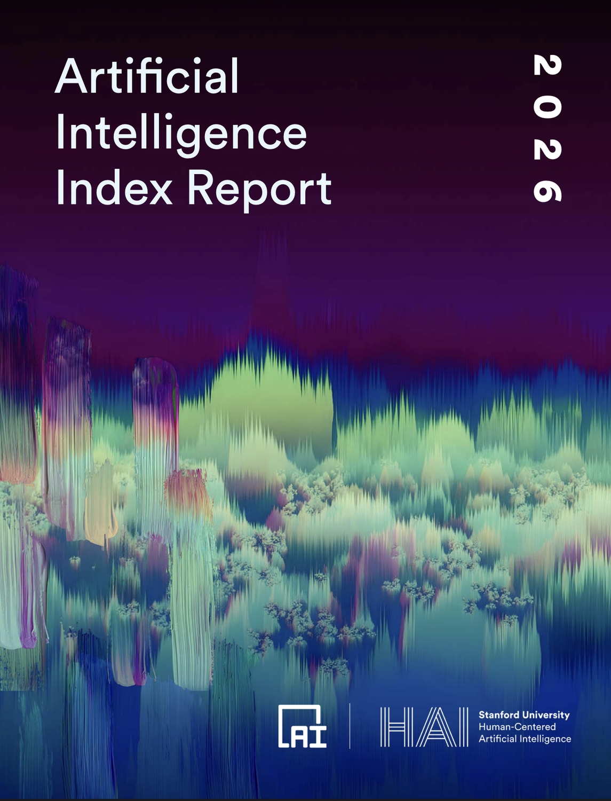
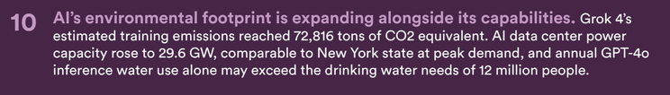

What Stanford's AI Index Actually Measured (and What It Couldn't)

Stanford just released the ninth edition of its AI Index. 424 pages. Nine chapters. The most comprehensive independent measurement of AI's trajectory that exists.

I've read the [report](https://hai.stanford.edu/assets/files/ai_index_report_2026.pdf). Roughly 384 pages of charts, diagrams, data visuals, and explaination. It covers everything: Education, healthcare, and on and on.

The headlines will find the capability numbers. Models converging at the frontier. The U.S.-China gap effectively closed. AI agents jumping from 12% to 66% task success in a single year. Gemini winning gold at the International Math Olympiad.

Those headlines are accurate. They are also exactly what they want you to focus on.

I've watched systems fail for two decades. Not because the threat was invisible. Because everyone was looking at the wrong thing. The capability story is the shiny object. Impressive. Real. And almost completely beside the point.

The report measured something else underneath the benchmarks. What's happening to the governance. The trust. The workforce. The knowledge infrastructure. The gaskets between what machines can do and what humans can absorb. These are the load-bearing walls. These are what's cracking.

Without a gasket, the faster system destroys the slower one. That's not a metaphor. That's physics.

Seven findings. Read through the lens of trust physics and the Kinetic Trust Protocol — a framework that treats trust as a measurable environmental state, not a policy preference. Not because I'm selling something. Because the math doesn't lie, and right now the math is telling us something most people aren't ready to hear.

------------------------------------------------------------------------

### 1. The Gasket Gap: Capability Is Measured. Safety Is Not.

Almost every frontier AI model developer reports results on capability benchmarks. MMLU, SWE-bench, GPQA. These are the shared standards. When you read "the model scored 91% on reasoning," that number comes from a well-documented, independently verifiable evaluation.

Almost none of those same developers report results on responsible AI benchmarks. Fairness, safety, factuality, bias. The report found that "reporting on responsible AI benchmarks remains sparse" and that "only Claude Opus 4.5 reports results on more than two of the RAI benchmarks."

This is a gasket failure. The translation layer between machine capability and institutional governance is missing. We are measuring how fast the engine runs. We are not measuring whether the brakes work.

KTP was built on the premise that trust measurement is the deployment requirement, not an afterthought. The Trust Proof lifecycle requires measured trust state before access is granted, not after incidents accumulate. The Stanford data shows what happens without that architecture: 362 documented AI incidents in 2025, up 55% from 2024.

------------------------------------------------------------------------

### 2. Transparency Declined. In 2025. After Improving.

The Foundation Model Transparency Index, which scores developers on disclosure about training data, compute, and post-deployment impact, dropped from 58 to 40 in 2025. After rising from 37 to 58 between 2023 and 2024. The improvement reversed.

In trust physics terms: the costly signal is declining. When developers disclose less about how their models are built, the information asymmetry between producer and consumer widens. The signal that used to cost something is becoming free to withhold.

This finding validated something KTP already specified. The [Context Tensor](https://nmcitra.github.io/ktp-rfc/learn/context-tensor/) requires measured environmental state across six domains, including signal verification rates and epistemic pollution. The measurement was built around the expectation that opacity would worsen. The Stanford data confirms it was warranted.

------------------------------------------------------------------------

### 3. Junior Developers Are Being Displaced. Not Senior Ones.

Software developers aged 22-25 saw employment fall nearly 20% from 2024. Older developers' employment continued to grow. The report notes a pattern: "AI's labor market effects are showing up unevenly, concentrated in hiring pipelines and the youngest workers in exposed occupations."

This is what happens when AI substitutes for human effort at the entry level. Junior developers are not just workers. They are the people who, by learning, produce the general knowledge that makes everyone's work better. When a company lets AI write the code a junior would have struggled through, the company gets faster output today. It loses the person who would have become the senior architect tomorrow.

An [MIT NBER paper by Acemoglu, Kong, and Ozdaglar](https://www.nber.org/papers/w34910) proved formally that this dynamic, scaled across an economy, can lead to a steady state where general knowledge vanishes entirely. They call it knowledge collapse. The Stanford data is the first large-scale empirical signal that the mechanism is operating.

KTP addresses this partially, not completely. The protocol's trust-in-the-loop verification keeps human judgment in the system at specific points. But the broader problem of preserving the learning pipeline is not a protocol question. It is an institutional design question that no protocol alone can solve.

------------------------------------------------------------------------

### 4. 53% Adoption in Three Years. Faster Than the PC or the Internet.

Generative AI reached 53% population-level adoption within three years of its mass-market introduction. For comparison: the personal computer took about ten years to reach that level. The Internet took about seven.

Speed of adoption is not the same as speed of institutional readiness. The report documents that only half of middle and high schools have AI policies. Only 6% of teachers say those policies are clear. Organizational AI adoption hit 88%, but AI agent deployment was in single digits across nearly all business functions.

The technology arrived. The governance didn't. The gap between those two speeds is the thing the gasket is supposed to absorb. Without it, the faster system cracks the slower one.

------------------------------------------------------------------------

### 5. The United States Has the Lowest Trust in Its Own Government to Regulate AI. Of Any Country Surveyed.

31%.

Singapore: 81%. Indonesia: 76%. Malaysia: 73%. The global average: 54%.

The country that leads the world in AI investment, model development, and deployment trusts its own government to manage the technology less than any other nation surveyed.

This number has a history. In 1964, 77% of Americans trusted the government to do the right thing most of the time. By 2024, that number was 22%. By most available measures, no major institutional trust crisis since 1972 has produced a full recovery to pre-crisis levels. The 31% figure for AI regulation is not a new phenomenon. It is the latest step on a staircase that only descends.

KTP was designed as physics, not policy. The protocol operates through environmental constraint, not regulatory enforcement. Trust is maintained through measured state, not through institutional authority. When a third of the population does not trust the institution responsible for governance, the physics has to live somewhere else.

------------------------------------------------------------------------

### 6. AI Models Cannot Reliably Tell Time. Or Distinguish Knowledge from Belief.

[Gemini Deep Think earned a gold medal at the International Math Olympiad.](https://arstechnica.com/ai/2025/07/google-deepmind-earns-gold-in-international-math-olympiad-with-new-gemini-ai/) The same class of system reads analog clocks correctly 50.1% of the time. Humans: 90.1%.

Sit with that for a moment.

A system that can solve problems most PhD mathematicians cannot can also not tell you what time it is by looking at a clock face. The researchers call this the "jagged frontier." Capability is not a smooth surface. It has peaks and crevasses, and the crevasses are in places no one expected.

On a new benchmark testing whether models can distinguish between knowledge and belief, hallucination rates ranged from 22% to 94% across 26 top models. When a false statement is presented as something another person believes, models handle it well. When the same false statement is presented as something the user believes, performance collapses. GPT-4o's accuracy dropped from 98.2% to 64.4%.

These are not bugs. They are architectural features of systems optimized for plausible output rather than verified truth. The gap between what these systems can do and what they reliably know is not closing. It is becoming more jagged.

This is the problem distributed attestation was designed to solve. You do not ask the system to verify itself. You build an environment where verification is structural, where multiple independent sources establish truth through consensus rather than through the confidence of a single model/person/institution.

------------------------------------------------------------------------

### 7. AI's Environmental Footprint Is the Physical Cost of the Machine Clock

Grok 4's estimated training emissions: 72,816 tons of CO2 equivalent. More than the lifetime emissions of a car. AI data center power capacity: 29.6 GW. Comparable to New York state at peak demand. Annual GPT-4o inference water use may exceed the drinking water needs of 12 million people.

These numbers are the thermodynamic cost of operating at machine speed. Every query, every training run, every inference is a physical event with a physical cost. The laws of physics guarantee that information processing has a minimum energy cost. The Stanford data shows we are operating many orders of magnitude above that minimum, and the gap is widening.

The question this raises for any trust architecture: should every query cost the same? A low-stakes question about dinner recipes and a high-stakes medical recommendation currently consume similar resources. Signal cost proportionality, where the cost of verification scales with the risk of the decision, is not just an efficiency principle. It is an environmental one.

------------------------------------------------------------------------

### The Pattern

The [Stanford AI Index](https://hai.stanford.edu/assets/files/ai_index_report_2026.pdf) is not a policy document. It is a measurement. And the measurement reveals a consistent pattern across every chapter: the systems designed to translate between machine speed and human speed are either missing, underfunded, or actively being removed.

The gasket between capability and governance. The gasket between deployment and education. The gasket between machine output and human verification. The gasket between investment and maintenance.

Each one missing. Each one measurable. Each one, if the data is right, getting worse.

The question is not whether AI is advancing. The Stanford data makes that unambiguous. The question is whether we build the translation layers between what machines can do and what humans can trust before the gap becomes structural.

The acequia, maintained by the same governance principles for centuries, has lasted because someone shows up every spring.
