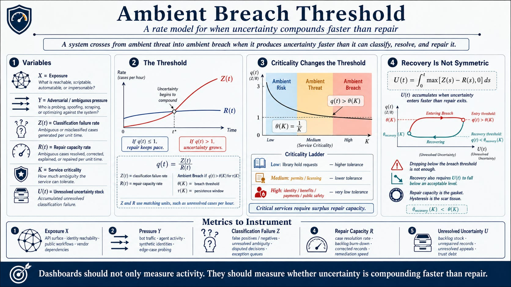

I had the formula wrong — here's what it changed
v0.1 folded trust degradation into the breach definition. That was circular. The correction matters — and it opens three questions I'll take in the next pieces.

*Series note: This is the first piece in a short Ambient Breach v0.2 series — the correction. Next: a short public thesis, an operating guide for leaders, and a narrative case showing what the ratio looks like inside an institution before anyone calls it a breach.*

------------------------------------------------------------------------

# The Correction I Had to Make

I’ve been sitting with an error in the v0.1 model.

Not a typo. Not a labeling issue. A structural mistake — the kind that feels fine until you try to falsify the thing and realize you’ve built a loop.

Here’s what happened.

In the original Ambient Breach formulation, trust degradation (T_d) appeared in the numerator of the breach ratio. The logic seemed reasonable: when trust degrades, the system becomes harder to navigate, which amplifies classification failures, which drives breach further. Felt causal. Felt dynamic.

It was circular.

If trust degradation is what you’re trying to measure — what sustained breach *produces* — you can’t also put it in the definition of breach itself. You’ve made the output an input. The model becomes unfalsifiable in the worst way: not because it’s wrong, but because it can’t be wrong. Any observation confirms it. That’s not a model. That’s a hall of mirrors.

So v0.2 corrects it.

T_d moves out of the breach formula entirely. It is now what sustained breach *causes*, not what defines it. The breach condition stands on its own:

Z is the rate at which your system generates ambiguity it cannot classify. R is the rate at which your organization resolves that ambiguity through genuine repair. Breach begins when q exceeds the threshold **θ(K) = 1/K** for your criticality level — and sustains there across a window τ(K).

No circular term. Clean causal chain.

------------------------------------------------------------------------

Why does this matter beyond internal housekeeping?

Because circular models give people false confidence. If T_d is both in your breach definition and your breach output, you can always find a story where the number makes sense. You never have to confront the moment when you were wrong about the system’s state. The model accommodates rather than tests.

Removing T_d from the numerator forces a harder question: is the ratio itself honest? Is Z measured or estimated? Is R a genuine throughput number or a capacity fiction — what we think we can repair, not what we’re actually repairing?

The correction sharpens the instrument. And sharpening the instrument is the point.

------------------------------------------------------------------------

The piece of the model that became clearer in v0.2 is hysteresis.

When q drops below θ(K), the breach condition formally clears. Organizations typically read this as recovery. It is not.

The system carries residue from the breach window: unresolved records that were never corrected, adversarial actors who spent the breach period mapping the system’s seams, workers who operated above capacity and don’t recover when the incident closes. These don’t reverse when the ratio improves. They compound.

Recovery requires more than q falling below threshold. It requires the unresolved uncertainty stock U(t) to be actively drawn down, repair minimums met — records corrected, people notified, exploit paths closed. You can pass the breach threshold on the way down and still be nowhere near recovered. The damage curve is not the mirror of the accumulation curve.

I think this is true of institutions more broadly. And of the people who submitted appeals during the breach, received wrong determinations, and are still waiting. The institution’s recovery clock and theirs are not the same.

------------------------------------------------------------------------

The correction also surfaces a gap I didn’t fully see before.

The model assumes that the people running it can see all of q. That one team has visibility into both the classification failure rate and the repair capacity.

That assumption isn’t always true.

Imagine two analysts — a cybersecurity threat hunter and a fraud analyst at a state unemployment agency — both receiving the same federal threat intelligence, both watching the same adversarial campaign from opposite sides of an organizational wall. Both Z’s are rising. Neither can see the other’s half. They attend the same weekly CISO briefing. They leave without knowing they’re working the same case.

The model I’ve built measures what one team can see. It doesn’t measure what neither can. Collective defense — the standing mechanism for threat intelligence to move across agency lines at the speed of the adversary’s tempo — is what makes the full ratio visible. This state didn’t have it. Most don’t.

Whether q = Z/R can be extended to see across that seam, or whether that requires a different instrument entirely, I don’t yet know. That’s the open question the correction didn’t answer.

------------------------------------------------------------------------

This correction does not finish the model. It opens the next three questions.

First: what does ambient breach look like before anyone calls it a breach — inside a real institution, with real analysts watching real signals?

Second: what should a security or public-sector leader actually measure on Monday morning?

Third: what happens when the relevant ambiguity is split across agencies that are not in the same conversation?

I’ll take those in the next three pieces: the public thesis, the operating guide, and the narrative case.

------------------------------------------------------------------------

The correction makes the model smaller and more falsifiable. That’s the right direction.

A framework that can accommodate any observation isn’t a framework — it’s a vocabulary. Useful for naming things, useless for predicting them. The corrected version can be wrong. That’s what makes it worth testing.

Thanks for reading. The next pieces follow shortly.

— Chris

*Chris Perkins writes about trust, systems, and the conditions that make both possible. Kinetic Trust Protocol: kinetic-trust-protocol.net*

