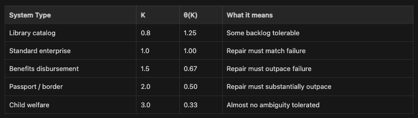

Ambient Breach v0.2: What to Measure When the Dashboard Is Green

Series note: Part 3 of a short Ambient Breach v0.2 series. The research note explains the model correction. The short public thesis names the problem. This piece shows how to measure. The narrative essay shows what the ratio looks like inside an institution before anyone calls it a breach.

## Ambient Breach v0.2: What to Measure When the Dashboard Is Green

In the [research note](https://open.substack.com/pub/kinetictrust/p/i-had-the-formula-wrong-heres-what?r=6yr1xq&showWelcomeOnShare=true), I explained the correction: trust degradation is not part of the breach definition. It is what sustained breach produces. Moving it out of the formula makes the model falsifiable.

This piece is about use.

If the corrected ratio is q = Z/R, what should a leader actually measure?

------------------------------------------------------------------------

### Start Here: What the Dashboard Is Hiding

Most security and operational dashboards show composite health scores — green, yellow, red — derived from aggregated signals. These are event instruments. Ambient breach is a rate problem. The dashboard is optimized for the wrong question.

The eight operational ledgers that feed the ABT (ambient breach threshold) tell you what the dashboard hides:

1.  Classification queue depth — unresolved ambiguity accumulating in backlog
2.  False-positive rate — legitimate actions misclassified as threats
3.  False-negative rate — adversarial actions cleared as legitimate
4.  Mean repair time — time from identification to genuine resolution
5.  Repair throughput — volume resolved per shift, day, or week
6.  Exploit-path closure rate — known seams patched vs. discovered
7.  Record correction rate — misclassified records reaching accurate state
8.  Analyst classification accuracy over time — are your people getting faster or slower?

These eight ledgers reveal the ratio the composite dashboard hides.

------------------------------------------------------------------------

### The Ratio

    q = Z/R

Z is your classification failure rate — the volume of ambiguity your system generates per unit time that it cannot resolve. R is your repair capacity rate — the volume of ambiguity your organization is actually resolving through genuine action: cases closed, records corrected, exploits patched, uncertainty cleared.

When q is below your threshold, you're resolving uncertainty faster than you're generating it. When q exceeds threshold and holds, the backlog accumulates. The uncertainty stock U(t) grows. The institution begins operating on a growing foundation of things it cannot verify.

The threshold is set by criticality.

------------------------------------------------------------------------

### The Threshold: θ(K) = 1/K

θ(K) = 1/K, where K is service criticality — a commitment about how much sustained ambiguity this service can carry, and whose life becomes more uncertain when it carries too much.

K is not a physics constant. It is a decision — made explicitly or by default — about acceptable risk. The person with the most institutional power to set K is rarely the person who bears the consequence when it's set wrong.

Again:

    Breach condition: q > θ(K) sustained for window τ(K)

Brief spikes are noise. Sustained exceedance is breach.

------------------------------------------------------------------------

### Hysteresis: When q Drops, You Are Not Done

When q drops below θ(K), organizations typically read this as recovery. It is not.

The system carries four categories of residue from the breach window:

- Unresolved records — misclassified cases never corrected, still in the uncertainty stock
- Adversary map — during the breach window, adversarial actors learned the system's seams. They don't forget.
- Worker degradation — staff who operated above capacity don't recover when the incident closes
- Trust already lost — constituents who experienced the breach have already updated their model of your reliability

Recovery requires: q sustained below a tighter recovery threshold, uncertainty stock U(t) actively drawn down, records corrected, affected parties notified, exploit paths closed, explanation issued.

You can be formally out of breach and still be months from recovery. Security programs that close incidents at threshold-crossing without running the recovery protocol are measuring the wrong endpoint.

------------------------------------------------------------------------

### The Cell Check: Five Questions — and One More

Before you have the ratio numbers, you have the Cell Check:

1.  What did we make reachable? — What data, systems, or decisions became accessible that weren't before?
2.  Who is learning the system faster than we are? — Where is the adversarial learning rate exceeding your internal modeling rate — and are all the agencies in your threat surface answering this question together?
3.  Can we still tell service from attack? — Not in aggregate. On any given request, at the point of classification.
4.  How fast can we repair what becomes uncertain? — Actual throughput given current staffing, tooling, and backlog.
5.  Is Z growing faster than R? — Is the ambiguity generation rate trending up while repair capacity holds flat or declines?

And one more the Cell Check doesn't include: Are all the people who can see different parts of Z in the same conversation?

The model assumes one team can see q. In real institutions, q is often distributed across agencies that don't share situational awareness.

Collective defense — a standing mechanism for threat intelligence to move across agency lines at the speed of the adversary's tempo — is what makes the full ratio visible. It is not a tool. It is an organizational capability. Most institutions don't have it.

Cell Check: [kinetic-trust-protocol.net/research/cell-check](https://kinetic-trust-protocol.net/research/cell-check)

------------------------------------------------------------------------

### Running the Numbers

The interactive ABT calculator lets you set your K value, input your Z and R estimates, and see your q ratio against the threshold in real time. It shows the recovery condition — not just whether you've cleared breach, but whether the repair minimums have been met.

Calculator: [kinetic-trust-protocol.net/research/ambient-breach](https://kinetic-trust-protocol.net/research/ambient-breach)

------------------------------------------------------------------------

The dashboard measures events. The ABT measures dynamics. Collective defense makes the dynamics visible across the full threat surface.

Those are three different instruments. Most organizations have one... too many do not have any.

The narrative version of this argument follows two analysts watching the same campaign from opposite sides of an organizational wall — same state, same threat intelligence, no shared mechanism for what one knows to reach the other.

------------------------------------------------------------------------

Chris Perkins is the author of the Kinetic Trust Protocol, a framework for trust infrastructure in human-AI systems. Published at kinetic-trust-protocol.net.
