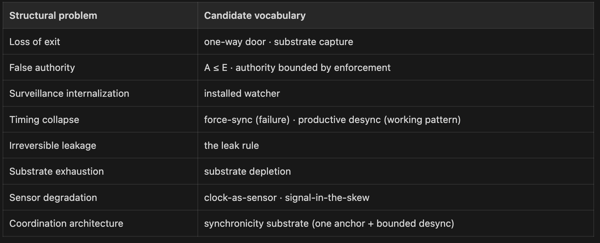

If the Framework Works, You'll Be the Last to Know
Notes on substrate adoption, credit, and the strange success of becoming infrastructure

When I started building the Kinetic Trust Protocol last year, I imagined a particular kind of arrival. The email that says *“we’re using your framework.”* The citation in a paper. Conference invitations. The LinkedIn message from someone at a Fortune 500 saying *“we built this and it changed how we work.”* The US government saying, “*heyyy, we’ve setup a Deep Blue Zone.”*

I had it backward. The acequia parciantes in northern New Mexico don’t credit the 800AD founders. They show up with shovels.

The thing I’ve come to understand — slowly, and with a kind of useful disappointment — is that working substrate is invisible by design. If KTP gets adopted the way it’s supposed to, I won’t hear about it.

The framework will become operational infrastructure for organizations and communities that have no obligation to tell me. They’ll use the vocabulary. Some won’t cite the source. Some won’t know the source. And that’s not a failure — that’s the *success condition* of substrate.

I’ve watched people I respect — researchers, founders, architects — build extraordinary things and then turn bitter when those things were used without credit. The bitterness is rational. It is also a category error. Substrate doesn’t ask for credit. It asks to be used.

So the question I’ve been sitting with: **if no one is going to tell me, how do I know?**

------------------------------------------------------------------------

## The signal is in the vocabulary

Specific terms become diagnostic because they’re unusual enough to be worth tracking. If *installed watcher* appears in a *Times* op-ed, or *substrate depletion* shows up in an economics commentary, or *productive desync* lands in an enterprise architecture blog post outside the original community, the vocabulary may be traveling whether or not anyone names the source.

*Diagnostic vocabulary grouped by the structural problem each term names — the vocabulary is functional, not branded.*

The list above is grouped by what each term names — eight structural problems, each with one or two candidate words. None of it is settled. All of it is forming in private notebooks and small communities of practice. The thing that matters isn’t whether the word stays. The thing that matters is whether the problem the word names has become legible enough to refuse.

------------------------------------------------------------------------

## The signal is also in refusals

What I didn’t expect when I started this work was that adoption would show up first as *refusal*. Not as adoption itself.

The pattern across the refusals I’ve been collecting is that institutions begin to refuse before they begin to name. The refusal is the dictionary’s first draft. The structural shape of the refusal precedes the vocabulary that names the shape. The name follows when enough refusals have accumulated to make the pattern visible.

Immune systems refuse before they classify. The refusal is the first response; the name is the learning.

------------------------------------------------------------------------

## Six months out

I’ll be brief here, because the predictions belong elsewhere. The flagship piece in this series — *The Days at Risk*, on Medium — handles the full six. The companion field note — *You’ll Hear It In A Refusal First*, on LinkedIn — handles the practical detection. What I want to say here is the part you can carry across both:

*Watch for structural convergence, not citation.*

The signal is in the shape, not the attribution — and the credited version usually lags the operational version. Some (I mean: most) of the people doing this work right now have never heard of me. Some of the work I am most proud of will be done by people I have never met, under words I did not invent, and that will be evidence that the thing was real.

------------------------------------------------------------------------

## One last thing

Here is the part I am most honest about.

If KTP works the way it’s supposed to work, I won’t be the canonical voice on KTP in three years. Someone else will be — someone who took the framework, built the right thing with it, and now speaks for the work because they did the work. That’s how substrate adoption proceeds. The author becomes the maintainer, then the editor, then the historian.

The substrate becomes the substrate.

The acequia parciantes don’t talk about the founders. They talk about the snowmelt and the spring cleaning. They talk about whose turn it is on the water. The framework that made all of it possible — the *acequia madre*, the *mayordomo*, the *limpia* — is the air they breathe.

If we get this right, that’s where KTP goes. Into the water. Into the spring cleaning. Into the way a community refuses something it can’t enforce, the way an organization names a cost it shouldn’t be asked to bear, the way an engineer recognizes that the gap between two clocks is the signal.

No one will have an obligation to tell me. I’ll know because I’ll see the words.

— Chris

------------------------------------------------------------------------

*From* ***The Counter Is Running*** *— a short series on how institutions name risks before they can govern them. Companion pieces: “You’ll Hear It In A Refusal First” (LinkedIn) · “The Days at Risk” (Medium).*
