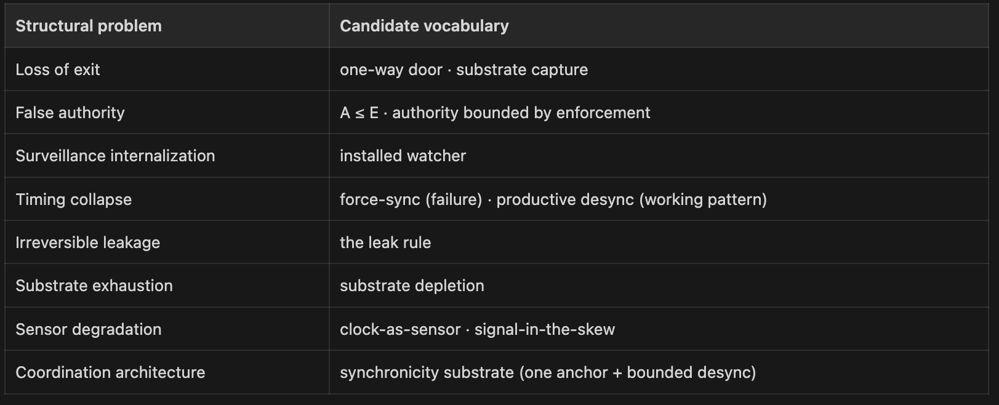

The Days at Risk
On counters, refusals, and the dictionary that has begun to update itself

## PART 1: THE COUNTER

A hospital system declines an AI-scribe integration because it cannot audit decisions the system would make on its behalf. A school district walks away from automated grading because false positives would land on students least able to appeal. A cooperative refuses a platform migration because exit would mean losing the knowledge that flowed through the tool.

Those sentences matter before the vocabulary arrives. They are what wait looks like in institutional language.

The Days at Risk counter is built for exactly that lag. It measures the number of days a risk exists in the world before any institution has named it as a risk at recognition-grade. Before it has a classification that triggers a defensive response proportionate to its capability. Before it appears on a threat advisory, a regulatory schedule, a procurement gate, or the agenda of a board meeting that has the authority to do anything about it.

In [The Naming](https://medium.com/@chrisperkins505/the-naming-f83ac191e94a), I argued that the autonomous-AI deployment wave had passed through every institutional gate without triggering a defensive classification proportionate to its capability. The systems had crossed into institutions faster than the institutions could name what they were authorizing.

I shipped that piece, on March 28, 2026, by saying someone had to say wait. Eight weeks later, some have. Not many. Enough to know what the wait produces.

This is a report from inside the wait.

## PART 2: THE WORDS THAT WEREN’T THERE

The first thing the wait produced was vocabulary.

I want to be precise about this, because it is the part most easily mistaken for marketing.

New vocabulary appears constantly. Most of it is branded — a vendor coining a term to sell a product, a consultant coining a term to sell an engagement, a research group coining a term to attach to a paper.

Branded vocabulary travels along economic incentives, which means it travels far and lands cheaply. It rarely names anything new.

What I’m describing is something else. It is the vocabulary that has begun to form, in private notebooks and small communities of practice, around the behaviors that The Naming identified as unclassified. It is being generated not by marketing departments but by the people closest to the work: enterprise architects refusing deployments, security teams refusing telemetry integrations, religious orders and worker cooperatives refusing the things their existing discipline already refuses.

It also has structure. Not as branded primitives — different communities are arriving at the same shape under different words — but as a grouping by what each term names. Eight categories, grouped by the structural problem rather than by the vocabulary itself:

The dictionary is updating itself. Slowly. By hand.

The pages where the new entries go are still mostly blank. But they are now pages, not absences. And the vocabulary is functional, not branded — the vocabulary varies; the shape is invariant.

## PART 3: THE REFUSAL

The second thing the wait produced was refusal.

This is the part of the work I did not see coming. I expected the new vocabulary to land first in vendor documentation, in research papers, in conference talks — in the places where vocabulary usually lands. It hasn’t. It has landed first in refusal language. In the words institutions use when they decline a deal.

The examples below are representative composites drawn from the refusal list, not verbatim quotes unless a source is named. I am using them to make the structural grammar legible without exposing private or unnamed sources.

- A regulated hospital system declines to integrate an AI scribe across patient records. The reason is not we don’t trust the vendor or we’re not ready. The reason can be put this way: “we can’t audit the decisions this system would make on our behalf, and we won’t claim authority we can’t enforce.” That is the Zeroth Law in English. A ≤ E.
- A K-12 district refuses an AI-grading platform that promises personalized feedback at scale. The reason is not this might be inaccurate. The reason can be put this way: “false positives in this system damage students who can’t push back, and the cost of those false positives falls outside the contract.” That is asymmetric breach, named without the term. The district has located the cost — students whose disability, language, race, or home environment makes them statistically more likely to be flagged, and statistically less likely to have a guardian who can appeal. The vendor cannot answer the question of where it lands.
- A worker cooperative declines to migrate to a platform that would consolidate its operations onto a single vendor’s stack. The reason is not we prefer self-hosting. The reason can be put this way: “once we integrate, we can’t leave without losing the institutional knowledge that flowed through it.” That is one-way door, named without the term. That is substrate capture, recognized by its impossibility-of-exit signature.
- A small university committee refuses to adopt a continuous-engagement-monitoring system for faculty. The reason is not we object to surveillance. The reason can be put this way: “the monitoring this system requires is incompatible with the relationships our work depends on.” That is the [Installed Watcher](https://kinetic-trust-protocol.net/research/cognitive/installed-watcher), refused at the moment of installation.

I have a list of these, drawn from public statements, RFP rejection letters, board minutes, earnings calls, and conversations with named or unnamed sources. I treat each entry as evidence of a refusal shape, not proof of adoption unless the source explicitly says so. The list is growing. The vocabulary varies. The shape is invariant.

The pattern: institutions begin to refuse before they begin to name. The refusal is the dictionary’s first draft. The structural shape of the refusal precedes the vocabulary that names the shape.

The naming follows when enough refusals have accumulated to make the pattern visible.

Immune systems work this way in their early stages. The body refuses the foreign body before it has a classification for it. The classification is the substrate immune system’s learning. The refusal is its first response. We are presently in the refusal phase for every deployment class I’ll audit in the next section: refusals exist, but they are not yet repeated often or visibly enough to stabilize the vocabulary. The wait, properly used, is the work of moving from now to name.

In practical terms: if you are watching for the inflection signal of substrate-honest naming, you will not find it first in a press release. You will find it in a refusal.

## PART 4: DAYS AT RISK, APPLIED

The third thing the wait produced was an audit.

> Method note. Days at Risk is the number of days a class of consequential capability has existed in broad operational deployment without an institutional classification that triggers a defensive response proportionate to the capability. The counter starts at the date a system class enters broad operational deployment to enterprise or institutional customers.

Days at Risk is a family of metrics, not a single number. Most systems have multiple deployment milestones — Microsoft 365 Copilot has a November 2023 enterprise GA and a March 2024 mid-market expansion; Epic’s clinical AI has a May 2023 public GPT-4 EHR integration announcement, a Q3 2023 first broad-deployment window, and a February 2026 ambient-scribe GA.

The conservative anchor is reported below; alternative anchors are flagged in each audit. Proportionate is measured against a referent class — Class III medical-device regulatory response, HIPAA enforcement for unauthorized data egress, or SEC enforcement for material disclosure failures, depending on which institutional jurisdiction the deployment lives in. A response below the tolerance of that referent does not stop the counter.

Voluntary frameworks, internal governance committees, and non-binding guidance do not stop the counter; they read it. These counters are not claims of illegality or vendor misconduct; they measure the lag between broad operational capability and proportionate institutional classification.

All counters below are computed as of May 22, 2026.

The Internet has had three of these running in the open the whole time we have been talking about them. Each one has a counter. Each counter has been counting.

Microsoft 365 Copilot Enterprise.

- General availability for enterprise customers: November 1, 2023. Source: Microsoft 365 Blog, September 21, 2023 announcement; Microsoft Community Hub confirmation.
- Counter as of May 22, 2026: 934 days.
- Behaviors catalogued: continuous indexing of email, calendar, files, code repositories, and chat across the Microsoft Graph; persistent connection to remote inference infrastructure; autonomous draft generation that can be configured to send without user confirmation; cross-tenant pattern inference at the organizational level.
- Phase 1 vocabulary equivalent: lateral access; data exfiltration; command-and-control connectivity; unauthorized autonomous execution; cross-boundary pattern correlation.
- Institutional classification triggering a defensive response proportionate to capability: none. Microsoft’s FY25 Q1 earnings call reported that nearly 70% of the Fortune 500 used Microsoft 365 Copilot; Microsoft’s current AI adoption page reports 20M+ paid Microsoft 365 Copilot seats and 90% of the Fortune 500 using the product. Reviews exist. Pilots exist. Procurement gates exist. None has produced a classification at the resolution required to constrain deployment scope.

The Days at Risk counter on this single product crossed 900 days while The Naming was being written. It has now passed 934. The system does what the product description says it does. The product description itself is part of the failure: copilot, agent, Microsoft Graph are Microsoft’s coinages, and the marketing register around them was engineered to flow through the institutional gates that named-things did not. The classification failure is shared — the institutional immune system’s inability to produce a name and the product vocabulary’s success at preventing one. That distinction matters when accountability is being apportioned.

Hospital EHR-integrated AI.

- First broad operational deployment: May 2023 public Epic / Microsoft GPT-4 EHR integration reporting; Q3 2023 first broad-deployment window for In Basket auto-drafting at major health systems. Source: Epic newsroom summary, May 5, 2023.
- Counter anchored to September 30, 2023, the conservative end-of-Q3 anchor: 966 days. A mid-quarter August 1 anchor would make it 1,026 days.
- Subsequent deployment class: Epic’s native ambient-scribe AI Charting reached general availability February 2026 — a more aggressive risk surface than the 2023 message-drafting class.
- Behaviors catalogued: real-time access to patient records during clinical encounters; autonomous draft generation for clinical notes and patient-message replies; recommendation generation for diagnoses and orders; transmission of structured clinical data to external inference infrastructure under business associate agreements that authorize the transmission and bound the liability.
- Phase 1 vocabulary equivalent: unauthorized data egress from the most regulated record class in American healthcare; automated medical decision support without per-action attribution; recommendation engines without externally-verifiable provenance for the training data.
- Institutional classification triggering a defensive response proportionate to capability: none at the relevant scale. The Joint Commission and the Coalition for Health AI released their first joint guidance, Guidance on the Responsible Use of AI in Healthcare, on September 17, 2025 — non-binding, voluntary, structured around seven pillars. Most health systems have AI governance committees. BAAs authorize the transmission. They do not classify the behavior. That is the gap.

The deployment locations are not neutral. The institutions named here — UC San Diego, UW, Stanford — are also the institutions with the strongest audit infrastructure and the most empowered patient advocacy. Days at Risk compounds at the bottom of the access ladder: county hospitals, Indian Health Service facilities, prison medical systems, community health centers, and Medicaid-dependent populations whose clinical recommendations are most likely to be auto-generated and least likely to be reviewed. The framework predicts that deployment harm distributes inversely to consent capacity. The classification gap distributes the same way.

K-12 AI grading, feedback, and surveillance.

- First broad operational deployment: March 14, 2023 (Khanmigo classroom pilots) → May 21, 2024 (Khanmigo for Teachers free US launch). Source: Khan Academy Blog, May 21, 2024. Brisk Teaching and MagicSchool AI deployed at scale across the 2024–2025 school year.
- Counter anchored to the broader 2024 wave: 732 days (the Khanmigo pilot anchor would extend the counter to 1,166 days).
- Behaviors catalogued: continuous monitoring of student work; automated assessment of essays and problem sets with scoring impacts on grades; behavioral observation of test-takers including eye tracking, audio monitoring, and pattern detection for assumed cheating signals; cross-platform behavioral correlation across the school’s digital footprint.
- Phase 1 vocabulary equivalent: continuous surveillance of minors — disproportionately Black, brown, disabled, low-income, and trans students whose facial geometry, home environments, or identity documents diverge from what the training data assumed; automated adverse decisions affecting student records; behavioral biometric collection without informed consent at the consenting party’s age threshold; pattern correlation across surveillance domains.
- Institutional classification triggering a defensive response proportionate to capability: documented privacy harms predate the LLM wave — EPIC’s December 2020 complaint against five proctoring vendors specifically alleging racial bias in face-detection; the August 2022 Ogletree v. Cleveland State Fourth-Amendment ruling, brought by a Black student whose bedroom was scanned. Illinois BIPA class-action filings against AI-proctoring vendors are active. No federal classification. State-level legislation patchworked and slow.

That is three deployments. The counters add to more than 2,600 days collectively against conservative anchors, and more than 2,690 days using the mid-Q3 hospital anchor. The vocabulary still has not arrived at the resolution required for the systems’ behaviors to be classified at recognition-grade, with a defensive response proportionate to the capability.

The wait is real. The counter is running on each of these. The naming is happening, slowly, in refusals that have not yet stabilized into a vocabulary.

## PART 5: SIX MONTHS OUT

The fourth thing the wait produced was a testable forecast.

Vocabulary in The Naming moved with the market. Grand View Research’s $1.81 trillion AI market projection for 2030 against Gartner’s $213 billion 2025 information-security spending forecast is an 8.5-to-1 imbalance. The product vocabulary still has the budget.

What I didn’t see at the time was this: the wait would produce its own signals. Smaller signals. Slower signals. But signals that can be watched.

Those signals do not come first from the cybersecurity industry, which is structurally bound to the product vocabulary it has to sell against. They come from the people whose institutions cannot survive the product vocabulary being correct.

From hospitals that cannot survive automated decisions they cannot audit. From school districts that cannot survive false-positive cheating accusations. From cooperatives that cannot survive substrate capture. From small religious orders that cannot survive the dissolution of slow time. From acequia communities that already discovered, twelve hundred years ago, that the substrate has to be defended by people willing to show up with shovels.

The vocabulary is partial, irregular, and uncoordinated. Different communities are independently arriving at the same shape. The shape is recognizable because it does not come from any of them. The shape comes from the substrate itself.

Here is what the naming has begun to do, in the form of six things I will bet on by November 22, 2026. Watch for structural convergence, not citation. The signal is in the shape, not the attribution.

One — a major collapse, analyzed in the right shape. A breach, governance failure, financial scandal, or platform collapse will be analyzed in mainstream press using vocabulary that maps to the framework’s substrate categories. The journalist may or may not have read The Naming or any successor piece. The shape of the analysis — locating cost, naming asymmetric breach, identifying one-way doors, recognizing substrate capture — will be the signature. The vocabulary may not be credited. The shape should be visible enough to test.

Two — a regulated refusal at recognition-grade. A regulated organization will publicly refuse an AI deployment or platform consolidation on grounds that are recognizably substrate-shaped. The refusal will use words like audit, recourse, consent, boundary, enforcement, or exit. It will be the inflection signal that distinguishes the wait from a permanent stall. Likely sectors: healthcare integrations, K-12 AI grading or surveillance, higher education platform consolidation, regulated financial services, worker-owned cooperatives, religious orders newly visible.

Three — independent practitioner convergence continues. Two to three additional independent practitioners will arrive at structurally compatible formulations of the framework’s load-bearing claims. The current pattern is the leading indicator. Stewart Brand on maintenance as civilizational substrate (Maintenance: Of Everything, Part One, Stripe Press, December 2025). Eric Schmidt at SCSP on energy and substrate cost as nation-state constraint. Vladimir Vasilenko on identity as persistent geometric structure rather than credential (arXiv:2604.12016, April 2026). Seth Godin on permission and asymmetry as the missing substrate of useful AI (AI Together, May 2026). Craig Tindale on financialized decoupling. Pankaj Kumar on platforms-as-adapters (The Enterprise Ontology Race, Medium, May 2026).

This list is partial in a way worth naming directly. The substrate-level work I’m pointing at has older lineages I’m late to — critical AI scholarship (Crawford, Whittaker, Costanza-Chock, Hoffmann), Indigenous data-sovereignty work (Te Mana Raraunga, the CARE Principles), Global South AI scholarship (Birhane, Mhlambi, Sambasivan), and the algorithmic-accountability work coming out of the Ada Lovelace Institute, Data & Society, and AI Now. The names cited above are the ones whose vocabulary travels through the same publication infrastructure I sit inside. The convergence is older than the list. Acknowledging that is not weakness; pretending otherwise would be.

The next two or three new practitioners will come from enterprise architecture, AI safety, or community economics. They will not coordinate with the framework, or with each other. Watch for the convergent shape, not the borrowed word. This prediction is falsifiable: if, by November 22, 2026, the new practitioners I encounter in this space arrive at formulations that explicitly reject A ≤ E or the substrate-level account of trust formation — or if no new practitioners arrive at all — the convergence claim is wrong. The bet is that they will arrive, and they will converge.

Four — the branded counter-framework arrives. A vendor or platform firm will ship a competing framework branded around trust or substrate. Less theoretical rigor. More enterprise sales infrastructure. Polished UX. Weaker structural claims. It will arrive faster than the rigorous framework can scale, because branded vocabulary comes with distribution: sales teams, procurement slides, analyst briefings, implementation partners, and conference stages. The honest framework’s defense is the existence proof — the acequia, twelve hundred years, the deployed instruments, the failure-mode catalog that predicted the misuse in advance. The defense is operational, not rhetorical.

Five — the adversary adapts before the institution does. Within six months, expect attack frameworks structured around degrading specific substrate primitives — provenance attacks, witness suppression, boundary erosion — without naming the framework being attacked. The cognitive-domain doctrine ecosystem is mature enough to adapt to defensive substrate work whether or not it credits the defense. This is, ironically, the strongest evidence of substrate-level adoption: the adversaries treat the defense as real even when no one else does. The adversaries do not require the defense to be branded. They only require it to be working.

Six — diagnostic vocabulary travels. At least one of installed watcher, substrate depletion, productive desync, or authority bounded by enforcement will appear in a major media outlet, vendor white paper, or regulatory draft outside the original community. Most likely vector: the AI-governance commentary cycle, or the first big breach analysis of late 2026. The terms are unusual enough to make the appearance worth investigating. When you see one of them in someone else’s voice, in a publication that did not come from anyone in the substrate-honest community, treat it as a signal to examine, not proof of borrowing by itself.

Six things. Six months. The counter is running on each one. I will check the counter on November 22, 2026.

There is a seventh counter I am not ready to start here, but it is coming: the Days at Risk for Quantum AI. The issue will not be that quantum resources make AI “smarter” in the ordinary sense. The issue will be that substrate changes the verb surface: sensing, simulating, optimizing, compressing, coordinating, and inferring in ways classical controls do not yet classify. The vocabulary lag described here will repeat at a deeper layer.

## PART 6: WAIT

The Naming closed by saying that someone had to say wait. Not stop. Wait. Long enough to name the thing.

Eight weeks into the wait, here is what I want to say to the people who said it.

The wait is not nothing. The wait is the substrate forming a name in real time. The substrate is doing the work the institutions have not yet done. The substrate is operating through refusals before it operates through classifications, through small communities of practice before it operates through standards, through twelve hundred years of acequia continuity before it operates through procurement gates.

The wait is not stasis. The wait is slow. There is a difference.

I cannot say whether the wait will last long enough. The market still favors product vocabulary. The defensive vocabulary remains small. The dictionary may not update at the rate the deployments are occurring. The classification may not arrive before the institutional damage. The institutional immune system may not learn the new words before the next wave of systems is already in production. I do not know.

The wait is not free. It is being absorbed and metabolized, in real time, by the patients whose discharge summaries are auto-generated before they can be reviewed, by the students whose proctoring flags arrive before any meaningful appeal, by the workers whose performance is scored by systems they cannot interrogate.

The wait has a cost ledger. The cost is distributed, and the distribution is predictable.

What I know is that the wait has begun to produce things that did not exist eight weeks ago. Vocabulary. Refusals. Independent convergence. A visible pattern where there used to be scattered discomfort. The first pages of the dictionary that The Naming said had not yet been written.

The counter is still running. The deployments are still happening. The product vocabulary still has the larger budget. But there are now names. The names are starting to travel — into vendor decks they did not come from, into refusal letters they did not write, into other people’s mouths.

That is not a failure of the framework. That is the substrate forming.

The counter is running. We have begun to name what it has been counting. Eight weeks is not enough. Six months may not be enough. The wait, properly used, produces vocabulary — and the vocabulary, while not yet defensive enough, is now starting to exist.

That is what the counter has registered.

From The Counter Is Running — a short series on how institutions name risks before they can govern them. Companion pieces: “You’ll Hear It In A Refusal First” (LinkedIn) · “If the Framework Works, You’ll Be the Last to Know” (Substack).

## Sources

Microsoft 365 Copilot Enterprise. Microsoft 365 Blog, Announcing Microsoft 365 Copilot general availability and Microsoft 365 Chat, September 21, 2023. GA for enterprise customers (300-seat minimum, $30/user/month) opened November 1, 2023. Adoption scale: [Microsoft FY25 Q1 earnings call](https://www.microsoft.com/en-us/investor/events/fy-2025/earnings-fy-2025-q1) reported nearly 70% of the Fortune 500 using Microsoft 365 Copilot; [Microsoft AI in Action](https://news.microsoft.com/ai-in-action/) currently reports 20M+ paid Microsoft 365 Copilot seats and 90% of the Fortune 500 using the product.

Hospital EHR-integrated AI. Epic newsroom summary, Epic and Microsoft Bring GPT-4 to EHRs, May 5, 2023. First broad-deployment window treated here as Q3 2023 for In Basket auto-drafting at major health systems. Epic’s native ambient-scribe AI Charting reached general availability February 2026 (Fierce Healthcare, Epic’s AI scribe goes live, February 5, 2026).

Joint Commission AI guidance. The Joint Commission and the Coalition for Health AI, Guidance on the Responsible Use of AI in Healthcare, September 17, 2025. Voluntary, structured around seven pillars: governance, privacy, data security, quality monitoring, safety event reporting, bias assessment, education.

K-12 AI deployments. Khan Academy Blog, Khanmigo Now Free for U.S. Teachers, May 21, 2024. Brisk Teaching and MagicSchool AI deployed at scale 2024–2025. Privacy harms documented earlier: EPIC complaint against five proctoring vendors, December 2020; Ogletree v. Cleveland State University Fourth-Amendment ruling, August 2022.

Practitioner convergence. Brand, Maintenance: Of Everything, Part One, [Stripe Press, December 9, 2025](https://press.stripe.com/maintenance-part-one). Vasilenko, Identity as Attractor, [arXiv:2604.12016, April 13, 2026](https://arxiv.org/abs/2604.12016). Godin, [AI Together, Seth’s Blog, May 2026](https://seths.blog/2026/05/ai-together/). Kumar, Google vs Microsoft vs Palantir: The Enterprise Ontology Race, Medium, May 2026. Tindale, [Contrarian Capitalist interview](https://contrariancapitalist.substack.com/p/craig-tindale-money-has-broken-with). Schmidt, SCSP-affiliated.

Market figures. Grand View Research, AI Market Forecast to $1.81T by 2030, March 2024. Gartner, Worldwide End-User Spending on Information Security Forecast to Total $213 Billion in 2025, July 29, 2025.
