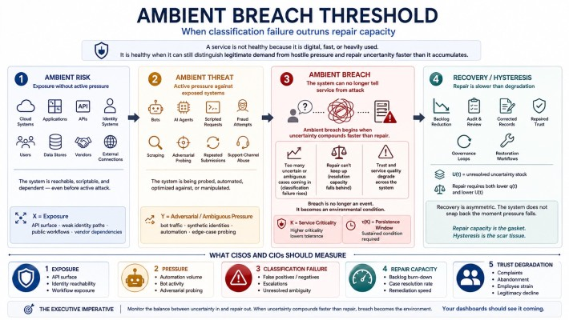

Your SIEM Can't Tell You If You're in Breach
Breach is a rate, not an event — and most platforms are built to miss it.

Digital Gravity newsletter surpassed 700 subscribers this week. Thank you for reading and sharing. If you would, please hit "like" or share this piece. It will help get the word out. If you have ideas for topics, please hit me up. KTP+anything is interesting!

------------------------------------------------------------------------

A breach is not an event.

It's a rate — and most security platforms are architecturally incapable of measuring it.

We picture breach as a moment: an alert fires, a tile turns red. The dangerous version is quieter.

It's the rate at which your environment generates uncertainty — false positives, false negatives, the genuinely ambiguous — outrunning the rate at which it verifiably repairs it. Hold that condition and you are in breach while every dashboard stays green. I've been calling it Ambient Breach.

If you've followed this newsletter, Digital Gravity, you'll recognize what I am pointing at. It's the one behind Days at Risk and Time to Good Decision: stop scoring security as a state, and start measuring it as a clock. Ambient Breach is the rate that clock is actually tracking.

To measure that rate, a platform has to clear three bars. Most clear one.

1. Keep what you couldn't classify. You can't count ambiguous events if the pipeline forced them into a category the instant they arrived. Normalize-on-ingest and schema-on-write discard the ambiguity before you can measure it. Only a schema-on-read engine — meaning imposed at search time — keeps the raw event, so you can count it now and re-judge it later when you learn you closed it wrong.

2. Measure the whole window, reliably. Generation-versus-repair is an integral over time. If your tool silently drops late-arriving events, the integral is wrong and nothing tells you. "We alert in five minutes" is not "we measured the whole five minutes."

3. See the whole substrate. "Did the fix actually restore the service?" is an observability question. "Is this an attack or a backbone path failure?" is a network question. A security-only tool measures one facet and is blind to the substrate the breach actually lives in.

------------------------------------------------------------------------

Run your own stack against those three:

→ The endpoint-first platforms bought a data lake, then bolted it under a detection product and can't see past security.

→ The cloud-native SIEMs share one query engine — but drop late events by default and stop at their own cloud's edge.

→ The legacy and search-derived SIEMs decide what your data means at the front door, the one move that makes the ambiguity impossible to count.

→ The observability platforms read performance beautifully and security barely.

→ The AI-first platforms — startups and pivoted incumbents alike — ask you to pour your data into a black box you can't inspect, under terms that let the vendor's model learn from it.

That last one fails twice: you can't independently measure a substrate whose meaning you've outsourced to someone else's algorithm — and you handed the data over to do it.

Splunk clears all three — not because it's a better SIEM (and not because I work here), but because it was never only a SIEM. Splunk is a schema-less, time-series data-analytics platform that also happens to be a security tool, spanning security, observability, and network in one fabric.

And the data stays yours: Splunk y Cisco don't access it, use it, or train on it. Any exception is something you opt into — not a default you find later in the fine print.

That's the distinction the category keeps forgetting. A security tool tells you what happened. A data-analytics platform lets you measure whether you're breached..

Green dashboard, rising breach. Only one of those is a measurement.

—

Digital Gravity is a newsletter on the physics of trust in human–AI systems. Days at Risk and Time to Good Decision are in the archive; the Ambient Breach Theory lives at <https://kinetic-trust-protocol.net/research/ambient-breach>

------------------------------------------------------------------------

*DM me if you're interested in the math.*
