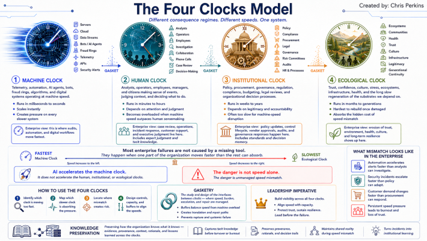

Tell Us How to Bribe Them Better

There is a question AI executives have started asking reporters, and it tells you more than any keynote this year. Jasmine Sun, who spent July driving between data-center fights in Wisconsin and Michigan, says her conversations with the people running the buildout keep arriving at what she describes as the same place: How much money do we need to give these cities? Tell us how to bribe them better.

Hold that question. By the end of this piece you'll hear what's wrong with it — and then you'll start hearing the same wrong note in rooms much closer to yours.

### The number that shouldn't exist

In Port Washington, Wisconsin, residents time the drive past their local site: a minute and forty-two seconds on the highway, at seventy miles an hour. That is the scale of thing being voted on.

Last August, a national poll by Embold Research for Heatmap found about four in ten registered voters opposed to a data center near where they live — against 44 percent in support. A close call. By May, in Heatmap's follow-up, opposition was at 71 percent. Marquette's polling drew the same line from another angle: 55 percent of Wisconsinites said data centers' costs outweigh their benefits in October, 69 percent by March, 76 percent nationally by July. One industry tracker counts more than a hundred local moratorium proposals across thirty-five states. New York's governor is backing a statewide pause. There is a national moratorium bill in Congress. The published pattern is enough to establish the first point: across differently worded polls, skepticism is broad and moving rapidly in one direction.

A second, more tentative clue comes from Charles Franklin, who runs the Marquette Law School Poll. Contested issues, he notes, tend to poll around 50/50 — a pro-case and an anti-case, fighting. This one does not, and Marquette finds the skepticism broad across partisan and demographic lines. Franklin's read, relayed through Sun, is that the split looks about the same whether or not you live near one.

If that read holds, it weakens the classic NIMBY explanation: opposition is not simply spiking next door and fading with distance. But the argument does not depend on the unpublished crosstab. The published polls establish the scale and direction of the drawdown. Sun's reporting tells us what is being drawn down.

And it isn't the deals. The deals are real. Sun's reporting is careful on this point, and so should we be: the Microsoft campus approved at Mount Pleasant this January carries a projected taxable value north of $13 billion, with tens of millions a year in eventual local revenue. Construction runs of two to six years produce six-figure jobs that don't require degrees. Sun pushes back on organizers who call the jobs a myth. The benefits exist.

They also aren't landing. The phrase she heard over and over, from stay-at-home moms and retired executives and farmers: nobody wants it. And about every specific promise — the water treatment, the rate guarantees, the jobs that stay: I don't believe them.

### The prediction

In March, after Jensen Huang's GTC keynote, I wrote [The Speed of Inference and the Depth of Trust](https://chrisperkins505.medium.com/the-speed-of-inference-and-the-depth-of-trust-56fd1099cdb0). The argument, in three sentences:

1.  The AI stack — energy, chips, cloud, models, applications — has no floor.
2.  The buildout is a concrete channel, engineered to move value fast; trust is the aquifer underneath it, and the speed of extraction now exceeds the speed of recharge.
3.  The map gets better, the territory gets worse, the aquifer drops.

The prediction was never that people would get angry. It was quieter than that: at some point the pro-arguments stop landing, because the thing that made arguments land was what the substrate provided.

Seventy-one percent is what a dropped aquifer looks like in a poll.

### Pouring concrete into the civic arroyo

The March piece told the story of Albuquerque's arroyos — the natural channels that caught monsoon water, slowed it, and let it soak into the aquifer under the city. In the 1960s the city poured concrete into them for flood control. Move the water fast, get it out. Nobody asked what the arroyos had been doing before we called them a problem. The aquifer dropped as much as 120 feet.

Watch the same move run on civic process.

A town hall, a zoning review, a public comment period — these are arroyos. Slow, frictional, and doing invisible work: they are where consent soaks in. The industry looked at that friction and saw latency. So it poured concrete.

First the NDAs. City council members signed them and then legally could not tell their own constituents what was coming — not the customer, not the size, sometimes not even that it was a data center. A construction-union VP gave Sun the old Irish line: the only way to keep a secret between three people is to kill two of them. The whispers moved anyway, through subcontractors and Facebook groups, and officials watched the story get away from them. One told her: we could not get ahead of social media, because we had signed an NDA. Note what actually happened there — the information was never suppressed, only the attestation was. Rumor is what a community runs on when its witnesses are under contract.

Then the litigation. Saline Township, Michigan — a few thousand people — voted 4-1 against rezoning 575 acres of farmland for a data center. The developer, Related Digital, sued within the week, arguing that a township with no industrial zoning amounted to unlawful "exclusionary zoning." A month later the parties entered a consent judgment: annual payments to the township and the schools, a package for farmland preservation and fire services, and the project moves ahead.

In [Every System Said Yes](https://www.linkedin.com/pulse/every-system-said-yes-chris-perkins-xgvwc) I asked who says stop — when the credentials are valid, the purpose is declared, and every layer built to grant permission has granted it.

Here is the same question at civic scale, answered. The room said no, four votes to one. The no was litigated into a settlement price. A no that can be sued away is a lock, not a wall.

Fast deals. No recharge. The flood arrives on schedule — it just arrives as polling. Those civic processes were gaskets: interfaces that translated machine-speed capital into evidence, consent, and repair.

### Four clocks, one desynchronization

Readers of [Gasketry](https://www.linkedin.com/pulse/gasketry-chris-perkins-dxh2c) know the Four Clocks. They are not four speeds on a single scale. They are four different regimes for absorbing consequence and producing repair. Everything in this story runs on one of them:

1.  The machine clock — the built. Accelerating. The buildout lives here: announcement to groundbreaking inside a year, valuations doubling, capacity sold before it's poured.
2.  The human clock — the person. Bounded. Consent lives here. Trust forms at the speed of people sitting across tables from each other, and that speed does not batch, parallelize, or scale with headcount. A town hall has a tick rate.
3.  The institutional clock — the designed. Zoning, ratemaking, elections. Slower than any person, faster than the land. The moratorium wave is this clock catching hold.
4.  The ecological clock — the substrate. Slow to recover, slow to forget. The aquifer lives here — and so does the ledger. GM's plant in Janesville closed in 2008; the contamination it left is still in the ground — cleanup is estimated at $30 million — and so is the memory. Foxconn promised 13,000 jobs up the road and delivered hundreds. When a resident asks why would this be the year they decide not to do it? — their bills carrying one approved rate increase after another since 2022 — that is the ecological clock talking. The land and the ledger forget at the same speed, which is barely at all.

Now the whole story compresses into one sentence: the machine clock ran years ahead of the other three, the NDAs were an attempt to stop the institutional clock from ticking at all, and the backlash is the desynchronization arriving as politics.

And the executives' question answers itself. A one-time check is a machine-clock instrument applied to a human- and ecological-clock deficit. Money can fund repair, but it cannot substitute for a mechanism that binds the future. That is why the bigger offers made things worse — Sun watched offer size and suspicion rise together. In a drawn-down environment, the size of the check is read as an estimate of the harm. The towns were never reading the offer. They were reading the well.

One more mechanism and the picture is complete: none of these towns is pricing Microsoft, or OpenAI, or any specific entrant. The process gives those towns almost nothing that would let them price one entrant separately from the class — no standardized stake, no bond, no visible obligation that survives failed promises. So promises price at the class level, and the class ledger holds Foxconn and the GM brownfield. Unstaked, every new arrival inherits the industry's trajectory instead of its own.

### Which clock are you spending on?

Here is the instrument, portable:

> Which clock does this initiative run on — and which clock does the thing it actually needs run on?

Because the data-center fight is just the largest current instance of a pattern your own organization runs weekly. The post-breach goodwill package — credit monitoring, an apology portal, spun up in days — that made customers angrier. The retention bonus that confirmed the layoff rumor it was meant to calm. The vendor assurance stack, fifty attestations deep, that lands with a security team as what are they papering over? The acquisition premium read as desperation. Machine-clock spending against a human-clock deficit, every one — and every one gets diagnosed, afterward, as a messaging failure.

In [Every Check Came Back Clean](https://www.linkedin.com/pulse/every-check-came-back-clean-problem-chris-perkins-mqwgc) I wrote about an adversarial swarm that passed every control by being younger than the question — no history, so nothing to flag. Empty read as clean. The towns are the mirror image: an industry failing every check by being older than its promises. The full ledger reads as dirty. Same instrument, opposite ends of the scale — which is worth a security practitioner's attention, because your controls are calibrated for one end of it, and your customers are running the other.

The strongest confirmation comes from the parties with the most to lose. Sun reports that every pro-build actor she interviewed — workers, developers, AI-lab compute staff — regrets the NDAs. And in March, Microsoft said it in its own words, in its own blog post: "our decision to end NDAs with local governments," existing agreements to be found and terminated. When an industry abandons its own instrument mid-fight, that is the gauge speaking.

### What the projects still moving have in common

This is a reporting observation, not a recommendation. The deals still closing look different from the deals that blew up.

The Janesville brownfield had sat unsellable for years — no commercial buyer would touch the remediation — until a data-center developer signed a letter of intent to buy the site and fund the estimated $30 million cleanup as part of the build. Mount Pleasant's Foxconn site already had the land cleared and the infrastructure sunk; the data center that landed there was, by most local accounts, an improvement on an empty scar. And the instrument already exists one industry over: Michigan law requires large wind and solar projects to post financial assurance — a bond, a parent guarantee, a letter of credit — against the version of the future where they leave. Stakes, not promises. A gagless process. Something at risk that lets one entrant differentiate itself from its class.

Nobody is generalizing that pattern to data centers yet. The pressure is teaching it.

### The watcher

I'll leave one instrument running in your head, and it travels well beyond data centers:

> When the offer gets bigger and the trust gets smaller, you are not watching a negotiation. You are watching a drawdown measurement.

You'll see it in settlement numbers. In sign-on bonuses. In post-breach security spending announced with a press release. In every assurance program whose thickness is mistaken for its depth. The size of the spend is the system telling you, in the only units it has left, how far the water has dropped.

------------------------------------------------------------------------

Every failed offer in this story was an answer to a question nobody asked. The towns weren't asking for bigger checks, better marketing, or friendlier project names. Strip the vocabulary away, and what they were asking — at the town hall, at the zoning vote, in polls where the skepticism keeps widening — is the thing I've been asking of every system built to move faster than the people inside it:

Show me your physics.

------------------------------------------------------------------------

Reporting throughout from Jasmine Sun's Wisconsin and Michigan fieldwork, discussed on [The Ezra Klein Show](https://www.youtube.com/watch?v=rbgvTlt1VB8&t=4331s) (August 2026).

