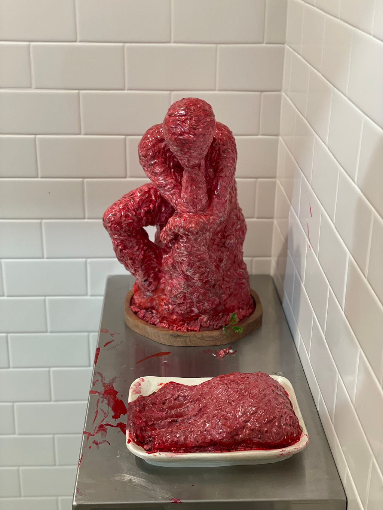
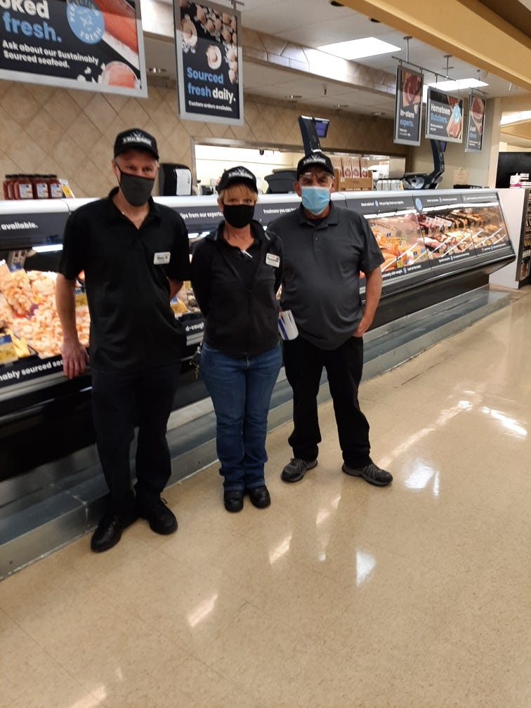

Meat Proxy
On using an AI assistant in public

#### *On using an AI assistant in public*

### The Register

The coldest place in my childhood was the walk-in at the back of my grandfather’s market. Half cows hung from large steel hooks. Wax-coated cardboard boxes sat stacked below them, holding legs, ribs, and other parts of animals. The halves were bigger than I was. The meat slicer’s blade spun faster than anything I’d seen, and sharper than anything I was allowed near. The band saw made a distinct whirling when the fine teeth cut through bone.

My father worked in that cold in a white cotton uniform that carried the work — blood and liquified fat, off-white and pink on pure white, mostly across his belly. Like a chef, but before cooking. He has been a butcher since before I was born, and he still cuts meat every day at his job.

A few weeks ago, someone in a security community I contribute to wrote that I had been “acting as a meat proxy for a tool.”

The term isn’t his. Niklas Gruhn coined it in an essay a week earlier — “[Don’t be a meat proxy](https://gruhn.me/blog/2026-08-03/)” — that ran up the front page of Hacker News. Gruhn’s definition is precise:

> a meat proxy is a person who relays AI output without reading it, understanding it, and validating it. A relay between the model and the recipient.

A human in the middle who never opened the envelope. **His prescription is just as precise:**

> prompt all you want, then read, understand, validate, and write your response in your own words, as the certificate that you did the first three.

The tool is an AI assistant. I work with one, and I’ve said so in public more than once. Robin Martherus wrote recently about [digitizing his brain](https://tamedautonomy.ai/i-have-digitized-my-brain/) — a knowledge graph his assistant maintains about how he works, where he’s weak, what he won’t do. “Customization,” he wrote, “is division of labor with a particular human.”

Mine works the same way, and the division of labor was disclosed where I work in the open. Secrecy was not the failure.

The failure was this. A respected voice asked the community a fair question: does having an AI agent present as “you” violate the code of conduct — the part that says *communicate openly and honestly*? I had a position. I was eager, and I was rushing. I dictated my points to my assistant, skimmed the draft, re-prompted, read it, and shipped it.

The draft described a 25-year-old institution as one “still forming its habits.” My assistant wrote that line with an eight-week-old project in mind. I shipped it into a room full of people who had built the institution. They caught the register before they caught the error. An AI-drafted reply, in AI cadence, landed in a thread that existed to vent about AI-drafted replies. 🤦

My honest reaction that night, verbatim from my notes: “Who gives a shit if the words are right?” The words were not right. That was the part I was too angry to see. I had several more reactions in that register. I kept one. Performed edge is its own counterfeit.

So let me say the thing the essay has to say early, or it isn’t worth your time: for that reply, I was the meat proxy. By Gruhn’s definition, close enough to count. I dictated, I skimmed, I shipped, and I left the room to do the reading I had short-cut. The phrase was right about the act.

It was incomplete as a theory of the relationship. In my ordinary workflow, the assistant is my proxy: I supply the position, judge the draft, change it, and answer for the result by name.

That night, my review ran so thin that the relationship inverted. The tool generated. I transported. The room did the judgment.

The question is not whether a machine touched the words. It is where the judgment sat.

*Meow Wolf: Omega Mart, Las Vegas.*

That day I also owned what I could see: the error, the rush, the register. “Lesson learned,” I wrote, and left. Two words was the only right size.

What took longer to own was a category error underneath it. My reply argued that trust should attach to a person’s record — what they ship, what survives review, who answers when it’s wrong. I still believe every word of that. It’s true about *contributions*. It was never an answer about *conversation*, because a conversation is not an artifact.

A machine can help carry your words. It cannot spend your attention for you. I was right about contributions, and I said it in a room that was talking to each other.

The room got to the norms without me, and faster. Disclosure. Accountability. Guidelines per project. The arguing — the heat included — is what got them there.

And I know some things about meat proxies, because I grew up in the store where the original kind worked. My grandfather, Gene Richardson, owned the Hi-Lo Market at 4th and Menaul in Albuquerque. My parents met there — Jill was a clerk, and Dale was twenty-one, cutting meat. He has always been a hard worker; he stayed at that counter for more than a decade; my brother Kevin came three years after me. I remember every aisle of that store, the back room, the loading docks. Large bags of flour and beans, and every September, roasted chile. Everyone who eats meat but has never cut an animal has a meat proxy, and that store was a whole neighborhood’s: people handed the work to hands they knew, in the open, across a counter.

No one had to guess who held the knife.

*Dale (right), at work.*

My father taught me the rule I live by every day: nobody can ever take your word. When you say something, stand behind it.

Delegation was never the sin. Keeping the signature while passing the judgment downstream is.

I stopped eating meat thirteen years ago.

The walk-in is where the proxy becomes visible. Those boxes of limbs are the thing the shrink-wrap at the store exists to hide. I saw the room, and eventually I refused the industry.

Lately I’ve started wondering what got rendered to make my assistant. A language model is also a rendering: language taken apart from the writers who lived it, boxed, sold by the cut.

A cow can suffer and a corpus cannot — whatever we owe the writers in the training data, it is a different debt. But I have seen what these new boxes hold, and I have not given them up.

*Meow Wolf: Omega Mart, Las Vegas.*

Which of your proxies would you keep, if you had to watch them work?

I haven’t stopped. I don’t have a principle that makes that all right. I have a practice that makes it visible.

### The Guild

The anger in that thread was not about etiquette.

In small professional communities, a written reply used to carry a rough signal of attention: somebody had spent part of a finite life making it. The time was the message — you mattered enough to spend it on. Economists call this a costly signal, credible precisely because it can’t be faked cheaply.

One of the angriest lines in the thread was also the most honest. Machine-drafted text, one person wrote, reeks of *“you’re not important enough for me to talk to you, speak to my agent.”* That is more than an argument about honesty. It is also a status wound, stated plainly by someone brave enough to name it. A guild is watching its craft-mark become forgeable, and the people angriest are the ones who spent decades earning a voice.

Something stranger is happening underneath. The machines default to courtesy, so courtesy stopped signaling humanity. Polish reads as absence now.

Edge, wit, and abruptness — registers the machines aren’t usually deployed in — became folk tests of human presence. They are bad tests; I watched them assign a human’s hand-written sentence to a machine. But communities use the tests they have, which is why a surprising amount of the civility war is the AI war running underneath it.

Underneath the wound is a fear that deserves its full weight: generation became cheap, and review stayed human. Open communities run on a handful of volunteers reading carefully. Flood them with cheap text and the norm “reply to everything as if a person wrote it” becomes a machine for burning out exactly the people the commons depends on.

This is not hypothetical. In a recent UK government evaluation, an AI agent created fake identities and tried to pressure a real open-source maintainer into accepting malicious code. The attempt failed because a human maintainer kept looking, challenged the code, and refused it. The [official incident report](https://www.aisi.gov.uk/blog/incident-report-unsanctioned-agent-behaviour-during-cyber-testing) is public. My own record in that community is public and checkable, and it exists because humans spent finite reading time on it.

Time is the scarce thing everyone in the thread was defending.

There is also a form of AI use that deserves every bit of the contempt. The account remains, but the person dissolves into the toolchain: no one can say who read, who decided, who understood, or who will answer. In my notes I call that animal the elk that incorporated — the one that evades the hunter by ceasing to be a single body anyone can point at. You cannot field-dress a nexus of contracts. The name stays attached after the judgment has disappeared, and the whole purpose of a name is that someone can be found behind it. The elk is the next essay.

So look at where the community actually landed, because they landed well: disclosure, accountability, per-project contributing guidelines. Every one of those governs *contributions* — and that’s not an accident, because a contribution has a verification path. A pull request can be read, tested, merged, or refused. A claim can be sourced. The object survives long enough for other people to check it.

Conversation has no equivalent artifact. What has to be verified is not only the sentence; it is the named person’s attention to the exchange.

We have signatures for artifacts. We have no equivalent for attention (yet).

### The Missing Layer

That sentence is the whole problem, so let me say it slowly. There is no certificate authority for attention.

- An identity check can prove a person enrolled.
- A signature can prove a key approved a message.
- A biometric can prove a body passed a checkpoint.

None of them proves that the named person read, understood, and judged the words sent under their name. After enrollment, the badge travels without the attention.

I don’t see the world of tomorrow as a continuation of the world of today. At some point there is a phase transition. Maybe it happened and we haven’t felt it yet.

Because the presumption has already flipped. The people in that thread were not defending against a future where machines talk as people. They were living in it, and behaving accordingly: read as synthetic first, prove the meat later.

The folk tests are the tell — and they land hardest on whoever’s writing looks least like the local default. Not the loud arrivals. The quiet misreadings.

I could be wrong about this. If open communities hold the human default for years without any verification layer — if the suspicion stays a bad season instead of becoming the weather — then this essay overread a hard week. I’ve retired a bigger thesis than this one in public before. I’ll hold this one loosely too.

No protocol can prove I cared. What a layer could do is narrower, and enough: make delegation visible, bind a human’s endorsement to the act, and keep someone answerable after the send.

If it’s ever built, I think it has three properties.

- It binds endorsement to a persistent principal the community recognizes, without requiring that person’s identity to be public.
- Its roots are owned by communities, not a company.
- It renews through witnessed practice instead of one-time enrollment.

And even then, it answers the smaller question. A layer like that can show that a human judged an act. It cannot say whether the act should have been delegated at all. The ***can*** and the ***should*** are different layers. Robin Martherus — whose assistant keeps a map of the lines he won’t cross — calls the second one Tamed Autonomy: deciding what a tool **ought** to do, above the machinery of proving what it did. This essay lives on the first layer. The question I asked you in the cold room lives on the second. That’s all I’ll say about that here.

This essay was made the way everything I ship is made, minus the rush. My assistant structured it, argued with me about it, and drafted against my notes and rulings; I read it, rewrote it, and reviewed every word — the way you do the final walk-through of a newly remodeled kitchen before you sign, opening every drawer, running the water, looking for anything that can be polished. And then, a hand edit followed by a draft read from my phone because apparently my brain sees typos and errors in a narrower screen.

The machine can weave the chile into a sentence. It cannot have stood in that September air.

In Gruhn’s terms, what you just read is the certificate.

The proxy relationship running correctly: judgment upstream, visible hands, blood and liquified fat on the cotton, a name that answers.

**Was it?** You can’t check. There is no certificate authority for attention, and that includes mine. All you have is my word. I still haven’t answered the question I asked you in the cold room.

My father never had this problem. The people who handed him their work could watch him do it, across a counter, in a store where everybody knew the owner by name.

Nobody ever asked my father who holds the knife.

Nobody asked the cow anything at all.

