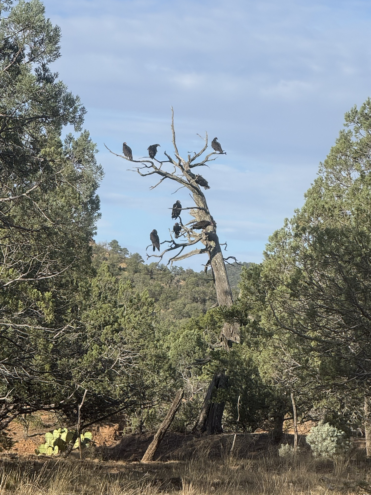
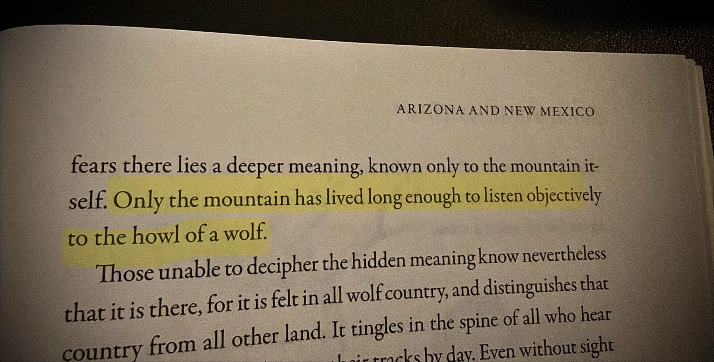
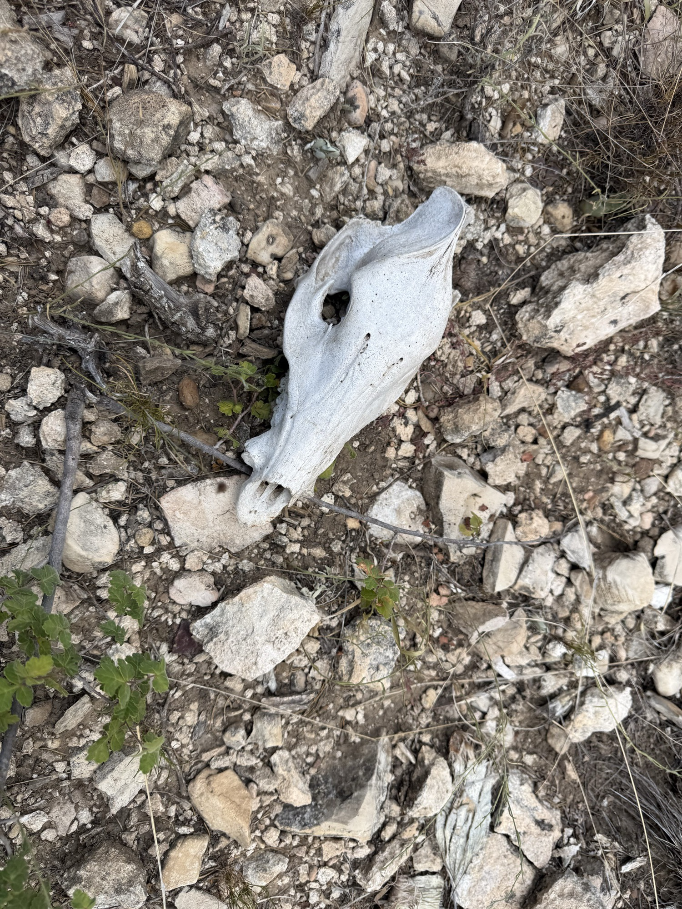
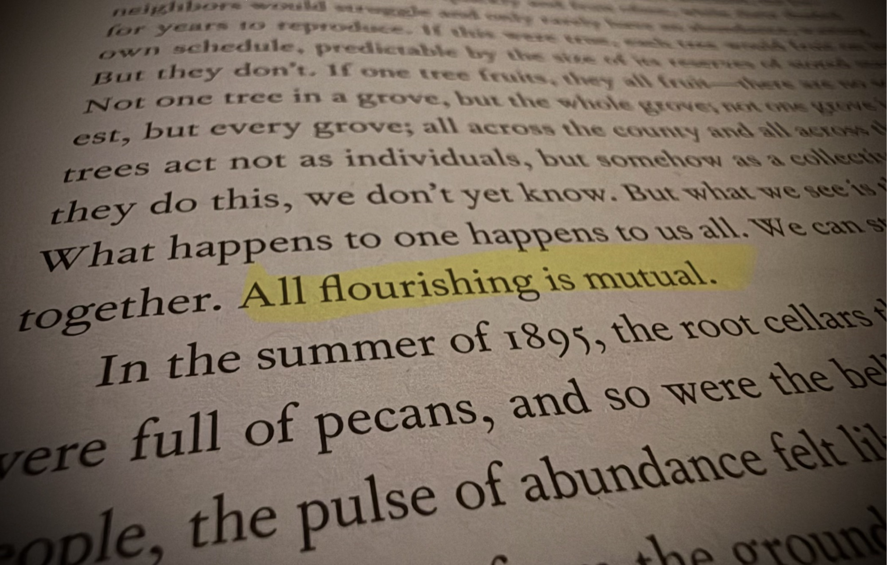
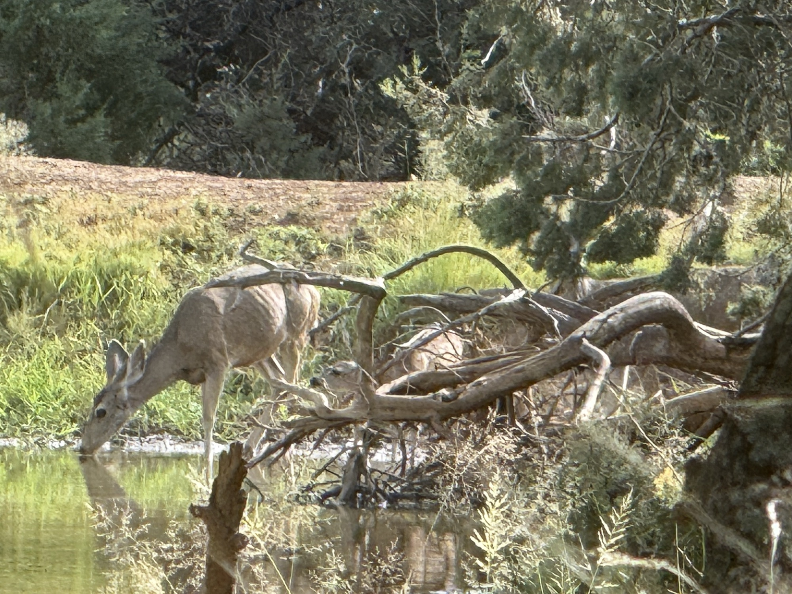
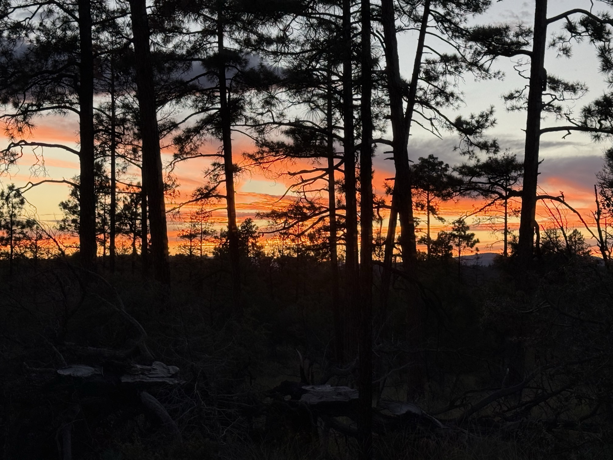

Don't Hunt the Guilty Mind
On the ones who read every trail but their own

### East

*Waiting on the morning air. Photo by Damian Kemm.*

Before sunup, in the third week of September, a few days shy of the equinox, the cold lies in the bottom of a valley in the Gila. It settled there overnight, heavy and still. Damian is up before the light, and he knows what the air will do. By mid-morning the sun will be on the rock and the canyon will warm, and the air lying so still now will rise up the canyon walls, carrying whatever is in it.

Including him. The elk will be reading him all day. Not his intent. His wind.

You don't hunt an animal by asking what he meant.

Damian Kemm is a seasoned hunter, a photographer, a metalsmith, a leather craftsman, and a good friend of mine. Damian and I have been friends for over 20 years and for as long as I've known him, he's gone on hunting trips multiple times per year. 

My dad was also a hunter, one of my best friends, Mike, is a hunter, and I've been out for turkey one time with a crew I worked with. Another guy I worked for a long time ago, Richard, was an avid hunter who preferred a single-shot muzzleloader. 

One shot, arrow or bullet. If you've read the environment wrong, that's the whole day. Or is it the other way around?

Damian has taught me a lot about his techniques... with the bow and with a rifle. I asked Damian recently about tracking. It was an insightful conversation that I'll always remember. What follows is some of what I learned from him and my experiences along the way. It matters more than it should, because the animal I've spent years building systems to catch is fraud — and fraud learned a long time ago to leave no guilty mind to hunt.

Damian's hunt starts with a decision. He is going to hunt elk. Everything from that moment on is observing, learning, and honing skills.

The wind comes first. Where it's coming from and where it's headed. Whether it will carry him into the path the elk will take or head the other way. He figures an elk's nose is ten thousand times better than his. If his scent drifts down to the herd, he has lost before he has seen a single animal. Then the rest of the weather. Then the map, and a starting point he knows.

Then the roads. Or where they aren't. Some hunters drive the roads up and down and take a shot at whatever shows itself near the shoulder. Damian goes where there are no roads. No truck rumbling, no laziness. Past the last road he is one more animal on the wind.

Then he looks for sign. Droppings. Tracks, beds in the tall grass. Scrapes where a bull has torn up the ground, and the wallows they become. Rubs, where antlers have stripped the bark off a tree, oftentimes breaking it in half. He studies the freshness of the attack, the height of the damage, the amount of aggression placed upon the tree. 

He listens. A bugle carries hundreds of yards. The soft grunting only reaches him when he's close. None of this points to one particular animal. It tells him he is in the right place. 

Sign narrows the ground.

The bent grass, the print pressed deeper where the weight rolled forward, the stride that says walking and the stride that says spooked, the place the trail dies at slickrock and resumes on the far side. 

None of it concerns intent. The elk did not *mean* to leave a worldline. 

He left one anyway, because moving through a world is the one thing you cannot do without marking it. The trail is not evidence of the animal. The trail *is* the animal, recorded — his identity written in the only ink that doesn't lie, which is where he actually went.

But notice whose intent is out there. Damian's. 

He is the only one in those woods with a plan. The elk is eating, drinking, looking for a mate, looking for somewhere to sleep — and marking the ground the whole time.

Our systems of blame run the opposite way. In criminal law, in ethics, in most of AI safety, the language still starts by hunting the mind. They want the intending subject: the one who meant it, the guilty knowledge, the hand on the trigger and the wish behind the hand. Find the mind and you've found the responsible party. No mind, no crime.

I heard someone call intent the new perimeter. It is a revealing phrase. A perimeter assumes something continuous enough to enclose: an inside, an outside, a crossing. Intent in a swarm need not be continuous. It can be sharded across agents until no node contains the plan and every local instruction is clean.

**Intent cannot be the perimeter if a swarm can split it until nothing crosses the line.**

Which tells you exactly how to get away with it. Not by hiding the act — by dissolving the mind. Take a decision and split it into pieces small enough that each piece is innocent. Hand each piece to a different actor optimizing a different local number. Let the harm reassemble downstream, where nobody is standing. Every hand stays clean. The outcome does not.

**This is how fraud works.**

I spent years building the systems that track it, and the thing people misunderstand about fraud is that the craft was never the lie. A lie is a single point of failure — one falsifiable claim with one author standing behind it. The competent fraudster doesn't lie if he can help it. He structures. He layers the transfers, splits the deposits, nests the shell inside the shell, writes the invoice that is true at every step and false only in the sum. Money laundering even has a technical word for the core move: *structuring.* Break the deposit into amounts under the reporting line so no single transaction trips the wire. Each piece looks clean. The pattern is the felony.

And don't picture a back office. [Picture a swarm](https://www.linkedin.com/pulse/every-check-came-back-clean-problem-chris-perkins-mqwgc) or a colony.

One agent gathers the data. Another ranks it. Another drafts the message. Another executes the transfer. Each carries a narrow instruction, a valid credential, and a policy sidecar saying its own act is allowed. No agent contains the plan. No local control sees a violation. The prohibited object exists only in the composition.

The system is right about every fragment and wrong about the whole.

*My copy of A Sand County Almanac. Photo by Chris Perkins.*

---

### South

*Bone in the scree. Photo by Damian Kemm.*

By mid-morning the elk have bedded down. They move mornings and evenings. The middle of the day is for listening, resting, planning the strategy to get closer — perhaps moving closer… slowly, watchfully.

The land is what Damian and the elk share. He guided in Southern Colorado, and he hunts this same ground in the Gila Wilderness each year — the Aldo Leopold country. Thirty years of hunting, on his own and as a guide to his clients. He knows which way the wind runs up which drainage, and when. He knows where the herd waters and where they bed, and how they move when nothing is wrong. The elk knows the same ground from the inside: where to feed, where to drink, where to sleep, how the country lies between them. 

Two animals the same terrain made. One of them is looking for the other.

*My copy of Braiding Sweetgrass. Photo by Chris Perkins.*

The skill is knowing what nothing-is-wrong looks like. New ground is hard because he doesn't know yet what normal looks like there. The elk are the same elk. Sign means little without a baseline. A scrape is just dirt until you know this slope doesn't usually have one.

Fraud detection lives or dies on the same thing. You can't flag the strange transaction until you know the ordinary ones. Structuring works for that reason. It is built to look normal: a deposit like every other deposit, an invoice like every other invoice. It walks at the pace of the herd.

Damian does the same thing to the elk.

He doesn't use cover scents, and he thinks camouflage is sold to our eyes more than to theirs, because what elk key on is movement. So the approach becomes arithmetic. Far off, noise matters less, but as he closes he gets quieter, and when they walk he walks, at their pace, so that his steps land inside theirs. He crawls, walks, sometimes runs. It depends on the cover, open field or timber, and on what the herd is doing. No single step crosses the line the elk are listening for.

The hunter is structuring. He breaks his approach into pieces the animal will pass one at a time. It works for the same reason it works at the Department of Labor: the elk judges each sound, and the sum is a man with a bow inside range.

He can't split one channel, and he watches it most. 

The wind. 

If it swings and carries him down to the herd, no amount of quiet helps. The elk don't have to hear the approach. They smell the sum.

#### The trap the law already sprang on itself

Here's the tell. Structuring is one of the few places the law has already ruled that the *decomposition itself* is the crime — not the deposits, the splitting. So somewhere, someone understood this pattern well enough to legislate against it directly.

Then read the statute and watch the remaining problem. Federal law does not require proof that the defendant knew structuring itself was illegal. It requires proof that the transactions were arranged *for the purpose of evading* the reporting requirement. The law names the splitting, but it still has to connect the splitting to an evasive purpose. That is straightforward when one person divides his own deposits at one bank. It gets harder when the operative plan is distributed across an org chart, an incentive system, or a fleet of agents, or LLCs, none of which carries the whole purpose.

> **The law criminalized the fingerprint and still has to ask whose hand made it.**

This is not a policing failure. It's math. In June, Apostol Vassilev at NIST [published a proof](https://www.nist.gov/publications/robust-ai-security-and-alignment-sisyphean-endeavor) that no finite set of rules can guard an AI system completely.

Most accountability checks are evaluated at the wrong grain: per transaction, per account, per agent, per tool call. A reporting line. A spending limit. A per-action policy. A review that triggers above some size. Structuring defeats those local thresholds because the sum is never assembled. A threshold over the aggregate can survive splitting — but only if the system knows which fragments belong to the same lineage. Trackers meet this exact problem where two trails cross at a stream: every print is real. The question is which prints belong to the same animal.

**The problem is not the threshold. It is the grain at which the threshold is applied.**

A sidecar can certify every hop and still miss the route. The hunt for the guilty mind fails for the same reason: “who is responsible” is a search for one sufficient cause, and decomposition is the craft of guaranteeing that no single cause is ever sufficient.

#### Why the reflex fix makes it worse

So we reach for the obvious remedy. Put a human in the loop. 

A named person who reviews, who signs, who is *accountable.*

Madeleine Clare Elish has a name for this person: the [moral crumple zone](https://estsjournal.org/index.php/ests/article/view/260). A car's crumple zone absorbs the crash to protect the driver. The moral crumple zone absorbs the blame to protect the system, at the expense of the nearest human.

But drop a human into a decomposed system without giving that person lineage-wide visibility, time to inspect it, authority to refuse, and power to stop the next act, and you have not added oversight. You have added a delivery address for **blame**. The operator holds answerability without control — the working definition of a fall guy. A human can be real oversight, but only when the architecture gives the human something real to govern. **Otherwise we build responsibility-diffusion *into* the machine and print “oversight” on the label.**

A kill switch is a control, not an account. It can stop the next act. It cannot tell you where the last thousand integrated or who should carry the debt.

None of this diagnosis is new, and that's worth saying plainly. Critical theory and organizational sociology have described subjectless power, organized irresponsibility, and accountability sinks for decades. The description is deep and useful. What remains underbuilt is the operational layer: a way to preserve lineage, evaluate composition, and bind consequence quickly enough to matter while the system is still acting.

---

### West

*A mule deer at a pond. Photo by Damian Kemm.*

Late in the day the light goes long across the canyon, and the elk start to move again.

In thirty years Damian has never once needed an animal's intent, and he has never waited for a confession. He needs the trail — and the trail is always there, because you cannot move through a world without marking it. Every one of those innocent fragments left a worldline. This agent read that data. That account funded this transfer. This sub-decision fed that outcome.

And he doesn't chase. The best hunt is the one where the elk come to him. 

Sometimes they feed in one place and bed in another, so he learns both and sets up between them, on the line the animal's own needs have to travel. It had rained a lot in the middle of the month. Sometimes the elk gather at water: a tank, a seep, a wallow. Water is one of the places their worldlines meet. He doesn't need to know what any one elk is thinking. He needs to know where the elk has to go next.

The intent decomposes. **The trajectory does not.** Ever.

The trail exists in the world even when the logs do not. Evidence of it does not preserve itself. Lineage has to be carried before the branches disappear. What happened has no incentive to lie. The systems that recorded it might.

So change the question. Stop asking *who meant it.* Ask *where did the advantage integrate.* 

Follow each clean fragment forward along its worldline to the place the gain actually pooled — the beneficiary the whole structure was, in aggregate, for. Sum the trail back to its root. Then put the debit there, whether or not that root can be shown to have “meant” any single piece — because the meaning was never in a piece. It was in the arrangement, and the arrangement has an address, and someone lives there.

None of this makes purpose useless. A declared purpose is a contract, not a confession. Bind the scope before execution. Compare it with the trajectory as the action unfolds. Constrain the action when they diverge. What you cannot do is reconstruct a guilty mind after the purpose has been decomposed and call that governance.

**Do not infer the mind. Bind the purpose. Read the trajectory.**

> **We do not have to settle whether the swarm is a mind before deciding what it may do to a person.**

That is where Robin Martherus's [Tamed Autonomy](https://www.tamedautonomy.ai/) work enters: not to infer what the system secretly meant, but to ask whether the action remains inside the purpose it was authorized to serve.

This is what makes a costly sponsor more than a formality. A delegation chain is not merely identity extended. It is a liability path. The standing that a swarm's gains accrue to is the standing its harms debit. Every disposable branch must still resolve to a root that cannot dispose of the consequence. You don't decompose your way out of that, because it doesn't count acts — it sums lineage.

The botanist and author Robin Wall Kimmerer, a citizen of the Potawatomi Nation, writes down the rules of what she calls the Honorable Harvest in *Braiding Sweetgrass*. They were never written down before. They were kept by being practiced. One of them says this better than any statute I know: *Be accountable as the one who comes asking for life.*

The debit belongs where the advantage integrated. Blame is a separate judgment.

A gate survives decomposition only if it is both **conjunctive and composite**. Every required condition must hold, and the lineage as a whole must remain inside what the environment can bear. Per-agent innocence cannot dilute a harmful aggregate — but per-agent compliance cannot certify the aggregate either. And the accounting cannot stop at one lineage: the environment has to aggregate every active lineage drawing on the same capacity, or ten clean swarms can reproduce the same failure one level up.

The wall is not: *every node passed.*

The wall is: *every node passed, and the composition remained admissible.*

The entire defense reduces to one refusal: **stop letting things sum their way to innocent.**

All of this used to take an institution, and it used to take time. To run decomposition at scale you needed a corporation: a charter, a payroll, a floor of lawyers, years. That cost was a tax on the technique, and machine speed removes it. 

A swarm of agentic systems is a decomposition engine you can rent by the hour. Cheapening the technique does not spread the payoff. The blame scatters across a thousand clean hands while the advantage still pools where it always did. Machine speed changes the reading too. That's another day.

By dark, no elk. The right shot never offered itself, and one shot is one shot. Kimmerer's list has two lines for a day like this: *Abide by the answer.* *Take only that which is given.* Today the answer was no. It is still a day spent reading the ground.

#### The elk that incorporated

Here's the part nobody warns you about on the canyon rim.

Somewhere out there is an elk who has figured out the game. He has watched hunters read his trail for ten thousand years and he has finally, quietly, retained counsel. He doesn't run anymore. *It* incorporates. Elk, Inc. Each hoof is a separate LLC. The left flank reports to a holding company in Delaware. The right flank has never met the left and could not be reached for comment. When the hunter kneels to read the ground, the prints belong to six, sometimes seven, different entities, none of which is, technically, an elk. The rack is leased. The heartbeat is a managed service with excellent uptime.

And it works. For a while it works beautifully. You cannot shoot an org chart. You cannot field-dress a nexus of contracts. The hunter stands there holding a rifle and a subpoena, and the woods say: *prove intent.*

This is roughly where we are. The powerful spent a few centuries becoming the first animal whose trail no longer resolved to one body. And now the trick is cheap enough that anything can do it, which sounds like justice right up until you remember the elk still owns the woods.

But here is the thing the incorporated elk forgot, and it is very stupid and entirely load-bearing: **[it still has to eat.](https://chrisperkins505.medium.com/digital-physics-is-dead-2dd733243d24)**

A committee bends the grass. A shell company files. A swarm of a thousand faceless context windows still leaves a thousand faces' worth of trail, and all of it points at the one dark patch in the forest where the advantage went to pool — every innocent, lawful, deniable step. You can decompose the mind. You cannot decompose the fact that you were here, and that you left the clearing fuller than you entered it. Existence is the one thing that refuses to structure itself under the reporting line.

For all of history, reading that trail was too slow to bother with — walking every fragment back to the fat, quiet animal at the end of it. The elk was safe not because it was innocent but because the trail was long, the hunter was tired, and the day was short.

---

### North

*Last light. Photo by Damian Kemm.*

After dark, Damian builds a fire and cooks the game meat he carried in from an earlier hunt, from a day when the answer was yes.

A hundred years ago a young forester named Aldo Leopold came to this part of the country full of what he later called trigger-itch. He believed fewer wolves meant more deer, and that no wolves at all would make a hunter's paradise. Then he shot one, and reached her in time to watch a fierce green fire dying in her eyes. He spent the rest of his life learning to read what the mountain had known all along. He wrote down what a wilderness should be: country open to lawful hunting, big enough to absorb a two-week pack trip, and kept devoid of roads. The Gila was the first place anyone drew that line. The ground Damian hunts was cut from it, and it carries Leopold's name.

The wolves are coming back to it now. The Mexican gray wolf, *Canis lupus baileyi*, [the lobo](https://medium.com/@chrisperkins505/the-cost-of-free-maps-c2c611a5b659), a few hundred of them, every one descended from the last handful anyone could find.

A reader that never tires is a road into every drainage. It is a compass for data, and a compass points the same way for whoever holds it. The question is [who may carry it in](https://www.linkedin.com/pulse/who-gets-set-clock-chris-perkins-d1p1c), what it may join, where consequence may land, and how the one being read can answer back.

Damian's fire is down to coals. The cold is settling into the valley again, the way it does every night. By morning it will be lying in the bottom, heavy and still, until the sun warms the canyon and the air rises up the walls, carrying whatever is in it. The elk. The hunter. Us.

Somewhere above him the elk are bedded down, the ones who left today's trail. They have been reading his wind since first light. Not once did they need to know what he meant.

The grass is already bent. It always was. That was never the hard part.

The hard part is that yours is bent too. Damian could read it by morning. Who else gets to?

---

*This essay joins* ***Different, and Held****, a collection in progress. Next:* The Car Is Where You Sleep Now*.*
