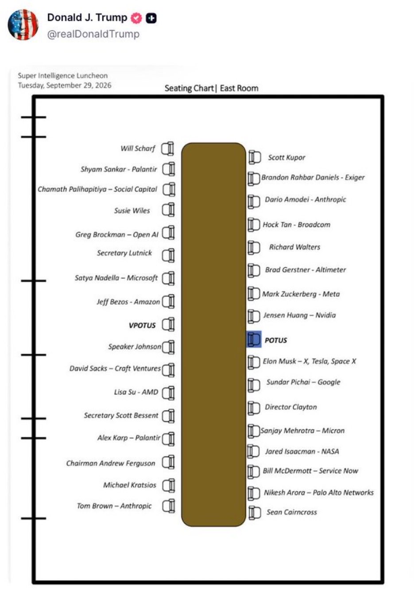

Ten in Washington. Eleven in the Desert.
On who watches the watchers, and who was never asked.

After the signing in Washington, with the industry clustered behind him, the president floated a committee to watch over artificial intelligence. "Maybe 10 people on that committee," he said. "It could be from that group."

The group was the one standing behind him.

In August, Doña Ana County, in southern New Mexico, [went looking for 11 residents](https://www.organmountainnews.com/dona-ana-county-project-jupiter-community-monitoring-committee-interest-form-2026/) to sit on a citizen-led committee charged with monitoring one data center, Project Jupiter. By September, commissioners were [set to amend that committee's rules and appoint its members](https://www.organmountainnews.com/dona-ana-county-project-jupiter-monitoring-committee-amendment-2026/), and the public packet did not say what would change or whom they meant to appoint.

Ten in Washington. Eleven residents in the desert.

One of those committees has neighbors on it. Both were being shaped somewhere the public couldn't see.

## The room

The document is called the White House Accord on Super Intelligence. By the president's count, about 40 people were at the table. His own posted seating chart for the September 29 luncheon shows 34 chairs: by my count, roughly 20 for executives and investors and 14 for government. Seven people signed it: the president and six executives, from Google, Anthropic, Meta, OpenAI, xAI and Nvidia.

The Super Intelligence Accord runs two pages. The commitments are voluntary: "Regardless of whether this is required of companies," the signers say, they're "committed to doing this." What the public gets, in the Accord's own words, is "confidence."

A reporter asked whether it was binding in any way. "I think it's morally binding."

Another asked why the world shouldn't be concerned. "Because we have people that love our country and love the world."

"It requires more than love, doesn't it, sir?"

"No, it requires this," pointing at his head... "and they're the smartest people in the world."

The oversight, as described in Washington, is "tremendous self policing," with the companies "really going to be policing each other."

At a second event, Elon Musk called it "grading each other's homework, which is a lot better than if people just grade their own homework." In 2017, at the National Governors Association, the same man said "AI is a rare case where I think we need to be proactive in regulation instead of reactive."

When the Speaker of the House was asked how companies would be held to any of it, and what "external review" meant, the answer was that the document "will be circulated."

It was, as a two-page scan. There's no line in it about publishing anything. The signature page reads "President of the [Unites States](https://www.usatoday.com/story/news/politics/2026/09/30/white-house-accord-super-intelligence-misspells-united-states/92024624007/)." A document about review, and nobody reviewed it.

Look at who was in that room: the companies, the White House, congressional leadership. Thirty-four chairs. Now look at who, as far as the seating chart shows, didn't get one:

- Neighbors of the data centers.
- The workers it's built to replace.
- Families whose records it reads.
- Towns sharing the aquifer.
- Anyone who pays a power bill.
- A second grader. Its heir.
- A teacher. Someone who grades homework.
- A nurse on the night shift.
- The analyst paged at 3 a.m.
- A tribal government.
- A state legislator.
- A parciante with a shovel.
- Anyone it calls "the public."

They spent the afternoon agreeing to grade each other's homework. There wasn't a teacher in the room.

## Two parties, one interim

It would be easy to make this a story about one party. It isn't.

The Republican frame, from Washington: the goal is winning ("Winning the AI race is winning"), and until then the industry polices itself, and the communities get generosity: contributions, partnerships, companies that "will produce" their own power so ratepayers don't pay.

The Democratic frame, from Barack Obama at [Colgate University](https://barackobama.medium.com/my-conversation-at-colgate-university-6d4e21b312d3) on September 18: the goal is durable public regulation, the kind we apply to airlines and drug companies, and until then, "voluntary industry restraint, not because it's a replacement, but because that's probably the best we can do for now."

Different words, same interim. Both hand the meantime to industry. One calls it self-policing. The other calls it restraint for now, and nobody has said when "now" ends. The Accord's own answer: "Over time, it may make sense to codify these steps into laws or regulations." May.

The Speaker opened the press conference with a line that should have stopped the room. The bipartisan work Congress did in 2024 "has now been rendered obsolete because the frontier labs are so far in front."

That's the legislature describing who sets the pace.

## Even the insiders say no

In August, Bill Gates, who discloses his own financial ties to the industry, [wrote](https://www.gatesnotes.com/work/save-lives/reader) that "we should not expect them to lead the charge," because "in a democratic society it's not their role to decide these things."

On September 29, [on Ezra Klein's show](https://www.youtube.com/watch?v=A_156w0aYtU), he went further: "You can't rely on the industry to self-regulate here. I mean, it's just insane."

At the press conference, a reporter raised Gates's warning. The president: "Now he's not saying that anymore… He actually went the opposite."

Put the dates next to each other. August 26: it's not the industry's role to decide. September 29, on Klein's show: relying on the industry to self-regulate is "just insane." September 29, at lunch in Washington: an accord built on self-policing gets signed.

Seventeen days before the signing, Dario Amodei, one of the men who signed, had published his own floor. [Outside reviewers](https://darioamodei.com/post/we-must-pace-the-frontier) "should have the right to publish key findings… without editorial control," and his company "can't redact findings just because they are unfavorable." The Accord routes the findings somewhere else: to "an independent committee of the board of directors" at each company. Amodei's publication clause isn't in it. Asked about the mechanism on the day, Amodei said it "is still under discussion."

## The public is the test environment

Obama made one argument at Colgate that deserves more attention than it got.

If the business model needs a product, he said, "sometimes you have to test it by letting it run wild in the world." That happens "not because necessarily they're trying to do bad things, but because they've got to justify these valuations." And then [the plain version](https://www.youtube.com/watch?v=CYhJPO5__Kc&t=2359s): "You're not in a sealed box. It's in the internet. It's looking at your bank accounts."

If the business model decides where these systems go, the rest of us are the test.

That goes for the worst case, too. A reporter asked the president what a bad actor could do with this technology. "A bad actor is going to get caught. And that's why we have the DOJ, that's why we have the FBI." The follow-up: "Isn't it too late then to prevent any damage done?" The answer: "We have the smartest people in the world watching over each other."

That answer is about the builders. The attacker isn't in it.

The people outside the room named the attacker. Gates listed empowered bad actors among his three risks. Obama ranked misuse above the science-fiction scenarios. The room answered with prosecution after the fact. By the time anyone gets caught, the harm has landed, and it lands on people who were never at that meeting.

*The president's own posted seating chart: Super Intelligence Luncheon, East Room, September 29. [Posted to Truth Social](https://truthsocial.com/@realDonaldTrump/posts/117355137125519227). The National Cyber Director, Sean Cairncross, had a chair. The answer about bad actors was still "they'll get caught."*

## Where the holds actually live

Here is what the national promises look like in one place.

The promise was generosity. Data center companies, the president said, will make "massive contributions to communities."

Some of that money is real, and some residents defend it. At a county meeting in August, [one resident asked opponents](https://searchlightnm.org/project-jupiter-foes-laud-recent-court-wins-at-quiet-dona-ana-county-meeting/) whether the Boys and Girls Club should give back "the $1.5 million they received for their new facility," and a food pantry "the $400,000 they received for food to feed the needy." It's a fair question, and it deserves a fair answer: a donation is not a vote. At the same meeting, another resident looked at the empty seats on the dais: "I've learned that you can't assume your elected representatives will show up to their jobs." Jensen Huang, to his credit, set a better standard on Ezra Klein's show: if a town doesn't want a data center, "then so be it."

In New Mexico, Oracle, Project Jupiter's anchor tenant, spent [more than $3.4 million](https://sourcenm.com/2026/09/16/new-mexico-state-ethics-commission-says-oracles-3-4m-project-jupiter-ads-sought-to-sway-permitting/) on advertising meant to influence the state's air-permit process, according to the State Ethics Commission.

Project Jupiter is part of Stargate, the AI infrastructure push led by OpenAI, Oracle and SoftBank, [Reuters reports](https://www.reuters.com/business/oracle-cites-force-majeure-shield-itself-controversial-data-center-bloomberg-2026-09-24/). OpenAI signed the Accord.

The promise was that companies "will produce it themselves," their own power, so ratepayers don't carry the load. In southern New Mexico that means about [400 million cubic feet of natural gas a day](https://www.organmountainnews.com/project-jupiter-air-quality-permit-new-energy-economy-motion-2026/). And the State Land Commissioner, Stephanie Garcia Richard, has said no to the pipeline's route across state trust land. Twice.

That's a hold. A public official, answerable to voters, stopping an action at the point where it touches land the public owns.

The Attorney General has [questioned an air-permit schedule](https://www.organmountainnews.com/raul-torrez-project-jupiter-water-air-permitting-supreme-court-2026/) that changed days after project representatives met with the Governor's Office. He does not allege that one caused the other, and neither do I. The Governor's Office [has said](https://www.organmountainnews.com/project-jupiter-air-quality-permit-protest-environment-department-2026/) the governor "does not interfere in state agencies' regulatory decisions." On September 17, the state Supreme Court [denied the petitions](https://www.santafenewmexican.com/las_cruces/project_jupiter/new-mexico-supreme-court-allows-project-jupiter-permit-proceedings-to-advance/article_c8d6f21a-dfd0-42f3-b789-f7032fb2205b.html), [without explanation](https://kvia.com/news/2026/09/17/new-mexico-supreme-court-denies-petitions-regarding-project-jupiter-air-quality-permit-water-use/). That isn't a ruling on the merits.

And the party lines don't map. Governor Michelle Lujan Grisham, Attorney General Raúl Torrez and Land Commissioner Stephanie Garcia Richard are all Democrats, on different sides of the same permit. The binding decisions anyone has actually made about this project were made at the state and county level. That's the level the national conversation treats as noise, the level both parties' frames step over on the way to Washington.

## You clear the ditch or you don't get water

Every spring, up and down the Rio Grande, the old acequia towns of New Mexico hold *la limpia.* The people who share a ditch walk its length with shovels and clear out a winter of silt and branch and leaf. The work is owed. You can send someone in your place, or pay instead, but the debt is real and somebody writes it down.

Then the water comes, and a man called the mayordomo decides when it reaches you. The ditch's members, the parciantes, elect him. He walks the ditch all season, opens the gates and closes them, and if you never settled what you owed, he can close yours... but that's rare, as I've learned. Graduated sanctions kick in. Repair as infrastructure.

Look at what that asks of everyone.

- It's costly: you owe the work, in sweat or in money.
- It's reciprocal: your neighbor's shovel clears your water.
- It's witnessed: somebody writes it down. And...
- It's repairable: if the record is wrong, you can say so and have it fixed.

This is what trust is made of. None of it is free.

That's consent with a hold attached. The people who share the water choose the person who can stop it, and that person answers to them. Now compare the deal you have with the AI on your phone. You clicked "I agree" on terms you didn't read. Your only hold is the delete button, and nobody can tell you what it reaches.

And the hold runs both ways. Suppose the ledger says you owe work you have already done. Someone must be able to hear your challenge, correct the record if it is wrong, and get the correction to the person controlling the water while it can still matter.

Because some limits belong to the community that lives with the truth or its consequences. No score, no payment and no press release overrides them. A system can ask. It can't overrule.

The same goes for one person. Every protection on the table so far is something an institution does on your behalf: it reviews, it audits, it revokes a permission after the fact. A revocation that arrives after the decision has landed is a record, not a remedy. The test is whether you can challenge a decision and, if it is changed, have someone act on that change in time.

I call this answerability, and nobody in that room offered it to you.

## What to ask for

Three things, and none of them is a slogan.

**A seat.**

Residents on the watchdog. Not "maybe 10 people… from that group." Eleven neighbors, with their names in the public packet. And the seats have to be filled.

In August, a Doña Ana County commissioner said the county hadn't had "as many applications as we expected." If you live near one of these, the seat may already exist. Take it.

**A hold.**

Authority to stop an action at the point where it lands, like a headgate, like a land commissioner's no. Not a donation. Not a committee that writes a report. A hold like that is expensive, because somebody has to show up for it. It should be.

**A published finding.**

Amodei's own floor, applied to everyone: outside reviewers who publish what they find, unedited, in public.

If you read [The Historical Society and the Kinetic Society](https://www.linkedin.com/pulse/historical-society-kinetic-chris-perkins-ozz4c), you'll recognize the last two. The hold is the Kinetic Society: it governs the next turn. The published finding is the Historical Society: it keeps the evidence of the last one.

Most consequential systems need both.

The Accord built a vault, handed the key to each company's own board, and called it oversight. That's the mistake I wrote about then.

Harm begins when the record is mistaken for the control.

---

I begin with the people we are serving and trying to protect. The public. The students. The constituents. Sometimes I picture my daughters, nieces, and nephews among them.

They will not always be in the room where these things get decided. That was never the test.

The test is whether they can challenge a decision and, if it is changed, have someone act on that change in time.

Everything here is on the record, with links, so it can be checked. A record needs a witness. You've read it now. You're the other one.

Ten in Washington. Eleven in the desert.

I stand for questions.
