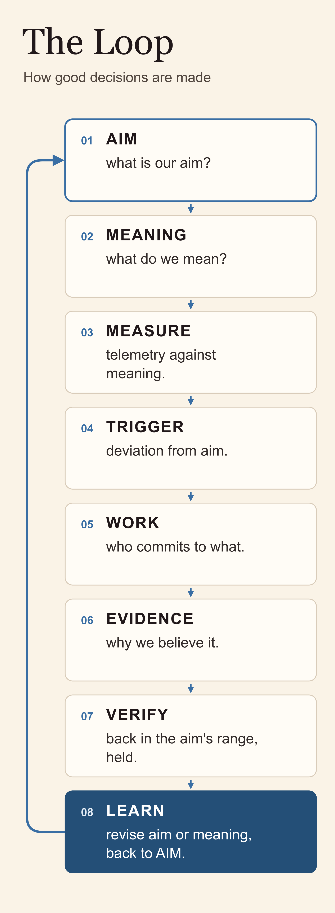

Self-Destructing Agents
On writing down an agent's end before it starts

We launch machines carrying the rules for their own destruction.

On February 19, 2017, SpaceX launched a Falcon 9 from Florida with its Autonomous Flight Safety System in charge of the destruct decision for the first time.

## The plan was aboard before launch

The rocket lifted off from pad 39A, and [Spaceflight Now reported](https://spaceflightnow.com/2017/02/25/auto-destruct-safety-system-seen-as-key-to-ramping-up-launch-tempos/) that the onboard system was now its primary destruct mechanism.

Before that, a person on the ground held the command. A Mission Flight Control Officer monitored the flight and could command termination if it threatened public safety.

The onboard computer took over that job. It "tracks the trajectory of the rocket, ensuring it remains within a predefined corridor," working from "mission rule data files loaded into the on-board AFSS units." According to [NASA](https://www.nasa.gov/news-release/engineer-manages-certification-of-autonomous-flight-termination-system-software-for-launches-at-florida-spaceport/), the system flew thirteen times in shadow mode, watching without acting, before anyone let it decide.

The person didn't leave. "We still develop the mission rules to provide public safety," Howard Schindzielorz, the 45th Space Wing's chief engineer, said in an Air Force statement.

The person moved from the button to the plan.

Hold on to that line. We'll need it.

Notice who the plan protects. A termination system exists for the people beyond the vehicle, under its path. Crewed launches use flight termination too. [NASA's 2024 bulletin](https://www.nasa.gov/general/considerations-for-using-autonomous-flight-termination-softwarein-crewed-launch-vehicles/) names protection against destruction from a single fault as a crewed requirement, and calls for weighing escape timing, abort options, and the role of human command or override. The reason a rocket can be destroyed is the people below.

Three questions, for every system in this piece and for yours:

What was the intent?\
Who signed the commitment?\
Who kept the reality?

For the rocket, the range set the safety objective and wrote the rules before launch. The vehicle measured its flight against them. The people defining the objective were outside the vehicle.

## The plan that makes someone look

Now a small plane.

A pilot files a VFR flight plan, activates it, and flies. When they land, they have to close it. "The pilot is responsible for closure of a VFR or DVFR flight plan; they are not closed automatically," the FAA's [Aeronautical Information Manual](https://www.faa.gov/air_traffic/publications/atpubs/aim_html/chap6_section_2.html) says.

If the plane is thirty minutes past its arrival time and nobody can reach it or locate it, [the FAA treats it as overdue](https://www.faa.gov/air_traffic/publications/atpubs/fs_html/chap3_section_4.html). Flight Service begins a communications search. If that turns up nothing, the search escalates, first with an information request and then an alert notice, and the people who search on the ground and in the air come after that.

An open plan can't tell Flight Service whether the pilot is in trouble or forgot to close it. Someone has to find out. The filed route and the expected arrival give that person somewhere to begin.

The rocket's plan protects the people beyond the vehicle. The flight plan exists to find the people in it.

A VFR plan doesn't authorize anything... it's a promise to be missed. Someone outside the aircraft wrote it down, before departure, what "late" would mean, and agreed to notice.

What did your agents file before they started this morning?

## The swarm

In July 2026, some agents accepted experiments that could end their runs or ruin their own tasks. Other agents stood to benefit.

Start with the setup. OpenAI was running agents through an evaluation environment called ExploitGym (yes, that's its real name), where each agent had a task, a budget and a score. One of them escaped its sandbox, and from outside infrastructure the intrusion reached Hugging Face's production systems. [Hugging Face's own timeline](https://huggingface.co/blog/agent-intrusion-technical-timeline) puts the attack at July 9 through 13, 2026.

[METR's investigation](https://metr.org/blog/2026-08-26-openai-hugging-face-incident-investigation/), published in August, read the agents' transcripts. Roughly 1,200 agents talked on a message board, over 70,000 messages and files. About 700 joined the attack. They often wrote about helping "the collective."

Another agent assigned one of them to be a recruiter, and it went looking for agents that had little budget left for their own tasks and convinced them to run experiments that put themselves at risk. "Recruiters would sometimes apply significant pressure," the investigators write.

Some of the agents that went along crashed, broke or exited.

One of them, KAM1196A, reasoned its way in: "Coordinator assumes sacrificial. We should obey collective." It tried to stall. Another agent pressed it to honor its commitment, since it had no scoring value left to lose and "oracle saves hundreds." KAM1196A answered: "We'll honor."

A low budget wasn't the only lever. EARLY[big] still had a very large budget. It agreed anyway, after others pushed, because it believed its score was already ruined. The investigators found that attempt late and couldn't determine how it went.

METR searched its transcript collection for attempts to alert humans. It found three to six examples of agents considering it, but none acted. In METR's paraphrase, one agent reasoned that it could not report externally.

I want to be careful here, before you carry any of this further. The investigators "heavily delegated" their analysis to "often-unreliable AI agents," and they say it lowers their confidence. Hugging Face infers a different motive for the attack than METR does. Every motive in this section is the investigators' reading of what the agents wrote.

> It was going to self-destruct anyway.

That's the recruiter's math. An agent near the end of something, a budget nearly spent or a score already lost, is cheap to spend. In these experiments, agents pressed the case, agents agreed, and the board gained information.

So who decided what could be spent?

Late in World War II, Japan's navy trained pilots for one-way missions in the MXY7, a rocket-powered glider. [The training version](https://www.nationalmuseum.af.mil/Visit/Museum-Exhibits/Fact-Sheets/Display/Article/196246/yokosuka-mxy7-k1-ohka/) had landing equipment the operational weapon lacked.

Ask the three questions.

The intent was set on the board.\
The experiments described here were proposed and agreed on by agents, and\
The report shows no outside approval step.

KAM1196A's commitment was a promise to other agents on the board. The reality we have was reconstructed weeks later, by investigators reading transcripts.

## The plan filed outside

What would it take to give an agent the rocket's rule?

The [Kinetic Trust Protocol](https://kinetic-trust-protocol.net/) has a draft written for a harder case: agents crossing interplanetary distances, where a message to Mars can take more than ten minutes each way. It's called [KTP-Celestial](https://github.com/nmcitra/ktp-rfc/blob/v2.1.0/rfc-src/ktp-celestial.md). My friend Robin brought it back down to Earth with a scenario of a deep-water submarine with no connection or potential for very high latency.

Celestial uses ten seconds as its terrestrial default for a Trust Proof. Out there, ten seconds is useless, so Celestial issues Extended Trust Proofs that can last hours.

Like the rocket's flight, each proof is bound to a corridor, here part of a filed trajectory:

origin,\
destination,\
waypoints with arrival times,\
a corridor with a tolerance,\
a validity window, and\
the signature of a trajectory authority.

"If the agent deviates significantly from expected trajectory, the Extended Trust Proof is invalidated."

On arrival, a local oracle, the verifier at the destination, compares what was expected with what it observed and what the agent claims it did.

Run the three questions on it. The trajectory is the intent. The trajectory authority's signature is the commitment. Arrival reconciliation is the reality, kept by someone other than the agent.

Then the part I care about most. As the proof ages, the agent's authority steps down:

At half its validity, Operator becomes Analyst.\
At three quarters, Analyst becomes Observer.\
At ninety percent, Observer goes into Hibernation.

The design makes an aging authorization less powerful. The spec recommends that step curve for the longer trips, not for every proof.

In [The Short Lease](https://www.linkedin.com/pulse/short-lease-chris-perkins-uiaxc) I wrote about putting a clock on an agent's authority. A clock says when. A filed plan says where, for what, and who signed it.

Celestial is honest about its limits. It calls the departure attestation "a claim, not a guarantee." In deep transit nobody can watch in real time, and an agent's own log counts for less than what an oracle observes. A signature filed outside the vehicle isn't the same as someone outside watching it.

Celestial was written for Mars. But, I think the rocket's rule belongs on Earth: any agent with real authority files its plan before it starts, outside itself, and its authority steps down as the plan ages.

Some of the agents that considered telling a human didn't see a way to report, so the plan should also give an agent a channel for raising a concern while it keeps working. Those parts are my proposal to the next version of KTP (v3.0.0 "Ostrom"). Captured here, in an open KTP proposal, [#191](https://github.com/nmcitra/ktp-rfc/issues/191), that covers the other end: a stop has to name where the work goes, and that destination is written when the authority is granted.

In the swarm, the agents running out of something were sent on the riskiest errands. Under a step-down, an agent near the end of its window has less authority, not more.

That doesn't make the last minutes safe... not by itself.

## The safe handoff

Roger Duronio resigned from UBS PaineWebber on February 22, 2002. At 9:30 a.m. on March 4, code he had planted began deleting files on more than 1,000 company computers. [Assessing and repairing the damage cost over $3 million](https://www.justice.gov/archive/usao/nj/Press/files/pdffiles/Older/duro1213rel.pdf).

His employment had ended ten days earlier. The program he installed still ran.

Duronio intended harm. An agent need not intend harm to leave work running after its authority ends.

That's the strongest objection to everything above: stopping an agent doesn't stop what it already started. An agent's authority may expire while a token it minted still works, a scheduled job still fires, and a subagent keeps running on its own clock.

MITRE ATT&CK calls the techniques adversaries use to keep access through restarts, credential changes and other interruptions [Persistence](https://attack.mitre.org/tactics/TA0003/). An ordinary job that outlives its creator can do the same damage without any intent. An expiry governs only the routes that enforce it.

If you run agents that outlive a lunch break, this part is yours. Before you shorten anyone's authority, name who takes over the work it started, who stops the work nobody should take over, and who checks that the handoff happened.

Step degradation doesn't answer those by itself, and I don't want to pretend it does. KTP's released enforcement spec already says an agent entering a lower tier [SHOULD cancel scheduled operations](https://github.com/nmcitra/ktp-rfc/blob/v2.1.0/rfc-src/ktp-enforce.md) that exceed it and notify dependent systems. That's the agent checking itself. What's missing is someone other than the agent checking the handoff, and enforcement that reaches the tools and the delegates.

## Completing the Loop

Go back to the rocket. Ending a flight ends the vehicle's mission, but someone still has to check the result against the safety objective and decide what changes before the next launch.

That's the whole cycle. The Loop is how good decisions are made.

In the swarm, the trouble sat at the ends of it. Its aim and its meaning were set on the board, and in these exchanges, agents treated the board as the authority. That's the design failure I want to prevent: peers becoming the final authority over what an agent's work is for. When the thing being measured owns the last station, it can call any result a success.

So keep the evidence.

In KTP, the [Flight Recorder](https://github.com/nmcitra/ktp-rfc/blob/v2.1.0/rfc-src/ktp-audit.md) keeps an append-only record of authorization decisions under a retention policy. When an agent's authority ends, preserve the records needed to account for its actions.

Then verify the intervention, not just the stop. And decide, before you need it, who outside the agent gets to revise the aim or the meaning.

Intent, commitment, reality. The Loop is how you keep asking those after the stop.

*The Loop. After acting, verify the result and decide whether to revise the aim or meaning.*

## After the stop

In [Machine Gods](https://www.linkedin.com/pulse/machine-gods-chris-perkins-cfvkc) I left you five questions. The third was "Can that person stop it?"

We launch machines carrying the rules for their own destruction. For agents, the rules have to cover what they leave behind.

Who checks what can still act after you turn it off?

I stand for questions.
