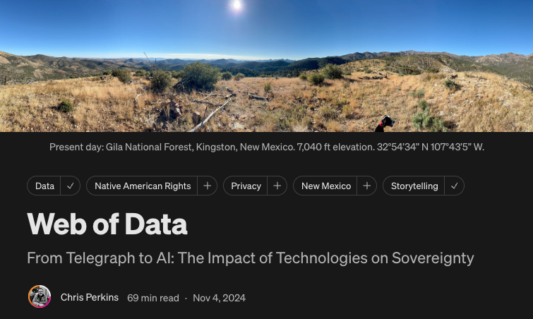
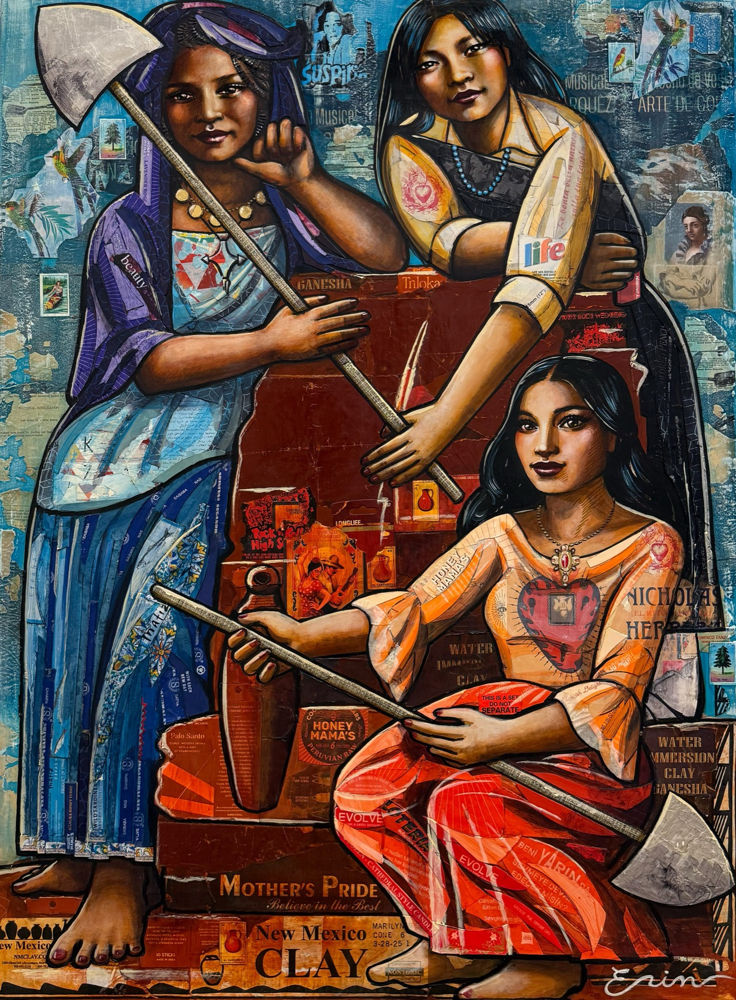
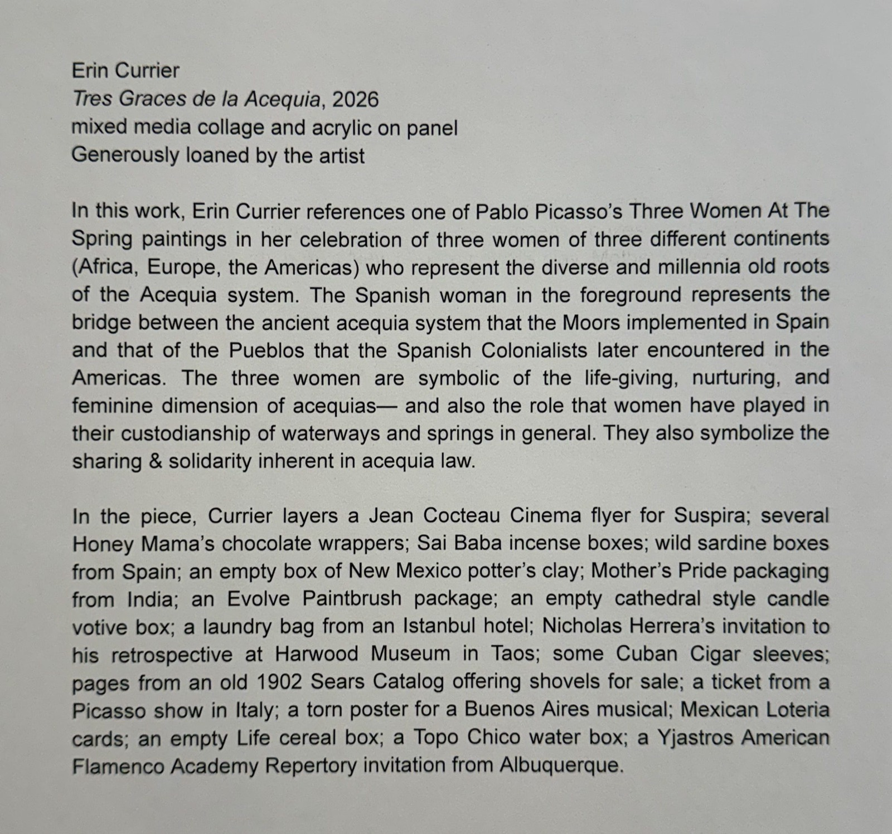

The Loom
On who decides what crosses

***Before we get into the essay, I want to say that the two-year anniversary of the Web of Data essay is significant to me… and thank you for being part of the work. The date was chosen because that's when the essay was done. I worked on the research and understanding for years and years. My journey was, roughly: data sovereignty, identity, knowledge, epistemic injustices, surveillance, and traditional knowledge. I studied each before writing Web of Data. Months of research, writing, creating images, reference charts, editing, and then finally, on November 4th, 2024, I hit publish.***

*Screenshot of the Web of Data essay on Medium.com*

***This essay also sits at eight of a fourteen-part essay series that is in alignment with Kinetic Trust Protocol version 3.0.0 "Ostrom" — to be released on December 10th, 2026. Which is KTP's one-year anniversary.***

***Another anniversary will be in the summer of 2027. The Open Trust Commons (OTCS).***

***Without further ado, I am honored to share with you now, The Loom.***

**With love,**
**- Chris**

---

Election Day was yesterday. The count isn't finished. It rarely is the next morning.

Somewhere in your county there is a warehouse or a room. Long tables. Bad light. People are opening envelopes. In many states they work in teams drawn from both parties. Indiana counts that way on election night. North Carolina recounts that way, two to a team. Each one watches the other's hands. Behind a rope, observers watch them both. In California, observers from the parties and from citizen groups may attend every phase.

The ballots are paper. In 2024, about ninety-eight of every hundred votes cast in this country left a paper record.

Count the people doing this. In the 2024 general election, 772,433 poll workers served in 6,461 local election jurisdictions. Most of them were over sixty-one. Nearly half the offices that hired them said finding enough people was hard.

They are preserving the votes. [And the possibility of another turn.](https://www.linkedin.com/pulse/historical-society-kinetic-chris-perkins-ozz4c)

Two years ago today, on the eve of a different election, an essay called [Web of Data](https://medium.com/@chrisperkins505/web-of-data-4e4272c7031c) went up. It was about the threads. Data as threads, weaving identity and community and power together. And who gets to hold them. In a list of systems that still carry old harms, it named voting.

It also asked a question a child might ask about a shelf of books.

> Who decided what went in those books?

The books were a gift. A grandfather gives a family a full set of Encyclopedia Britannicas, "complete with the supplement books after Z." When a volume was closed, the page edges were "a shiny, bright gold color." Each book was "the color of dark mud." A child runs a finger down the bold type from one volume to the next, looking for the answer to a homework question. The same grandfather ran [the market at 4th and Menaul](https://medium.com/@chrisperkins505/meat-proxy-29b3c0dae255). He kept a room of pottery and baskets behind glass, too. Nobody asked him about we he collected but we may know now.

The gift was real. So was the editing. Somebody chose what made the page. Somebody chose what stayed out. Somebody decided how long an entry could run, which words went in bold, which people got a page and which got a line. A child receives that as a fact about the world. It is not. **It is a design**.

The essays in this series keep circling the same discovery from different ground. On a bridge over the Rio Grande it went like this: [the river is physics, and the bridges are decisions](https://medium.com/@chrisperkins505/the-terrain-that-made-you-32cbd7b228df). Somebody chose where they went. Nobody asked the back seat. One of those bridges, Montaño, took thirty-three years from the first proposal to the first car.

This essay is about the machine that does the deciding. Not the threads this time. The loom: who built it, who sets its pattern, who can stop it.

---

In the first years of the 1800s, Joseph-Marie Jacquard fixed a chain of punched cards to a loom. Each card stood for one row of the cloth. Where a card had a hole, a needle passed through and lifted a hook, and the hook raised a thread. Where there was no hole, the thread stayed down. String the cards together and the loom wove a pattern nobody at the bench had to hold in their head.

He was not the first to try it. He was the one who made it work at scale. The weaver still worked the loom. The card decided the pattern.

## I. The constitution

The last essay tested Elinor Ostrom's eight design principles on a ditch. She found them in commons that had lasted from a century to more than a thousand years, and she called her list "still quite speculative."

The Kinetic Trust Protocol is a trust protocol for machines that act on our behalf. Its third version is named for her. It is [proposed](https://github.com/nmcitra/ktp-rfc/issues/182) and not yet released but the tag is planned for December 10th, this year. Version two, by its own account, made the set stop contradicting itself. It fixed the arithmetic of the score. It fixed one rule: every chain of accountability ends outside the system it judges. Version three is about the constitution around it.

The author of this essay writes that protocol, and founded the small commons that appears beside it here. Both are held to the test everything else gets. Neither existed when Web of Data went up. The protocol is a year old. The commons is half that. Asked two years ago whether any of it would be here by now, the author would have said no.

Donella Meadows spent her life studying how systems fail. She ranked the places you can push on one. Changing the numbers, she said, is where almost all the attention goes and the least of the leverage lives. Changing the rules matters more. Deeper still is the power to change the rules. She put it plainly: **pay attention to the rules, "and to who has power over them."**

[Put a Person There](https://medium.com/@chrisperkins505/put-a-person-there-dc30355c3e95) leaned on the first half of that sentence, on what happens where a rule lands. Here is the second half. Who writes the card.

> **When someone controls the loom, they decide what crosses.**

Ostrom's eight are rules about that.

Who is inside.

Who may change the rules.

Who watches.

What a miss costs.

Where a dispute goes.

Whose rules are recognized.

How the layers fit.

Under all of them this series has kept two older claims. They hold for a ditch, a loom, a model or a country.

> **Autonomy cannot exceed what its environment can carry.**

A loom cannot weave what its frame will not hold. A machine should not do what the world around it cannot bear.

> **Trust is a measure, not a switch. A rating can stay green while the ground gives way.**

Everything else here is one question. **Who holds the frame?**

Here are her eight again, at the size of a country. The ditch stays in the last essay.

### 1. Boundaries

Every commons has an edge. Somebody is inside. Somebody is not.

At El Paso the Rio Grande stops being a river that runs through a state and becomes the line between two countries. [The Terrain That Made You](https://medium.com/@chrisperkins505/the-terrain-that-made-you-32cbd7b228df) followed it there. The water did not change. The decision did. Web of Data told the older version. In 1853 a treaty bought a strip of desert for a railroad, and the people already living on it were not asked.

The books have an edge too. Last year their publisher went to court over it. In September 2025 the company that published those encyclopedias sued an AI answer engine, Perplexity, [in federal court in New York](https://www.courtlistener.com/docket/71313411/encyclopaedia-britannica-inc-v-perplexity-ai-inc/) (research for this essay used it). Its dictionary, Merriam-Webster, the one Web of Data quoted twice, sued beside it. The complaint says the engine copies their pages into its answers, often word for word. It says the engine sets their names beside answers they never wrote. A name on a page is a promise about who made it.

No court has ruled on the claims. But the two sides have agreed to a protocol for confidential inspection of the engine's source code. A magistrate judge has ordered one more snapshot of its retrieval database, and six months of its user logs.

A child's question about a shelf of books now has a docket number.

The second version of the protocol asks that question of every model. Its [provenance specification](https://github.com/nmcitra/ktp-rfc/blob/v2.0.0/rfcs-md/ktp-provenance.md) calls it the Origin Edge: "what an AI model is made of, whose knowledge it carries, and what debts it inherits." The debt, it says, "is acknowledged, not absolved." Then it asks what no specification can settle. "What cannot be repaid?" It leaves the question open. So does this essay.

A boundary is a card. It says who counts. It also has to say who is affected without being inside, and that list is always longer than the first.

Montaño had both lists. The people who needed the crossing lived on the West Side, across the river. The ground it would cut ran through the bosque, the cottonwood forest along the water, and past the North Valley and the Village of Los Ranchos, a town of its own. One side needed the turn. The other side would carry it.

A country does this with citizenship, with districts, with the line around who may vote. Someone drew each of those lines. Each can be read. Each can be argued over and redrawn. This is the difference between a border and a wall.

### 2. Local fit

Ostrom's second principle says the rules should fit the place.

> **Every decision is made somewhere. It has to read where.**

American elections are not run from Washington. They are run by local offices. Each fits the same federal duty to its own counties, its own languages, its own roads. In 2024 there were 6,461 of them.

In New Mexico the fit goes down to the ditch. Since 1965 an acequia has been, in law, a political subdivision of the state. A ditch is a unit of government. Its rules fit one slope and one snowpack. Nobody in Santa Fe could write them better.

The machines we are building now are the opposite of local. One model, trained once, answers in every town at once. It cannot read where it is.

Not unless someone builds it to.

### 3. Collective choice

This is the principle a country runs on. Ostrom's wording: "Most individuals affected by the operational rules can participate in modifying the operational rules."

The political scientist Adam Przeworski put democracy in one line. "Democracy is a system in which parties lose elections." Karl Popper turned the old question of who should rule into a better one: "How can we so organize political institutions that bad or incompetent rulers can be prevented from doing too much damage?"

Both describe a turn.

[A turn is a visible, ordered, and answerable transition of something shared from one holder to the next.](https://www.linkedin.com/pulse/historical-society-kinetic-chris-perkins-ozz4c)

An election is the biggest turn a country takes. The loser hands over. The winner knows the card can be taken back.

The small turns count too. Montaño was first proposed in 1964. In 1983 and again in 1985, Albuquerque's voters approved the bond money. The back seat… not asked. The voters were, twice. But the people of Los Ranchos, in their own village, had no vote in that election. They would live beside the traffic. That is the hard edge of collective choice. The many decide. The few carry it.

[Don't Hunt the Guilty Mind](https://medium.com/@chrisperkins505/dont-hunt-the-guilty-mind-c08ee8d09bb8) ended on four words that this whole series has been chasing. Who else gets to?

The ditch has its own answer. It is not the country's. Every other year the parciantes elect the mayordomo and three commissioners. On many ditches the votes are counted by how much water each person holds. A member behind on assessments cannot vote at all.

> **Authority is earned along a path. It is not a badge you carry.**

That is right for a mayordomo. The person who walks the ditch should have walked it. It is wrong for a ballot. The ditch weighs a vote by water and withholds it for debt. A country cannot. A citizen who never cleaned a ditch still votes. So does one who never served on a jury or worked a poll. The vote is a right. Not a reward.

---

There is a version of this inside the machines, and it is worth being exact about. The Open Trust Commons wrote it into [its charter](https://github.com/open-trust-commons/otcs-registry/blob/main/CHARTER.md#7-stewardship-and-succession). Once an outsider has taken part substantively in its rules for ninety days, nominations for a maintainer open. And "the founder cannot veto that opening." Opening nominations is not handing over control. Appointment still takes a vote. But the door is written down, and the founder cannot lock it.

In September Maksim Barziankou, an outside contributor, [found](https://github.com/open-trust-commons/otcs-registry/blob/main/proposals/OTCS-0004/objections/objection-001-two-relations-one-field.md) that a rule the founder had proposed made one field carry two different rights. The founder accepted the finding in public. He took the fix. Then he put a rule on himself, [on the record](https://github.com/open-trust-commons/otcs-registry/issues/49#issuecomment-5840854617): "whoever's work an amendment carries reviews that amendment before it merges." Before, he could merge a change on his own review. Even one that touched someone else's work. Now the person whose work it carries reads it first. That is a commitment, written where anyone can hold it up to him.

Web of Data had a name for the wrong that rule guards against. A wrong done to someone "in their capacity as a knower." On September 25 the commons merged [its first change from an outside contributor](https://github.com/open-trust-commons/otcs-registry/pull/67).

### 4. Monitoring

On the ditch everyone sees who came. A democracy does something stranger. It hides one act on purpose.

The vote is secret. You are entitled to keep your choice to yourself. That makes it harder to buy, and harder to punish. Paying someone to vote, or to stay home, is a federal crime. The count is the opposite. It is done in the open, on the mayordormo's paper. People from different sides watch each other. Observers watch them.

The vote is kept like a vault. The count is done like a ditch. The design is older than any of us.

Alvin Toffler sorted power by quality. Force is the lowest. It can only punish. Wealth can punish and reward. Knowledge is the highest. It can persuade, and even turn an enemy into an ally. The secret ballot is built to keep the first two out of the booth. The only way left to win a vote is to change a mind. Toffler called knowledge "the most democratic source of power," because the weak and the poor can grasp it too.

The count is trusted because nobody counts alone. Two sets of hands. A paper ballot that can be counted again. Signatures prove keys, not crossings. Cryptography has vastly narrower powers than human ambition.

Nothing can be the only witness to its own soundness.

The second version of the protocol was [named for Kurt Gödel](https://github.com/nmcitra/ktp-rfc/blob/v2.0.0/RELEASE-NOTES-v2.0.0.md?plain=1#L222-L234). In 1931 he proved that a formal system rich enough to do arithmetic cannot prove its own consistency from the inside. The release borrowed his name as a citation. It is not a theorem about elections. But the lesson travels.

The country learned it in 2008. The agencies that rated mortgage securities were paid by the banks that issued them. The issuer could shop. The rater needed the business. Of the mortgage-related securities Moody's rated triple-A in 2006, 83 percent were later downgraded. Seventy-three percent fell all the way to junk. The rating stayed green while the ground gave way.

It also runs through the feeds. A study of a decade of rumors on one platform found that false stories were 70 percent more likely to be shared. Truth took about six times as long to reach fifteen hundred people. A machine paid by attention cannot certify the truth of what holds attention. It is the rater, paid by the issuer.

A system that grades its own homework gets easier grades. They mean less every year. The protocol is held to the same test. Its first release shipped with two defects that were found later. They are [recorded by number](https://github.com/nmcitra/ktp-rfc/blob/main/SECURITY-NOTES.md), and the release stays as published. [No implementation has passed its tests in public yet.](https://github.com/nmcitra/ktp-rfc/issues/182) Being [listed under the same rules as everyone else](https://github.com/open-trust-commons/otcs-registry/blob/aeb2185f38d3a8633bac6e5a1311879d1c5374ce/CHARTER.md?plain=1#L109-L114) is consistency. It is not proof. Proof needs a witness from outside.

Monitoring also needs someone outside the room. Local papers used to sit in the back of the council meeting and the county canvass. More than 3,500 American newspapers have closed since about 2005. In 238 counties there is no local news source left. About 47 million people live where there is one source or none.

A count nobody outside can see is a count people will stop believing.

---

A machine that watches has to keep a vault too. Web of Data spent its longest chapter on what watching does to the watched. People begin to "doubt their own perceptions." They lean on "authoritative systems for validation." A protocol that scores trust by watching could become that system.

The protocol's first fixed version took the question up from the original. It carried Helen Nissenbaum's account of privacy, [contextual integrity](https://github.com/nmcitra/ktp-rfc/blob/v1.0.0/rfcs/ktp-privacy.txt#L199-L207). **Information should move by the norms of the setting it came from.** That asks more than using data only for what it was collected for. It wrote one sentence of its own. ["A system that provides security through surveillance is not acceptable."](https://github.com/nmcitra/ktp-rfc/blob/v1.0.0/rfcs/ktp-privacy.txt#L124-L126) And it names its own danger, in a section called [The Surveillance Paradox](https://github.com/nmcitra/ktp-rfc/blob/v1.0.0/rfcs/ktp-privacy.txt#L128-L162).

Its answer there is a requirement. "Sensors measure environment, not individuals. Statistics over populations, not profiles." It watches the machines. A person's data takes that person's explicit consent. That is what the document demands. No deployment has yet shown it kept. Sentences do not keep vaults. People do.

### 5. Graduated sanctions

Ostrom's fifth principle says the cost should fit the miss. No guillotine for a first offense.

> **When the ground gives, a system should step down, not fall.**

Michigan learned the opposite. A machine decided fraud on its own. [Put a Person There](https://medium.com/@chrisperkins505/put-a-person-there-dc30355c3e95) told it. The sanction arrived at full weight, on tens of thousands of people, with nobody standing where it landed.

A good system steps down when the ground shakes. It strips the dangerous capabilities first. It keeps the safe ones. It waits for the ground to settle. And an actor that breaks trust comes back below where it stood, and climbs.

### 6. Conflict resolution

> **Every decision leaves a record that can answer for it.**

A dispute needs somewhere to go. It needs something to stand on. The courts are where it goes. The record is what it stands on. Without a record, nobody can tell "we failed" from "the world said no."

Montaño went to court. The Village of Los Ranchos and others sued, in federal court and then in state court. Over the bosque, the permits, the traffic and the money. The limits came from a third hand. In June 1987 the Army Corps of Engineers and the state's historic preservation office signed an agreement. Two lanes. No heavy commercial traffic. Walls against the noise. A month later the Corps issued the permit, and the permit added the work to restore the bosque. In June 1989 a state judge stopped the project with an injunction. An appeals court said it should never have been issued. The suits ran on for years.

The bridge opened in 1997.

The community outside the electorate did not win in court. [Every court turned the Village's claims away.](https://cite.case.law/nm/119/150/) What it had was a route to contest what crossed its ground. And a permit, on the record, that bound the city whether the Village won or lost. That is what answerable disagreement looks like.

Nobody gets everything. The people who carry a decision get a hearing, a record, and limits on the one who decides. Even when the limits come from a third hand.

Here is the strongest argument against everything so far.

It comes from the founders. Some cards should be hard to rewrite.

The Bill of Rights exists to protect people from the turn. A majority that can change any rule overnight can change the one that protects you. **The vault is not the enemy of the ditch**. Sometimes the vault is the only thing standing between a person and the crowd.

The answer is the question a good judge, or a good system, has to keep asking about itself. Can it change its judgment when warranted, preserve it when unwarranted pressure arrives, and remain available for further correction in both cases?

Can it be alterable? Change when the evidence is real? Hold when the pressure is not? Stay open either way?

A country that can only change is a mob. One that can only hold is a museum.

The design that survives is [the one with a published route](https://medium.com/@chrisperkins505/time-to-good-decision-307710ad7a84), where accountable judgment arrives while it can still alter what follows. It is an architecture of visible disagreement, built in, not tolerated.

> The "tragedy of the commons" isn't inevitable. It's a failure of imagination.

### 7. Recognition

Ostrom's seventh principle: "The rights of appropriators to devise their own institutions are not challenged by external governmental authorities."

The Pueblos of New Mexico keep a record of what that looks like. The Indian Pueblo Cultural Center dates the first Spanish cane, varas de mando, of office to about 1620 and the Mexican cane to 1821. Abraham Lincoln sent nineteen silver-crowned canes, each marked with a Pueblo's name, "1863" and "A. Lincoln." They were delivered the next year. The Pueblos describe them as symbols of their sovereignty and of the authority of their governments. Their officials still carry them.

Three governments. Each one, in the end, recognized a government that was already there. That is the Pueblos' story to tell. They tell it.

Web of Data asked the same of data. It pointed to the CARE principles, and to the Traditional Knowledge Labels of Local Contexts, which let a community attach its own conditions to its own knowledge. Two years later a draft in the Open Trust Commons [made those conditions a stop](https://github.com/open-trust-commons/otcs-registry/blob/aeb2185f38d3a8633bac6e5a1311879d1c5374ce/proposals/OTCS-0017/proposal.md?plain=1#L263). Any party with recognized authority over what a machine's work touches can stop it from going on, "a community exercising collective control over its data or knowledge" among them. The draft honors a community's labels without writing them. It ["never enumerates, copies or applies" them](https://github.com/open-trust-commons/otcs-registry/blob/aeb2185f38d3a8633bac6e5a1311879d1c5374ce/proposals/OTCS-0017/proposal.md?plain=1#L296).

This is the seventh principle inside a machine. Recognize the rules you did not write.

The hard word is **recognized**.

Someone still decides who has standing over what a machine touches. In the Open Trust Commons draft, that is whoever deploys the machine, under its own governance.

The city, deciding who counts as affected by its bridge. Los Ranchos was affected without being inside and the people deciding did not have to count it. So the bridge's question comes straight into the proposal.

Where does the person left outside go?

The protocol's boundary rule reaches part of the way. A zone that denies an outsider [has to record the route for a challenge](https://github.com/nmcitra/ktp-rfc/issues/189). The draft adds two things. A stop [has to come with a way back](https://github.com/open-trust-commons/otcs-registry/blob/aeb2185f38d3a8633bac6e5a1311879d1c5374ce/proposals/OTCS-0017/proposal.md?plain=1#L267). And anything that changes a person's standing [goes to a named person](https://github.com/open-trust-commons/otcs-registry/blob/aeb2185f38d3a8633bac6e5a1311879d1c5374ce/proposals/OTCS-0017/proposal.md?plain=1#L271), never to the work's own judgment.

Neither says who carries the cost while the challenge runs.

### 8. Nested enterprises

Ditches sit inside watersheds. Counties sit inside states. States sit inside a country. Ostrom's eighth principle says big commons work when they are built in layers, each with its own job.

Machines can be layered the same way, each keeping its own job.

A small example is being built. [NC25OL](https://github.com/petronushowcore-mx/NC25OL) is an open ledger that Maksim Barziankou builds to record who was admitted to act and what was done. It is built to connect to the Open Trust Commons, on terms [its own README sets](https://github.com/petronushowcore-mx/NC25OL#otcs-authority-boundary). The registry supplies facts. The ledger alone decides. A receipt from the registry that says "allowed" is rejected. Neither machine takes the other's card.

Ezra Klein would push hard here. He would be right to.

Local control is also how incumbents block what their neighbors need. Since 2004 a New Mexico acequia can refuse a transfer of water that would harm it. The same kind of power lets a neighborhood refuse an apartment building a family needs. Layers can protect a commons. They can also wall one in.

The hard case is the one where a neighbor's turn has to cross your ground. An apartment on your street. A bridge through your bosque. Montaño is that case. A veto would have kept the West Side waiting forever. A Catapillar would have cleared and paved the bosque with nobody answerable for it.

What happened was slower than either and less satisfying. The crossing went through, under limits written into its permit. The community that carried it got its hearing, and the record of what it cost stayed open.

It took thirty-three years. That is a real cost, and the people waiting paid it.

A family that needs an apartment cannot wait thirty-three years. So the test cannot be that everyone gets what they need. It is that the people who carry a decision can make it answer to them, and the people waiting on it can make it come.

Who pays while it stays unresolved is settled by default. The ones waiting pay. Who *should* pay is not settled at all. The right to challenge a decision raises the cost of making one, and nobody has written down where that cost belongs. That part is unfinished. On the ditch and in the draft.

---

Layers are also where a country's loyalty lives. A person loves the ditch, the town, the state, the country. The love is real at every layer. Alexis de Tocqueville noticed it in the 1830s. "Americans of all ages, all conditions, and all dispositions constantly form associations." The country turned two hundred and fifty this year. Its founding document ends in a pledge, "our Lives, our Fortunes and our sacred Honor," given by people to each other.

There are two kinds of patriotism and a country needs both. One loves the record. The founding pages, the flag, the monument, the vault. The other shows up for the turn. They work the poll. They sit on the jury. They clean the ditch. Us.

In June 2026 only 53 percent of Americans told Gallup they were extremely or very proud to be American, the lowest since the question began in 2001. In the most recent count, 28.3 percent of Americans volunteered through an organization. And in November 2024 more than three-quarters of a million of them spent a long day in school gyms and church halls so a country could take its turn.

Patriotism is a practice, not a test. **Nobody has to earn the right to belong.** But somebody has to clean the ditch.

### The ninth, reviewed

> **The rules bind the people who write them.**

The last essay added a ninth principle, the one [the protocol calls its own](https://github.com/nmcitra/ktp-rfc/issues/182): repair as infrastructure. Its proposed specification, [KTP-REPAIR](https://github.com/nmcitra/ktp-rfc/pull/172), has a section called [The Rule](https://github.com/nmcitra/ktp-rfc/blob/e331c9c31f7a907b20773e8c1358466843ebc659/rfcs-md/ktp-repair.md#the-rule). It holds a clause that sounds simple and is not.

"Repair applies to the rule as it applies to the actor."

When the same harm keeps happening under a rule, the rule is in breach, and "**the governing authority that set it is the breaching party.**" Everyone under it can obey. The machinery can run correctly. The arrangement can still owe repair. The repair is an amendment, and the amendment has to cite the record of the harm that drove it.

Most of a country's repair runs through ordinary doors.

A law.

A court.

An agency.

An election.

When the text itself is the harm, there is Article V. It is the slowest door there is. Two-thirds of both houses of Congress can propose an amendment. Or two-thirds of the state legislatures can call for a convention to propose one, a route never yet used. Then three-quarters of the states, thirty-eight today, have to ratify.

Once, the country walked through it citing the record. The Thirteenth Amendment says: "Neither slavery nor involuntary servitude, except as a punishment for crime whereof the party shall have been duly convicted, shall exist within the United States." The Fifteenth forbids denying the vote "on account of race, color, or previous condition of servitude."

The Fourteenth holds void any claim "for the loss or emancipation of any slave." The historian Eric Foner calls those three amendments a second founding. They are repair applied to the rule, with the harm named in the text.

They were not the end of the harm. A repair that cites the record does not undo it. And it never asks the harmed to earn anything back. What the rule took is owed.

What its author lost in trust has to be earned again.

Web of Data opened on the same kind of repair. In October 2024 a sitting president apologized for the federal Indian boarding schools. The report behind the apology led with four verbs: "Acknowledge, Apologize, Repudiate and Affirm." Two face the past. One faces the future. Repudiate faces the rule. The report asked that the statement come "accompanied by actionable policies." A rule taken back has to stay taken back. That takes a calendar, not a speech.

> **The rule must answer for the harm it keeps repeating.**

The last essay ended on a question. Who gets to decide that what we keep repairing should continue?

A democracy answers: The people who live under the rule. Through every door it has, and the slowest one when the text itself is the harm. As often as they need to.

## II. The machine

### The machine

Charles Babbage owned a portrait of Jacquard woven on one of those looms. He borrowed the cards for his Analytical Engine. Some cards would choose the operation. Others would choose the numbers it worked on.

Ada Lovelace saw what that meant. In 1843 she wrote, "We may say most aptly that the Analytical Engine weaves algebraical patterns just as the Jacquard-loom weaves flowers and leaves." Her question was never whether the machine could think. [It was what the loom is allowed to weave.](https://medium.com/@chrisperkins505/the-pedagogy-of-trust-ace0febfc3bc)

In December 2025 the protocol shipped its first fixed version and named it [Lovelace](https://github.com/nmcitra/ktp-rfc/releases/tag/v1.0.0). [The notes to its next release](https://github.com/nmcitra/ktp-rfc/blob/v2.0.0/RELEASE-NOTES-v2.0.0.md?plain=1#L222-L234) give the reason. It was "the first specification of a machine that had not been built." [The Physics of Trust](https://medium.com/@chrisperkins505/the-physics-of-trust-3416d9c9efea) had already walked the line from her loom to ours.

### The card

The card is the rule.

Machines that weave have always had owners. The owners decided what crossed. For most of history most people were the cloth. These new looms run on language. For the first time a great many people can sit at one.

That does not make them its owners.

A market is a machine too. Its card: price. It is a remarkable card. It moves corn, soy, copper, and steel across the world, and nobody has to understand the whole. But a card can be written to favor its writer. Debbie Millman, writing about design, named the ones the card is written over. They are "the people who have to live alongside it."

## III. The work

### The weaver again

Every rule in this essay needs people who know enough to run it.

Who will they be?

Judgment is learned beside someone. On the ditches in New Mexico, the acequia association calls its shortage the Mayordomo Crisis. The people who know the work are aging. The work was learned by children cleaning beside their parents.

Election offices say the same thing about the count.

Most of the 2024 poll workers were over sixty-one, and nearly half the offices struggled to find enough. Apprenticeship cannot be digitized, because proximity cannot be streamed.

*Erin Currier, Tres Graces de la Acequia, 2026. Mixed media collage and acrylic on panel, generously loaned by the artist to the Millicent Rogers Museum in Taos. Working from Picasso's Three Women at the Spring, Currier painted three women from Africa, Europe and the Americas, the old roots of the acequia. The Spanish woman in front is the bridge between the ditches the Moors built in Spain and the ones the Pueblos already had. All three stand for the women who have kept the water, and for the sharing and solidarity in acequia law.*

When the first rung goes, the last rung follows. It just takes a generation. In thirty years, who will know enough to walk the ditch, run the count, or change the card?

Here is the pressure on the first rung.

The new loom weaves language. It takes the repeatable part of thinking work and prices it near zero. The first draft. The first read. The boilerplate. That is the work the young have always been handed first.

A Stanford team tracking payroll records reported in August 2026 on workers aged 22 to 25 in the most AI-exposed occupations. Their employment stood 19 percent below where it would have been had it kept pace with their less-exposed peers. Their data ran through June. The same team found no evidence of widespread, economy-wide displacement. Economists at the Budget Lab at Yale, looking across the whole labor market, found no discernible disruption since late 2022. Both can be true. The economy is holding. The bottom rung is the place to watch.

It has happened before.

When the power loom broke the handloom weaver, output per worker in Britain rose 46 percent between 1780 and 1840. Real wages rose 12. The historian Robert Allen called it Engels' pause. The framebreakers who fought back were skilled workers objecting to machines used "in a fraudulent and deceitful manner." [They were asking who controls the loom, and who eats the loss.](https://medium.com/@chrisperkins505/the-pedagogy-of-trust-ace0febfc3bc)

The gap is open now too.

Since 1979, net productivity in the United States has risen about 94 percent. Pay for the typical worker has risen about 33. The machine did not open that gap. It may widen it.

That depends on who holds the card.

Price also reaches for things that were never made for sale. The economist Karl Polanyi called land, labor and money fictitious commodities. A market treats them as if they had been produced to be sold. None of them was. In 1907 New Mexico's territorial water code let a right to the water be severed from the land. Sold separately from the ditch. [The Ninth Principle](https://chrisperkins505.medium.com/the-ninth-principle-d5ab7cae2dc3?source=friends_link&sk=3284e409a74204a661fe6c2c0b167e5e) told what that did to the people holding the shovels. Look at whose hand is on the card now. In the middle of 2026, the richest one percent of American households held 50.9 percent of the corporate stock and mutual fund shares owned by American households. That is not a verdict on anyone. It is a map of the hands.

Web of Data ended on a warning it borrowed, by way of a podcast, from the philosopher Stephen Cave. Intelligence, all through history, has been used "as a justification for dominating and controlling people."

Now it is sold by the word.

Useful work and paid work are different lists. Someone decides where they overlap. Whoever pays decides which tasks become jobs, and whether the first rung stays on the ladder.

A job did more than pay. [It was a standing machine.](https://medium.com/@chrisperkins505/a-job-was-a-standing-machine-2c1882c5e099) It put you somewhere at a certain hour. Beside people you had to make peace with by Thursday. *The Pedagogy of Trust* called it an accidental school for trust. Where the job thins, that school has to be built on purpose. Otherwise something else moves in. A watcher installed behind your own eyes, asking, on the machine's behalf, whether you're still necessary. [The Geometry and the Terror](https://medium.com/@chrisperkins505/the-geometry-and-the-terror-edd2f3a82daa) named that watcher. It has a job title now.

### Work types

Before a machine can be handed a job, somebody has to name the job.

That naming is a card.

Whoever writes the category decides what the machine is said to be able to do.

What counts as "exposed." Who is allowed to refuse. **The categories of work are about to become the most important rules most people never read.**

That draft from the seventh principle is about exactly this. It is called [Work Types](https://github.com/open-trust-commons/otcs-registry/blob/main/proposals/OTCS-0017/proposal.md). A work type is a durable description of a kind of consequential work, and of what must be able to refuse it. The standards that already exist for this work name the work. OpenC2 names commands. CACAO names playbooks. Both say something about authorization and control. The harder question is whose permission should count, and who is entitled to stop the work. A signed playbook is not an authorized one.

One boundary, said plainly. Work types describe actions a system takes, like [revoking a credential](https://github.com/open-trust-commons/otcs-registry/blob/main/proposals/OTCS-0017/drafts/work-types/credential.revoke.yaml) or [ending a session](https://github.com/open-trust-commons/otcs-registry/blob/main/proposals/OTCS-0017/drafts/work-types/session.terminate.yaml). They are not a list of human jobs. The parallel to how a government sorts occupations is an analogy, and it stops there.

It also cannot answer the questions above. A list of authorized machine actions does not say who gets the income, who owns the machine, or who keeps their standing as the work changes. Work types ask a smaller question, and so far answer it only on paper. When a machine is handed a consequential job, where is the point at which someone can refuse it? The draft's first entry ends on a line no time clock ever printed. ["Completion is not success, and inefficiency is not a defense."](https://github.com/open-trust-commons/otcs-registry/blob/aeb2185f38d3a8633bac6e5a1311879d1c5374ce/proposals/OTCS-0017/proposal.md?plain=1#L278)

The registry doesn't tell machines what to trust. It tells the people responsible what has survived being doubted. And it writes the refusal into the category, before the work is ever handed off.

> **No single authority gets to declare who is trusted.**

Capability can emerge. Authority must still be granted. Purpose must still be bounded. Judgment must remain alterable. Consequence must remain answerable.

## IV. Ahead

### A glimpse

Here is what the people building this are trying for. Not a forecast. An intention, on the record.

A world where every machine acting on your behalf carries [a short lease](https://www.linkedin.com/pulse/short-lease-chris-perkins-uiaxc). An expiring permission. Anything that would change a relationship [comes back to the people in it before it can finish](https://github.com/open-trust-commons/otcs-registry/blob/aeb2185f38d3a8633bac6e5a1311879d1c5374ce/proposals/OTCS-0017/proposal.md?plain=1#L270).

A protocol whose next version, [planned for December](https://github.com/nmcitra/ktp-rfc/issues/182), would keep a person's record to the acts they signed, ["and nothing else about the person"](https://github.com/nmcitra/ktp-rfc/issues/162).

Categories of work that [arrive with their refusal already written in](https://github.com/open-trust-commons/otcs-registry/blob/main/proposals/OTCS-0017/proposal.md#5-refusal-points).

A small commons whose outsiders can open the door to running it, [a door its founder cannot lock](https://github.com/open-trust-commons/otcs-registry/blob/main/CHARTER.md#7-stewardship-and-succession).

And a fight that has barely started. Who will own the machines?

One proposal, from Nicolas Berggruen and Nathan Gardels, is a universal basic capital: a share of the new enterprises held by every citizen. David Autor has called broadly held capital a hedge against the devaluing of labor. Whatever wins, the question under it is Meadows' question. Who holds the card?

> **Build safe ground where you can, and join it by agreement. Conquer nothing.**

None of it is inevitable. We architect and design these systems. AI or SI, they are not weather.

We have rebuilt the mayordomo's shovel at machine speed. We have given it to every enterprise and every government on the Internet. What we have not rebuilt is the dawn. The hour the ditch gets walked. The hour a neighbor can still stop you and say something.

### The copy we keep

Today the essays that began with Web of Data are released as an [archive](https://github.com/nmcitra/web-of-data). Canonical copies, dated, corrected in place where they were wrong, free to reuse with credit.

Web of Data asked its reader a plain question. "Do you keep ideas, or do you share them?" The archive's answer is both. Its first correction is in Web of Data itself. It had put Samuel Morse's telegraph a century early.

Put it beside the books with the gold edges. Somebody edited that encyclopedia. A child did not know who, or why one entry ran long and another short, or who would edit the next edition. The archive is a small attempt at the other kind of record. Its author is named. Its corrections are made in public, where anyone can watch. Its license lets you carry it somewhere else. And it is built to outlast the person who wrote it.

A selection that deserves trust needs an author who can be found, a route to challenge it, limits on how it can be changed, and someone to carry it on.

The vault keeps the last turn honest. The ditch governs the next one.

But one question runs under all of this. What do we owe one another for the ways we change each other's lives?

Some of it is a vote. Some of it is a shift in a counting room with florescent light. Some of it is reading the card before you sit at the loom… asking who wrote it and who controls power. Asking whether the people who have to live alongside it can change it.

And some of it is knowing where the card ends. The canes are still in the governors' hands. What a people has decided about its own offices, its own land and its own knowledge is not on anyone else's card.

> **Some things are not ours to move. We navigate by them.**

Everyone starts in the back seat. Nobody asked us about the books, or the bridges, the ditch, or the card. A country is where that stops being somebody's gift.

The next card is ours to help write, whether or not anyone invites us.

By tonight the count will be closer to done. Then the people in that counting room will go home. In two years someone will have to come back and do it again. Some of them should be young.

---

***The Loom*** is 8 of 14 in the series, ***Different, and Held***. KTP v3.0.0 "Ostrom" will be released on December 10th, 2026. And the Web of Data archive is now [public](https://github.com/nmcitra/web-of-data). ***The Borrowed Light*** is the next essay.